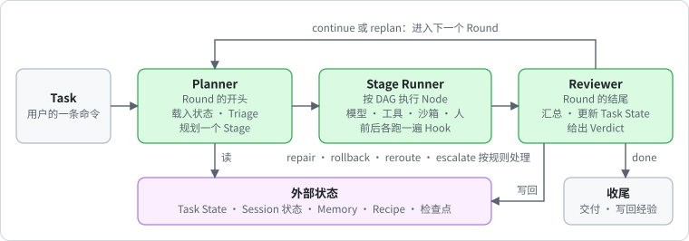
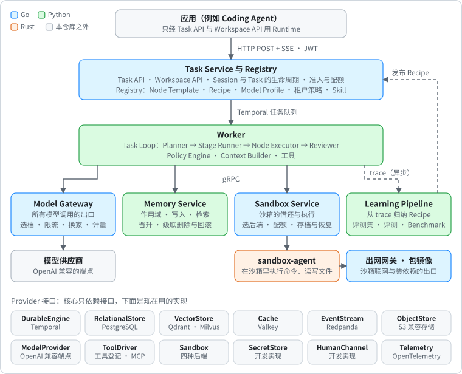
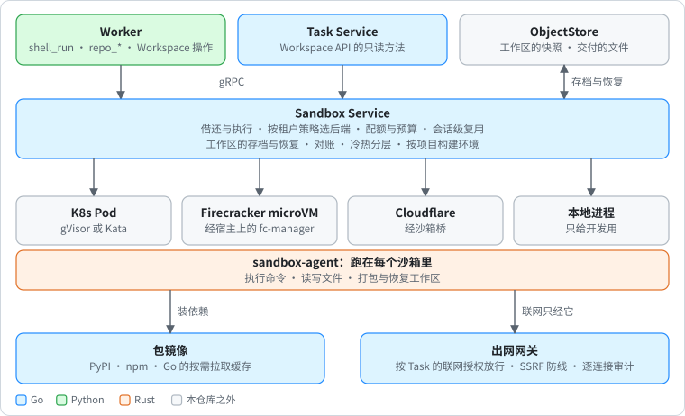

# Agent Runtime（暂名）

多租户的 Agent 运行核心。用户的每一条命令都是一个 Task，按同一个固定的 Task Loop（Planner → Stage → Reviewer）执行完：进程崩溃或发布时从断点继续，写操作不重复生效，模型按成本选档，数据、记忆、凭据与配额按租户隔离。

上层应用只提供领域的 Node Template 与 Recipe，经 Task API 下任务，不用各自实现执行逻辑。第一个建在它上面的应用是 [Coding Agent](https://github.com/Hanwen-Jiang/coding-agent)（在线多租户编码智能体，单独的仓库）。

> 状态：测试预发行（[v0.1.0-alpha.1](docs/releases/v0.1.0-alpha.1.md) 之后持续在 main 上推进），有一套单节点的线上部署在跑。项目名、Go 模块路径 `github.com/agentruntime/agent-runtime` 与 schema 的 `$id` 前缀都还是占位。

## 它怎么跑一个 Task



```text
Tenant → User → Workspace → Session → Task → Round → Stage → Node → Attempt
```

1. 客户端用 HTTP POST 提交命令。Task Service 认证、识别租户、做准入，把 Task 交给这个 Session 的工作流，立刻返回 `task_id` 与 SSE 订阅地址。
2. **Planner** 载入 Task State、偏好与经验，做 Triage（fast、light、full、replan），规划下一个 Stage。每个 Round 只规划到下一个信息检查点。
3. **Stage Runner** 按 DAG 执行 Stage 里的 Node。模型调用都经 Model Gateway，工具调用都经 ToolDriver，代码在沙箱里跑。
4. **Reviewer** 汇总结果、更新 Task State，给出 Verdict：continue 或 replan 进入下一个 Round；repair、rollback、reroute、escalate 按规则处理；done 或 abort 收尾。
5. 收尾时把交付结果经 SSE 推给用户，经验候选、Recipe 统计与 trace 异步写回。

编排逻辑是确定性的工作流代码，跑在 Temporal 上；模型调用、工具调用与外部 I/O 都是被记录的 activity，恢复时直接取结果。副作用按 effect 分级：可逆与不可逆的写都带幂等键，不可逆的写不自动重试，执行前必须有通过的审批记录。

## 组成



| 部分 | 位置 | 语言 | 做什么 |
| --- | --- | --- | --- |
| Task Service 与 Registry | `services/go-task-service` | Go | 对外入口：Task API（HTTP POST + SSE）、Workspace API、Session 与 Task 的生命周期、准入与配额；Registry 版本化存放 Node Template、Recipe、Model Profile、租户策略、Skill |
| Model Gateway | `services/go-model-gateway` | Go | 所有模型调用的唯一出口：选档、限流、换家、计量 |
| Worker | `services/py-worker` | Python | Task Loop 本身：Planner、Stage Runner、Node Executor、Reviewer，以及 Policy Engine、Context Builder、工具 |
| Memory Service | `services/py-memory` | Python | 记忆的作用域、写入、检索、晋升、级联删除与回滚 |
| Learning Pipeline | `services/py-learning` | Python | 从 trace 归纳 Recipe；评测 harness、评测集与主流 Benchmark 的适配 |
| Sandbox Service | `services/go-sandbox-service` | Go | 沙箱的借还与执行、选后端、配额、会话复用、工作区的存档与恢复、按项目构建环境 |
| sandbox-agent | `services/rs-sandbox-agent` | Rust | 跑在沙箱里：执行命令、读写文件（`go-sandbox-agent` 是只修 bug 的旧版） |
| fc-manager | `services/rs-fc-manager` | Rust | 宿主上的服务，每个沙箱环境一台 Firecracker microVM |
| 包镜像、出网网关 | `services/go-pkg-mirror`、`services/go-egress-gateway` | Go | 沙箱装依赖的缓存；沙箱联网的唯一出口，按 Task 的联网授权放行 |

### 沙箱这一层



Worker 的 `shell_run`、`repo_*` 与 Workspace 操作都经 Sandbox Service；它按租户策略选后端，管配额、会话级复用和工作区的存档与恢复。后端有四种：K8s Pod（gVisor 或 Kata）、Firecracker microVM、Cloudflare、本地进程（只给开发用）。沙箱默认断网，装依赖走包镜像，联网只经出网网关。

### Provider 接口

核心代码只依赖 13 个 Provider 接口，不直接引用具体产品的 SDK（Temporal 工作流代码除外）。现在用的实现：

| 接口 | 实现 |
| --- | --- |
| DurableEngine | Temporal |
| RelationalStore | PostgreSQL（行级安全）；开发时 SQLite |
| VectorStore | Qdrant、Milvus |
| Cache | Valkey；开发时进程内 |
| EventStream | Redpanda |
| ObjectStore | S3 兼容存储（R2、S3、MinIO）；开发时本地目录 |
| ModelProvider | OpenAI 兼容的端点，由 Model Gateway 适配；离线用 mock |
| ToolDriver | 进程内的工具登记，MCP 经它接入 |
| Sandbox | 见上 |
| SecretStore、HumanChannel、Ingress | 开发实现；Ingress 另有验 Ed25519 签名的 JWT |
| Telemetry | OpenTelemetry → Collector → Tempo、Langfuse、VictoriaMetrics |

接口定义与两种语言的共享库在 [libs](libs/README.md)。

## 在本机跑起来

前置：Go 1.27、[uv](https://docs.astral.sh/uv/) 0.12（Python 3.13）、Temporal CLI 1.9.1。用本地沙箱或跑 Rust 的检查时另要 cargo（工具链版本见 `rust-toolchain.toml`）。

```bash
uv sync --all-packages --locked
```

离线拉起整套（不调真模型，Planner、Reviewer、tool_loop 都是桩）：

```bash
uv run --no-sync python scripts/dev_stack.py up --provider mock --decisions stub
```

它编译 task-service、Model Gateway 与 Sandbox Service，种好 Registry，再拉起 Temporal、task-service、Model Gateway、Sandbox Service 与 Worker。之后：

| 做什么 | 命令 |
| --- | --- |
| 看各组件的地址与状态 | `uv run --no-sync python scripts/dev_stack.py status` |
| 签一个开发用的访问令牌 | `uv run --no-sync python scripts/dev_stack.py token --tenant t1 --user u1` |
| 全部停掉 | `uv run --no-sync python scripts/dev_stack.py down` |

用真模型：把 `AR_MODEL_PROVIDER_BASE_URL` 与 `AR_MODEL_PROVIDER_API_KEY` 写进 `~/.agentruntime/model-provider.env`（在仓库外，不提交），`up` 时去掉 `--provider mock --decisions stub`。

Task API 的契约在 [proto/agentruntime/taskapi/v1/task_api.proto](proto/agentruntime/taskapi/v1/task_api.proto)。想直接从网页上用，按 Coding Agent 仓库的 README 把它拉起来，它会顺带调这里的 `dev_stack.py`。

仓库放在网络共享盘上时，虚拟环境必须在本地盘（设 `UV_PROJECT_ENVIRONMENT`）。这一条和其余的环境变量、各服务单独运行的方法，都在 [CLAUDE.md](CLAUDE.md) 的“常用命令”里。

## 检查与测试

本地与 CI 用同一个脚本：

```bash
uv run --no-sync python scripts/check.py
```

默认的 pr 档跑 proto、契约、Go、Rust、各 Python 包与端到端测试；`--tier full` 再加故障注入与恢复套件；`--only`、`--skip` 挑步骤，`--list` 看计划。测试自己拉起临时的 Temporal、PostgreSQL、Qdrant 等，所以这些工具要在 PATH 上；缺工具时那一步失败并写明缺什么，设 `AR_ALLOW_MISSING_TOOLS=1` 改为跳过。

重放是硬门槛：Go 与 Python 的测试都会回放 golden 事件历史。改变工作流命令序列的修改要加版本分支，否则进行中的 Task 上线后回放失败。

## 部署

| 内容 | 位置 |
| --- | --- |
| Helm Chart 与 OpenTelemetry Collector 配置 | [deploy/helm/agent-runtime](deploy/helm/agent-runtime) |
| 镜像 | `deploy/images`，用 `scripts/build_images.py` 构建 |
| 单节点 k3s 基线、密钥、演示手册 | [deploy/cluster/README.md](deploy/cluster/README.md) |
| 数据层与面板、备份与恢复演练 | `deploy/data` |
| Cloudflare 的沙箱桥 | `deploy/cloudflare` |

上线的步骤、每一版的记录与线上验收在 [docs/plan/cloud-deploy.md](docs/plan/cloud-deploy.md)。

## 目录

```text
proto/       protobuf 契约与生成的 Go、Python 代码（生成结果提交进仓库，不手改）
schemas/     Node 与模板的 JSON Schema，含正例与反例
services/    各服务，见上表
libs/        共享库：Provider 接口、错误模型、租户绑定、适配器、一致性测试（go-core、py-core）；Rust 的 rs-sys、rs-transfer
deploy/      Helm Chart、镜像、集群与数据层的脚本
tests/       契约（contract）、端到端与故障注入（e2e）、部署（deploy）、sandbox-agent 的黑盒测试
scripts/     check.py、dev_stack.py、build_images.py 与评测、同步模型目录等工具
docs/        设计书（已锁定）、计划、参考文档、学习笔记、发布说明；docs/readme 是本页的图
```

## 文档

| 文档 | 是什么 | 什么时候看 |
| --- | --- | --- |
| [设计书](docs/design/agent-runtime-design.md) | 项目最开始定下的设计，**已锁定，不再修改**。名词（附录 A）、原则与各模块的逻辑以它为准 | 实现任何模块前先读对应章节 |
| [强档实施计划](docs/plan/strong-tier-plan.md) | 工作项（S-xx、R-xx）、顺序、验收、评审方式 | 安排开发顺序、接任务、做评审时 |
| [全部计划的总表](docs/plan/all-plans-dag-2026-11-03.md) | 各条线的计划汇总与依赖；`docs/plan/` 下还有各模块的细化 | 找某个工作项的现状时 |
| [运行核心速查](docs/reference/runtime-quickref.md) | 对象存放、模块依赖、接口与开发实现、旧叫法对照 | 随手查 |
| [docs/reference](docs/reference) | 调研依据：Agent 模式、Task Loop 的依据、模型评测、记忆与检索、上下文工程、沙箱后端、风险与待定问题、全部来源 | 遇到边界情况、要回到出处时 |
| [docs/note](docs/note) | 各模块的学习笔记 | 想快速读懂一个模块时 |
| [docs/releases](docs/releases) | 发布说明 | 看某一版包含什么、已知问题 |

三者冲突时：设计书 > 实施计划 > 参考文档。

设计书锁定在开工之前，之后仓库长出了它没写的部分（Sandbox Service 与四种沙箱后端、出网网关、包镜像、Workspace API、用户 Skill 等），接口的实现也有几处没按当时的推荐。所以：

- 后来确认的设计改动记在 [docs/plan/design-changes-2026-10.md](docs/plan/design-changes-2026-10.md)，各模块的细化在 `docs/plan/` 下各自的文档里。
- 设计书里的 34 张图画的是当时的设计，其中总体架构、部署拓扑、Sandbox 等几张已经和现在的实现对不上。本页的图按仓库现状另画，在 `docs/readme/`。
- 仓库现在是什么样，以本页和 [CLAUDE.md](CLAUDE.md) 为准。

## 参与开发

人和 AI 编码助手都先读 [CLAUDE.md](CLAUDE.md)：先读什么、怎么接一个任务、术语，以及不能违反的硬性规则。最要紧的几条：

- **契约**：不直接改 `/proto` 与 `/schemas`；要改时走 S-01 的流程（改 → `buf generate` → 契约测试 → `buf breaking` → 人审 → 更新基线）。
- **工作流代码必须确定**：不读系统时间、不用随机数、不做 I/O、不调模型；这些一律放进 activity。
- **副作用**：写操作带幂等键；超时且结果未知时先按幂等键对账，不直接重试。
- **租户隔离**：租户由服务端按认证身份确定；查询的租户条件由服务端拼接，缺了就拒绝。
- **密钥**：不出现在日志、trace 与错误信息里。

建在 Runtime 上的应用不放在这个仓库里。
