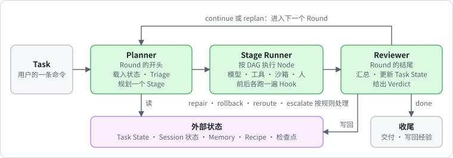
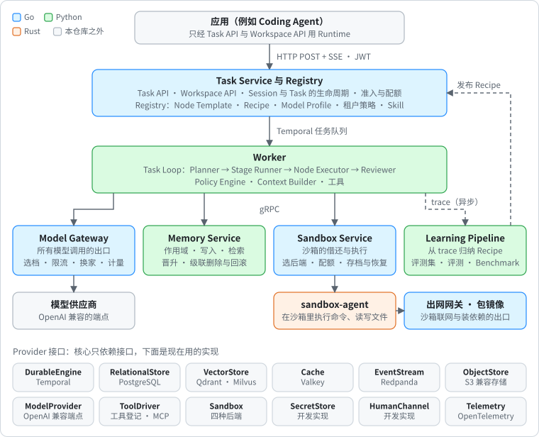
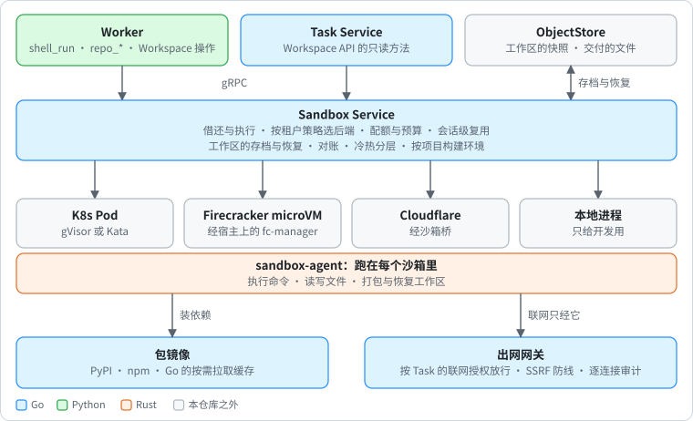

<div align="center">

# Agent Runtime

**多租户持久化 Agent 运行时核心 · Multi-Tenant Durable Agent Execution Kernel**

[](https://github.com/Hanwen-Jiang/agent-runtime/releases/tag/v0.2.0-alpha.1)
[](#执行模型task-loop)
[](go.work)
[-3776AB?style=flat-square&logo=python&logoColor=white)](pyproject.toml)
[-DEA584?style=flat-square&logo=rust&logoColor=black)](Cargo.toml)
[](#生产部署与可观测性)

[核心能力](#核心能力) · [执行模型](#执行模型task-loop) · [系统架构](#系统架构与组件) · [安全沙箱](#安全沙箱与网络治理) · [快速开始](#快速开始) · [评测与自进化](#评测基准与自进化) · [测试与部署](#检查测试与重放门槛)

</div>

---

**Agent Runtime** 是一个面向生产级多租户场景的 **Agent 运行时核心（Execution Kernel）**。用户的每一次指令都作为一条受控 `Task` 进入系统，沿统一的确定性 **Task Loop（`Planner → Stage → Reviewer`）** 推进：进程崩溃或版本发布时从断点无损恢复，副作用操作按幂等键防重放，模型按“每次成功期望成本”动态选档，计算沙箱、记忆、凭据与配额在租户边界内严格隔离。

上层业务应用只需定义领域相关的 `Node Template` 与 `Recipe`，通过 Task API 下发任务，无需重复构建工作流编排、状态持久化、沙箱隔离或计费审计基础设施。首个构建于本内核之上的应用是 [Coding Agent](https://github.com/Hanwen-Jiang/coding-agent)（多租户在线编码智能体）。

> [!NOTE]
> **当前版本与命名说明**
> - **最新预发行版本**：[`v0.2.0-alpha.1`](https://github.com/Hanwen-Jiang/agent-runtime/releases/tag/v0.2.0-alpha.1)（Coding Agent MVP），`main` 分支持续推进 Wave 2–4 及生产化加固（Helm 收敛、Firecracker 实测、双区爬虫网关、Capability Matrix 与自进化流水线），当前已有单节点线上环境运行。
> - **占位符状态**：项目正式定名前，仓库名、Go 模块路径前缀（`github.com/agentruntime/agent-runtime`）与 JSON Schema `$id` 前缀（`https://agentruntime.example/schemas/`）暂为占位，后续将随正式版本统一替换。

---

## 核心能力

| 工程支柱 | 设计与实现亮点 |
| --- | --- |
| **确定性持久化执行** | 编排逻辑运行于 Temporal（Go & Python 双侧确定性工作流），支持版本分支（`patches.py` / `GetVersion`）与 Golden 事件历史回放校验；大载荷经 Claim-Check 自动外置到 ObjectStore |
| **副作用分级与护栏** | Node `effect` 严格区分为只读、`write_reversible` 与 `write_irreversible`：写操作强制绑定不含 `attempt` 的幂等键，不可逆写操作禁止自动重试且须经 Policy Gate 审批 |
| **端到端多租户隔离** | 租户身份由服务端认证确定，Provider 客户端经 `bind(tenant)` / `Bind(tenant)` 绑定；Postgres 行级安全（RLS）、向量检索分片/过滤条件强制由服务端拼接、租户独立密钥环 |
| **成本感知模型网关** | Go 实现的统一模型出口（gRPC + `/healthz`）：支持多级 `Model Profile`、按每次成功期望成本（expected cost per success）选档、按租户限流与配额预警、跨供应商故障切换及 BYOK |
| **多后端沙箱与网络治理** | 统一 `Sandbox Service` 调度 **K8s Pod（gVisor / Kata）**、**Firecracker microVM**、**Cloudflare Sandbox Bridge** 与本地开发后端；沙箱默认断网，依赖走 `pkg-mirror`，出网经 `egress-gateway`，网页检索经双区防 SSRF 的 `crawler-gateway` |
| **评测基准与自进化闭环** | 内置 Skill × Model 能力矩阵与公开基准适配（SWE-bench Verified、Terminal-Bench 2.0、DeepEval、Ragas、LongMemEval），通过 OTel → Redpanda → Learning Pipeline 自动归纳候选 Recipe 并经非劣效门槛灰度发布 |

---

## 执行模型：Task Loop



```text
Tenant → User → Workspace → Session → Task → Round → Stage → Node → Attempt
```

1. **准入与分发**：客户端通过 HTTP `POST` 向 Task Service 提交任务；服务端完成身份鉴权、租户识别、限流与提交去重后，将 Task 交给对应 `Session` 的 Temporal 工作流，并立即返回 `task_id` 与支持 `Last-Event-ID` 断点续传的 SSE 订阅地址（可选由独立内部端口推送 `token_delta` / `thinking_delta` 逐字增量）。
2. **Planner（Triage 与 Stage 规划）**：加载 `Task State`、用户偏好与检索记忆，执行四级 Triage（`fast` / `light` / `full` / `replan`），仅规划至下一个信息检查点的 Stage（由 `Atomic Node` 或 `Goal Node` 构成）。
3. **Stage Runner（DAG 执行）**：按拓扑顺序与并发策略调度 Stage 内的 Node。模型调用统一经由 `Model Gateway`，工具调用统一经由 `ToolDriver`（含 `repo_*`、`shell_run`、`web_fetch`、`deliver_file` 与 stdio MCP），代码与命令在隔离沙箱内执行。
4. **Reviewer（裁决与状态收敛）**：汇总节点产出与质量信号，更新 `Task State` 并输出八种标准 Verdict 之一：`continue` / `replan`（进入下一 Round）、`repair` / `rollback` / `reroute` / `escalate`（按策略修复或升级），或 `done` / `abort`（终态收敛）。
5. **交付与异步回写**：通过 SSE 向调用方交付终态产物与 Artifact 下载句柄，同时将评测 trace、经验候选与 Recipe 统计异步写入遥测与学习流水线。

---

## 系统架构与组件



### 服务与共享库矩阵

| 模块 / 定位 | 源码路径 | 语言 | 核心职责 |
| --- | --- | --- | --- |
| **Control Plane & Registry** | `services/go-task-service` | Go | 对外唯一控制面：Task API（HTTP + SSE + 内部增量流）、Workspace API、Session/Task 生命周期、租户配额与准入；内置版本化 Registry（Node Template、Recipe、Model Profile、Tenant Policy、Skill） |
| **Model Gateway** | `services/go-model-gateway` | Go | 模型调用统一出口：Tier 选档、限流与并发控制、供应商故障转移、BYOK 凭据注入、按租户 token/成本计量与 OpenAI 兼容适配 |
| **Task Loop Worker** | `services/py-worker` | Python | 执行引擎核心：Planner、Stage Runner、Node Executor、Reviewer、Policy Engine（Hook 审计与 Gate）、Context Builder（五区布局与 Compaction Ladder）及 ToolDriver |
| **Memory Service** | `services/py-memory` | Python | 多作用域记忆治理：作用域 ACL、写入安全、记忆晋升（Promotion）、稠密 + 稀疏混合检索（RRF）、级联删除、回滚及 Prometheus `/metrics` |
| **Learning & Evals** | `services/py-learning` | Python | 从 OTel/Redpanda trace 归纳 Recipe（含非劣效门槛校验）、公开 Eval Dashboard、Skill × Model 能力矩阵及基准评测 harness |
| **Sandbox Service** | `services/go-sandbox-service` | Go | 沙箱统一调度层：按租户策略路由后端、配额与环境账本、会话级复用、工作区冷热分层与存档恢复、按项目自动构建镜像环境 |
| **Sandbox Guest Agent** | `services/rs-sandbox-agent` | Rust | 运行于沙箱内部的高性能轻量守护进程（命令执行、文件读写、tar 归档流式传输；`go-sandbox-agent` 为仅修缺陷的早期参考实现） |
| **Firecracker Manager** | `services/rs-fc-manager` | Rust | 宿主机 systemd 守护服务：为每个沙箱实例拉起独立 Firecracker microVM（`jailer`、cgroup v2 上限、vsock 反向代理） |
| **Package Mirror** | `services/go-pkg-mirror` | Go | 面向断网沙箱的依赖缓存代理（支持 `PIP_INDEX_URL`、`npm_config_registry`、`GOPROXY` 与带租户路径前缀的凭据注入） |
| **Egress Gateway** | `services/go-egress-gateway` | Go | 沙箱联网唯一出口：按 Task `request_network` 逐次授权放行、CIDR 黑名单/SSRF 防护、逐连接审计与临时预览入口 |
| **Crawler Gateway** | `services/go-crawler-gateway` | Go | 双区网页检索与正文抽取网关：`external` 区防 SSRF/DNS 重绑定、域名熔断与 TTL 缓存；`internal` 区受控白名单访问；支持多 WebSearch / SearXNG 后端 |
| **Headless Renderer** | `services/py-headless-renderer` | Python | 为 `go-crawler-gateway` 配套的隔离无头 Chromium 渲染微服务（拦截内网/云元数据地址及基础设施端口） |
| **跨语言核心库** | `libs/go-core`、`libs/py-core`<br>`libs/rs-sys`、`libs/rs-transfer` | Go / Python / Rust | 13 个 Provider 接口定义与一致性测试、错误模型、`bind(tenant)` 租户上下文、各类生产/开发适配器；Rust 侧包含系统调用薄封装（全仓唯一允许 `unsafe` 的 crate）与单对象 HTTPS 传输库 |

### 安全沙箱与网络治理



Worker 的 `shell_run`、`repo_*` 与 Workspace 操作均经由 `Sandbox Service` 调度，四种后端统一运行兼容相同协议的 `sandbox-agent`：

- **Kubernetes Pod（gVisor / Kata Containers）**：面向标准容器或轻量虚拟化隔离的集群工作负载。
- **Firecracker microVM**：由宿主机 `rs-fc-manager` 托管，提供强硬件虚拟化边界与微秒级/毫秒级启动控制。
- **Cloudflare Sandbox Bridge**：位于 `deploy/cloudflare/sandbox-bridge`，支持边缘无服务器沙箱执行与基于 R2 的归档传输。
- **Local Process / Docker**：仅限本机开发与 CI 测试使用的轻量后端。

> 安全默认策略：沙箱默认**完全断网**；包安装统一路由至 `go-pkg-mirror`；确需联网的任务必须由 Task 发起 `write_irreversible` 级别的 `request_network` 审批，经 `go-egress-gateway` 放行并在任务结束时回收授权。

### 13 个 Provider 抽象接口

核心编排与业务逻辑仅依赖 `libs/go-core` 与 `libs/py-core` 定义的 **13 个 Provider 接口**（Temporal 工作流适配器除外），语言间同名接口由 `tests/contract/test_provider_parity.py` 强制校验一致性：

| 接口 | 生产实现 | 本地开发 / 测试实现 |
| --- | --- | --- |
| `DurableEngine` | Temporal | Temporal CLI 本地开发服务 |
| `RelationalStore` | PostgreSQL（行级安全 RLS） | SQLite（与 PG 保持迁移与布局对齐） |
| `VectorStore` | Milvus 3.0 / Qdrant | 内存向量存储（`InMemoryVectorStoreProvider`） |
| `Cache` | Valkey | 进程内内存缓存 |
| `EventStream` | Redpanda (Kafka 兼容) | 内存事件流 |
| `ObjectStore` | S3 兼容存储（Cloudflare R2 / AWS S3 / MinIO） | 本地磁盘目录对象存储 |
| `ModelProvider` | OpenAI 兼容端点（经 `go-model-gateway` 适配） | 离线 `mock` 适配器 |
| `ToolDriver` | 进程内工具登记 + stdio MCP 桥接 | 本地受控 `ToolDriver` |
| `Sandbox` | K8s (gVisor/Kata) / Firecracker / Cloudflare | 本地子进程 / Docker |
| `SecretStore` | 集群 Secret / SOPS 密钥管理 | 本地加密密钥文件 |
| `HumanChannel` | 上层应用审批通道 | CLI 交互通道 |
| `Ingress` | Ed25519 签名 JWT 验签 | 开发签名令牌（`AR_DEV_SIGNING_KEY`） |
| `Telemetry` | OpenTelemetry → Collector → Tempo / Langfuse / VictoriaMetrics | 控制台结构化 JSON 导出 |

更多接口签名与构造细节请参阅 [libs/README.md](libs/README.md)。

---

## 快速开始

### 环境前置

- **Go**：`1.26+`（`go.work` 声明 `1.26.0`，开发基线建议 Go 1.27）
- **Python & 包管理**：Python `3.13` + [uv](https://docs.astral.sh/uv/) `0.12+`
- **Temporal CLI**：`1.9.1+`
- **Rust 工具链**（构建或测试 `rs-sandbox-agent` / `rs-fc-manager` 时需要）：`1.99.1`（见 `rust-toolchain.toml`）
- **全量测试附加依赖**（按需）：PostgreSQL 17、Qdrant 1.19.1、Docker（用于 Milvus 3.0 与 Redpanda 测试）、`buf` 1.73、`helm` 3.19

### 1. 安装依赖

```bash
uv sync --all-packages --locked
```

> [!TIP]
> 若仓库位于网络共享盘（如 `\\172.31.0.1\VMShare`），Temporal Python SDK 的原生扩展无法从共享盘加载，请先将虚拟环境目录指向本地磁盘：
> ```bash
> export UV_PROJECT_ENVIRONMENT="$HOME/.local/venvs/agent-runtime"
> ```

### 2. 离线一键拉起完整本地栈

无需真实 LLM API Key，使用内置 `mock` Provider 与桩决策引擎启动全套服务（自动编译 `task-service`、`model-gateway` 与 `sandbox-service`，初始化 Registry 种子并拉起 Temporal 与 Worker）：

```bash
uv run --no-sync python scripts/dev_stack.py up --provider mock --decisions stub
```

常用控制命令：

| 操作 | 命令 |
| --- | --- |
| 查看各服务端口与健康状态 | `uv run --no-sync python scripts/dev_stack.py status` |
| 签发本地开发访问令牌 | `uv run --no-sync python scripts/dev_stack.py token --tenant t1 --user u1` |
| 启用 Docker 沙箱模式 | `uv run --no-sync python scripts/dev_stack.py up --sandbox docker` |
| 停止并清理全部本地服务 | `uv run --no-sync python scripts/dev_stack.py down` |

### 3. 接入真实大模型

将供应商端点与密钥写入仓库外的 `~/.agentruntime/model-provider.env`（切勿提交到仓库）：

```env
AR_MODEL_PROVIDER_BASE_URL=https://api.example.com/v1
AR_MODEL_PROVIDER_API_KEY=sk-...
```

随后去掉 `--provider mock --decisions stub` 参数启动即可：

```bash
uv run --no-sync python scripts/dev_stack.py up
```

Task API 的 protobuf 定义位于 [proto/agentruntime/taskapi/v1/task_api.proto](proto/agentruntime/taskapi/v1/task_api.proto)。如需体验完整的 Web 交互界面，可配合 [Coding Agent](https://github.com/Hanwen-Jiang/coding-agent) 仓库启动（其会自动编排调用本仓库的 `dev_stack.py`）。

---

## 评测基准与自进化

`services/py-learning` 提供了完整的离线/在线评测基建与模型能力验证工具链：

- **Task Loop & 上下文压缩评测**：支持 `--split dev|holdout`、`--repeat N`（多次运行取中位数与置信范围）及 `--max-fallback-rate` 有效运行门槛，并可在设定 `OTEL_EXPORTER_OTLP_ENDPOINT` 后向 Eval Dashboard 实时推送 `runtime.eval.*` 指标。
- **Skill × Model 能力矩阵（Capability Matrix）**：通过 `python -m agentruntime_learning.capability` 估算预算、并发运行评测、生成能力矩阵分数并回写 `Model Profile` 与 Registry 候选配置。
- **主流公开 Benchmark 适配**：
  - **SWE-bench Verified**：支持分层抽题、预算封顶（`--budget-usd` / `--task-usd-limit`）、断点续跑与官方镜像判分。
  - **Terminal-Bench 2.0**：支持任务拉取、工作区准备、Harbor 容器判分与结果报告。
  - **DeepEval & Ragas & LongMemEval**：分别用于验证交付物质量、记忆混合检索效果与长程记忆端到端上线验收。
- **公开评测看板与自进化闭环**：通过 `scripts/eval_dashboard.py` 启动聚合看板；`agentruntime_learning.pipeline` 消费 Redpanda `telemetry.spans` 归纳高频成功路径为候选 `Recipe`，并通过非劣效门槛校验后经 Registry 自动发布。

---

## 检查、测试与重放门槛

本地开发与 GitHub Actions CI（[`.github/workflows/ci.yml`](.github/workflows/ci.yml)）共用同一套统一入口脚本：

```bash
# PR 级检查：proto、契约测试、Go、Rust、各 Python 服务与端到端测试
uv run --no-sync python scripts/check.py

# 全量检查：额外包含 Temporal 故障注入与恢复套件（tests/e2e/faults）
uv run --no-sync python scripts/check.py --tier full

# 按模块筛选或查看执行计划
uv run --no-sync python scripts/check.py --list
uv run --no-sync python scripts/check.py --only go,rust
```

- 缺省条件下若本机 `PATH` 缺少临时实例所需的外部二进制（`temporal`、`postgres`、`qdrant`、`docker` 等），对应步骤会显式报错；可设置 `AR_ALLOW_MISSING_TOOLS=1` 跳过缺失工具的步骤。
- **Temporal 重放硬门槛**：Go 与 Python 测试套件均包含对 Golden 事件历史的确定性重放验证。任何会改变工作流命令序列的改动都必须配合版本分支（`workflow.patched` / `workflow.GetVersion`），否则在线长程任务在滚动发布时会触发非确定性错误。

---

## 生产部署与可观测性

| 部署资产 | 路径 | 说明 |
| --- | --- | --- |
| **Helm Chart & Collector** | [deploy/helm/agent-runtime](deploy/helm/agent-runtime) | 包含 `task-service`、Model Gateway、Memory Service、按队列分池的 KEDA Worker、Kafka 触发的 Learning ScaledJob 与三路导出的 OTel Collector（Tempo / Langfuse / VictoriaMetrics & Redpanda） |
| **容器镜像构建** | `deploy/images` | 由 `scripts/build_images.py` 统一构建各服务与沙箱基础镜像（含 `universal`、Rust 静态 `musl` 二进制与 `py-headless-renderer`） |
| **k3s 单节点基线** | [deploy/cluster/README.md](deploy/cluster/README.md) | 单节点 k3s 集群安装、防越权防火墙、SOPS 加密密钥模板、Firecracker `fc-manager` systemd 服务与上线演示手册 |
| **数据层与容灾演练** | `deploy/data` | PostgreSQL、Milvus、Valkey、Redpanda、Temporal、Tempo、Langfuse、VictoriaMetrics 与 Grafana 质量/运行时面板及定期备份恢复演练脚本 |
| **Cloudflare 沙箱桥** | [deploy/cloudflare/sandbox-bridge/README.md](deploy/cloudflare/sandbox-bridge/README.md) | 边缘沙箱 Worker 与 R2 传输策略实现 |

部署验收测试位于 `tests/deploy`，完整上线流程与历史版本验收记录见 [docs/plan/cloud-deploy.md](docs/plan/cloud-deploy.md)。

---

## 仓库目录与文档导航

```text
.
├── proto/          # protobuf 契约定义、breaking 基线与生成的 Go/Python 代码（禁止手改生成文件）
├── schemas/        # Node 输入/结果、Template 与状态的 JSON Schema 及正反例
├── services/       # 13 个核心微服务（go-* / py-* / rs-*）
├── libs/           # 跨语言共享库（go-core、py-core、rs-sys、rs-transfer）
├── deploy/         # Helm Chart、容器镜像定义、k3s 集群配置、数据层与 Cloudflare 桥
├── tests/          # 契约（contract）、端到端与故障注入（e2e/faults）、部署（deploy）、沙箱黑盒（sandbox-agent）
├── scripts/        # check.py、dev_stack.py、build_images.py、评测运行与模型目录同步脚本
└── docs/           # 已锁定设计书、实施计划、调研依据、模块笔记与发布说明
```

### 核心文档索引

| 文档 | 内容说明 | 适用时机 |
| --- | --- | --- |
| [开发规范（CLAUDE.md）](CLAUDE.md) | 仓库唯一开发总纲：术语约束、接单流程、常用命令与硬性规则 | **所有贡献者与编码 Agent 必读首站** |
| [系统设计书](docs/design/agent-runtime-design.md) | 项目立项期核心设计（**已锁定**），定义附录 A 权威术语、架构原则与模块契约 | 实现或评审任何核心模块前 |
| [设计书改动记录](docs/plan/design-changes-2026-10.md) | 已确认的 7 项设计演进（如默认向量库切向 Milvus、委派主体、PII 令牌化等） | 核对设计与现行代码的演进差异 |
| [强档实施计划](docs/plan/strong-tier-plan.md) | 工作项编号（`S-xx` / `R-xx`）、依赖顺序、验收标准与评审模板 | 领用开发任务或代码评审时 |
| [全部计划总表](docs/plan/all-plans-dag-2026-11-03.md) | 各研发线（Wave / T-xx / N-xx）全局 DAG 进度与依赖索引 | 追踪某项功能当前状态时 |
| [运行核心速查](docs/reference/runtime-quickref.md) | 对象存储位置、模块依赖图、旧称对照表 | 日常开发快速检索 |
| [调研参考资料](docs/reference) | Agent 模式、上下文工程、混合检索、沙箱后端与竞品差距分析 | 深入设计边界与权衡依据 |
| [发布说明](docs/releases) | 预发行版变更清单、试跑指引与已知限制 | 了解版本里程碑与现存问题 |

> 文档冲突裁决顺序：**设计书 > 实施计划 > 参考文档**（涉及后期已确认的架构扩展如 `Sandbox Service`、双区爬虫与出网治理等，以 `docs/plan/` 与 [CLAUDE.md](CLAUDE.md) 为准）。

---

## 参与开发与工程护栏

所有人类开发者与 AI 编码助手在提交代码前请务必阅读 [CLAUDE.md](CLAUDE.md) 并遵守以下底线规则：

1. **契约变更受控**：不直接手改 `/proto` 或 `/schemas`；确需变更须按 `S-01` 流程执行（修改 → `buf generate` → 契约测试 → `buf breaking` → 人工审核 → 更新基线）。
2. **工作流绝对确定**：Temporal 工作流代码中严禁读取系统时间、原生随机数、文件/网络 I/O 或直接调用模型，相关操作一律下沉至 Activity。
3. **写操作幂等与对账**：所有 `write_*` 节点必须携带稳定幂等键；写操作超时且结果未知时，必须先按幂等键对账再决定后续策略，禁止盲目重试。
4. **严格租户隔离**：租户上下文仅以服务端鉴权结果为准，数据库与向量查询的租户过滤条件由服务端强制注入，缺失租户条件的请求一律拒绝。
5. **零密钥泄露**：严禁将令牌、API Key 或加密私钥写入日志、OpenTelemetry trace 或报错信息；上层业务应用请独立建仓，不合入本核心仓库。
