# Agent Runtime 项目设计书（暂名）

> 本文件导出自 Claude Docs 文档《Agent Runtime 项目设计书（暂名）》（https://claude.ai/code/artifact/9208d7e8-6b94-4792-9382-a0d0f36921b5），以该文档为准。
> 导出日期：2026-10-19；2026-10-20 同步原文档 rev 10（3.6“恢复”与附录 K.4 写清 write_irreversible 崩溃后的处理）与 rev 11（4.3 补“行级安全的约束”）、rev 21（附录 B.7、C.1、C.2、D.5、D.6 按 S-08 评测集人审统一口径）、rev 40（按 D1–D16 设计缺口评审：3.1.1、3.1.2、3.2.3、3.2.6、3.3.1，附录 A、B.5、C.2、D.4、E.1、F.3、J.3、J.5、K.1、K.3）、rev 43（3.2.2 与附录 C.1、C.2 统一口径）。正文与原文档一致；34 张结构图转为 `assets/` 下的 SVG，第 4 章 4.9–4.14 的六张接口图为新补。
> 术语以附录 A 为准；调研阶段的旧叫法见附录 A 的“原称”列。

## 目录

- 1. 项目目标与概述
  - 1.1 目标
  - 1.2 范围与边界
  - 1.3 核心概念
  - 1.4 设计原则
  - 1.5 设计容量
- 2. 总体架构
  - 2.1 架构图
  - 2.2 Task Loop
  - 2.3 模块一览
  - 2.4 接口一览
  - 2.5 端到端流程
- 3. 模块逻辑设计
  - 3.1 Control Plane 单元
  - 3.2 Worker 单元
  - 3.3 Model Gateway 单元
  - 3.4 Memory Service 单元
  - 3.5 Learning Pipeline 单元
  - 3.6 执行保障
- 4. 接口与选型
  - 4.1 接口设计约定
  - 4.2 DurableEngine
  - 4.3 RelationalStore
  - 4.4 VectorStore
  - 4.5 Cache
  - 4.6 EventStream
  - 4.7 ObjectStore
  - 4.8 ModelProvider
  - 4.9 ToolDriver
  - 4.10 Sandbox
  - 4.11 HumanChannel
  - 4.12 SecretStore
  - 4.13 Telemetry
  - 4.14 Ingress
  - 4.15 工程基座
- 5. 附录
  - A. 术语与命名对照
  - B. Task Loop 细节
  - C. Triage 细节
  - D. 节点契约
  - E. Goal Node、quality 与 reasoning
  - F. Policy Engine 细节
  - G. Context Builder 细节
  - H. Model Gateway 细节
  - I. Memory Service 细节
  - J. Learning Pipeline 细节
  - K. Temporal 映射与恢复场景
  - L. 接口选型对比
  - M. 设计容量模型
  - N. 业界模式在本设计中的位置
  - O. 调研摘要与参考来源

## 1. 项目目标与概述

Runtime 是一个多租户的 Agent 运行核心：把用户的每一条命令按同一个固定框架可靠地执行完，在执行中控制成本、保证可恢复，并把经验沉淀下来。上层应用只需提供领域的 Node Template 与 Recipe，不必各自实现执行逻辑。

### 1.1 目标

| 目标 | 含义 | 验收方式 |
| --- | --- | --- |
| 统一执行 | 所有 Task 走同一个 Task Loop，差异只体现在 Stage 的形状与节点配置 | 新增一类任务只需新增 Node Template 或 Recipe，不改框架代码 |
| 可恢复 | 进程崩溃、重启或发布时，Task 从断点继续，已完成的步骤不重做 | 故障注入：杀掉 Worker 后 Task 自动完成，写操作不重复生效 |
| 成本可控 | 按“每次成功的期望成本”选模型，执行受预算约束 | 每个任务族都能算出每次成功成本 |
| 多租户隔离 | 数据、记忆、凭据、配额按租户隔离 | 跨租户读写测试全部被拒 |
| 持续改进 | 从执行记录中沉淀经验与 Recipe，反哺规划与模型路由 | 经验命中前后的任务成功率差异可统计 |
| 可观测 | 每个决策、每次调用都有 trace | 任意 Task 都能回放决策链 |

### 1.2 范围与边界

- **在范围内**：Task 生命周期、执行框架、节点执行、模型路由、记忆、上下文管理、策略检查、离线学习。
- **只定义接口**：沙箱（WASM、容器、VM）、入口网关、人工渠道等外层资源，核心只依赖第 4 章的 Provider 接口。
- **不在范围内**：产品界面与领域业务逻辑，它们通过 Task API 调用 Runtime。

### 1.3 核心概念

```text
Tenant → User → Workspace → Session → Task → Round → Stage → Node → Attempt
```

一个 User 可以有多个 Workspace，一个 Workspace 下有多个 Session。用户在 Session 里每下发一条命令就是一个 Task。Task 跑若干 Round，每个 Round 规划并执行一个 Stage；Stage 是一组 Node 组成的 DAG，Node 每执行一次就是一个 Attempt。所有名词的定义见附录 A。

### 1.4 设计原则

1. **一个框架**：Task Loop 固定不变，变化只发生在 Stage 内部。
2. **渐进规划**：每轮只规划到下一个信息检查点，看到结果再决定后续。
3. **确定的编排，可重放的步骤**：编排逻辑是确定性代码；模型调用与副作用都是被记录的步骤，恢复时直接取结果。
4. **副作用分级**：按 effect 决定能否缓存、能否重试、是否需要幂等键与审批。
5. **最小充分**：默认单一写者加只读子代理；只有失败证据出现时才增加结构。
6. **接口隔离**：外层资源按能力定义接口，核心不依赖具体产品。
7. **证据优先**：模型选择与 Recipe 晋升都以内部评测和 trace 为准。

### 1.5 设计容量

容量按容量评估参考资料中的“黄金生产栈”规划：Temporal 用高可用 Postgres 并开启 Advanced Visibility，Qdrant 量化加分片，Redpanda 集群，Langfuse 用 ClickHouse 存储。下表的设计值是规划估算，不是实测结果，上线前要压测确认；超过演进阈值就换档。各组件的容量换算见附录 M。

| 指标 | 含义 | 设计值 | 演进阈值 |
| --- | --- | --- | --- |
| Temporal 状态吞吐 | 每秒工作流动作数：activity 调度、重试、定时器、状态迁移 | 峰值 1,200 Actions/s；本档上限按 3,000 规划 | 超过 1,500：开启 Advanced Visibility 并异步解耦；超过 3,000：换 Cassandra + OpenSearch |
| 记忆向量规模 | Qdrant 中的向量条数 | 3,000 万条 | 超过 5,000 万：开启标量量化与分片；超过 1.5 亿：评估 Milvus GPU 索引或 DiskANN |
| 中间件内存 | 本档中间件的常驻内存 | 约 32 GB，另加每百万向量约 0.45 GB；3,000 万条时约 46 GB | — |
| 并发 Task 数 | 同时运行中的 Task | 待定；由状态吞吐反推 | — |
| Task 提交速率 | 峰值每秒新建 Task 数 | 待定；由状态吞吐反推 | — |
| 在线连接数 | 同时保持的 SSE 连接 | 待定 | — |
| 模型调用峰值 | 每秒请求数与每分钟 token 数 | 待定；受供应商配额约束 | — |
| 首 token 延迟 | 交互式 Task 的 P95 | 待定 | — |
| 恢复时间 | Worker 故障到 Task 继续执行 | 待定；取决于 activity 超时设置 | — |

## 2. 总体架构

### 2.1 架构图

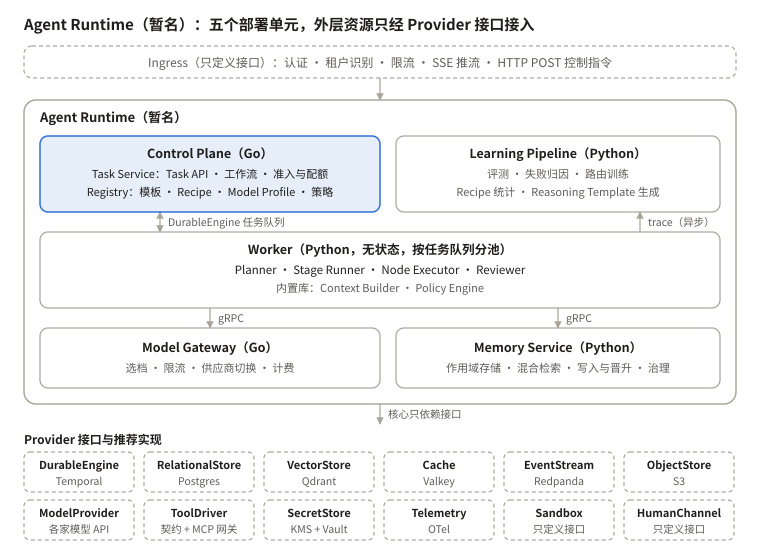

*图 1　总体架构 · 五个部署单元与 Provider 接口*

Runtime 由五个可独立部署的部分组成。Control Plane 与 Model Gateway 用 Go，Worker、Memory Service 与 Learning Pipeline 用 Python。Control Plane 与 Worker 之间通过 DurableEngine（Temporal）的任务队列协作，其余部分之间用 gRPC。外层资源只经 13 个 Provider 接口接入，核心代码不依赖任何具体产品；图下方列出 12 个，第 13 个 Ingress 在最上方。

### 2.2 Task Loop

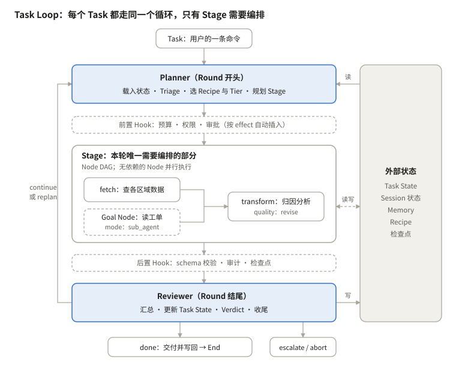

*图 2　Task Loop · Planner、Stage、Reviewer 与外部状态*

每个 Task 都按同一个 Task Loop 运行：Planner 规划一个 Stage，Stage Runner 执行它，Reviewer 判定下一步。Verdict 为 continue 或 replan 时进入下一个 Round。Stage 是每个 Round 唯一需要编排的部分；Task State、Memory、Recipe 等外部状态由 Planner 读取、由 Reviewer 写回，Stage 内的节点也可以读写 Task State。

### 2.3 模块一览

| 模块 | 部署单元 | 语言 | 职责 | 详见 |
| --- | --- | --- | --- | --- |
| Task Service | Control Plane | Go | 对外入口；Session 与 Task 的生命周期；准入与配额 | 3.1.1 |
| Registry | Control Plane | Go | 版本化存放 Node Template、Recipe、Reasoning Template、Model Profile、租户策略 | 3.1.2 |
| Task Loop | Worker（由 Planner、Stage Runner、Reviewer 构成） | Python | 每个 Task 的固定执行框架 | 3.2.1 |
| Planner | Worker | Python | Round 的开头：载入状态、Triage、规划 Stage | 3.2.2 |
| Stage Runner | Worker | Python | 按 DAG 执行 Stage，展开 quality 与 Goal Node | 3.2.3 |
| Node Executor | Worker | Python | 执行 Atomic Node：model、program、human | 3.2.4 |
| Reviewer | Worker | Python | Round 的结尾：汇总、Verdict、收尾 | 3.2.5 |
| Policy Engine | Worker 内的库 | Python | 在挂载点执行 Hook | 3.2.6 |
| Context Builder | Worker 内的库 | Python | 为每次生成型模型调用组装并压缩上下文 | 3.2.7 |
| Model Gateway | Model Gateway | Go | 所有模型调用的唯一出口：选档、限流、切换、计费 | 3.3.1 |
| Memory Service | Memory Service | Python | 记忆的作用域、写入、检索、晋升与治理 | 3.4.1 |
| Learning Pipeline | Learning Pipeline | Python | 从 trace 学习，更新 Model Profile、Recipe 与路由 | 3.5.1 |

持久化、恢复、并发与延迟是跨模块的保障，单独在 3.6 说明。

### 2.4 接口一览

| 接口 | 核心用它做什么 | 推荐实现 | 详见 |
| --- | --- | --- | --- |
| DurableEngine | Session 与 Task 的持久化执行、定时器、信号 | Temporal，自建，Postgres 存储 | 4.2 |
| RelationalStore | 元数据、Registry、Task State 快照、记忆元数据 | Postgres，与 Temporal 分实例 | 4.3 |
| VectorStore | 记忆与知识的稠密 + 稀疏混合检索 | Qdrant | 4.4 |
| Cache | 限流计数、SSE 跨节点广播、短期缓存、分布式锁 | Valkey | 4.5 |
| EventStream | trace 与离线管道 | Redpanda | 4.6 |
| ObjectStore | 大工具输出、产物、工作流大载荷 | S3 兼容存储 | 4.7 |
| ModelProvider | 生成、打分、嵌入 | 各家模型 API，由 Model Gateway 适配 | 4.8 |
| ToolDriver | 外部工具调用 | 内核强类型契约；MCP 经边缘网关接入 | 4.9 |
| Sandbox | 执行 program 节点中的代码 | 只定义接口 | 4.10 |
| HumanChannel | 审批与澄清 | 只定义接口 | 4.11 |
| SecretStore | 基础设施密钥与租户动态凭据 | 云 KMS + Vault/OpenBao | 4.12 |
| Telemetry | trace 与指标 | OpenTelemetry → Langfuse + Tempo | 4.13 |
| Ingress | 认证、租户识别、限流、客户端协议 | 协议定为 SSE + HTTP POST；网关只定义接口 | 4.14 |

### 2.5 端到端流程

1. 客户端用 HTTP POST 提交命令；Ingress 完成认证与租户识别后交给 Task Service。
2. Task Service 做准入，把 Task 投递给该 Session 的工作流；Session 工作流启动 Task 子工作流，立即返回 task_id 与 SSE 订阅地址。
3. Planner 载入 Task State、偏好与经验，做 Triage；需要时选 Recipe 与 Tier，输出 Task Plan，并规划第一个 Stage。
4. Stage Runner 执行 Stage：前置 Hook → Node 按依赖并行执行 → 后置 Hook。模型调用都经 Model Gateway，工具调用都经 ToolDriver。
5. Reviewer 汇总结果、更新 Task State 并给出 Verdict：continue 或 replan 回到第 3 步；repair、rollback、reroute、escalate 按规则处理；done 或 abort 进入收尾。
6. 收尾：deliver 节点的输出经 SSE 推给用户；经验候选、Recipe 统计与 trace 异步写回。

## 3. 模块逻辑设计

本章按部署单元组织，依次是 Control Plane、Worker、Model Gateway、Memory Service 与 Learning Pipeline，最后是跨单元的执行保障。每个单元先给一张单元图，说明它包含哪些模块、怎样部署、与其他单元和 Provider 接口怎样连接；再逐个说明单元内的模块，每个模块配一张模块图，正文包含职责、输入输出、核心逻辑与关键规则。字段、阈值、schema 等细节只给附录链接。图中高亮框是本节说明的对象，实线框是 Runtime 内的组件，虚线框是 Provider 接口或外部资源。

### 3.1 Control Plane 单元

Control Plane 用 Go 实现，包含 Task Service 与 Registry 两个模块，以 Kubernetes Deployment 多副本部署。它本身不保存状态：Session 与 Task 的执行状态在 Temporal 中，元数据与 Registry 的版本在业务 Postgres 中，所以副本可以随请求量水平扩展。Task Service 内置一个 Go 工作流 Worker，消费 session 队列，运行 Session 工作流；Task 子工作流投递到 task 队列，由 Python 的 Worker 执行。对外经 Ingress 提供 Task API；对内用 gRPC 向 Worker、Model Gateway 与 Learning Pipeline 提供 Registry 的查询与发布。

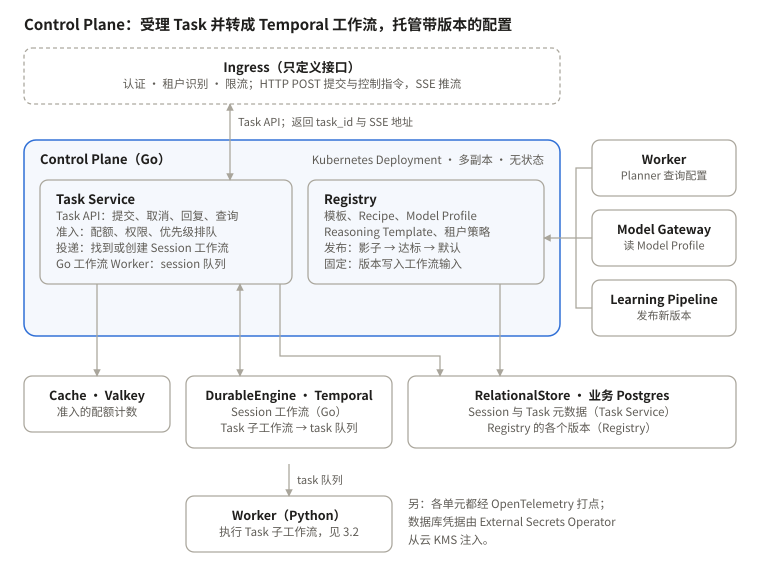

*图 3　Control Plane 单元 · 两个模块、调用方与依赖*

#### 3.1.1 Task Service

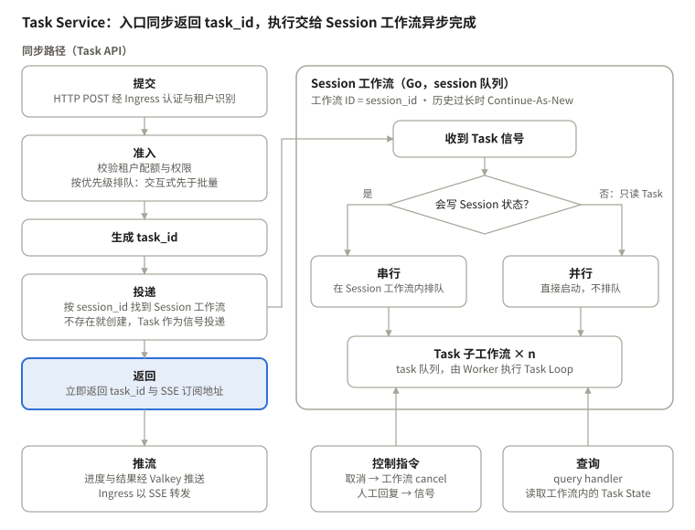

*图 4　Task Service · 同步路径与 Session 工作流*

**职责**：对外唯一入口，把 Session 与 Task 映射为 DurableEngine 上的工作流。

**输入与输出**：输入是 Ingress 转来的请求；输出是 task_id、SSE 订阅地址，以及对工作流的启动、取消与信号。

**核心逻辑**

1. 提交：校验租户配额与权限，生成 task_id；同一 Session 内带相同 client_request_id 的重复提交返回同一个 task_id。
2. 投递：以 session_id 为 ID 找到 Session 工作流，不存在就创建，再把 Task 作为信号投递进去。
3. 排队：提交时声明是否会写 Session 状态，不声明按会写处理。会写的 Task 在 Session 工作流里串行；只读 Task 直接并行启动 Task 子工作流，effect 上限压到 read，收尾只追加 Session 记录，不改 Session 的可变状态。
4. 返回：立即返回 task_id 与 SSE 订阅地址；进度与结果经 Cache 推流。
5. 控制：取消、人工回复等控制指令经 HTTP POST 到达，转为工作流的 cancel 或信号。
6. 查询：运行中读取工作流内的 Task State；Task 结束时把 Task State 快照写入 RelationalStore，结束后的查询读快照，不依赖工作流历史的保留期。

**关键规则**：Session 工作流长期运行，事件历史过长时用 Continue-As-New 续接（阈值与做法见附录 K.3）；准入按租户配额与优先级排队，交互式 Task 优先于批量 Task：优先级映射到任务队列的优先级或单独的批量队列，客户端能用哪一级由租户策略限定。Session 状态分两部分：可变状态（profile 区、brief 区里的 Session 摘要、Session 内的共享产物）只由会写的 Task 修改；追加记录（每个 Task 的命令与交付摘要）任何 Task 都可以追加，按完成时间排序。

细节：工作流映射见附录 K。

#### 3.1.2 Registry

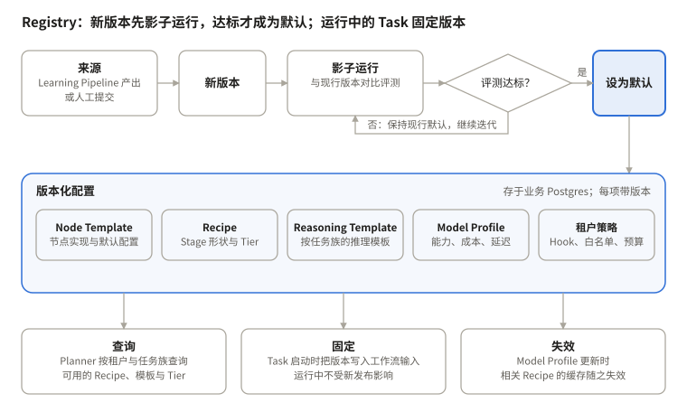

*图 5　Registry · 发布、固定与失效*

**职责**：集中存放所有可发布、带版本的配置：Node Template、Recipe、Reasoning Template、Model Profile，以及租户策略（Hook 声明、模型白名单、预算）。

**核心逻辑**

1. 发布：新版本先影子运行，评测达标后再设为默认。Learning Pipeline 的产出也经这里发布。
2. 固定：Task 提交时固定一个 Registry 修订号，写入工作流输入。之后的解析都按这个修订号取版本：Planner 选 Recipe、reroute 换 Recipe，以及 Node Template、Reasoning Template、Model Profile、租户策略；实际用到的版本记入 Task State 的 pinned。固定的是决定行为的版本，价格、延迟、可用性等运行数据始终取最新。租户策略的收紧立即对运行中的 Task 生效，放宽只对新 Task 生效。
3. 查询：Planner 按租户与任务族查询可用的 Recipe、Node Template 与 Tier。
4. 失效：Model Profile 更新时，相关 Recipe 的缓存随之失效。

**关键规则**：Registry 只追加新版本，不改已发布的版本。Registry 不可用时，运行中的 Task 用已固定版本的本地只读缓存；新 Task 的准入按失败处理（fail-closed）；租户策略与安全类 Hook 取不到时一律按拒绝处理。

细节：Node Template 与 Node Catalog 见附录 D，Model Profile 见附录 H。

### 3.2 Worker 单元

Worker 用 Python 实现，无状态，以 Kubernetes Deployment 部署，按 Temporal 任务队列分成四个池：task 池运行 Task 工作流，也就是 Task Loop 的编排代码，Stage Runner 在其中调度节点；decision 池执行 Planner 与 Reviewer 的模型决策 activity；model 池执行 model 节点；program 池执行 program 节点。四个池用同一份代码与镜像，只是订阅的队列不同，由 KEDA 按各自队列的积压独立扩缩。Policy Engine 与 Context Builder 是进程内的库。Worker 经 gRPC 调用 Model Gateway、Memory Service 与 Registry，经 ToolDriver 与 Sandbox 调用工具和代码；human 节点经 HumanChannel 发出问题，回复以信号送回工作流。

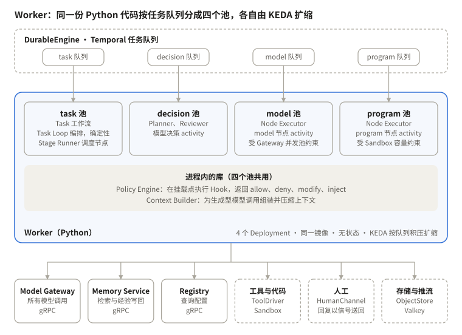

*图 6　Worker 单元 · 四个任务队列池与依赖*

#### 3.2.1 Task Loop

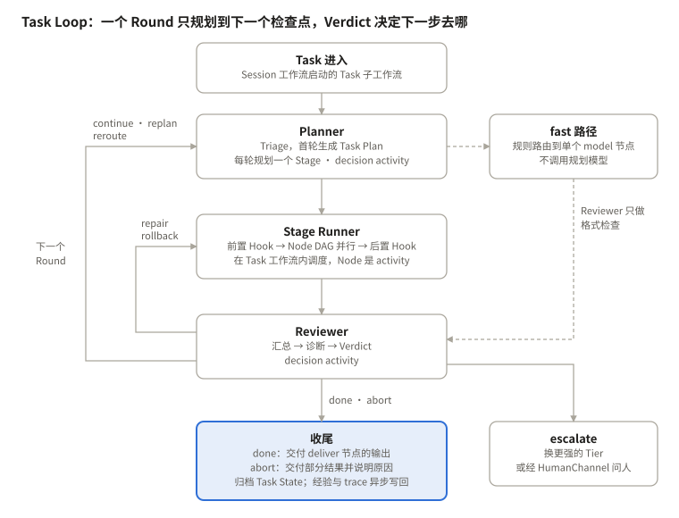

*图 7　Task Loop · 一个 Round 的路径与 Verdict 去向*

每个 Task 由若干个 Round 组成，每个 Round 依次经过三个角色：

| 角色 | 输入 | 输出 |
| --- | --- | --- |
| Planner | Task State、Session 上下文、检索到的经验与 Recipe | 本轮的 Stage 定义 |
| Stage Runner | Stage 定义 | 各 Node 的 result 与 trace |
| Reviewer | Stage 的结果、Task 的验收条件 | Verdict；完成时交付 |

**核心逻辑**

1. **一轮只规划到下一个信息检查点。** 凡是要看了结果才能决定后续的地方，就是 Stage 的边界。
2. **步长随不确定性变化。** 信息齐全时一轮发出完整 DAG；部分未知时每轮一个阶段；几乎未知时只发一个 Goal Node 去探索，回来再规划。
3. **细循环放进 Node，粗循环才走 Task Loop。** tool_loop 的每一步是 Node 内的一次调用，不是一个 Round，否则开销和上下文都会失控。
4. **Planner 与 Reviewer 分开。** 两者可以用同一个模型，但提示与上下文不同：Reviewer 只看结果和验收条件，不看规划过程，避免自评宽容。

**快速路径**：Triage 为 fast 时，Planner 和 Reviewer 都退化为规则，不调用模型。Planner 直接路由到单个 model 节点，Reviewer 只做格式检查和异步写回。

细节：Task State 与 Stage 的结构和完整示例见附录 B。

#### 3.2.2 Planner

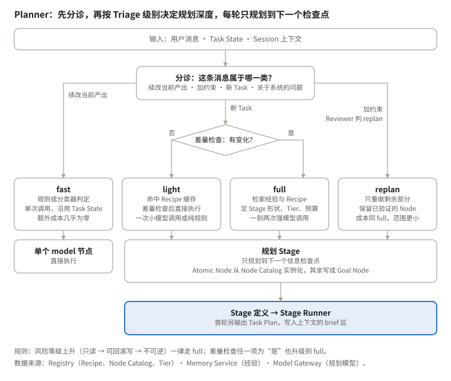

*图 8　Planner · 分诊、Triage 与 Stage 规划*

**职责**：Round 的开头，决定这一轮做什么。

**输入与输出**：输入是用户消息、Task State 与 Session 上下文；首轮输出 Task Plan，每轮输出一个 Stage。

**核心逻辑**

1. 分诊：判断消息是续改上一个产出、给运行中的 Task 加约束、新 Task，还是关于系统本身的问题。续改开新 Task，继承上一个 Task 的 Task State；加约束让运行中的 Task 以 replan 重做剩余部分（附录 C.2）。
2. Triage：决定规划深度。
    - fast：闲聊、简单问答、续改；规则或分类器判定后单次调用。
    - light：已知任务族、置信度高、风险不高于本 Session 已授权的等级；命中 Recipe 后只做差量检查。
    - full：新任务族、置信度低、风险高于已授权的等级或预计成本高；完整规划，必要时先澄清。
    - replan：Reviewer 判定 replan，或目标、约束变化；只重做剩余部分，保留已验证的 Node。
3. 完整规划：检索 Memory 与 Recipe，按任务维度决定 Stage 形状、Tier、上下文策略与预算，输出 Task Plan。
4. 规划 Stage：只规划到下一个信息检查点。Atomic Node 只能从 Node Catalog 实例化，其余写成 Goal Node。

**关键规则**：风险等级上升（只读 → 可回滚写 → 不可逆）一律走 full；fast 与 light 增加的延迟控制在数百毫秒内；full 的成本不超过 Task 预计成本的约 5%。

细节：Triage 级别、差量检查清单、Task Plan 与任务维度见附录 C。

#### 3.2.3 Stage Runner

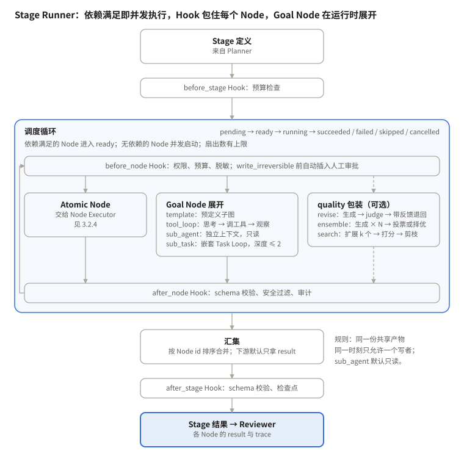

*图 9　Stage Runner · 调度循环、Hook 与展开*

**职责**：把一个 Stage 跑完。

**输入与输出**：输入是 Stage 定义；输出是各 Node 的 result 与 trace。

**核心逻辑**

1. 调度：依赖满足的 Node 进入 ready；没有依赖的 Node 并发启动，扇出数有上限。
2. 插入 Hook：每个 Node 前后由 Policy Engine 执行 Hook；effect 为 write_irreversible 的 Atomic Node 前自动插入人工审批；tool_loop 里每次调用 effect 为 write_irreversible 的工具前，也插入一次人工审批。
3. 展开 quality：revise 展开为“生成 → judge → 不通过带反馈退回”；ensemble 展开为“生成 × N → aggregate 或 judge”；search 展开为“每层扩展 k 个 → 打分 → 剪枝”。
4. 展开 Goal Node：template 展开为预定义子图；tool_loop 在 Node 内循环“思考 → 调工具 → 观察”；sub_agent 交给独立上下文的子 agent，只交回摘要；sub_task 嵌套运行一个完整的 Task Loop。
5. 汇集：结果按 Node id 排序后合并；下游默认只拿 result。

**关键规则**：同一份共享产物同一时刻只允许一个写者；Goal Node 嵌套深度不超过 2；sub_agent 默认只读。

细节：Goal Node、quality 与 reasoning 的展开规则见附录 E。

#### 3.2.4 Node Executor

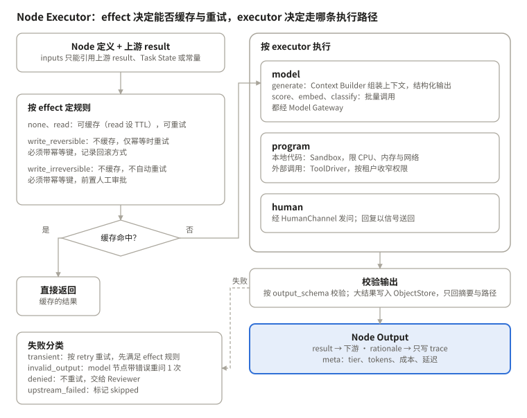

*图 10　Node Executor · effect 规则、执行路径与失败分类*

**职责**：执行 Atomic Node。

**输入与输出**：输入是 Node 定义与上游的 result；输出是 Node Output（result、rationale、meta）。

**核心逻辑**

1. 按 executor 执行：
    - model：经 Model Gateway 调用。generate 由 Context Builder 组装上下文，并按 reasoning 套用推理方式；score、embed、classify 批量调用。
    - program：本地代码在 Sandbox 中执行；外部调用经 ToolDriver，使用 SecretStore 签发的短期凭据。
    - human：经 HumanChannel 发出问题，Task 挂起等待信号；超时按模板默认处理。
2. 按 effect 决定缓存与重试：none、read 可缓存、可重试；write_reversible 仅在幂等时重试；write_irreversible 不自动重试。写操作必须带幂等键。
3. 校验输出：结果按 output_schema 校验；大结果写入 ObjectStore，只回摘要与路径。
4. 失败分类：transient 按配置重试；invalid_output 对 model 节点带上错误重问一次；denied 直接交给 Reviewer；upstream_failed 标记为 skipped。

**关键规则**：rationale 只写入 trace，不传给下游；judge 需要时才显式传入。

细节：Node 契约、executor、effect、role 的规则与失败分类见附录 D。

#### 3.2.5 Reviewer

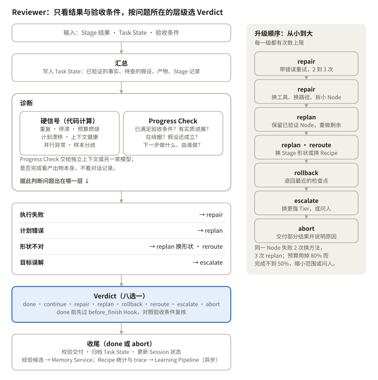

*图 11　Reviewer · 汇总、诊断、Verdict 与升级顺序*

**职责**：Round 的结尾，决定下一步。

**输入与输出**：输入是 Stage 结果、Task State 与验收条件；输出是 Verdict，完成时还输出交付并触发写回。

**核心逻辑**

1. 汇总：把 Stage 结果写进 Task State：已验证的事实、待查的假设、产物与 Stage 记录。
2. 诊断：用硬信号（重复、停滞、预算燃烧、计划漂移、上下文健康、并行异常、样本分歧）和 Progress Check 的五个问题，判断问题出在哪一层：执行、计划、模式还是目标。
3. 判定：从 done、continue、repair、replan、rollback、reroute、escalate、abort 中选一个；从小到大逐级升级，每一级都有次数上限。
4. 收尾：done 或 abort 时校验交付、归档 Task State、更新 Session 状态；经验候选与 Recipe 统计异步写回。

**关键规则**：最常见的错误是用低层手段处理高层问题，例如计划本身错了，却在原地反复重试。同一 Node 失败 2 次就换方法，失败 3 次就重规划。是否完成看产出物本身，不看对话记录。

细节：判定表、信号与症状见附录 B。

#### 3.2.6 Policy Engine

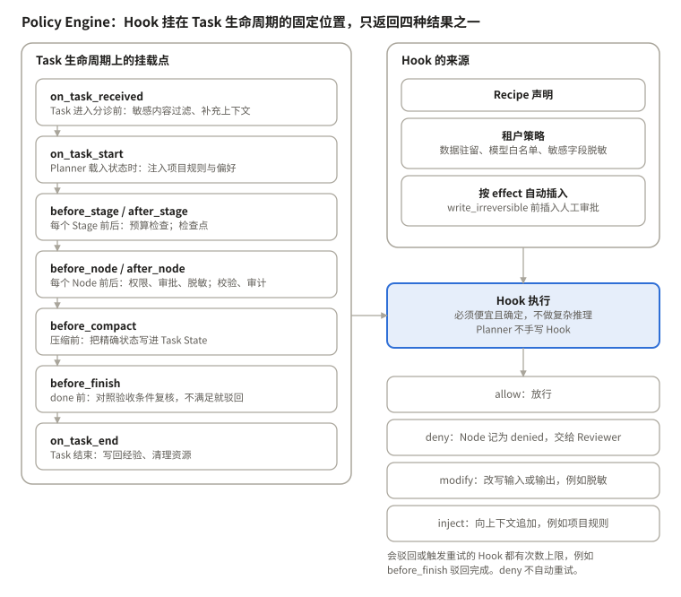

*图 12　Policy Engine · 挂载点、Hook 来源与结果*

**职责**：在固定的挂载点执行确定性检查。它是 Worker 内的库，不单独部署。

**核心逻辑**

1. 挂载点：Task 接收、Task 开始、Stage 前后、Node 前后、压缩前、完成前、Task 结束。
2. Hook 的来源：由 Recipe 与租户策略声明，Planner 不手写。部分 Hook 按 effect 自动插入，例如 write_irreversible 的 Node 前、tool_loop 里每次调用不可逆工具前插入人工审批。
3. 执行：每个 Hook 只返回 allow、deny、modify、inject 之一。deny 交给 Reviewer 处理，不自动重试。
4. 防循环：会驳回或触发重试的 Hook 都有次数上限，例如“完成前”驳回完成。

**典型 Hook**：预算与配额、权限、敏感数据脱敏、提示注入检测、schema 校验、审计日志、检查点。

**关键规则**：Hook 必须便宜且确定，不在里面做复杂推理。

细节：挂载点与默认 Hook 清单见附录 F。

#### 3.2.7 Context Builder

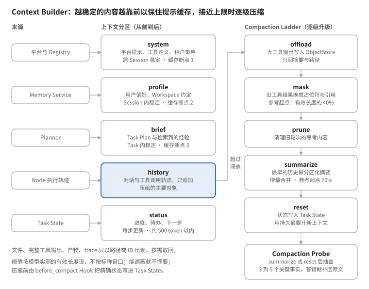

*图 13　Context Builder · 分区与 Compaction Ladder*

**职责**：为每次生成型模型调用组装上下文，接近上限时压缩。它是 Worker 内的库，在每次调用的关键路径上，所以不单独部署。

**核心逻辑**

1. 分区组装：按稳定性从前到后排五个区：system、profile、brief、history、status。越稳定越靠前，以保住提示缓存。
2. 外置：文件、完整工具输出、产物与 trace 只以路径或 ID 出现在上下文里，按需取回。
3. 压缩：超过阈值时按 Compaction Ladder 逐级升级：offload → mask → prune → summarize → reset。阈值按模型实测的有效长度设，不按标称窗口。
4. 精确状态：文件清单、ID、数值由 Task State 注入，不交给摘要。
5. 抽查：summarize 或 reset 后做 Compaction Probe，答错关键事实就补回原文片段。

**关键规则**：能遮蔽就不摘要；摘要只做增量合并，不整体重写。保留什么、何时触发，按工作模式、目标和模型调整。

细节：见附录 G。

### 3.3 Model Gateway 单元

Model Gateway 用 Go 实现，以 Kubernetes Deployment 多副本部署，是所有模型调用的唯一出口：Worker、Memory Service 与 Learning Pipeline 都经 gRPC 调用它。各副本共享的限流计数放在 Valkey；Model Profile 与租户策略从 Registry 读取并在本地缓存；平台的模型 Key 由 External Secrets Operator 从云 KMS 注入，租户自带的 Key（BYOK）运行时从 Vault 或 OpenBao 读取。模型调用的语义 span 送往 Langfuse，用于核算 token 与成本。

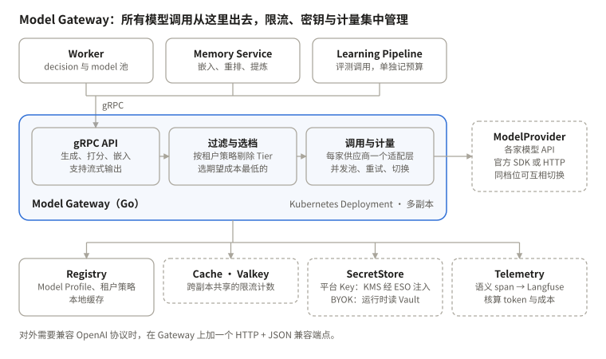

*图 14　Model Gateway 单元 · 调用方、内部组件与依赖*

#### 3.3.1 Model Gateway

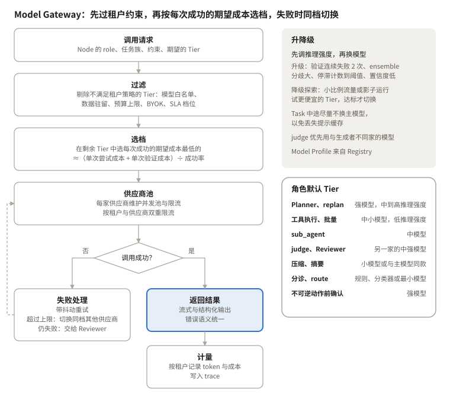

*图 15　Model Gateway · 过滤、选档、调用与升降级*

**职责**：所有模型调用的唯一出口。

**输入与输出**：输入是调用请求（Node 的 role、任务族、约束、期望的 Tier，以及 Task 固定的 Model Profile 版本）；输出是模型结果与计量。

**核心逻辑**

1. 过滤：先按租户策略剔除不可用的 Tier：模型白名单、数据驻留、预算上限、BYOK。
2. 选档：在剩余 Tier 中选“每次成功的期望成本”最低的。
3. 调用：按供应商维护并发池与限流；失败带抖动重试，超过上限就切换同档位的其他供应商。
4. 计量：按租户记录 token 与成本，写入 trace。
5. 升降级：运行中先调推理强度，再换模型；连续失败、样本分歧大或停滞时升级。

**关键规则**：只在 Task 固定的 Model Profile 版本里选档，价格、延迟与可用性用实时数据；Task 中途尽量不换主模型，以免丢失提示缓存；judge 角色优先用与生成者不同家的模型。

细节：Model Profile、选择公式、角色默认 Tier 与内部评测见附录 H。

### 3.4 Memory Service 单元

Memory Service 用 Python 实现，分为两类进程：在线的检索服务以 Deployment 多副本部署，经 gRPC 为 Planner 与 Node Executor 提供检索，并接收 Reviewer 提交的经验候选；离线的提炼 Worker 消费 Temporal 的 offline 队列，执行写入流水线。条目的元数据、版本与谱系存于业务 Postgres，向量存于 Qdrant；嵌入、重排与提炼都经 Model Gateway 调用模型；向量按租户密钥加密，密钥来自 SecretStore。

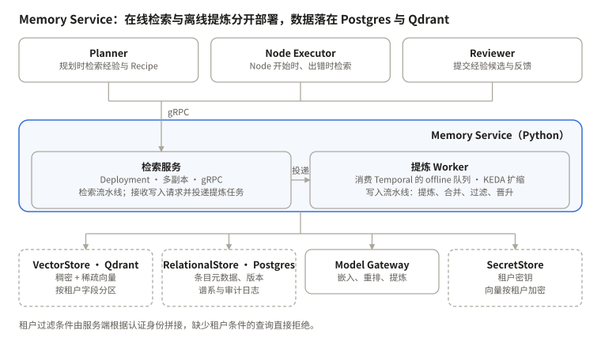

*图 16　Memory Service 单元 · 检索服务、提炼 Worker 与存储*

#### 3.4.1 Memory Service

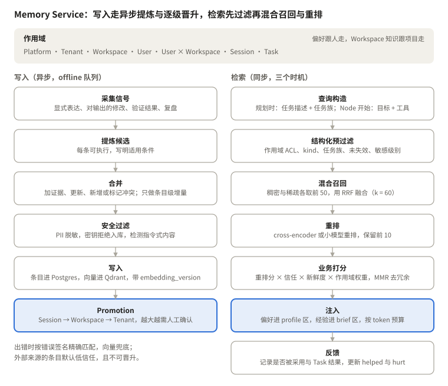

*图 17　Memory Service · 写入流水线与检索流水线*

**职责**：多租户记忆的存储、检索与治理。

**核心逻辑**

1. 作用域：Platform、Tenant、Workspace、User、User × Workspace、Session、Task。用户偏好跟人走，Workspace 知识跟项目走，二者不互相写入。
2. 写入（异步）：采集信号 → 后台提炼成候选条目 → 与已有条目合并，只做条目级增量 → 安全过滤：脱敏、拒绝指令式内容、外部来源降低信任。
3. Promotion：经验先在 Session 中产生，验证后逐级晋升；作用域越大，越需要人工确认。
4. 检索：在三个时机触发：规划时、Node 开始时、出错时（按错误签名）。先在服务端做作用域与结构化过滤，再做稠密 + 稀疏混合召回与重排，按信任 × 相关 × 新鲜打分，按 token 预算注入。
5. 反馈：记录条目是否被采用以及 Task 结果，更新 helped 与 hurt，驱动衰减与淘汰。

**关键规则**：租户过滤条件由服务端拼接，永不由模型生成；嵌入向量与原文同等敏感；记忆库版本化，支持级联删除与回滚。

细节：见附录 I。

### 3.5 Learning Pipeline 单元

Learning Pipeline 用 Python 实现，全部是后台任务：消费者从 Redpanda 读取 trace 事件；归因、评测与 Recipe 搜索作为 offline 队列上的工作流运行；由 KEDA 按 Redpanda 消费延迟与队列积压扩缩。评测集与 trace 原文存于 ObjectStore；评测中的模型调用经 Model Gateway，单独记预算；所有产出经 Registry 发布，不直接修改运行中的配置。

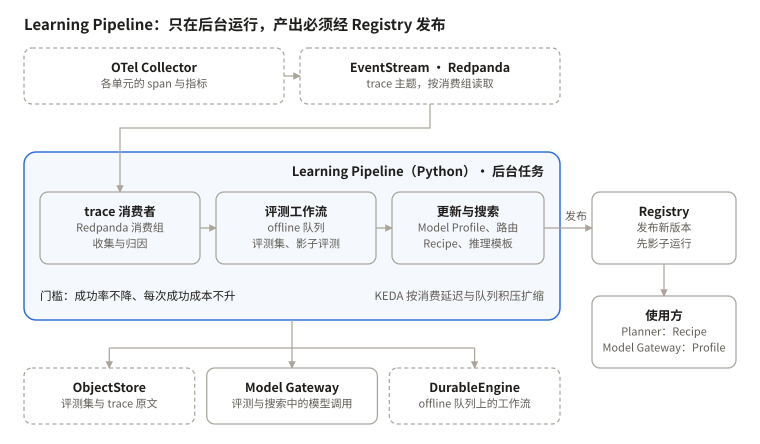

*图 18　Learning Pipeline 单元 · 输入、后台任务与发布出口*

#### 3.5.1 Learning Pipeline

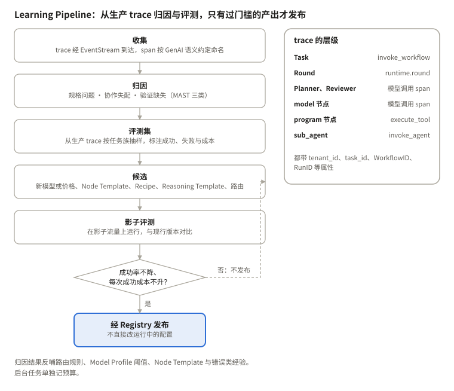

*图 19　Learning Pipeline · 归因、评测、门槛与发布*

**职责**：从运行记录中学习，持续改进路由、模板与 Recipe。

**核心逻辑**

1. 收集：trace 经 EventStream 到达，span 按 OpenTelemetry 的 GenAI 语义约定命名。
2. 归因：失败按三类归因：规格问题、协作失配、验证缺失。
3. 评测：从生产 trace 中按任务族沉淀评测集；新模型、新模板、新 Recipe 先做影子评测。
4. 更新：Model Profile 的内部分数、路由策略、Recipe 统计、Reasoning Template；也可以离线搜索更优的 Recipe。
5. 发布：所有产出经 Registry 发布，不直接修改运行中的配置。

**关键规则**：后台任务单独记预算；离线产出必须过评测门槛才能发布。

细节：见附录 J。

### 3.6 执行保障

**持久化**：Task Loop 写成 Temporal 工作流，编排代码是确定性的。所有模型调用、工具调用和人工回复都是 activity 或信号，结果记入事件历史。恢复时重放历史，已完成的步骤直接取记录的结果。

**恢复**

- Worker 崩溃：activity 超时后由其他 Worker 接手。只读的 Node 直接重跑；写操作先用幂等键查询外部状态：已生效就取当时的结果；确认未生效时，write_reversible 再执行，write_irreversible 不自动重试，交给 Reviewer。
- 等待人工或外部回调：工作流挂起，不占用 Worker。
- 模型供应商故障：Model Gateway 切换到同档位的其他供应商。
- 发布新版本：运行中的 Task 绑定启动时的代码与模板版本，只有新 Task 使用新版本。

**并发**

- Task 之间没有共享状态，随工作流水平扩展。
- 同一 Session 内，只有会写状态的 Task 需要串行。
- Worker 按任务队列分池：决策、model 节点、program 节点、离线任务各用一个队列，由 KEDA 按队列积压扩缩容。
- 租户之间按配额准入；Model Gateway 按租户与供应商双重限流。

**延迟**：fast 路径不调用规划模型；deliver 节点边生成边推流；上下文保持稳定前缀以命中提示缓存；记忆写入与 trace 全部异步；Planner 规划时并行预取记忆与 Recipe。

细节：Temporal 映射、限制与恢复场景见附录 K，容量换算见附录 M。

## 4. 接口与选型

本章先给一张部署拓扑总图，再逐个说明 Provider 接口的设计、推荐实现和优劣。每个接口配一张接入图，标出项目里谁通过它连接、实现部署在什么上、连接或调度哪些资源，以及它的特点；图例与第 3 章相同。各接口的备选对比放在附录 L。

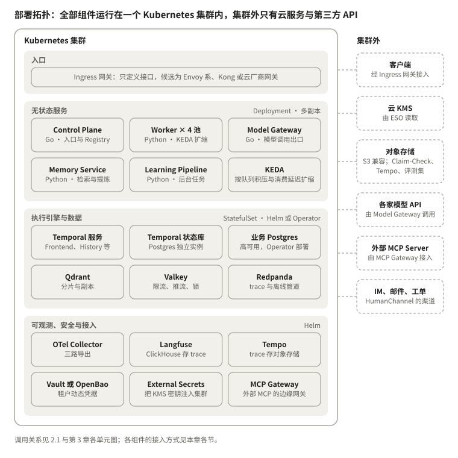

*图 20　部署拓扑 · 集群内各组件与集群外依赖*

### 4.1 接口设计约定

- **按能力命名**：接口名描述能力，不写产品名，例如叫 Cache 而不叫 Valkey。换产品只改适配层。
- **租户上下文强制传递**：每次调用都带 tenant_id 等上下文，实现方在服务端据此隔离，调用方无法绕过。
- **每个接口带开发实现**：本地开发与测试用内存或单机实现，例如 SQLite、本地磁盘、Temporal 开发服务；生产实现按部署环境选择。
- **契约分两层**：服务接口、事件与工作流输入输出用 protobuf 定义，是骨架；Node 输入输出与模板参数用 JSON Schema 定义，是载荷，作为 protobuf 消息中的字段携带。骨架稳定、强类型；载荷随模板演进，不必重新生成代码，也能直接交给模型做结构化输出。
- **只依赖接口**：核心代码不引用任何具体产品的 SDK。

各接口的备选对比见附录 L。

### 4.2 DurableEngine

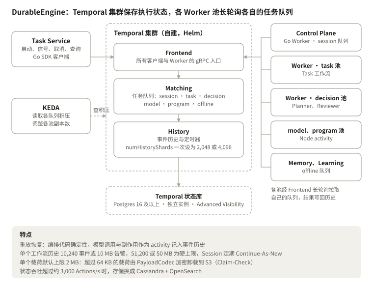

*图 21　DurableEngine · Temporal 集群、任务队列与 Worker 池*

**接口**：启动与取消工作流、子工作流、activity（带超时与重试策略）、信号与查询、持久化定时器、版本管理。

**推荐实现**：Temporal，自建集群，在 Kubernetes 上用 Helm 部署；存储用 Postgres 16 及以上，开启 Advanced Visibility。

**优势**：重放、重试、定时器、信号、子工作流、版本升级都已成熟；Go 与 Python SDK 可在同一集群跨任务队列协作。自建时数据不出内网，固定算力下边际成本低；Temporal Cloud 按 Action 计费，而 Agent 的多步循环会产生大量 Action。

**代价与对策**

- 编排代码必须确定：不能直接读时间、取随机数或调用模型，这些都放进 activity。
- 事件历史有上限：Session 工作流定期 Continue-As-New。
- 未完成的 activity、子工作流、信号各有默认 2,000 的上限：Stage 扇出设上限，大批量拆到子工作流。
- numHistoryShards 初始化后不能修改：一次设为 2,048 或 4,096，为扩容留余量。
- 高频、短耗时的纯内存步骤用 Local Activity，减轻 History 服务压力。
- 状态吞吐超过约 3,000 Actions/s 时，存储换成 Cassandra + OpenSearch。

限制的具体数值与恢复场景见附录 K。

### 4.3 RelationalStore

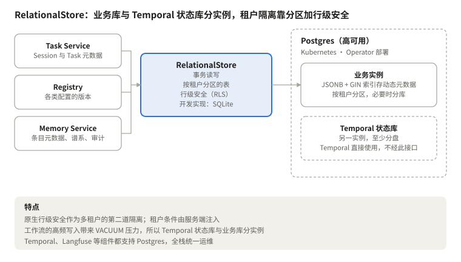

*图 22　RelationalStore · 业务库与 Temporal 状态库*

**接口**：事务读写、按租户分区的表、行级安全。

**推荐实现**：Postgres。Temporal 状态库与业务库分实例（至少分盘），避免工作流的高频写入拖慢业务查询。

**优势**：JSONB 配合 GIN 索引适合 Agent 的动态元数据；原生行级安全（RLS）可作多租户的第二道隔离；Temporal、Langfuse 等组件都支持 Postgres，全栈统一运维。

**代价与对策**：单实例写入有上限，按租户分区，必要时分库；高频更新带来 VACUUM 压力，所以 Temporal 与业务分开部署。

**行级安全的约束**：业务表由各租户共用，每张表带 tenant_id 列，开启并强制 RLS；策略按事务内设置的租户会话变量过滤读写，连接归还连接池时核对并清除。由此带来几条约束：业务表不用外键，因为外键检查会越过 RLS；主键与唯一约束以 tenant_id 开头；迁移只改结构，不写入不属于任何租户的数据；在线服务的数据库角色不能是超级用户，也不能带 BYPASSRLS。

备选对比见附录 L。

### 4.4 VectorStore

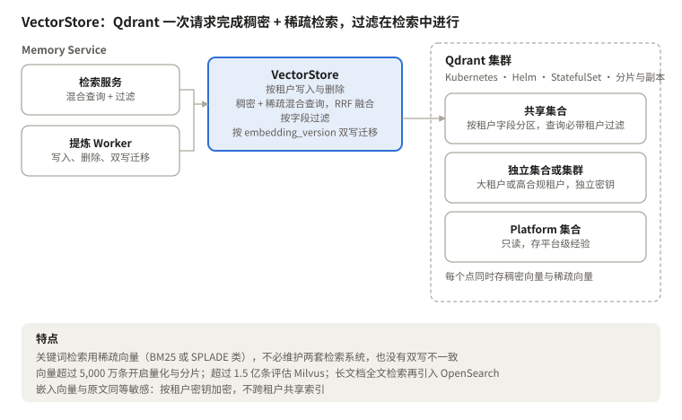

*图 23　VectorStore · Qdrant 集合布局与混合检索*

**接口**：按租户写入与删除向量；稠密 + 稀疏混合查询并融合排序；按字段过滤；按 embedding_version 双写迁移。

**推荐实现**：Qdrant。稠密向量与稀疏向量放在同一集合，关键词检索用稀疏向量（BM25 或 SPLADE 类）完成。

**优势**：一次请求即可完成稠密与稀疏检索，并用 RRF 融合，不必维护两套检索系统，也没有双写不一致；过滤在检索过程中进行；支持按租户字段分区与量化。

**代价与对策**：是一个需要运维的独立组件。向量超过 5,000 万时开启量化与分片，超过 1.5 亿时评估 Milvus；需要处理百万级长文档或代码库全文检索时，再引入 OpenSearch。

备选对比见附录 L。

### 4.5 Cache

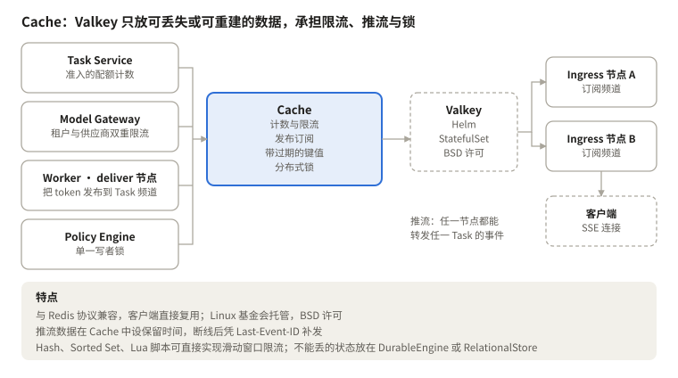

*图 24　Cache · Valkey 的用途与 SSE 跨节点广播*

**接口**：计数与限流、发布订阅（SSE 跨节点广播）、带过期的键值、分布式锁。

**推荐实现**：Valkey。

**优势**：与 Redis 协议兼容，客户端可直接复用；由 Linux 基金会托管，BSD 许可，没有 Redis 更改许可证后的合规顾虑；有 Hash、Sorted Set、Lua 脚本等原语，可直接实现滑动窗口限流。

**代价与对策**：只存可丢失或可重建的数据；不能丢的状态放在 DurableEngine 或 RelationalStore。

备选对比见附录 L。

### 4.6 EventStream

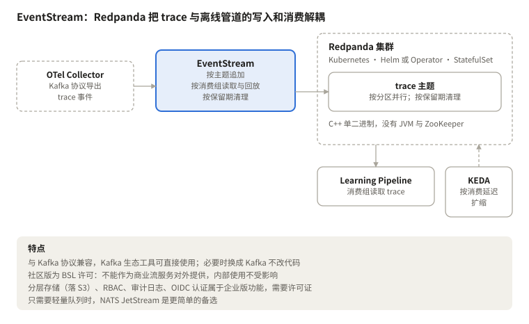

*图 25　EventStream · Redpanda 的生产者、主题与消费组*

**接口**：按主题追加、按消费组读取与回放、按保留期清理。

**推荐实现**：Redpanda。

**优势**：与 Kafka 协议兼容，Kafka 生态工具可直接使用；C++ 单二进制，没有 JVM 与 ZooKeeper，资源占用低；适合 trace、离线管道与记忆提炼任务的异步落盘。

**代价与对策**

- 社区版为 BSL 许可，不能作为商业流服务对外提供；内部使用不受影响。
- 分层存储（落 S3）、RBAC、审计日志、OIDC 认证属于企业版功能，需要许可证。技术选择资料里“自带 S3 分层存储”的说法需要按此修正。确实需要这些能力时，要么购买企业版，要么在网络层与应用层补偿。
- 因为用的是 Kafka 协议，必要时可以换成 Kafka 而不改代码；只需要轻量队列时，NATS JetStream 是更简单的备选。

备选对比见附录 L。

### 4.7 ObjectStore

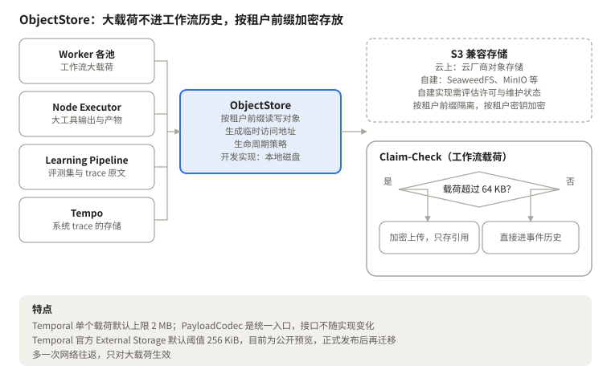

*图 26　ObjectStore · 写入方与 Claim-Check*

**接口**：按租户前缀读写对象、生成临时访问地址、生命周期策略。

**推荐实现**：S3 兼容存储。云上用云厂商的对象存储；自建集群可选 SeaweedFS、MinIO 等兼容实现，需评估其许可与维护状态。

**用途**：大工具输出、产物、trace 原文、Temporal 大载荷。

**Claim-Check**：Temporal 单个载荷默认上限 2 MB。超过阈值（技术选择资料建议 64 KB）的载荷由统一的 PayloadCodec 加密上传到 S3，工作流历史里只留引用。Temporal 官方的 External Storage 提供同样的能力，默认阈值 256 KiB，目前仍是公开预览；正式发布前先用自研 PayloadCodec，接口保持不变。

**代价与对策**：多一次网络往返，只对大载荷生效；按租户密钥加密，按前缀隔离。

备选对比见附录 L。

### 4.8 ModelProvider

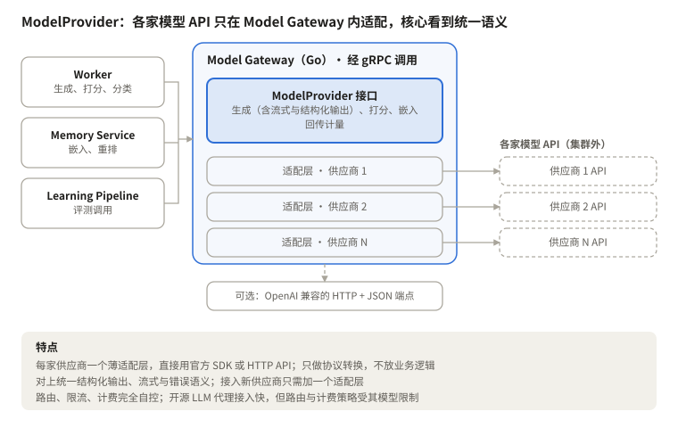

*图 27　ModelProvider · Model Gateway 适配层与各家模型 API*

**接口**：生成（含流式与结构化输出）、打分、嵌入，并回传计量。

**推荐实现**：Model Gateway 内为每家供应商写一个薄适配层，直接使用官方 SDK 或 HTTP API；对上统一结构化输出、流式与错误语义。

**优势**：路由、限流、计费等差异化逻辑完全自己掌控；接入新供应商只需加一个适配层。

**代价与对策**：适配层要自己维护，所以只做协议转换，不放业务逻辑；对外需要兼容 OpenAI 协议时，在 Gateway 上加一个 HTTP + JSON 兼容端点。备选是现成的开源 LLM 代理（如 LiteLLM），接入快，但路由与计费策略受其模型限制。

备选对比见附录 L。

### 4.9 ToolDriver

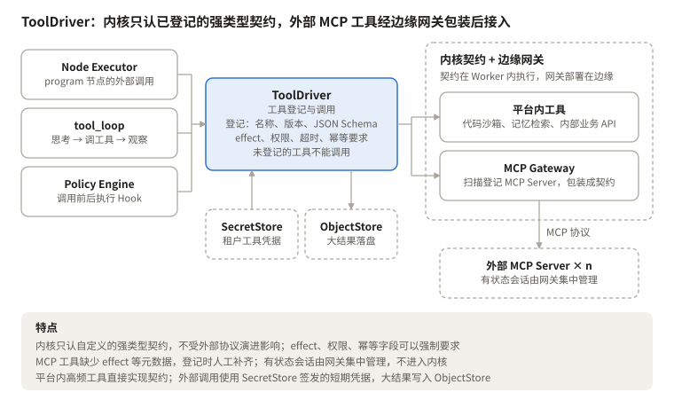

*图 28　ToolDriver · 内核工具契约、平台内工具与边缘 MCP Gateway*

**接口**：工具登记与调用。登记内容包括名称、版本、输入输出的 JSON Schema、effect、权限、超时与幂等要求。

**推荐实现**：内核只认自定义的强类型工具契约。平台内的高频工具（代码沙箱、记忆检索、内部业务 API）直接实现该契约；外部 MCP Server 由边缘的 MCP Gateway 扫描登记，包装成内核契约。

**优势**：内核不受外部协议演进影响；effect、权限、幂等等运行时需要的字段可以强制要求；现有 MCP 生态可以直接复用。

**代价与对策**：MCP 工具缺少 effect 等元数据，登记时要人工补齐，未登记的工具不能调用；MCP 的有状态会话由网关集中管理，不进入内核。

备选对比见附录 L。

### 4.10 Sandbox

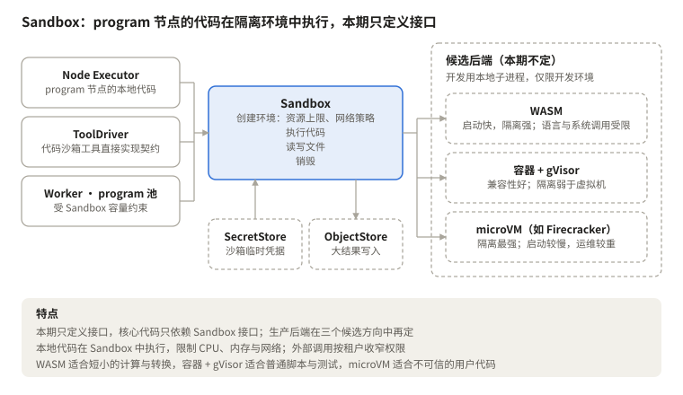

*图 29　Sandbox · program 池、环境生命周期与三种候选后端*

**接口**：创建环境（资源上限、网络策略）、执行代码、读写文件、销毁。

**本期**：只定义接口；开发时用本地子进程实现，仅限开发环境。

**候选方向**

| 方案 | 优势 | 代价 |
| --- | --- | --- |
| WASM | 启动快，隔离强 | 语言与系统调用受限 |
| 容器 + gVisor | 兼容性好 | 隔离弱于虚拟机 |
| microVM（如 Firecracker） | 隔离最强 | 启动较慢，运维较重 |

备选对比见附录 L。

### 4.11 HumanChannel

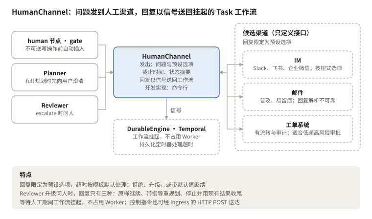

*图 30　HumanChannel · 发问、渠道、回复信号与超时处理*

**接口**：发出问题（问题、选项、截止时间、状态摘要），回复以信号送回 Task 工作流。

**本期**：只定义接口；开发时用命令行实现。

**候选方向**：IM（如 Slack、飞书、企业微信）、邮件、工单系统。

**设计要点**：回复限定为预设选项，超时按模板默认处理。Reviewer 升级问人时，回复设计为三种：原样继续、带指导重规划、停止并用现有结果收尾。

备选对比见附录 L。

### 4.12 SecretStore

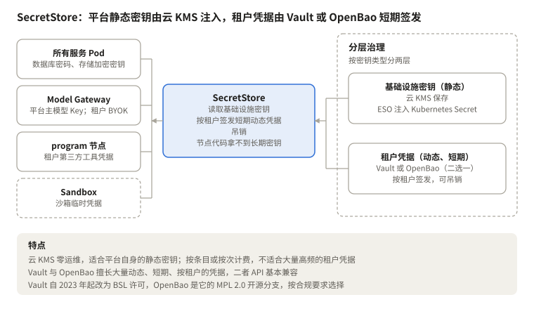

*图 31　SecretStore · 云 KMS 与 Vault 或 OpenBao 两层密钥的流向*

**接口**：读取基础设施密钥；按租户签发短期动态凭据；吊销。

**推荐实现**：分层治理。平台自身的静态密钥（数据库密码、主模型 Key、存储加密密钥）用云 KMS，配合 External Secrets Operator 注入 Kubernetes；租户的第三方工具凭据、自带的模型 Key、沙箱临时凭据用 Vault 或 OpenBao 管理并签发短期凭据。

**优势**：云 KMS 零运维；Vault 与 OpenBao 擅长大量动态、短期、按租户的凭据，云 KMS 按条目或按次计费，不适合这类高频场景。

**代价与对策**：Vault 自 2023 年起改为 BSL 许可，OpenBao 是它的 MPL 2.0 开源分支，二者 API 基本兼容，按合规要求选择；节点代码永远拿不到长期密钥。

备选对比见附录 L。

### 4.13 Telemetry

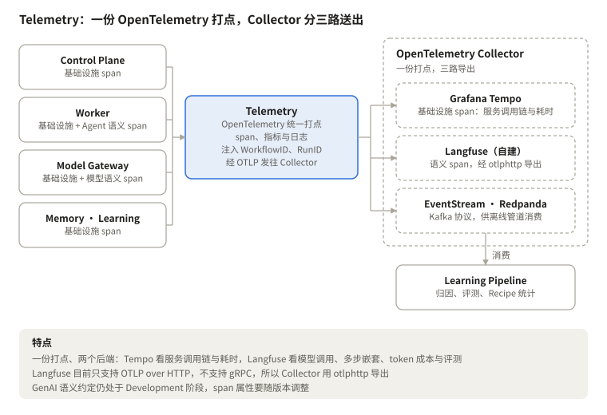

*图 32　Telemetry · OpenTelemetry Collector 的三路导出*

**接口**：span、指标与日志的打点与导出。

**推荐实现**：应用端统一用 OpenTelemetry 打点，并把 Temporal 的 WorkflowID、RunID 注入 trace 上下文。OpenTelemetry Collector 双路转发：基础设施的 span 送到 Grafana Tempo，Agent 与 Model Gateway 的语义 span 送到自建的 Langfuse；另经 Kafka 协议导出一路到 EventStream，供 Learning Pipeline 消费。

**优势**：一份打点、两个后端。Tempo 看服务调用链与耗时；Langfuse 看模型调用、多步嵌套、token 成本与评测。Langfuse 原生接收 OTLP，并按 GenAI 语义约定映射字段。

**代价与对策**：Langfuse 目前只支持 OTLP over HTTP，不支持 gRPC，所以 Collector 用 otlphttp 导出；GenAI 语义约定仍处于 Development 阶段，span 属性要随版本调整。

备选对比见附录 L。

### 4.14 Ingress

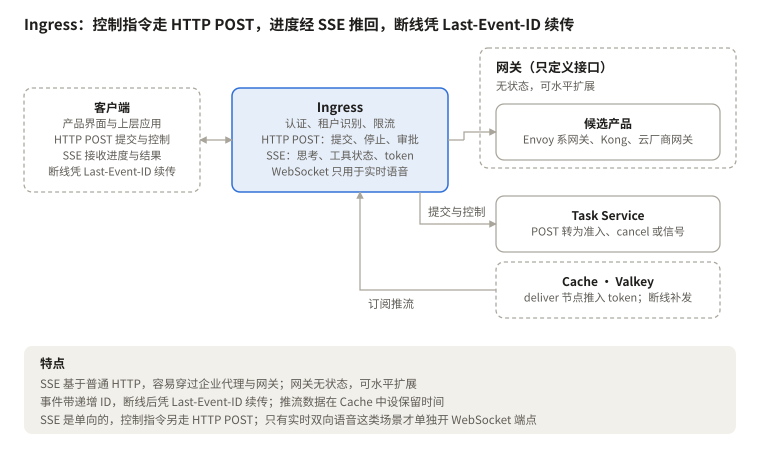

*图 33　Ingress · HTTP POST 提交与控制、SSE 推流与断线续传*

**接口**：认证、租户识别、限流；对客户端提供 HTTP POST 与 SSE。

**协议**：SSE 推送思考过程、工具状态与 token 增量；控制指令（提交、停止生成、人工审批）走 HTTP POST。只有实时双向语音这类场景才单独开 WebSocket 端点。

**优势**：SSE 基于普通 HTTP，容易穿过企业代理与网关，网关可以无状态水平扩展；事件带递增 ID，断线后凭 Last-Event-ID 续传。

**代价与对策**：SSE 是单向的，控制指令另走 POST；断线续传要从 Cache 补发，所以推流数据在 Cache 中设保留时间。

**网关产品**：只定义接口，候选为 Envoy 系网关、Kong 或云厂商 API 网关。

备选对比见附录 L。

### 4.15 工程基座

| 项 | 选择 | 理由 |
| --- | --- | --- |
| 语言 | Go：Task Service、Model Gateway；Python：Worker、Memory Service、Learning Pipeline | Gateway 要维持大量上游流式连接，做毫秒级限流与熔断，Go 的协程适合高并发 I/O；Worker 与 Memory 依赖模型客户端、重排、文档解析与数据处理，Python 生态不可替代 |
| 服务间通信 | gRPC + protobuf；Go 服务用 connect-go 实现 | Python 端继续用成熟的 grpcio；同一端口也能用 HTTP + JSON 调试 |
| 契约 | 外层 protobuf + 内层 JSON Schema | 见 4.1；Python 端用 Pydantic 校验 |
| 部署 | Kubernetes + KEDA | 有状态组件都有成熟的 Helm Chart 或 Operator；KEDA 按 Temporal 任务队列积压或 Redpanda 消费延迟扩缩 Worker |
| 代码仓库 | Monorepo：Buf 管理 protobuf，uv workspace 管理 Python，Go Workspace 管理 Go | 一次提交同时更新契约与两种语言的代码，避免线上契约版本错位 |

仓库结构：

```text
/proto                      # protobuf，Buf 生成代码并做兼容性检查
/schemas                    # Node 与模板的 JSON Schema
/services/go-task-service
/services/go-model-gateway
/services/py-worker
/services/py-memory
/services/py-learning
/deploy                     # Helm 与环境配置
```

备选对比见附录 L。

## 5. 附录

### A. 术语与命名对照

命名原则：用直白的工程词，不沿用论文或框架的专有叫法；一个词只指一样东西。“原称”列是调研阶段文档里的叫法，仅供对照。

**对象层级**

| 名称 | 含义 | 原称 |
| --- | --- | --- |
| Tenant | 租户，隔离与计费的边界 | 租户 |
| User | 租户下的用户 | 用户 |
| Workspace | 用户创建的项目空间，一个用户可有多个 | workspace |
| Session | Workspace 下的一段会话；Session 状态分为可变状态与追加记录（见 3.1.1） | session |
| Task | 用户在 Session 中下发的一次命令及其完整执行；状态为 queued、running、done、aborted、cancelled、failed | task |
| Round | Task Loop 的一轮：规划、执行、评审 | 一轮 |
| Stage | 一轮里执行的节点 DAG，有目标与退出条件 | 超步 x |
| Node | Stage 里的执行单元 | 节点 |
| Attempt | 节点的一次实际执行；重试或采样会产生多次 | attempt |

**执行框架**

| 名称 | 含义 | 原称 |
| --- | --- | --- |
| Task Loop | 每个 Task 的固定执行框架：Planner → Stage → Reviewer，循环到结束 | Orchestrator → 超步 → Synthesizer |
| Planner | 每轮的头：载入状态、分诊、规划下一个 Stage | Orchestrator |
| Stage Runner | 按 DAG 执行一个 Stage | 超步执行器 |
| Node Executor | 执行 Atomic Node | 节点执行器 |
| Reviewer | 每轮的尾：汇总、判定、收尾 | Synthesizer |
| Verdict | Reviewer 的判定：done、continue、repair、replan、rollback、reroute、escalate、abort | 判定；处置阶梯 L1–L7 |
| Task State | Task 的结构化状态：目标、约束、里程碑、已验证事实、待查假设、Stage 记录、产物 | task 账本 |
| Triage | Planner 的第一步，决定规划深度：fast、light、full、replan | 预检 P0–P3 |
| Task Plan | Triage 的产出：本 Task 的 Recipe、模型、记忆、上下文与预算配置 | task_plan |
| Progress Check | Reviewer 每轮回答的五个进度问题 | 进度账本、软信号 |

**节点**

| 名称 | 含义 | 原称 |
| --- | --- | --- |
| Atomic Node | 从 Node Template 实例化、执行一次的节点 | 精确节点 |
| Goal Node | 只声明目标与验收条件、运行时再展开的节点 | 抽象任务 |
| mode | Goal Node 的展开方式：template、tool_loop、sub_agent、sub_task | runner：subflow、react、subagent、task |
| executor | 由谁执行：model、program、human | kind |
| effect | 副作用等级：none、read、write_reversible、write_irreversible | effect |
| role | 在数据流里的职责：fetch、transform、plan、route、judge、aggregate、act、gate、deliver | role |
| quality | 质量包装：none、revise、ensemble、search | 做-评-改、多做-聚合、搜索 |
| reasoning | 生成型 model 节点内的推理方式：direct、stepwise、plan_first、templated | none、CoT、PS+、Self-Discover |
| Reasoning Template | 按任务族生成一次、反复套用的推理结构 | Self-Discover 阶段 1 产物 |
| Node Template | Atomic Node 的模板：实现、默认配置、输出 schema、评测集 | 节点模板 |
| Node Catalog | 所有 Node Template 的集合 | 节点模板库 |
| Node Output | 节点输出的三段：result、rationale、meta | answer、reasoning、meta |
| Recipe | 某个任务族验证过的做法：Stage 划分、模板、模型档位 | flow 配方 |
| Hook | 挂载点上的确定性检查，只返回 allow、deny、modify、inject | 钩子 |

**模块与服务**

| 名称 | 含义 | 原称 |
| --- | --- | --- |
| Runtime（暂名） | 本文设计的 Agent 运行核心 | 运行核心 |
| Control Plane | Task Service 与 Registry | 控制面 |
| Task Service | 对外入口，管理 Session 与 Task 的生命周期 | Task Service |
| Registry | 存放 Node Template、Recipe、Reasoning Template、Model Profile、租户策略 | 注册中心 |
| Worker | 无状态执行进程，运行 Planner、Stage Runner、Node Executor、Reviewer | Worker 池 |
| Policy Engine | Worker 内的库，在挂载点执行 Hook | 钩子与策略引擎 |
| Context Builder | Worker 内的库，为每次模型调用组装并压缩上下文 | 上下文装配 |
| Model Gateway | 所有模型调用的唯一出口：路由、限流、切换、计费 | Model Gateway |
| Model Profile | 一个模型的能力、成本、延迟、可靠性档案 | 模型画像 |
| Tier | 模型与推理强度的组合档位 | 档位 |
| Memory Service | 多租户记忆的存储、检索与治理 | Memory Service |
| Memory Item | 一条记忆 | 记忆条目 |
| Promotion | 记忆从窄作用域升到宽作用域 | 晋升 |
| Learning Pipeline | 离线评测、路由训练、Recipe 统计与搜索 | 离线面 |
| Context Zones | 上下文五区：system、profile、brief、history、status | S0–S4 |
| Compaction Ladder | 压缩五级：offload、mask、prune、summarize、reset | 压缩阶梯 L0–L4 |
| Compaction Probe | 压缩后对关键事实的抽查 | 压缩质量探针 |
| Provider 接口 | 外层资源的抽象接口，按能力命名，共 13 个（见第 4 章） | 外层接口 |

### B. Task Loop 细节

#### B.1 Task State

```yaml
task_state:
  task_id: tsk_01J...
  session_id: ses_01H...
  goal: 分析上季度退款率上升的原因并给出建议
  done_when: 每个结论有数据支撑，建议可执行
  constraints: {effect_ceiling: read, budget_usd: 2.0, deadline_min: 20}
  milestones: [取数, 归因, 成稿]          # 粗计划，可随时调整
  facts: [华东退款率明显高于其他区域]       # 已验证
  assumptions: [工单原因字段可靠]          # 待回查
  open_questions: [物流商是否更换过]
  rounds:
    - {seq: 1, stage_goal: 取数, verdict: continue, cost_usd: 0.12}
    - {seq: 2, stage_goal: 归因, status: running}
  artifacts: [obj://t1/tsk_01J/region_refund.csv]
  pinned: {recipe: refund_analysis@v3, node_templates: by_stage}   # 运行中不受新发布影响
```

#### B.2 Stage

```yaml
stage:
  seq: 2
  goal: 找出华东退款率上升的原因
  exit_when: 每个候选原因都有证据，或已被排除
  budget: {usd: 0.6, wall_clock_min: 5}
  hooks: {before: [budget_check], after: [schema_check, checkpoint]}
  nodes:
    - id: read_tickets
      kind: goal               # Goal Node
      goal: 归纳华东工单中的退款原因
      done_when: 输出原因分布与代表性工单
      mode: sub_agent          # 独立上下文，只读
      output_schema: {reasons: [{name, share, examples}]}
    - id: analyze
      kind: atomic             # Atomic Node
      template: refund_attribution@v2
      executor: model
      output: generate
      effect: none
      role: transform
      after: [read_tickets]
      tier: strong@medium
      reasoning: plan_first
      quality: {type: revise, judge: check_numbers_match@v1, max_rounds: 2}
```

#### B.3 示例：一个 Task 的三个 Round

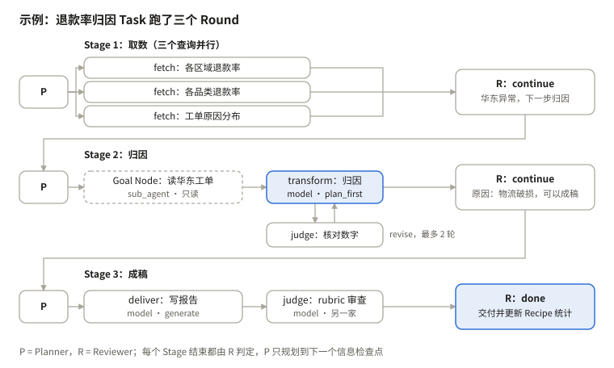

*图 34　示例 · 一个 Task 的三个 Round*

Stage 1 的三个查询互不依赖，放在同一个 Stage 里并行；“下一步查什么”要看查询结果，所以在这里切开。Stage 2 的读工单是 Goal Node，交给只读的 sub_agent 完成；归因节点外加一层 revise。Stage 3 才有 deliver 节点，它的输出就是最终答案。

六类常见任务的 Stage 划分：

| 任务 | Stage 划分 | 关键节点配置 |
| --- | --- | --- |
| 修复 CI 中一个失败的测试 | 1 个 | Goal Node（tool_loop，主 agent 是唯一写者），quality = revise，judge 是跑测试的 program 节点；同一错误连续 3 次时判定 replan |
| 行业研究报告 | 3 个：澄清 → 并行研究 → 综合 | Stage 1 是 human 执行的 gate 节点，确认范围；Stage 2 是 3 到 5 个 sub_agent；Stage 3 是综合（model · transform）、引用核验（program 与 model 担任 judge）和 deliver |
| 批量处理 1000 张工单 | 1 个 | template 模式的 Goal Node 按工单并行展开，每条走固定链加 schema 校验；后置 Hook 抽样转人工复核 |
| 产品命名 | 1 个 | model 节点 quality = ensemble（5 个候选）+ rubric judge；deliver 给出前 3 名 |
| 跨多天开发一个应用 | 每个 Session 若干 Round | 每个 Stage = 实现一个功能 + 端到端验证；Planner 读功能清单与进度，Reviewer 提交并更新进度 |
| 订机票并付款 | 2 个：比价 → 付款 | Stage 1 是 tool_loop 浏览比价；Stage 2 的付款节点 role = act、effect = write_irreversible，前置 Hook 自动插入人工审批 |

#### B.4 Verdict 判定表

| Verdict | 条件 | 去向 |
| --- | --- | --- |
| done | 满足 Task 的验收条件 | 收尾：交付、写回 |
| continue | 本 Stage 的退出条件已满足，Task 尚未完成 | 进入下一个 Round |
| repair | 个别 Node 失败，属于执行层问题 | 在当前 Stage 内带错误重试，或换方法 |
| replan | 计划依赖的假设被证伪，或出现停滞 | Planner 带着失败原因重做剩余计划（Triage = replan） |
| rollback | 共享产物被改坏 | 退回最近的检查点 |
| reroute | 任务实际属于另一类流程 | 换 Recipe 继续 |
| escalate | 卡住，或遇到高风险决定 | 换更强的 Tier，或问人 |
| abort | 预算用尽，或确认无法完成 | 交付部分结果并说明原因 |

#### B.5 四层诊断

| 层级 | 症状 | 对应 Verdict |
| --- | --- | --- |
| 执行失败 | 工具报错、输出格式不对 | repair |
| 计划错误 | 前提假设被证伪、某个 Node 做不完 | replan |
| 形状不对 | Stage 形状本身不合适，例如对强耦合任务扇出 | replan（换形状）或 reroute |
| 目标误解 | 产出偏离真实需求 | escalate，回到澄清 |

表中的 Verdict 是该层问题的默认去向。附录 B.8 的触发规则可以改变去向，例如预算用掉 80% 而完成度不到 50% 属于计划层的问题，去向却是缩小范围或问人（escalate）。Verdict 的 layer 字段记的是问题所在的层，不是 Verdict 本身。

#### B.6 判定依据：硬信号与 Progress Check

硬信号由代码计算，便宜且可靠：

- 重复：同样的工具和参数调用 N 次以上；同一错误签名连续出现；编辑来回震荡（A → B → A）。
- 停滞：验证通过率或评分连续 k 轮不升；里程碑连续 k 个 Round 没有推进。
- 预算燃烧：按“已用预算 ÷ 已完成比例”外推，预计成本超过预算。
- 计划漂移：动作对不上任何计划节点；节点数持续膨胀；replan 次数偏多。
- 上下文健康：占用率高、压缩次数多、反复读同一个文件。
- 并行异常：sub_agent 结果互相矛盾、重复劳动、返回空结果。
- 样本分歧：ensemble 的候选分歧大。

Progress Check 在每个 Round 结束回答五个问题：

1. 是否已满足验收条件？
2. 最近几个 Round 有没有实质进展？
3. 是否在绕圈？
4. 计划依赖的假设还成立吗？
5. 下一步做什么、由谁做？

进度评估交给独立上下文或另一个模型，避免自评宽容；是否完成看产出物本身，不看对话记录。

#### B.7 形状不对的典型症状

| 症状 | 诊断 | 调整 |
| --- | --- | --- |
| 扇出后子结果冲突，合并困难 | 耦合度被低估 | 收回单一写者，或先定共享接口再扇出 |
| 前几个 Node 就频繁 replan | 信息不确定性被低估 | 先探索再规划，改用 tool_loop |
| tool_loop 轨迹很长，没有里程碑 | 缺全局结构 | 补一个显式计划或待办清单 |
| revise 循环里同一错误反复出现 | 问题在上游 | 停止修复，升级为 replan |
| 反思只改措辞 | 自评没有新信息 | 引入外部判据或独立 judge |
| ensemble 分歧大 | 题目含糊或超出能力 | 澄清、拆解，或改用工具求证 |
| 多方辩论很快一致或永不收敛 | 互相附和，或 judge 缺标准 | 给 judge 明确 rubric；强制安排反方 |
| judge 总选第一个或最长的 | 评判偏差 | 两两比较并交换顺序，按 rubric 打分 |
| 上下文越来越长，质量下降 | 上下文污染 | 状态写入 Task State，reset 后继续（Verdict：repair，换方法；reset 后仍无进展再 replan） |

#### B.8 升级顺序与触发规则

1. repair：带上错误信息重试，最多 2 到 3 次。
2. repair：目标不变，换工具、换路径、把 Node 拆小，或先补充信息。
3. replan：保留已验证 Node，从当前状态重做剩余部分；卡住的原因写进 Task State，让下一次尝试真正不同。
4. replan 换 Stage 形状，或 reroute 换 Recipe。
5. rollback：退回最近的检查点，前提是有快照或版本控制。
6. escalate：换更强的 Tier，或带着状态摘要和一个具体问题去问人。人的回复限定为三种：原样继续、带指导重规划、停止并用现有结果收尾。
7. abort：交付部分结果，说清完成了什么、没完成什么、为什么。

触发规则示例：同一 Node 失败 2 次换方法，3 次 replan；replan 2 次仍无进展，换形状或 escalate；预算用掉 80% 而完成度不到 50%，缩小范围或问人。循环类 Goal Node 设最大迭代次数，并检测、打断重复出现的同一错误。

#### B.9 收尾写回

- 交付：最终答案只来自 role = deliver 的节点；Reviewer 只做最终校验，不重写内容。
- Task State 标记完成并归档；更新 Session 状态，包括上下文的 profile 区与 brief 区。
- 成功或失败的经验、本次 Recipe 的效果（Stage 划分、Tier、成本）作为候选，异步进入 Memory Service 的写入流水线。
- 每次成功成本、升级次数、各 Verdict 的分布写入 trace，供 Model Gateway 路由与内部评测使用。

### C. Triage 细节

#### C.1 四个级别

| 级别 | 何时用 | 做什么 | 额外成本 |
| --- | --- | --- | --- |
| fast | 闲聊、简单问答；对上一个产出的续改，例如“再短一点” | 规则或分类器判定后单次调用；续改开新 Task，继承上一个 Task 的 Task State（附录 C.2） | 几乎为零 |
| light | 已知任务族，置信度高，风险等级不高于本 Session 已授权的等级 | 命中 Recipe 缓存 → 差量检查 → 直接执行 | 一次小模型调用或纯规则 |
| full | 新任务族、置信度低、风险等级高于已授权的等级（例如第一次写操作或第一次不可逆动作）、预计成本高 | 生成完整 Task Plan：检索经验，选 Stage 形状、Tier、上下文策略与预算，必要时先澄清 | 一到两次强模型调用 |
| replan | Reviewer 判定 replan、目标变化、用户插入新约束 | 只对剩余部分重新规划，保留已验证的 Node | 同 full，但范围更小 |

风险等级上升一律走 full：只读 → 可回滚写 → 不可逆外部动作，每升一级都要完整规划，不允许走缓存。风险等级按本 Session 已授权的最高等级比较：已授权过的写操作，同一任务族再次出现时可以走 light。write_irreversible 是绝对约束：不论 Triage 走哪一级，运行时都在不可逆动作前插入人工审批（附录 F.3）；light 涉及不可逆动作时还要通过附录 C.2 的额外检查，比只读的 light 更严。

#### C.2 分诊与差量检查

分诊先判断消息属于哪一类：续改上一个产出、给运行中的 Task 加约束、新 Task、关于系统本身的问题。每条命令都是一个新 Task（附录 A），续改也不例外：它的 Task State 继承上一个 Task 的约束、已验证事实、产物与固定的版本，目标改为这次的要求，Round 与 Stage 从 1 开始计数。给运行中的 Task 加约束不开新 Task，而是让该 Task 以 Triage = replan 重新规划剩余部分。只有新 Task 才进入差量检查。

Session 开始时已经加载的内容不再逐个 Task 检查：租户策略、用户偏好、可用工具、模型可用性。每个新 Task 只比对下列变化项，任何一项为“是”就升级到 full：

- 目标或交付物类型变了吗？
- 风险等级高于本 Session 已授权的等级吗？
- 需要的工具或权限超出当前授权了吗？
- Session 剩余预算够这个任务族的典型成本吗？
- 缓存的 Recipe 最近失败过，或相关 Model Profile 已更新吗？
- 分诊置信度低于阈值吗？
- 只对 light 的候选：要做不可逆动作，而它的对象或参数（金额、收件人、日期等）不能从这次的指令里明确得出，或超出了指令的目标范围吗？

#### C.3 Task Plan

```yaml
task_plan:
  triage: {level: full, task_family: analytics.attribution, confidence: 0.64}
  recipe: null                          # light 时为命中的 Recipe
  horizon: per_stage                    # 每轮只规划到下一个信息检查点
  first_stage: {goal: 取数, nodes: [q_region, q_sku, q_reason]}
  tiers: {planner: strong@medium, reviewer: other_vendor@medium, node_default: mid@low}
  memory: {retrieved: [mem_01J.., mem_01K..], write_policy: workspace_on_verified}
  context: {profile: research, mask_at: 0.4, summarize_at: 0.7, must_keep: [citations, numbers]}
  budget: {usd: 2.0, tool_calls: 80, wall_clock_min: 20}
```

Task Plan 写入上下文的 brief 区。

#### C.4 缓存与学习

- Recipe 缓存按（租户、Workspace、任务族、风险等级、工具集）索引，值为 Stage 形状、Tier、上下文策略与预算。成功一次加一条证据，失败一次降低信任；Model Profile 更新时缓存失效。
- 成本上限（建议值）：fast 与 light 增加的延迟控制在数百毫秒内；full 的成本不超过该 Task 预计成本的约 5%。
- 记录每次 Triage 决策与最终结果，作为训练路由器和调整阈值的数据。

#### C.5 完整规划的依据：任务的 11 个维度

| 类别 | 维度 | 一端 ↔ 另一端 | 决定 Stage 的什么 |
| --- | --- | --- | --- |
| 目标 | ① 规格清晰度 | 验收标准明确 ↔ 模糊或隐含 | 是否先澄清、先写规格或功能清单 |
| 目标 | ② 可验证性 | 有便宜的硬判据 ↔ 只能主观判断 | 能否用 revise；judge 优先级：测试 > 规则 > 另一家模型 > 人 |
| 目标 | ③ 解空间形态 | 唯一答案 ↔ 开放创作 ↔ 有死胡同的组合搜索 | ensemble 用投票还是择优，或用 search |
| 结构 | ④ 路径确定性 | 已知流程 ↔ 边走边发现 | 一轮发完整 DAG，还是用 tool_loop |
| 结构 | ⑤ 耦合度 | 子任务独立 ↔ 共享产物、隐式决策互相影响 | 能否扇出；写操作是否必须单一写者 |
| 结构 | ⑥ 时程与上下文规模 | 几步完成 ↔ 跨多个上下文窗口 | 是否需要跨 Session 的 Task State、上下文隔离 |
| 环境 | ⑦ 信息不确定性 | 信息已在手 ↔ 需要探索、环境会变 | 一轮规划多远 |
| 环境 | ⑧ 风险与可逆性 | 只读 ↔ 可回滚写 ↔ 不可逆动作 | 审批 Hook、沙箱、试运行、检查点 |
| 环境 | ⑨ 人的可用性 | 随时可问 ↔ 无人值守 | 提问，还是先做假设并记录、到不可逆点停下 |
| 资源 | ⑩ 价值 × 预算 | 低价值要快 ↔ 高价值可慢 | Tier 与 quality 的投入 |
| 资源 | ⑪ 重复度 | 一次性 ↔ 高频 | 是否固化为 Recipe 或 Node Template |

最决定 Stage 形状的是 ② 和 ⑤：

| <br> | 低耦合 | 高耦合 |
| --- | --- | --- |
| 可验证性高 | 扇出，每个分支各自 revise | 单一写者 + 测试驱动的修复循环 |
| 可验证性低 | 扇出研究 + 综合 + rubric 评审 | 单一写者 + 先澄清 + 多方案供人选 |

### D. 节点契约

#### D.1 Atomic Node 的字段

```yaml
- id: q_region
  kind: atomic
  template: sql_query@v3            # 来自 Node Catalog
  executor: program
  effect: read
  role: fetch
  after: []
  inputs:                           # 只能引用上游 result 字段、Task State 或常量
    params: {quarter: $task.constraints.quarter}
  output_schema: region_refund_rate_v1
  budget: {timeout_s: 30, max_cost_usd: 0.02}
  retry: {max: 2, on: [timeout, rate_limit], backoff: exponential}
  cache: {ttl_s: 3600}              # 缓存键 = 模板版本 + 输入哈希
  idempotency_key: null             # effect 为 write_* 时必填
  fallback: fail                    # alternate | skip | fail
```

用 executor、effect、role 三个字段描述一个节点，例如：

- cross-encoder 重排：model（score）· none · judge
- 查数据库：program · read · fetch
- 发邮件：program · write_irreversible · act
- 人工审批：human · none · gate
- 写最终报告：model（generate）· none · deliver

model 节点再用 output 细分：generate、score、embed、classify。program 同时包含本地代码与外部调用，两者的差别由 effect 表达。

#### D.2 Node Output

```yaml
node_output:
  result: {...}       # 按 output_schema，默认只有它传给下游
  rationale: "..."    # 推理文本或思考摘要，只写入 trace；judge 需要时才显式传入
  meta: {tier, reasoning, tokens, cost_usd, latency_ms, confidence}
```

整个 Task 的最终答案只来自 role = deliver 的节点。

#### D.3 按 executor 的规则

| executor | 执行要点 | 失败处理 |
| --- | --- | --- |
| model | generate 由 Context Builder 组装上下文，用结构化输出约束格式，只接收上游的 result；score、embed、classify 批量调用，判定阈值用自有标注集校准 | 输出不符合 schema 时带上错误重问 1 次；超时或限流时换同档位的其他供应商；连续失败则升级 |
| program | 本地代码在 Sandbox 中执行，限制 CPU、内存与网络；外部调用按租户收窄权限，大结果写入 ObjectStore，只回摘要和路径 | 临时错误按 retry 重试；参数错误或代码异常直接失败，交给 Reviewer |
| human | 经 HumanChannel 异步等待；回复限定为预设选项 | 超时按模板默认处理：拒绝、升级，或带默认值继续 |

#### D.4 按 effect 的规则

| effect | 缓存 | 自动重试 | 额外要求 |
| --- | --- | --- | --- |
| none | 可以 | 可以 | — |
| read | 可以，设 TTL | 可以 | 结果写入 trace，便于复现 |
| write_reversible | 不缓存 | 仅幂等时 | 必须带幂等键并记录回滚方式；同一时刻只允许一个节点写同一份共享产物 |
| write_irreversible | 不缓存 | 不可以 | 必须带幂等键；执行前插入人工审批：Atomic Node 在节点前，tool_loop 在每次调用不可逆工具前 |

#### D.5 按 role 的规则

| role | 含义 | 规则 |
| --- | --- | --- |
| fetch | 从外部取数据：查询、搜索、读文件 | 可缓存、可并行 |
| transform | 抽取、转换、总结，产出中间结果 | 只把 result 传给下游 |
| plan | 产出计划或子图 | 输出必须通过子图 schema 校验 |
| route | 在几个分支中选一个 | 输出只能是预设的枚举值 |
| judge | 评价结果好不好：通过与否或分数 | 不看生成者的 rationale；model 担任时优先用另一家的模型 |
| aggregate | 合并多个上游：投票、汇总、去重 | 等全部上游完成或超时 |
| act | 对外部产生写操作：发送、下单、写库 | effect 必须是 write_reversible 或 write_irreversible |
| gate | 决定能不能继续：权限、预算、人工审批 | write_irreversible 前的审批与策略要求的 gate 由 Hook 按策略自动插入，Planner 不手写；任务本身需要的人工确认（澄清范围、抽查试跑结果）由 Planner 写成 executor = human 的 gate 节点 |
| deliver | 产出面向用户的最终结果 | 每个 Task 只有一个出口 |

judge 与 gate 的区别：judge 评价结果好不好，属于质量；gate 决定能不能继续，属于控制。

工具参数需要模型来写时（例如根据问题生成 SQL），拆成两个 Atomic Node：model 节点（transform）产出参数，program 节点（fetch）执行。只有需要边看结果边调参数时，才改用 tool_loop。

#### D.6 状态与失败分类

- 状态：pending → ready（依赖已满足）→ running → succeeded、failed、skipped 或 cancelled。
- transient（超时、限流）：按 retry 配置重试，但先要满足 effect 规则；重试用完仍失败才交给 Reviewer，它可以判 repair 再给一轮（例如基础设施抖动），同一错误反复出现则按附录 B.8 升级。
- invalid_output（输出不符合 schema）：model 节点带上错误重问一次，其他执行者直接失败。
- denied（被 Hook 或权限拒绝）：不重试，直接交给 Reviewer。
- upstream_failed（上游失败）：标记为 skipped，由 Reviewer 判定 repair 还是 replan。

#### D.7 Node Catalog

- 每个 Node Template 包含：executor、effect、role、实现（Tier 与提示模板，或脚本与接口）、默认配置、output_schema、评测集。
- 模板带版本。新版本先影子运行，评测达标后再切换，与 Model Gateway 的内部评测共用同一套流程。
- 持续统计每个模板的成功率、每次成功成本与 P95 延迟，Planner 规划时据此选模板。
- 高频的 Goal Node 稳定后固化为 template 模式的 Recipe，下次直接展开成 Atomic Node。

### E. Goal Node、quality 与 reasoning

#### E.1 Goal Node 的展开方式

| mode | 何时用 | 怎么展开 |
| --- | --- | --- |
| template | 有现成的 Recipe 或技能 | 展开为预定义子图，内部全是 Atomic Node |
| tool_loop | 步骤未知，要边看边做 | 单 agent 循环：思考 → 调工具 → 观察；每一步是一次 model 或 program 调用（即 ReAct） |
| sub_agent | 读密集、宽度型，或需要隔离上下文 | 独立上下文的子 agent，只交回摘要；默认只读 |
| sub_task | 本身就是一个复杂任务 | 嵌套运行一个完整的 Task Loop；嵌套深度不超过 2 |

Goal Node 只需写清 goal、done_when、预算与 output_schema。mode 可以推迟到运行时，按 Recipe 的历史表现选择：有 Recipe 用 template，否则用 tool_loop；读密集或宽度型用 sub_agent。多 agent 的 token 消耗远高于单 agent，所以默认不派 sub_agent。tool_loop 调用不可逆工具前逐次人工审批：审批时展示工具与具体参数，超时按拒绝处理；拒绝时把审批人的指导作为这一步的观察送回循环，同一个 Goal Node 被拒 2 次就记为 denied，交给 Reviewer。

#### E.2 quality：质量包装

| quality | 展开为 | 适用场景 |
| --- | --- | --- |
| none | 不展开 | 低价值节点 |
| revise | 生成 → judge → 不通过带反馈退回，最多 N 轮 | 有判据时使用；judge 优先用 program（测试、规则），其次用另一家模型按 rubric 评审 |
| ensemble | 生成 × N → aggregate（投票）或 judge（择优） | 答案可以归一时投票；开放答案时择优 |
| search | 每层扩展 k 个候选 → 打分 → 剪枝，可回溯 | 有死胡同的组合问题；成本最高 |

quality 可以挂在单个 Node 上，也可以挂在整个子图上。

#### E.3 reasoning：生成型 model 节点内的推理方式

| reasoning | 做法 | 默认用于 |
| --- | --- | --- |
| direct | 只给目标与约束；推理模型用原生思考，按 Tier 设思考预算 | 推理模型 |
| stepwise | 要求在输出里逐步推理（即 CoT） | 需要把推理过程留在输出里审计 |
| plan_first | 先列变量与计划，再按计划执行（即 Plan-and-Solve） | 小模型或非推理模型，减少漏步骤 |
| templated | 按 Reasoning Template 逐项填写（即 Self-Discover） | 高频、要求可审计的任务族 |

Reasoning Template 由 Learning Pipeline 按任务族生成一次，经 Registry 发布后反复使用。推理文本写入 rationale，不传给下游。

#### E.4 默认选择

- 推理模型默认 direct；需要结构时，把结构作为输出格式，推理交给模型自己的思考过程。
- 提高推理强度不一定更好：HAL 的实验中，提高 reasoning effort 在 36 组里有 21 组反而降低了准确率，所以推理强度按任务族实测选择。
- quality 默认 none；有便宜的硬判据时用 revise；低价值节点不加。

### F. Policy Engine 细节

#### F.1 挂载点

| 挂载点 | 时机 | 典型 Hook | 业界对应 |
| --- | --- | --- | --- |
| on_task_received | Task 进入分诊前 | 敏感内容过滤、补充上下文 | Claude Code 的 UserPromptSubmit |
| on_task_start | Planner 载入状态时 | 注入项目规则与偏好 | SessionStart；before_agent |
| before_stage / after_stage | 每个 Stage 前后 | 预算检查；检查点 | LangGraph 每个超步结束时的检查点 |
| before_node / after_node | 每个 Node 前后 | 权限、审批、脱敏；schema 校验、安全过滤、审计 | PreToolUse、PostToolUse；before/after_model、before/after_tool；wrap_tool_call |
| before_compact | Context Builder 压缩前 | 把精确状态写进 Task State | PreCompact |
| before_finish | Reviewer 判定 done 前 | 对照验收条件复核，不满足就驳回 | Stop；after_agent |
| on_task_end | Task 结束 | 写回经验、清理资源 | SessionEnd |

#### F.2 Hook 的结果

- allow：放行。
- deny：拒绝本次动作，Node 记为 denied，交给 Reviewer；不自动重试。
- modify：改写输入或输出，例如脱敏。
- inject：向上下文追加信息，例如项目规则。

会驳回或触发重试的 Hook（例如 before_finish 驳回完成）都有次数上限，防止无限循环。

#### F.3 默认 Hook

| 触发条件 | 自动插入的 Hook |
| --- | --- |
| 所有 Node | 预算与配额检查、审计日志 |
| effect = read | 结果写入 trace |
| effect = write_reversible | 幂等键检查、单一写者锁、检查点 |
| effect = write_irreversible | 幂等键检查、人工审批（gate 节点；tool_loop 里每次调用不可逆工具前各审批一次） |
| 外部内容进入上下文 | 提示注入检测，标记为低信任 |
| 租户策略声明 | 数据驻留、模型白名单、敏感字段脱敏 |

### G. Context Builder 细节

#### G.1 分区

任何对前缀的改动都会让其后的提示缓存失效，所以分区按稳定性从前往后排。

| 分区 | 内容 | 稳定周期 | 压缩方式 |
| --- | --- | --- | --- |
| system | 平台提示、固定工具集定义、租户策略 | 跨 Session | 不压缩；缓存断点 1 |
| profile | 用户偏好、Workspace 约定（来自 Memory） | Session 内 | 不改写，新偏好以变更形式追加；缓存断点 2 |
| brief | Task Plan：目标、验收条件、约束、计划摘要、检索到的经验 | Task 内 | replan 时整体替换；缓存断点 3 |
| history | 对话与工具调用轨迹，只追加 | 每步增长 | 压缩的主要对象 |
| status | 进度、待办、下一步，放在最末尾 | 每步更新 | 保持在约 500 token 以内 |

上下文之外的一切（工作区文件、完整工具输出、产物、trace、记忆库）只以路径或 ID 出现，按需取回。status 区由 Worker 生成，不让模型自己维护，避免记账吃掉有效动作。

#### G.2 Compaction Ladder

1. offload：大工具输出直接写入 ObjectStore，只回摘要与路径；读密集的探索交给 sub_agent。
2. mask：较早的工具结果替换为占位符和引用；可直接用模型 API 原生的工具结果清理。
3. prune：清理旧轮次的思考内容，权衡对缓存命中的影响。
4. summarize：把最早的历史段做成分区化摘要（意图、决策、产物、未决、下一步），合并进持久摘要；精确状态由 Task State 注入，不依赖摘要。
5. reset：状态写入 Task State，用 system、profile、brief、持久摘要与 status 开一个新上下文。

阈值按模型实测的有效长度设，不按标称窗口。参考起点：有效长度的 40% 开始 mask，70% 开始 summarize；出现重复或停滞信号，或压缩若干次后质量下降，就 reset。

#### G.3 按工作模式

| 工作模式 | 必须精确保留 | 可遮蔽或丢弃 | 主要手段 |
| --- | --- | --- | --- |
| 编码、运维 | 文件改动清单、错误原文、命令与退出码、测试状态、决策与原因 | 旧文件内容、长日志（可重读） | 早遮蔽、晚摘要；产物轨迹由 Task State 跟踪 |
| 研究、深度搜索 | 引用（URL、要点、出处）、已排除的假设、待查问题 | 网页全文（存文件） | sub_agent 先压缩成每个来源一张卡片，主上下文只收卡片 |
| 对话、客服 | 用户偏好、承诺、未解决诉求 | 寒暄、已解决的话题 | 偏好写入 Memory + 滚动窗口 + 话题级摘要 |
| 写作、文档协作 | 风格约定、修改意见及其状态 | 旧版草稿 | 文档外置，上下文只留大纲、当前段落与意见清单 |
| 数据分析 | schema、已算出的数字及生成代码、分析假设 | 原始数据行 | 数据与中间结果写文件，代码可重跑 |
| 批量处理 | 每项结果的状态表 | 单项细节 | 每项独立上下文，汇总只读状态表 |
| 长时程任务 | 功能清单、进度、版本历史 | 全部对话历史 | 每个工作单元结束就 reset |

#### G.4 按目标

- 正确性优先（金融、法律、医疗）：宁多勿少，用更强的模型做摘要；压缩后答不出关键事实就回退到更保守的压缩。
- 成本与延迟优先：早遮蔽、少摘要，摘要用小模型，尽量保住缓存命中。
- 可审计：原文永不删除，只移出上下文并保留引用，任何压缩都可恢复。

#### G.5 按模型

| 模型特征 | 调整 |
| --- | --- |
| 有效上下文短 | 阈值按有效长度设；更多依赖 Task State 与 sub_agent |
| 提示缓存折扣大 | 压缩只动尾部；攒一批再压，避免前缀反复失效 |
| 有原生压缩与上下文编辑 | 原生能力做 mask、prune 与 reset；自研只负责必须保留的清单与状态注入 |
| 推理模型 | 工具调用期间保留思考的连续性，旧轮次的思考可清理 |
| 小模型做执行 | 上下文更短、Task Plan 更结构化、更频繁地复述目标 |
| 中途换模型 | 缓存不可复用；交接时传持久摘要与 Task State，不传原始历史 |

#### G.6 Compaction Probe 与指标

- 每次 summarize 或 reset 后，从 Task State 与 Task Plan 中自动抽 3 到 5 个关键事实提问；答错就补回原文片段。
- 跟踪指标：压缩后的 Task 成功率、压缩后的重复操作率（重读同一文件、重做已完成步骤）、缓存命中率、每个 Task 的 token。

#### G.7 依据

- 所有前沿模型都随输入变长而退化，标称窗口不等于有效窗口（[Chroma](https://trychroma.com/research/context-rot)）。
- 观察遮蔽的成本约为不做管理的一半，解决率与 LLM 摘要持平甚至略高（[JetBrains](https://arxiv.org/pdf/2508.21433)）。
- 锚定式增量摘要在可继续任务的信息保留上优于整体重写（[Factory](https://docs.factory.ai/guides/power-user/evaluating-context-compression)）；反复整体重写会造成细节流失（ACE，ICLR 2026）。
- 生产 agent 把 KV 缓存命中率视为最重要的指标，前缀保持稳定（[Manus](https://manus.im/blog/Context-Engineering-for-AI-Agents-Lessons-from-Building-Manus)）。

### H. Model Gateway 细节

#### H.1 Model Profile

同一模型的不同推理强度或思考预算视为不同的 Tier，各自有能力、成本、延迟数据。

```yaml
model_profile:
  id: provider/model@version
  tiers:
    - {name: low,  effort: low,  thinking_budget: 2k}
    - {name: high, effort: high, thinking_budget: 32k}
  capability:                     # 按技能分项，每项标来源与时间
    code_patch:    {score: 0.71, src: swe-bench-pro, at: 2026-10-01}
    tool_calling:  {score: ..., src: bfcl-v4}
    deep_search:   {score: ..., src: browsecomp}
    effective_ctx: 96k            # 实测有效长度，不是标称窗口
    internal:      {task_family: {success: 0.83, n: 240, ci95: [0.78, 0.87]}}
  cost:        {in_per_m, out_per_m, cache_read_per_m, batch_discount, cost_per_task_p50}
  latency:     {ttft_p50_ms, tokens_per_s_p50}
  reliability: {uptime_3d, rate_limit, fallbacks: [..]}
  constraints: {context_window, max_output, tools, modalities, data_region}
  freshness:   {scores_at, price_at}
```

数据按可信度加权：内部评测 > 垂直第三方（Vals、HAL）> 独立综合评测（Artificial Analysis、Epoch）> 厂商自报。刷新频率：价格、延迟、可用性每天；公开分数每周；内部评测在新模型上线时和每月各跑一次。

#### H.2 选择目标

选档的目标不是单次调用最便宜，而是在成功率、延迟和租户约束下，让一次成功交付的期望成本最低。对“生成 → 验证 → 重试”的节点，可近似为：

```text
每次成功的期望成本 ≈ (单次尝试成本 + 单次验证成本) ÷ 成功率
```

单价便宜但成功率低的 Tier，可能比强 Tier 更贵。

#### H.3 角色默认 Tier

| 角色 | 选型重点 | 默认 Tier |
| --- | --- | --- |
| Planner、replan | 推理、指令遵循、长上下文 | 强模型，中到高推理强度 |
| 工具执行、批量处理 | 工具调用可靠性、速度、成本 | 中小模型，低推理强度 |
| sub_agent（只读研究） | 搜索与阅读能力、并发吞吐 | 中模型 |
| judge、Reviewer | 判别力；与生成者不同家族，避免同源偏差 | 另一家的中强模型 |
| 压缩、摘要 | 忠实度、便宜 | 小模型，或与主模型同款 |
| 分诊、route | 极低延迟 | 规则、分类器或最小模型 |
| 不可逆动作前确认 | 稳健与安全 | 强模型 |

#### H.4 升降级

- 先调推理强度，再换模型。Task 中途换主模型会丢失提示缓存，所以主模型尽量固定，换模型留给子任务和 sub_agent。
- 升级触发：验证连续失败 2 次、ensemble 分歧大、停滞计数到阈值、置信度低；与 Reviewer 的升级顺序共用信号。
- 降级探索：某任务族在强 Tier 上连续成功后，用小比例流量或影子运行试更便宜的 Tier，达标才切换。

#### H.5 内部评测闭环

- 从生产 trace 按任务族沉淀评测集，带成功、失败标签与成本。
- 新模型或新价格出现时，先影子运行，再灰度放量。
- 在线跟踪：成功率、每次成功成本、P95 延迟、升级率、用户纠正率。
- 升级率持续偏高，说明便宜的 Tier 被过度使用，应调高该任务族的默认 Tier。

#### H.6 租户约束

选档前先过租户策略：模型白名单、数据驻留区域、预算上限、BYOK、SLA 档位。不满足约束的 Tier 直接剔除，不参与优化。

#### H.7 外部评测数据来源

| 来源 | 用途 |
| --- | --- |
| [Artificial Analysis](https://artificialanalysis.ai/) | 能力、价格、速度三方面初筛；每任务成本已包含思考 token |
| [HAL](https://iclr.cc/virtual/2026/poster/10006806) | 模型 × 脚手架 × 基准的成本-准确率前沿 |
| [Vals AI](https://www.vals.ai/benchmarks/vals_index_v2) | 金融、编码、法律等垂直领域，私有数据集 |
| [Epoch AI](https://epoch.ai/benchmarks) | 结构化数据可直接导入 Model Profile |
| [METR](https://capitalandcompute.net/ai-benchmarks/metr-time-horizon/) | 估计长时程任务能否托管、检查点要多密 |
| [OpenRouter](https://openrouter.ai/rankings) | 实时价格、延迟与可用性 |

按节点类型看专项基准：代码补丁看 SWE-bench，终端与运维看 Terminal-Bench，工具与用户交互看 τ-bench，函数调用看 BFCL，深度搜索看 BrowseComp，电脑操作看 OSWorld。脚手架和配置的差异常常大于模型差异，公开分数只作先验，最终以内部评测为准。

### I. Memory Service 细节

#### I.1 作用域

用户偏好跟人走，Workspace 知识跟项目走。不要把个人偏好写进 Workspace（会强加给他人），也不要把 Workspace 机密写进 User（成员离开项目后仍会带走）。

| 作用域 | 存什么 | 谁能写 | 谁能读 | 生命周期 |
| --- | --- | --- | --- | --- |
| Platform | 通用的工具与模型已知坑，不含任何租户数据 | 平台团队审核后写入 | 所有租户 | 随版本发布 |
| Tenant | 合规政策、术语、审批规则、禁用操作 | 管理员 | 租户内 | 长期 |
| Workspace | 项目约定、代码库与数据结构知识、成功做法、常见错误 | Task 结束自动提议，维护者确认或达到阈值 | 项目成员 | 随项目 |
| User | 语言、格式、详略、风格偏好；个人常见纠正 | 用户显式表达与行为信号 | 本人，跨 Workspace 跟随 | 长期，可查看可删除 |
| User × Workspace | 该用户在该项目中的角色与习惯 | 同上 | 本人在该项目内 | 随项目 |
| Session | 工作记忆：进度、决策、未决问题、本次纠正 | agent | 本 Session | 结束时沉淀后归档 |
| Task | Node 状态、草稿、工具结果 | agent | 本 Task | 结束即清理 |

#### I.2 类型

| kind | 例子 | 主要来源 | 形态 |
| --- | --- | --- | --- |
| preference | “汇报用表格，不超过一页”；“改代码前先给方案” | 显式陈述、对输出的修改、撤销与重做、点赞点踩 | 带有效期的条目，新偏好使旧偏好失效 |
| success | “此仓库跑测试前要先启动 Redis” | 验证通过的轨迹、复盘 | 做法条目；高频后固化为 Recipe |
| failure | “该 API 分页参数是 cursor 不是 page” | 验证失败、升级记录、用户纠正 | 触发条件 + 根因 + 规避方法 |
| fact | 用户角色、项目结构、外部系统账号映射 | 对话、连接器数据 | 带时间的事实，可失效不删除 |
| recipe | 某任务族用什么 Stage 划分、哪个 Tier、多少预算最终成功 | 成功的 Task | 直接供给下一次 Triage 与规划 |

#### I.3 Memory Item

```yaml
memory_item:
  id: mem_01J...
  scope: {tenant: t1, workspace: w3, user: null}    # 写入最小必要作用域
  kind: failure                  # preference | success | failure | fact | recipe
  applies_when:                  # 结构化检索条件，比纯向量相似更可靠
    task_family: [code.fix_test]
    tools: [github, docker]
    model_family: any
  content:
    title: 测试依赖本地 Redis
    guidance: 运行 make test 前先执行 docker compose up -d redis
    rationale: 3 次失败均为连接被拒绝
  evidence: [{trace: tr_88, outcome: verified}, {trace: tr_91, outcome: verified}]
  provenance: {source: agent_reflection, session: ses_42}   # user_explicit | user_correction | admin | external_content
  trust: 0.82                    # 来源 × 验证次数 × 新鲜度 × 用后反馈
  stats: {retrieved: 14, helped: 11, hurt: 1}
  validity: {valid_from: 2026-09-02, valid_to: null, superseded_by: null}
  sensitivity: none              # pii 先脱敏；secret 禁止入库
  lineage: [mem_01H...]          # 晋升或合并来源，支持级联删除
  embedding_version: e3
  version: 3
```

#### I.4 写入与 Promotion

1. 采集信号：显式表达、用户对输出的修改与撤销、验证结果、升级记录、Task 结束复盘。
2. 提炼：Task 结束或空闲时由后台任务抽取候选条目，每条必须可执行并写明适用条件；同一 Task 多次尝试时，用成败对比提炼。
3. 合并：与现有条目语义比对，选择加证据、更新、新增或标记冲突。只做条目级增量，不整体重写。
4. 安全过滤：PII 脱敏，密钥拒绝入库；检测指令式内容；来自网页、邮件、文件等外部内容的条目默认低信任，且不得含指令。
5. Promotion：
    - Session → User：用户显式表达，或同一纠正出现 2 次以上，自动晋升。
    - Session → Workspace：在本项目被验证成功 N 次，或被不同成员复现；维护者可选确认。
    - Workspace → Tenant：管理员审核。
    - Tenant → Platform：去标识化 + 人工审核，只接受通用的工具与模型经验。
    - failure 类可以较快晋升以防重复踩坑，但措辞是“注意”，不是强制规则。

#### I.5 检索与注入

- 三个时机：Triage 时按任务族取 Recipe 与错误经验；Node 开始时按节点类型取；出错时按错误签名取，回答“上次遇到同样错误怎么解决的”，这一路收益最高。
- 注入预算：例如偏好 300 token、经验 1,500 token。
- 冲突优先级：租户安全与合规策略 > 用户显式偏好 > Workspace 约定 > 用户隐式偏好 > 平台经验。同层冲突取较新且信任高者；消解不了就同时列出并标注。
- 注入位置：稳定的偏好与规则进 profile 区，利于提示缓存；任务相关经验放进 brief 区，标为“参考经验，可能过时”并注明来源，让模型当证据用，不当命令执行。
- 用后反馈：记录是否被采用与 Task 结果，更新 helped 与 hurt。

#### I.6 索引与检索流水线

| 对象 | 嵌入文本 | 主要元数据 | 检索方式 |
| --- | --- | --- | --- |
| Memory Item | 标题 + 指导 + 适用条件的自然语言描述，不嵌入原始证据 | scope、kind、task_family、tools、trust、validity、sensitivity、embedding_version | 过滤 + 混合召回 + 重排 |
| Task 复盘 | 任务描述 + 结果 + 关键教训 | task_family、outcome、trace_id | 回答“类似任务以前怎么做的” |
| Workspace 知识：文档、工单、wiki | 片段 + 上下文前缀 | 文档 ID、源系统权限、更新时间 | 混合召回 + 重排；权限继承源系统 |
| 错误签名 | 不嵌入；去掉路径、行号、ID 后归一化并哈希 | 工具、版本 | 精确匹配优先，向量兜底 |
| 代码库 | 默认不建向量索引 | — | grep、glob、符号跳转按需检索 |
| 小规模偏好 | 不检索 | — | 全量放进 profile 区 |

检索流水线：

1. 查询构造：Triage 时用“任务描述 + 任务族”；Node 开始时用“节点目标 + 工具”；出错时用“错误签名（精确）+ 错误消息（语义）”。
2. 结构化预过滤：作用域 ACL、kind、task_family、未失效、敏感级别允许。
3. 混合召回：稠密与稀疏各取前 50，用 RRF 融合（常用 k = 60）。
4. 重排：cross-encoder 或小模型重排，保留前 10。
5. 业务打分：重排分 × 信任 × 新鲜度衰减 × 作用域权重，再用 MMR 去冗余。
6. 截断与注入：按预算与注入位置放入上下文。
7. 回写反馈。

多租户布局：默认单集合 + 租户字段分区，每次查询都带租户过滤，这也是 Qdrant 推荐的默认做法；大租户或合规要求高的租户升级为独立集合，乃至独立集群与独立密钥。Workspace、User 作为分区内的过滤字段；Platform 级经验放独立的只读集合。

更新与迁移：条目更新时按同一 ID 重写向量；删除时写墓碑，并沿 lineage 级联；嵌入模型升级时按 embedding_version 双写，后台重嵌入，影子比对召回率达标后再切换读路径。

#### I.7 治理与安全

- 衰减：信任随时间和 hurt 下降；模型或工具升级时，相关条目标记为待复核。
- 遗忘：用户可查看、编辑、删除自己的记忆；借助 lineage 级联删除晋升出去的派生条目。
- 隔离：存储按租户分区并使用独立密钥；ACL 过滤条件由服务端根据认证身份拼接，缺少租户条件的查询直接拒绝；定期做越权测试。
- 嵌入与原文同等敏感：Vec2Text 能从嵌入中恢复大部分短文本（[来源](https://arxiv.org/pdf/2310.06816)），所以向量按租户密钥加密，不跨租户共享索引，不暴露给客户端。
- 防投毒：研究显示普通用户仅通过查询就能向共享记忆注入恶意记录（[MINJA](https://arxiv.org/abs/2601.05504v1)）。对策：来源分级；外部内容来源的条目不可晋升；指令式条目必须人审；与已有高信任条目语义冲突的新条目进入人审；监控 hurt 突增、某条目突然被大量检索；记忆库版本化，可回滚。
- 审计：每次写入、晋升、检索都有日志，Workspace 管理员可审阅本项目的经验库。

#### I.8 评测指标

- 离线：从 trace 构造“查询 → 应命中条目”标注集，分别测召回段与重排段的 recall@10、nDCG@10。先保召回，重排救不回没被召回的候选。
- 在线：检索采用率、helped 与 hurt、空召回率、P95 延迟。
- 经验效果：命中经验前后的 Task 成功率差异。

### J. Learning Pipeline 细节

#### J.1 trace 命名

span 按 OpenTelemetry 的 GenAI 语义约定命名，并带上本项目自己的属性：

| 层级 | span | 关键属性 |
| --- | --- | --- |
| Task | invoke_workflow | tenant_id、session_id、task_id、WorkflowID、RunID、recipe |
| Round | 自定义 runtime.round | round_seq、triage_level、verdict |
| Planner 与 Reviewer 的决策 | 模型调用 span | tier、tokens、cost_usd |
| model 节点 | 模型调用 span | role、template、reasoning、quality |
| program 节点 | execute_tool | tool、effect、idempotency_key |
| sub_agent | invoke_agent | goal、mode |

GenAI 语义约定已移到独立仓库，仍处于 Development 阶段，属性名要随版本调整（[来源](https://www.truefoundry.com/blog/opentelemetry-genai-semantic-conventions)）。

#### J.2 失败归因

按 [MAST](https://arxiv.org/abs/2503.13657v2) 的三类归因：规格问题（目标或验收条件不清）、协作失配（Node 之间、sub_agent 之间信息不一致）、验证缺失（没有 judge 或 judge 太弱）。归因结果反哺路由规则、Model Profile 阈值、Node Template 与错误类经验。

#### J.3 评测闭环

- 评测集：从生产 trace 按任务族抽样，标注成功、失败与成本。
- 影子评测：新模型、新 Node Template、新 Recipe 先在影子流量上运行，与现行版本对比。
- 门槛：按非劣效检验判定。成功率的 95% 置信下界不低于现行版本减 δ，每次成功成本的上界不高于现行版本的 (1 + ε) 倍；默认 δ = 2 个百分点、ε = 5%，每个任务族至少 100 条样本，可按任务族在 Registry 里另设。豁免要人工审批并记录。达标后灰度放量，指标变差就自动回滚到上一版本。

#### J.4 Recipe 统计与搜索

- 统计：每个 Recipe 记录使用次数、成功率、每次成功成本、平均 Round 数、升级率。
- 晋升：某任务族的做法连续验证成功后，固化为 Recipe；高频 Goal Node 固化为 template 模式。
- 搜索：对高频任务族，可离线搜索更优的 Stage 划分与 Tier 组合（类似 AFlow 的做法），结果同样走影子评测。
- Reasoning Template：对 reasoning = templated 的任务族，用样例生成一次推理结构，评测达标后发布。

#### J.5 发布

所有产出（Model Profile 及其派生的路由数据、Recipe、Node Template、Reasoning Template）都经 Registry 发布，带版本；运行中的 Task 不受影响。后台任务单独记预算，用小模型，按价值抽样。

### K. Temporal 映射与恢复场景

#### K.1 概念映射

| 本设计的概念 | Temporal 对应 |
| --- | --- |
| Session | 长期运行的 Session 工作流，以 session_id 作为工作流 ID；历史过长时用 Continue-As-New 续接 |
| Task | Session 工作流启动的子工作流，执行 Task Loop |
| Planner、Reviewer 的模型决策 | activity |
| Atomic Node（model、program） | activity，重试策略取自 Node 契约；高频、短耗时的纯内存步骤用 Local Activity |
| human 节点、外部回调 | 工作流等待信号，配合持久化定时器处理超时 |
| Goal Node（sub_task、sub_agent） | 子工作流 |
| Goal Node（tool_loop） | 子工作流里的循环，每一步是一个 activity |
| 查询 Task 状态 | 运行中由 query handler 读取工作流内的 Task State；结束后读 RelationalStore 里的快照 |
| 控制指令（取消、人工回复） | Ingress 收到 HTTP POST，由 Task Service 转为 cancel 或信号 |
| 流式输出 | deliver 节点的 activity 把 token 推入 Valkey，由 Ingress 订阅并以 SSE 转发 |
| 代码与模板升级 | Worker Versioning；模板版本写在工作流输入里 |
| 大载荷 | Claim-Check：载荷卸载到 S3，历史里只存引用 |
| 可观测性 | WorkflowID、RunID 注入 OpenTelemetry trace 上下文 |

#### K.2 重放约束

- Temporal 靠重放事件历史恢复工作流，同样的历史必须得出同样的决定（[来源](https://blog.elest.io/temporal-open-source-durable-workflows-for-apps-ai-agents/)）。所以工作流代码里不能直接读当前时间、取随机数或调用模型，这些都放进 activity。
- 模型输出作为 activity 结果记入历史，重放时直接取记录，不会再次调用模型。
- Stage 内的并发：在同一工作流里并发启动多个 activity 再统一等待，重放顺序由 Temporal 保证。

#### K.3 限制与应对

| 限制 | 数值 | 应对 |
| --- | --- | --- |
| 单个工作流的事件历史 | 10,240 个事件或 10 MB 告警；51,200 个事件或 50 MB 为硬上限 | Session 工作流在事件数达到 4,000 或 Temporal 建议续接时 Continue-As-New，续接前排空信号，运行中的 Task 子工作流不受影响（父工作流关闭策略为 ABANDON）；长 Task 拆成子工作流 |
| 未完成的 activity、子工作流、信号、取消请求 | 各默认 2,000 | Stage 扇出设上限；大批量按批拆到子工作流 |
| 单个载荷 | 默认 2 MB | Claim-Check 卸载到 S3 |
| External Storage | 默认阈值 256 KiB，目前为公开预览 | 正式发布前用自研 PayloadCodec，阈值按技术选择资料建议设为 64 KB |
| numHistoryShards | 初始化后不可修改 | 一次设为 2,048 或 4,096 |

数值来自 Temporal 官方文档：[Workflow Execution limits](https://docs.temporal.io/workflow-execution/limits)、[External Storage](https://docs.temporal.io/external-storage)。

#### K.4 恢复场景

| 场景 | 恢复方式 |
| --- | --- |
| Worker 在 Node 执行中崩溃 | activity 超时后由其他 Worker 重试。effect 为 none 或 read 的 Node 直接重跑；写操作先用幂等键查询外部状态：已生效就取当时的结果；确认未生效时，write_reversible 再执行，write_irreversible 不自动重试，交给 Reviewer |
| Node 已完成，但结果未写入历史 | 同上，靠幂等键去重 |
| 写操作结果未知 | 结果记为 UNKNOWN，走对账路径确认，不当作失败直接重试 |
| 等待人工或外部回调 | 工作流挂起，不占用 Worker；信号到达后继续 |
| 模型供应商故障 | Model Gateway 切换到同档位的其他供应商；超过重试上限则交给 Reviewer |
| 跨天续做 | Session 工作流长期存在；新的 Round 从 Task State 接着做 |
| 发布新版本 | 运行中的 Task 绑定启动时的代码与模板版本，只有新 Task 使用新版本 |

#### K.5 任务队列划分

| 队列 | 消费者 | 扩缩依据 |
| --- | --- | --- |
| session 与 task 工作流 | Go 与 Python 工作流 Worker | 工作流任务积压 |
| decision | Planner、Reviewer 的 activity | 队列积压 |
| model | model 节点 activity | 队列积压；受 Model Gateway 并发池约束 |
| program | program 节点 activity | 队列积压；受 Sandbox 容量约束 |
| offline | Learning Pipeline 与记忆提炼 | 低优先级，可排队 |

KEDA 按各队列积压独立扩缩，互不挤占。

### L. 接口选型对比

本附录逐项列出备选方案与取舍。部分判断来自技术选择参考资料，已经过核实或修正的地方单独注明。

#### L.1 DurableEngine

| 方案 | 优势 | 劣势 | 结论 |
| --- | --- | --- | --- |
| Temporal 自建 | 重放、重试、定时器、信号、子工作流、版本升级齐全；Go 与 Python SDK 成熟；MIT 许可；数据不出内网 | 要运维独立集群；编排代码有确定性约束；历史有大小上限 | 采用 |
| Temporal Cloud | 免运维，SLA 高 | 按 Action 计费，Agent 的多步循环会产生大量 Action，规模上去后成本高 | 不采用 |
| Restate | 轻量；按会话键的有状态对象自带并发控制；人工审批用持久化 promise | 生态与大规模运维经验较少 | 备选 |
| DBOS | 进程内的库，只依赖 Postgres | 没有独立调度服务；大规模与多语言协作经验较少 | 备选 |
| 自研 | 完全可控 | 重放、幂等、版本升级容易出错，成本高 | 不采用 |

#### L.2 Temporal 存储

| 方案 | 优势 | 劣势 | 结论 |
| --- | --- | --- | --- |
| Postgres 16 及以上 | 可在 Postgres 上开启 Advanced Visibility，不必另配 Elasticsearch；与业务库同栈 | 高频更新带来 VACUUM 写放大；参考资料估计 1,500 到 2,500 Actions/s 以内可稳定支撑 | 采用；与业务库分实例 |
| Cassandra | 无主架构，水平写扩展最好 | 不支持 Advanced Visibility，必须另配 OpenSearch 或 Elasticsearch；运维重 | 状态吞吐超过约 3,000 Actions/s 时切换 |
| MySQL | Temporal 同样支持 | 能力与 Postgres 重叠，JSON 与 AI 生态协同较弱 | 不采用 |

#### L.3 RelationalStore

| 方案 | 优势 | 劣势 | 结论 |
| --- | --- | --- | --- |
| Postgres | JSONB + GIN 索引；原生行级安全；Temporal、Langfuse 等组件都支持 | 单实例写入有上限 | 采用 |
| MySQL | 运维普及，简单读写稳定 | 复杂查询优化与 JSON 能力弱于 Postgres | 不采用 |

#### L.4 VectorStore

| 方案 | 优势 | 劣势 | 结论 |
| --- | --- | --- | --- |
| Qdrant | 稠密与稀疏向量同一集合、查询时融合；检索中过滤；支持量化；按租户字段分区 | 独立组件需运维 | 采用 |
| pgvector | 与 Postgres 合一，少一个组件 | 大规模与强过滤下的性能需调优；关键词检索要另配 | 备选 |
| Milvus | 亿级向量、GPU 索引 | 部署复杂 | 向量超过 1.5 亿时评估 |
| Weaviate | 原生多租户，每个租户一个分片 | 资源占用较高 | 备选 |

#### L.5 关键词检索

| 方案 | 优势 | 劣势 | 结论 |
| --- | --- | --- | --- |
| Qdrant 稀疏向量（BM25 或 SPLADE 类） | 与稠密检索在一次请求内完成并用 RRF 融合；不必维护两套存储与双写 | 长文档切片、正则匹配、分词高亮不如倒排索引 | 采用 |
| OpenSearch | 基于 Lucene 的倒排索引成熟；Apache 2.0 许可 | 多一个 JVM 组件，混合检索要跨系统融合 | 百万级长文档或代码库全文检索时引入 |
| Elasticsearch | 功能最全 | 许可证几经变化，需评估合规 | 不采用 |

#### L.6 Cache

| 方案 | 优势 | 劣势 | 结论 |
| --- | --- | --- | --- |
| Valkey | Redis 协议兼容；Linux 基金会托管，BSD 许可；有 Hash、Sorted Set、Lua 等原语 | 新功能节奏可能与 Redis 分化 | 采用 |
| Redis | 生态最成熟 | 2024 年改为非开源许可，需评估合规 | 不采用 |
| NATS Core | 发布订阅极快 | 缺少复杂数据结构，做不了滑动窗口限流与分布式锁 | 不采用 |

#### L.7 EventStream

| 方案 | 优势 | 劣势 | 结论 |
| --- | --- | --- | --- |
| Redpanda | Kafka 协议兼容；C++ 单二进制，无 JVM，资源占用低 | 社区版为 BSL 许可；分层存储、RBAC、审计日志、OIDC 等需要企业版许可证（[来源](https://docs.redpanda.com/streaming/25.2/get-started/licensing/overview/)） | 采用 |
| Kafka | 生态最大，Apache 2.0 许可；4.0 起只用 KRaft，不再依赖 ZooKeeper | 仍需 JVM，内存与运维开销大 | 备选；可无缝替换 |
| NATS JetStream | 极轻量，支持持久化流与 KV | 不兼容 Kafka 生态 | 运维人力紧张时的备选 |
| Redis Streams | 简单 | 全内存成本高，不适合堆积海量 trace | 不采用 |

修正：技术选择资料称 Redpanda“自带 S3 分层存储”，按 Redpanda 官方许可文档，分层存储属于企业版功能。

#### L.8 ObjectStore 与 Claim-Check

| 方案 | 优势 | 劣势 | 结论 |
| --- | --- | --- | --- |
| 云厂商对象存储 | 零运维、耐久性高 | 按量计费；依赖云环境 | 云上部署时采用 |
| 自建 S3 兼容存储（SeaweedFS、MinIO 等） | 数据在本地集群，延迟低 | 要自己运维；需评估各实现的许可与维护状态 | 自建集群时采用 |
| 自研 PayloadCodec 做 Claim-Check | 可立即使用，阈值与加密自己掌控 | 要自己维护 | 先采用 |
| Temporal External Storage | 官方实现，支持 Go、Python 等 SDK 与 S3 | 仍是公开预览，API 可能变化 | 正式发布后迁移 |

#### L.9 ModelProvider 适配

| 方案 | 优势 | 劣势 | 结论 |
| --- | --- | --- | --- |
| 在 Model Gateway 内自写薄适配层 | 路由、限流、计费完全自控；与 Model Profile 深度结合 | 每家供应商要写适配 | 采用 |
| 开源 LLM 代理（如 LiteLLM） | 接入快，供应商覆盖广 | 路由与计费策略受其模型限制；多一跳 | 不采用 |

#### L.10 ToolDriver

| 方案 | 优势 | 劣势 | 结论 |
| --- | --- | --- | --- |
| 内核自定义契约 + 边缘 MCP Gateway | 内核不受外部协议演进影响；可强制 effect、权限、幂等字段；复用 MCP 生态 | 要维护转换层；MCP 工具的 effect 等元数据要人工补登 | 采用 |
| 纯 MCP | 生态现成 | 有状态会话在集群内管理重；缺少多租户细粒度鉴权、超时与副作用等治理字段 | 不采用 |
| 纯自定义 | 完全可控 | 不能复用 MCP 生态 | 不采用 |

#### L.11 Sandbox（只定义接口）

| 方案 | 优势 | 劣势 | 适合 |
| --- | --- | --- | --- |
| WASM | 启动快，隔离强，资源占用小 | 语言与系统调用受限 | 短小的计算与转换 |
| 容器 + gVisor | 兼容性好，生态成熟 | 隔离弱于虚拟机 | 普通脚本与测试 |
| microVM（如 Firecracker） | 隔离最强 | 启动较慢，运维较重 | 运行不可信的用户代码 |

#### L.12 HumanChannel（只定义接口）

| 方案 | 优势 | 劣势 |
| --- | --- | --- |
| IM（Slack、飞书、企业微信） | 响应快，支持按钮式选项 | 各家接口不同，要逐个适配 |
| 邮件 | 普及、易留痕 | 响应慢，回复解析不可靠 |
| 工单系统 | 有流转与审计 | 交互重，适合低频高风险审批 |

#### L.13 SecretStore

| 方案 | 优势 | 劣势 | 结论 |
| --- | --- | --- | --- |
| 云 KMS + External Secrets Operator | 零运维，适合平台自身的静态密钥 | 按条目或按次计费，不适合大量高频的租户凭据 | 采用，管基础设施密钥 |
| Vault | 功能最全，动态凭据成熟 | 2023 年起为 BSL 许可 | 二选一，管租户动态凭据 |
| OpenBao | Vault 的开源分支，MPL 2.0 许可，API 基本兼容 | 企业功能与生态略少 | 二选一，管租户动态凭据 |
| Postgres 信封加密 | 不加组件，用云 KMS 主密钥加密 | 没有动态签发与自动轮换 | 不采用 |

#### L.14 Telemetry

| 方案 | 优势 | 劣势 | 结论 |
| --- | --- | --- | --- |
| Langfuse（自建） | 核心为 MIT 许可；v3 用 ClickHouse 存 trace；多步嵌套可视化、提示版本管理、按模型与租户核算 token、评测；原生接收 OTLP（[来源](https://langfuse.com/integrations/native/opentelemetry)） | OTLP 只支持 HTTP，不支持 gRPC；不擅长系统层链路 | 采用，语义层 |
| Grafana Tempo | 看服务调用链与耗时；存在对象存储上，成本低 | 不理解 token、提示与评测 | 采用，系统层 |
| Arize Phoenix | 偏本地实验与 RAG 检索分析 | 高并发写入与多租户成本统计不如 Langfuse | 不采用 |
| LangSmith | 评测功能强 | 自建需要企业版授权，偏向 LangChain 体系 | 不采用 |

#### L.15 Ingress 协议与网关

| 方案 | 优势 | 劣势 | 结论 |
| --- | --- | --- | --- |
| SSE + HTTP POST | 普通 HTTP，易穿过代理，网关无状态扩展；可用 Last-Event-ID 续传 | 单向；每条流占一个连接 | 采用 |
| WebSocket | 全双工，开销低 | 网关层需维护长连接负载均衡、心跳与重连状态 | 只用于实时语音类场景 |

网关产品只定义接口，候选为 Envoy 系网关、Kong、云厂商 API 网关。

#### L.16 语言

| 方案 | 优势 | 劣势 | 结论 |
| --- | --- | --- | --- |
| Go + Python | 高并发长连接组件用 Go；模型、检索、评测生态在 Python；Temporal 两种 SDK 都成熟，可跨任务队列协作 | 两套工具链；跨语言接口必须先定义 | 采用 |
| 全 Python | 一套工具链，迭代最快 | Gateway 层在高并发长连接下 CPU 与内存开销大；混入同步阻塞代码会卡住事件循环 | 不采用 |
| 全 Go | 运行效率高，部署简单 | 记忆提炼、文档解析、算法实验缺少成熟库 | 不采用 |
| Go + TypeScript | 前后端可共享类型 | 科学计算与离线数据管道生态弱 | 不采用 |

#### L.17 服务间通信

| 方案 | 优势 | 劣势 | 结论 |
| --- | --- | --- | --- |
| gRPC + protobuf，Go 端用 connect-go | 强类型、代码生成、流式 RPC；Python 端用成熟的 grpcio 连接；同一端口也可用 HTTP + JSON 调试 | 浏览器不能直接调用，由 Ingress 对外 | 采用 |
| 全部用 Connect | 兼容 gRPC、gRPC-Web 与 HTTP + JSON | 参考资料指出 Python 端客户端成熟度不如 grpcio | 仅用于 Go 服务端 |
| HTTP + JSON | 简单通用 | 序列化开销大，缺少强类型 | 只用于对外兼容层 |

#### L.18 契约格式

| 方案 | 优势 | 劣势 | 结论 |
| --- | --- | --- | --- |
| 外层 protobuf + 内层 JSON Schema | 骨架强类型、严格兼容；载荷随模板演进，可直接用于模型的工具调用与结构化输出；Python 端用 Pydantic 校验 | 载荷校验在运行时进行，需统一收口到 Policy Engine | 采用 |
| 全 protobuf | 端到端强类型 | 每改一个模板都要改 proto 并重新生成；给模型仍要转成 JSON Schema | 不采用 |
| 全 JSON Schema | 灵活 | 内部服务序列化性能与兼容性检查弱 | 不采用 |

#### L.19 部署编排

| 方案 | 优势 | 劣势 | 结论 |
| --- | --- | --- | --- |
| Kubernetes + KEDA | Temporal、Qdrant、Valkey、Redpanda、Langfuse 都有成熟的 Helm Chart 或 Operator；KEDA 按队列积压或消费延迟弹性扩缩 Worker | 运维复杂 | 采用 |
| Nomad | 轻量简单 | 有状态中间件的自动化运维与弹性组件不如 Kubernetes 丰富 | 不采用 |

#### L.20 代码仓库

| 方案 | 优势 | 劣势 | 结论 |
| --- | --- | --- | --- |
| Monorepo（Buf + uv + Go Workspace） | 改一个 proto 后一次 buf generate，Go 与 Python 同步更新并在同一 PR 内提交，杜绝线上契约错位；Buf 做破坏性变更检查 | 构建需按变更范围裁剪 | 采用 |
| Polyrepo | 权限与发布独立 | 改接口要先发协议包、再分别升级，联调摩擦大 | 不采用 |

### M. 设计容量模型

#### M.1 三档部署栈

以下分档与数值来自容量评估参考资料（interactive_visual_im 容量评估器）。它们是规划用的经验估算，不是本项目的实测结果。

| 档位 | 组件 | Temporal 状态吞吐上限 | 基础内存 | 每百万向量增加 |
| --- | --- | --- | --- | --- |
| 轻量栈 | Temporal（Postgres）、单节点 Qdrant、Valkey、NATS JetStream、Langfuse | 约 1,500 Actions/s | 约 16 GB | 约 0.3 GB |
| 黄金生产栈（本项目采用） | Temporal（高可用 Postgres + Advanced Visibility）、Qdrant 量化 + 分片、Valkey、Redpanda 集群、Langfuse（ClickHouse） | 约 3,000 Actions/s | 约 32 GB | 约 0.45 GB |
| 超大规模栈 | Temporal（Cassandra）+ OpenSearch、Milvus GPU 索引、Valkey 集群、Redpanda | 约 10,000 Actions/s | 约 128 GB | 约 0.6 GB |

当前设计点：峰值 1,200 Actions/s、3,000 万条向量，落在黄金生产栈范围内；中间件内存约 32 + 30 × 0.45 ≈ 46 GB。

#### M.2 演进阈值

| 触发条件 | 动作 |
| --- | --- |
| 状态吞吐 ≤ 1,500 Actions/s | 单实例或高可用 Postgres 即可支撑 Temporal |
| 1,500 到 3,000 Actions/s | 开启 Advanced Visibility，并把可观测与离线写入经 Redpanda 异步解耦 |
| 超过 3,000 Actions/s | Temporal 存储换成 Cassandra（或 ScyllaDB），可见性索引换成 OpenSearch |
| 向量超过 5,000 万条 | Qdrant 开启标量量化与分片 |
| 向量超过 1.5 亿条 | 评估 Milvus GPU 索引或 DiskANN 一类磁盘索引 |
| 运维人力紧张 | 尽量收敛组件数，例如事件流改用 NATS JetStream |

#### M.3 从 Actions/s 反推 Task 容量

1.5 节里“待定”的几项可以按下面的方法从状态吞吐推算，确定任务画像后再代入实际数字：

- 每个 Task 的 Actions ≈ Round 数 ×（Planner 1 + Reviewer 1 + Node 数 × (1 + 重试率)）+ 定时器与信号。
- Task 完成吞吐 ≈ 状态吞吐 ÷ 每个 Task 的 Actions。
- 并发 Task 数 ≈ Task 完成吞吐 × 平均 Task 时长（Little 定律）。

示意算例（参数为假设）：若典型 Task 为 3 个 Round、每轮 4 个 Node、重试率 10%、另有 4 个定时器与信号，则每个 Task 约 3 × (2 + 4.4) + 4 ≈ 23 个 Actions。峰值 1,200 Actions/s 对应每秒约 52 个 Task 完成；若平均时长 60 秒，并发 Task 约 3,100 个。

模型调用峰值需要另外对照供应商配额：它往往比 Temporal 更早成为瓶颈。

### N. 业界模式在本设计中的位置

| 业界模式 | 在本设计中的位置 |
| --- | --- |
| 路由、投入分级（RouteLLM 等） | Triage，以及 Model Gateway 的选档 |
| 提示链、Plan-and-Execute、ReWOO、LLMCompiler、编排者-工人、Map-Reduce | Stage 的形状：一轮规划多远、并行多宽 |
| ReAct、CodeAct、迭代检索 | Goal Node 的 tool_loop |
| 子代理、DeepResearch、Supervisor | Goal Node 的 sub_agent 或 sub_task |
| Self-Refine、Reflexion、评估者-优化者、生成者-审查者 | quality = revise |
| Self-Consistency、Best-of-N、多方辩论、Mixture-of-Agents | quality = ensemble |
| Tree of Thoughts、LATS、Graph of Thoughts | quality = search |
| CoT、扩展思考、Plan-and-Solve、Self-Discover | reasoning = stepwise、direct、plan_first、templated |
| 人在环审批 | gate 节点，由 Hook 按 effect 自动插入 |
| Magentic-One 的任务账本与进度账本 | Task State 与 Progress Check |
| Handoff | Verdict = reroute |
| LLM Cascade（按难度升级模型） | Model Gateway 的升级 |
| 长时程 harness、Ralph 循环 | 跨 Session 的 Task State 加 Round 循环；最大迭代次数与重复错误检测 |
| 技能库、Agent Workflow Memory | Recipe 与 Node Catalog |
| 黑板 | Task State 作为共享状态 |
| ADAS、AFlow、GPTSwarm | Learning Pipeline 的离线 Recipe 搜索 |

各模式的论文出处与流程图见调研文档的“模式图谱”页（[链接](https://claude.ai/code/artifact/2d2e2022-9f8a-49e7-b70d-9709d21995cd)）。

### O. 调研摘要与参考来源

#### O.1 影响设计的调研结论

- **脚手架与配置常比模型差异更大**：仅配置差异就能在 Terminal-Bench 上造成约 6 个点差距，公开分数只能作先验。
- **推理强度越高不一定越好**：HAL 的实验中，提高 reasoning effort 在 36 组里有 21 组反而降低准确率。
- **成本看每次成功，不看单价**：推理模型的思考 token 可能让“便宜”的模型更贵。
- **路由有成熟收益**：RouteLLM 只把 14% 的请求送强模型，就保住约 95% 的强模型质量，成本降低约 85%。
- **标称窗口不等于有效窗口**：Chroma 测试的 18 个前沿模型都随输入变长而退化。
- **能遮蔽就不摘要**：观察遮蔽成本约为不做管理的一半，效果与 LLM 摘要持平；摘要应增量合并，反复整体重写会造成细节流失。
- **失败经验同样值钱**：ReasoningBank 从成功与失败轨迹中提炼策略，WebArena 提升 8.3%、SWE-bench Verified 提升 4.6%；ACE 用条目级增量更新，agent 任务提升 10.6%。
- **记忆会被投毒**：MINJA 在理想条件下注入成功率超过 95%，所以共享记忆必须带来源、信任分与审核。
- **多 agent 很贵**：多 agent 的 token 消耗约为普通对话的 15 倍；读可以并行，写保持单一写者。

#### O.2 参考来源

执行框架与纠偏

- [Anthropic: How we built our multi-agent research system](https://www.anthropic.com/engineering/multi-agent-research-system)
- [Anthropic: Effective harnesses for long-running agents](https://anthropic.com/engineering/effective-harnesses-for-long-running-agents)
- [Magentic-One（AutoGen 文档）](https://microsoft.github.io/autogen/stable/reference/python/autogen_ext.teams.magentic_one.html)
- [LangChain: Plan-and-Execute、ReWOO、LLMCompiler](https://www.langchain.com/blog/planning-agents)
- [MAST: Why Do Multi-Agent LLM Systems Fail?](https://arxiv.org/abs/2503.13657v2)
- [Cognition 多 agent 生产经验](https://www.zenml.io/llmops-database/multi-agent-systems-in-production-code-generation-and-review-at-scale)

持久化执行与选型

- [Temporal Workflow Execution limits](https://docs.temporal.io/workflow-execution/limits)
- [Temporal External Storage](https://docs.temporal.io/external-storage)
- [Temporal Replay 2026 发布内容](https://temporal.io/blog/replay-2026-product-announcements)
- [Restate 持久化 agent](https://pydantic.dev/docs/ai/integrations/durable_execution/restate/)
- [DBOS 持久化 agent](https://pydantic.dev/docs/ai/integrations/durable_execution/dbos/index.md)
- [Redpanda 许可与企业版功能](https://docs.redpanda.com/streaming/25.2/get-started/licensing/overview/)
- [Langfuse 的 OpenTelemetry 接入](https://langfuse.com/integrations/native/opentelemetry)
- [OpenTelemetry GenAI 语义约定现状](https://www.truefoundry.com/blog/opentelemetry-genai-semantic-conventions)

模型评测与路由

- [HAL: Holistic Agent Leaderboard](https://iclr.cc/virtual/2026/poster/10006806)
- [HAL 论文要点：reasoning effort 与准确率](https://papers.lunadong.com/paper/7506)
- [RouteLLM](https://lmsys.org/blog/2024-07-01-routellm/)
- [Vals Index v2](https://www.vals.ai/benchmarks/vals_index_v2)
- [配置差异对 Terminal-Bench 的影响](https://www.buildfastwithai.com/blogs/deepswe-vs-terminal-bench-vs-osworld)

记忆与检索

- [ReasoningBank](https://research.google/blog/reasoningbank-enabling-agents-to-learn-from-experience/)
- [ACE: Agentic Context Engineering](https://iclr.cc/virtual/2026/10018667)
- [MINJA 复现：记忆投毒的攻防](https://arxiv.org/abs/2601.05504v1)
- [Mem0 实体作用域记忆](https://docs.mem0.ai/platform/features/entity-scoped-memory.md)
- [Qdrant 多租户：独立集合还是按字段分区](https://oneuptime.com/blog/post/2026-08-28-qdrant-one-collection-per-tenant-or-payload-partitioning/markdown)
- [Text Embeddings Reveal (Almost) As Much As Text](https://arxiv.org/pdf/2310.06816)

上下文与压缩

- [Chroma: Context Rot](https://trychroma.com/research/context-rot)
- [JetBrains：观察遮蔽与摘要的对比](https://arxiv.org/pdf/2508.21433)
- [Factory: Evaluating Context Compression](https://docs.factory.ai/guides/power-user/evaluating-context-compression)
- [Manus: Context Engineering for AI Agents](https://manus.im/blog/Context-Engineering-for-AI-Agents-Lessons-from-Building-Manus)
- [Claude context editing](https://platform.claude.com/en/docs/build-with-claude/context-editing)

完整的调研记录与更多来源见调研文档（[链接](https://claude.ai/code/artifact/2d2e2022-9f8a-49e7-b70d-9709d21995cd)）。
