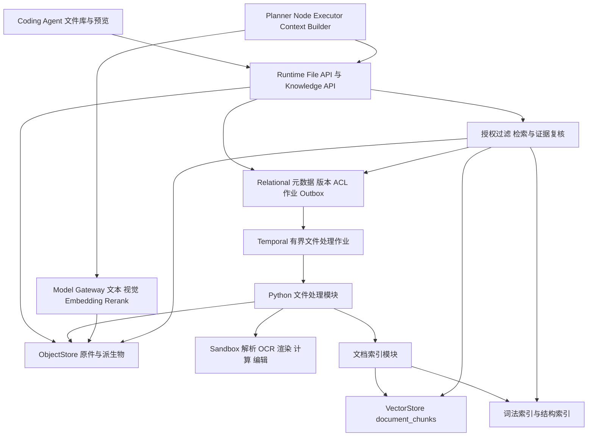
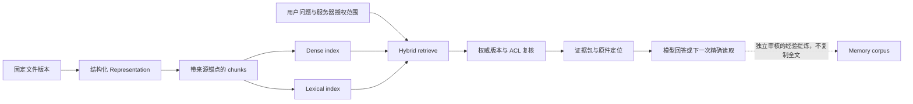
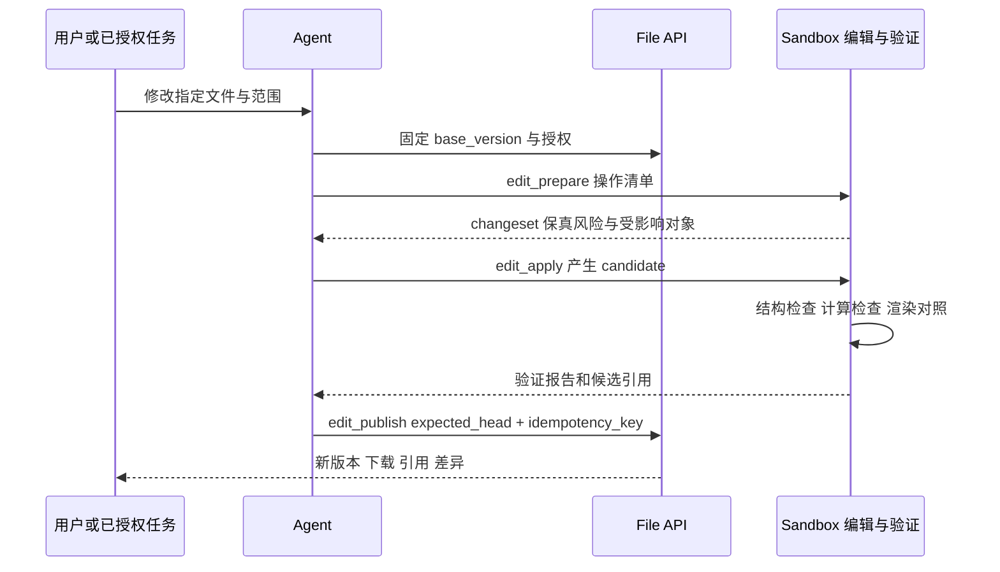

# Agent 文件工作台与文档智能架构设计

版本：设计稿 1.1 · 2026-11-10
范围：Agent Runtime 与 Coding Agent 的下一期文件能力。本文定义目标能力、底层模型、交互、工具契约和分期出口；除“现状”明确列出的项目外，均为拟议设计，不表示已经实现。本文是专项设计提案，合入现有主设计前按 S-01 审阅契约。

**核心决策：把文件从“聊天附件”提升为有版本、有权限、有结构、有计算能力、能编辑交付的工作对象。** 用户可以交给 Agent 一组 PDF、Word、Excel、PPT、图片和代码资料，要求查找、比较、分析、计算、修改并输出文件；每一步都能定位到原始证据，任务结束有可验证结果。

功能目标采取完整闭环，不停留在“多装几个解析库”。工程实现保持边界清晰：文件权威在 Runtime，原件与派生物在 ObjectStore，解析和计算在 Sandbox，所有模型经 Model Gateway，检索复用 VectorStore，Coding Agent 负责交互。文档知识与长期经验记忆使用独立语料和生命周期。

**阅读路线：** 先看第1–5节的产品目标与借鉴，第6–15节是架构和契约，第16–20节是预算、验收与实施出口。

## 1 设计原则与明确决策

| 决策 | 采用的做法 | 避免的失败 |
| --- | --- | --- |
| 一个文件权威 | Runtime 管文件身份、版本、授权和处理状态；应用层只保留可重建投影 | Coding Web 与 Runtime 对同一文件各说各话 |
| 原件不可变 | 编辑、转换、同步生成新版本或派生物；原件与解析结果分开 | 解析覆盖上传文件，历史引用随最新版漂移 |
| 能力分开表达 | stored、preview、read、search、compute、edit、export 分别报告 | “上传成功”被当成“已读懂” |
| 结构先于向量 | 页、段落、表格、单元格、幻灯片、图片区域先建立可定位结构 | 分块后无法回到原件、表格丢单位和公式 |
| 原生视觉与解析协同 | 文字走结构读取；页面视觉、图表、扫描内容按需渲染/OCR/看图 | 把所有文件截图耗费预算，或只抽文字漏掉图表 |
| 检索与计算分开 | 搜索发现证据；SQL/表格引擎完成精确计算 | 用相似片段猜总额、行数和公式结果 |
| 编辑有可验产物 | changeset → candidate → verify → publish new version | 只说“修改完成”，没有真实文件和差异 |
| 所有派生物有血缘 | 原件版本、处理器版本、参数、来源位置和质量记录可追踪 | OCR、模型解释与原始内容混淆 |
| 固定版本不固定权限 | Task pin 确保可复现；每次读仍检查当前撤权/删除状态 | 历史 manifest 成为绕过撤权的通行证 |
| 任务有结束条件 | 开始冻结产物、覆盖范围、预算和验收；未完成部分明确交付 | 不断索引、反复优化、无限派生子任务 |

本文的“激进”体现为完整覆盖读取、检索、计算、编辑和管理，不体现为默认开放所有文件、执行宏、隐藏部分失败或自动把资料写入长期记忆。

## 2 现状与需要补齐的能力

以下为当前代码基线，不能和后续目标混读：

| 层次 | 已有代码能力 | 本期缺口 |
| --- | --- | --- |
| 文件存取 | 同源上传/下载、来源列表、SHA 校验、任务 `source_ids`、显式复用；10 MiB/文件、10 文件/Task | 项目级文件库、版本、共享 ACL、删除回收、来源变更 |
| 文本读取 | `context_read` 可读取 UTF-8 附件，支持字符范围 | 格式识别、编码检测、语义结构、可靠来源锚点 |
| 图片 | PNG/JPEG/WebP typed refs、Gateway 授权解析、能力路由和独立预算已实现 | 页图/裁剪图的派生授权、OCR、区域读取和可点击引用；线上视觉模型启用仍需核验 |
| 二进制 | `attachment_import` 导入 task 隔离输入目录，供 shell 处理 | 默认解析器/渲染器和稳定能力目录；目前不保证 PDF/Office 可解析 |
| 检索 | Memory 已有 dense/sparse、Milvus/Qdrant 适配、embedding 和作用域过滤 | 上传文件抽取、分块、文档索引、页码/单元格引用、索引更新删除 |
| 编辑与交付 | 沙箱执行与文件交付机制存在 | 格式化 changeset、保真度等级、公式重算、候选版本和验证闭环 |
| UI | HeroUI Pro 对话、附件预览、来源与子智能体模块 | 文件库、结构导航、引用定位、解析覆盖、计算与编辑审阅面板 |

代码证据入口：[附件来源](../../../coding-agent/internal/server/sources.go)、[附件工具](../../services/py-worker/src/agentruntime_worker/tools/attachments.py)、[原生图片](../../services/py-worker/src/agentruntime_worker/executor/image_input.py)、[Gateway 图片授权](../../services/go-model-gateway/internal/gateway/images.go)、[VectorStore](../../libs/py-core/src/agentruntime_core/providers/vector_store.py)、[Memory 装配](../../services/py-memory/src/agentruntime_memory/wiring.py)。

**迁移不兼容点必须提前解决：** 当前文件元数据位于 Coding Web 的 JSON 文件；Task manifest 只有原件 URI 列表；Gateway 仅允许固定上传原件；没有完整删除 API；Memory Item 不是文档 chunk。这些不能靠给旧接口加几个 UI 字段掩盖。

## 3 借鉴了哪些 Agent 与平台

只借鉴公开文档能确认的能力，不把产品 UI 推测成其私有架构。来源核对日期为 2026-11-10。表中“本设计采用”是我们的工程选择。

| 编号与来源 | 公开机制 | 本设计采用 | 不照搬或不推断 |
| --- | --- | --- | --- |
| S01 [Codex 图片输入][S01] | 图片可作为任务视觉上下文 | 图片保持原生内容，文字指令说明使用目的；与引用关系一起进入任务 | 不推断 Codex 的内部对象存储和权限实现 |
| S02 [Codex Skills][S02] | 按需加载说明、脚本和参考资源 | 格式能力以轻量目录发现；格式工作流用 versioned skill，确定性操作由工具完成 | 不把 skill 当解析引擎，也不把所有说明一次塞进上下文 |
| S03 [Claude Code Read][S03] | 文本范围读取、图片视觉内容、PDF 分页、Notebook 单元与输出；其它二进制可转交 skill/shell | 统一读取入口＋格式专用 selector，先目录再局部读取；按页渲染用于视觉复核 | 不声称 Read 原生解析所有 Office 格式；不把其当前页数限制当我们的产品上限 |
| S04 [Gemini CLI 文件工具][S04] | 同一文件工具支持文本和多模态内容，并提供列表/写入等操作 | `file.read` 返回 typed parts 和结构定位，按内容能力分派 | 不要求切换到 Gemini，也不让模型接口决定文件权威 |
| S05 [Cursor Search][S05] | 当前 Instant Grep 在本机建索引与搜索，官方明确不为代码搜索存代码库 embeddings | 代码与符号搜索优先精确检索；探索子任务与主上下文分开 | 不采用“所有文件都必须先 embedding”的旧式假设 |
| S06 [Dify Classic Knowledge Pipeline][S06] 与[索引设置][S06b] | 明确区分提取、切块、索引；High Quality使用embedding，Economical走关键词索引 | 可观察的处理流水线、覆盖状态、索引发布和知识集合 | 不照搬其具体存储实现，不把“支持上传”理解为完整可编辑 |
| S07 [OpenAI Retrieval][S07] | vector store、属性过滤、语义与稀疏结果融合 | 文档检索接口、服务器过滤、dense＋lexical 混合召回、有限 Top K | 不绑定托管向量库，不混淆租户 ACL 与客户端过滤条件 |
| S08 [OpenAI File Search][S08] | Agent 可按需从已建立的文件知识库检索 | `file.search` 是模型工具，返回证据片段而非全文注入 | 不将 API 产品能力宣称为 Codex 默认内部行为 |
| S09 [LangChain Deep Agents Retrieval][S09] | loader、splitter、embedding、vector store、retriever 可分离；已有知识源可作为工具连接 | 内部解析/切块/检索接口可替换，避免一个框架包办文件系统 | 不必引入 LangChain 依赖，更不以框架状态替代 Runtime 状态 |
| S10 [Docling 格式][S10]与[文档模型][S10b] | 多格式转换和结构化文档表示 | 作为布局/表格抽取适配器候选，借鉴结构化 IR 思路 | Docling 是实现库而非 Agent；不把其输出当可无损回写的 Office 源文件 |
| S11 [DuckDB 数据导入][S11]与[Excel 扩展][S11b] | CSV/JSON/Parquet 等分析；Excel 使用对应扩展 | 数据计算后端候选，查询真实行数据并记录结果来源 | DuckDB 是执行引擎，不是向量库，也不是 Excel 公式重算器 |
| S12 [Claude 文件上传][S12] | 聊天与项目资料入口，按格式采取不同处理；非 PDF 文档抽取文字不代表读到嵌入图片 | 会话附件与项目资料分层、预览/文字/视觉覆盖分别报告 | 不沿用供应商套餐限额，不推断其私有 RAG 机制 |

我们的新增决策包括：不可变版本、结构锚点、独立文档语料、代次原子发布、撤权屏障、可逆编辑协议。这些是为现有多租户 Runtime 设计的机制，不归因于未公开的竞品内部实现。

## 4 用户要完成的工作与产品入口

### 4.1 六条完整用户路径

1. **读资料**：上传 PDF/Word → 看处理覆盖 → 按目录/页读取 → 提问 → 点击回答引用回到原页。
2. **查多份资料**：选项目文件或知识集合 → 精确/语义检索 → 对比版本和出处 → 给结论与冲突说明。
3. **算数据**：上传 Excel/CSV/Parquet → 选表和字段 → 运行查询/计算 → 返回结果表、图和可复跑记录。
4. **改文件**：指定 Word 段落、Excel 范围或 PPT 页面 → 产生候选新版本 → 结构和视觉检查 → 发布、下载或撤回版本指针。
5. **图文联合判断**：PDF 中的图表、扫描页、截图 → 局部视觉读取＋文字/数值证据 → 给出带区域引用的说明。
6. **协作与复用**：把文件授权给项目或本次任务 → 最小范围委派子 Agent → 收回权限、替换版本、重新索引 → 历史引用保持版本身份。

### 4.2 UI 信息架构

| 入口 | 内容与交互 | 默认行为 |
| --- | --- | --- |
| 输入框附件 | 文件选择、拖放、图片粘贴、历史来源复用、单文件状态和取消 | 本次 Task 的明确选集；粘贴文字保持原行为 |
| 会话来源栏 | 子 Agent 实际统计、使用中的来源版本、添加、查看全部 | 小列表，不展示全用户库；解析/检索状态不挤进工具标题 |
| 项目文件库 | 文件名、类型、版本、授权范围、处理覆盖、索引状态、引用任务、过滤搜索 | 列表为主，支持多选批处理；原件与输出可区分 |
| 文件预览抽屉 | 目录/页/工作表/幻灯片导航、原件与提取结果切换、区域选择 | 可定位引用，失败时显示摘录与下载入口 |
| 计算结果面板 | SQL/脚本摘要、输入范围、单位/空值规则、表格/图、导出 | 默认展示结果与口径，详细执行日志折叠 |
| 编辑审阅面板 | 修改前后、changeset、保真警告、重算/渲染结果、发布新版本 | 原件不覆盖；可逆发布按用户既有授权执行，不额外制造通用审批门 |
| 知识集合 | 选入文件、索引覆盖、更新策略、版本快照、查询质量 | 是授权资料的视图，不复制文件原件或自动扩大权限 |

采用现有 HeroUI Pro `PromptInput`、`ChatAttachment`、`Disclosure`、`CodeBlock`，文件库可选 `ListView`/`FileTree`，具体 API 在实现时再查版本。保留现有紧凑工具链和轻动效，不另造一套视觉系统。

运行过程按“公开说明 → 工具组 → 可用的小结果 → 下一步”组织。真实小结果包括已提取目录、发现的表、页缩略图、查询行数、候选差异；`queued` 或 `uploaded` 阶段不得生成“已读完”的文案。借鉴 [Codex App Server][S13] 与 [Claude 流式协议][S14]中独立文本块、工具项及终态的表达；上述具体展示节奏是本平台设计，不推断它们的私有前端实现。平台事件仍以自己的 Task/Node 契约为准。

## 5 文件支持矩阵

能力等级：**原件存取**不等于**结构读取**；结构读取不等于**原生视觉**；三者均不等于**可保真编辑**。下面是目标能力全集，不是当前承诺；发布等级在紧随其后的表中冻结，核心能力必须真实实现，条件扩展必须如实报告支持状态。

| 文件族 | 读取与定位 | 检索/计算 | 编辑与导出 | 主要实现路径 |
| --- | --- | --- | --- | --- |
| TXT/MD/源码/日志 | 编码、行范围、标题、代码块 | 精确检索优先；长说明文档可入混合索引 | 精确 patch、换行/编码保留、diff | 原生文本适配器；借鉴 S03/S05 |
| JSON/JSONL/XML/YAML | 结构路径、记录范围、原文本锚点 | 结构过滤；JSONL 可转查询表 | 受 schema 约束的 patch，保留原件 | 结构适配器，XML 禁外部实体 |
| CSV/TSV/Parquet | 字段类型、行组、分隔符、schema、抽样和范围 | SQL 过滤/聚合/连接、结果可复算 | 新表/CSV/Parquet 输出，不依赖语义召回计算 | DuckDB 等沙箱后端；S11 |
| PDF 文字版 | 页、段落、表格、bbox、嵌图、阅读顺序 | 文字与页级检索；表格需复核 | 注释、标记、拆分/合并、派生报告；不承诺任意重排版文字无损编辑 | 文字提取＋页面渲染；S03/S10 |
| PDF 扫描版 | OCR 文本、页图、置信度、低质量区域 | OCR 检索＋原图复核 | 标注/OCR 文本层/派生文件；原扫描件保留 | 按页 OCR 与视觉；S03/S10 |
| DOCX | 标题/段落/run/表格/页眉页脚/图片/批注/修订存在性 | 结构与混合检索，原图按需读取 | 受支持对象定点修改、追踪差异、渲染校验、新 DOCX | 专用 OOXML 适配器＋渲染器；S02仅借鉴工作流组织 |
| XLSX | 工作表、命名区域、单元格、公式、缓存值、格式、隐藏行列存在性 | 范围/SQL/计算；表和图分开 | 范围 patch、公式、样式、新工作表；可用引擎重算后验证 | openpyxl 类结构适配器＋计算/渲染后端；S11 |
| PPTX | slide/shape/text/notes/table/chart/image、布局坐标 | 文字检索与逐页视觉读取 | 受支持形状/文本/图片/表格修改、新版 PPTX、PDF/图片导出 | 专用 OOXML 适配器＋页面渲染；S02为工作流借鉴、S10为解析候选 |
| PNG/JPEG/WebP | 元数据、尺寸、原生看图、区域裁剪、OCR | OCR/说明用于文字检索；视觉结果始终关联原图 | 裁剪、缩放、标注为派生图；生成式编辑是单独模型能力 | 复用 native image input；S01/S04 |
| GIF/TIFF/HEIC/SVG | 转换器可用时生成静态预览/帧；原件保留 | 单独帧/文字片段，明确覆盖范围 | 受控转换/导出；SVG 不直接执行脚本 | 能力协商的转换适配器，不假装已有原生支持 |
| HTML/EPUB/RTF/ODT | 清洗 DOM/章节/段落/表格；远程资源默认不取 | 文档检索与章节引用 | 标准化导出或受支持格式 patch；复杂样式可降级 | 转换适配器，隔离渲染 |
| IPYNB | cell ID、代码/Markdown、输出与图片 | 单元定位；执行是单独操作 | 单元 patch、在指定沙箱执行并记录依赖 | Notebook 适配器；借鉴 S03 |
| ZIP/TAR 等归档 | 先列清单，按需提取，记录 archive-member 链 | 提取后按各文件类型处理 | 新归档，不原地危险覆盖 | 解压目录/数量/展开字节限制，拒路径穿越 |
| DOC/XLS/PPT 老格式 | 转换能力存在时只读导入为派生新格式 | 转换后可检索/计算，报告损失 | 导出新格式；不承诺原格式保真回写 | LibreOffice 等转换容器，单独适配验收 |
| 音频/视频、邮件/云盘同步 | 预留 transcript/timecode/connector 类型；目前只管理原件 | 独立后续发布范围 | 不计入本期退出条件 | 不因某供应商支持就隐式宣称平台支持 |

发布等级与验收映射：

| 等级 | 格式/操作 | 里程碑与验收 |
| --- | --- | --- |
| 必须交付 | TXT/MD/代码、JSON/JSONL、CSV/TSV/Parquet、PDF文字与扫描、DOCX/XLSX/PPTX、PNG/JPEG/WebP | M1读取/M2检索/M3声明范围的编辑计算；第17节对应核心场景必须通过，不能仅返回unsupported就宣布完成 |
| 必须交付 | Notebook读取与受控执行、ZIP/TAR安全清单与提取 | M1只读、M3执行；第17节Notebook/归档场景 |
| 条件适配 | XML/YAML、HTML/EPUB/RTF/ODT、GIF/TIFF/HEIC/SVG、DOC/XLS/PPT导入转换 | M1冻结默认安装集；对每个宣布enabled的适配器验证最小读取/定位/导出与损失报告，其余准确unsupported，不阻断核心发布 |
| 后续单独发布 | 音视频处理、邮件/云盘同步、生成式图片编辑 | 不进入M0–M4验收，不在本期后台偷偷启动 |

表中格式标记由 `file.inspect` 返回真实部署能力；没有安装的后端明确 `unsupported`。宏、外部工作簿链接、Notebook 执行、自动联网是独立权限，绝不随“读文件”自动启用。

## 6 底层服务边界



| 责任 | 部署归属 | 不承担什么 |
| --- | --- | --- |
| File Catalog / Access | 先作为 `go-task-service` 内部模块＋共享数据表 | 不执行解析器，不把应用服务器本地盘当原件库 |
| Knowledge / Retrieval | 首版在 `py-memory` 进程中注册独立 `KnowledgeService` 与 sibling package，复用Python VectorStore/embedding；负载证明需要时再拆部署 | 只共享进程与Provider，不共享Memory Item、RPC或文档/经验生命周期 |
| File Processing | `py-worker` 独立任务队列和模块；确定性编排＋activity | 不在 workflow 里读文件、运行解析器或调用模型 |
| Parser/Renderer/Editor | 版本固定的 Sandbox 镜像中的适配器 | 不允许供应商库散落在 Planner/Go API 业务逻辑里 |
| Computation | 沙箱内的可取消、有配额执行后端 | 不用模型生成的结论替代真实计算输出 |
| Model Gateway | 原生多模态、embedding、计量、限流和模型路由 | 不成为全部文档解析的唯一入口 |
| Coding Web | 身份与应用会话映射、API 代理、UI、用户操作意图 | 不保留第二份不可恢复的文件权威 |

Go File API经独立Knowledge RPC访问Python检索模块；处理Worker通过同一接口登记generation。这样遵守现有VectorStore仅Python接口的事实，同时避免起步就增加新的服务部署。

`FileProcessor`/`Renderer`/`Editor` 首先是 Worker 内部适配接口；复用现有 Sandbox、ObjectStore、Relational、VectorStore、ModelProvider，不默认新增“第十四种核心 Provider”。只有需跨语言共享或独立部署的接口才走 S-01 升级。

## 7 统一文件与证据模型

### 7.1 主要实体

| 实体 | 核心字段 | 不变量 |
| --- | --- | --- |
| `File` | `file_id, tenant_id, owner_id, workspace_id, name, head_version_id, lifecycle, acl_revision, revocation_epoch` | 逻辑身份可改名；ID不由路径或文件名决定 |
| `FileVersion` | `version_id, file_id, blob_ref, sha256, size_bytes, detected_mime, created_by, created_at, parent_version_id, origin` | 原始字节不可变；`head` 只是可变指针 |
| `FileGrant` | `principal, file_id, actions, expires_at, grant_revision` | 文件权限≠知道 blob URI；禁止跨租户继承 |
| `SessionSource` | `session_id, file_id, selected_version_id, added_by` | 会话来源是关联关系，不再复制原件 |
| `TaskFilePin` | `task_id, manifest_version, version_id, allowed_selectors, allowed_actions, derived_policy, snapshot_id` | 提交时固定版本和最小能力；读取仍受当前撤权控制 |
| `Representation` | `representation_id, root_versions, captured_epochs, kind, processor_digest, selector_digest, options_digest, blob_ref, content_hash, coverage, warnings` | 发布后内容与coverage不可变；相同处理身份可复用 |
| `DocumentBlock` | `block_id, representation_id, kind, parent_id, order, text_ref, source_anchor` | 解析文本与页/表/图片关系保留 |
| `Dataset` | `dataset_id, source_version_ids, schema_ref, row_identity, table_refs, semantic_rules` | 明确单位、空值、精度与时区；记录与原来源对应 |
| `IndexGeneration` | `generation_id, collection_id, pinned_versions, parser_config_digest, chunker_digest, embedding_version, status` | 全量构建与查询发布分开，不混代 |
| `Computation` | `run_id, input_versions, selectors, code_ref, engine_digest, parameters, result_refs, checks` | 相同输入和环境可追查；生成结果不是原数据 |
| `ChangeSet` | `changeset_id, base_version, operations_ref, expected_hashes, candidate_version, verification_ref` | 发布前检查 base/head 冲突；不覆盖原件 |
| `EvidenceRef` | `evidence_id, version_id, representation_id, selector, quote_hash, derivation, coverage` | 引用始终指向具体版本和来源位置 |

原件在租户内按 SHA 去重；不同用户/文件可共享物理 blob，但授权仍基于 File/Version。禁止跨租户去重命中信息向用户暴露文件是否存在。关系数据库存身份和状态；正文、IR、渲染页、计算表、diff 等大内容存对象库。

表中 `tenant_id` 表示概念所有权/请求作用域，不是要求应用SQL增加租户列。关系表继续通过 `RelationalStore.bind(tenant)` 隔离，SQL不写租户列或租户过滤，遵守现有可移植类型与全域migration版本。VectorStore的`tenant_id/scope`也是保留字段，由绑定实现注入；业务payload仅保存file/version/generation/ACL等允许字段。

### 7.2 SourceAnchor 定位规范

```json
{
  "file_id": "file_x",
  "version_id": "ver_3",
  "representation_id": "rep_pdf_v2",
  "selector": {
    "kind": "pdf_region",
    "page_index": 11,
    "bbox": [0.12, 0.18, 0.88, 0.42],
    "coordinate_space": "normalized_top_left_after_rotation"
  },
  "quote_hash": "sha256:...",
  "derivation": "native_text",
  "coverage": "complete_for_selection"
}
```

公共 selector 类型：`text_range`、`document_block`、`pdf_region`、`sheet_range`、`slide_shape`、`image_region`、`notebook_cell`、`archive_member`。`page_index/slide_index` 内部统一从 0 起，UI 展示从 1 起；工作表使用稳定 sheet ID，A1 只是可读坐标；文字 offset 明确使用 Unicode code point，浏览器 UTF-16 由适配层转换。

bbox 使用旋转后的页面坐标，另存原始宽高和变换矩阵。DOCX 原件页码并不稳定：引用以原结构 block 为主，渲染后的页码是特定 renderer/font/profile 下的派生定位。重解析可能改变 block ID，因此 EvidenceRef 固定 representation；跨解析版本重定位必须匹配原选区/hash，不能静默漂移。

`derivation` 区分原生提取、OCR、公式计算、模型描述和人工注释。模型描述不是原文，OCR 不确定字段不伪装成精确引用。借鉴 [Claude 的局部读取][S03] 与 [检索结果携带文件来源][S08]，坐标与版本机制为本平台设计。

### 7.3 任务快照与尚未就绪的派生物

新增 `TaskInputSnapshot`：冻结具体版本列表、`collection_revision`及其成员版本、允许selector/actions、处理器/options/chunker/embedding身份。一次Task不能随知识集合的`latest`或索引`active_generation`漂移；查询明确使用该snapshot。

提交时索引尚未就绪，可建立 `pending` derivation slot，记录预期处理身份和选区；作业完成后只允许一次CAS绑定到不可变representation/index generation和coverage。读取时只使用已绑定结果；预算耗尽则返回未就绪或明确partial，不能临时切到别的版本。用户要求重新解析/新增资料时建立新的显式操作binding并记录变更，而非原地改写旧pin。

Representation 的 partial 产物也不可变：每次分页/OCR续作创建独立fragment；合并产生新的aggregate representation，并保留fragment血缘。旧EvidenceRef仍定位旧representation。API重试idempotency key、可复用处理身份、continuation ID三者分开；处理身份包含selector/选区和处理配置，不能让两段不同页范围命中同一错误缓存。

多来源产物（比较报告、连接表、聚合结果、索引摘要）记录全部 `root_versions` 与 `captured_epochs`。默认有效权限为所有根权限的交集；读取、模型resolve、对外发布均复核全部根。任一根撤权即禁止旧作业发布与后续访问；经过单独授权的脱敏/发布策略才可改变此默认。

## 8 文件处理流水线与状态

### 8.1 上传与版本发布

1. 建立 UploadSession，预留配额、关联用户/workspace/idempotency key。
2. 标准档目标为单文件50 MiB、每Task10文件/合计200 MiB；容量策略单独协商并分阶段激活。现运行10 MiB限制在代理、传输、Worker和配额链路验收前仍有效。最终commit一律由服务端验证大小/SHA/MIME；不能只改前端提示。
3. 创建不可变 FileVersion 和 source 关联；重复 commit 对账并返回同结果。
4. 数据库事务写处理 Outbox；异步执行识别/预览/抽取。对象库成功而 DB 失败留下可回收孤儿，不能先显示“已入库”。
5. Task 提交原子固定选定 version，随后经 admission outbox 启动工作流；“任务已启动但 pin 未建立”是禁止状态。

### 8.2 状态分层

- 文件生命周期：`active → trashed → purging → purged`；恢复只在 `trashed` 且物理内容仍保留时允许。
- 每项处理能力：`not_requested / queued / running / ready / partial / failed / unsupported / cancelled`。
- 索引发布：`building → validating → published`，或 `failed/cancelled/superseded`。
- 编辑：`prepared → applied_candidate → verifying → verified → published`，冲突/失败为独立终态。

UI 不用一个总进度条掩盖不同状态。例如原件可以已上传、PDF 文本已读、80/100页 OCR 完成、索引尚未发布。失败返回稳定错误码、受影响区域、是否可重试和已有可用产物。

### 8.3 幂等、取消与重试

可复用处理身份为 `(tenant_scope, root_versions, processor_digest, selector_digest, options_digest, operation)`；chunk 和派生对象 ID 可确定性生成。Temporal 负责作业恢复，不再额外发明一套独立任务调度器。API Job ID 映射工作流/run，物化状态由事件投影产生。

每项 activity 最多 2 次 transient 重试，受总预算限制；`unsupported`、鉴权拒绝、确定损坏、缺解析器不重试。区分可复用派生结果、一次ProcessingJob执行和TaskJobSubscription：Task取消只取消自己的订阅、预算续租和后续步骤；最后一个消费者退出，或文件被撤权/删除时，才取消共享job。已有文件库主动索引订阅必须具有独立owner、deadline和预算，不能成为脱离Task限制的永动后台任务。费用由job的创建方预算预留并结算；缓存复用只记复用成本，不向多个消费者重复收同一次解析成本。

取消确认前，已写内容登记为未发布候选或回滚。发布对象/向量后，`revocation_epoch/tombstone`复核与DB publication CAS在同一事务中执行；竞争失败的对象/向量留为未发布孤儿，由对账GC回收，防检查与发布之间删除造成内容复活。

## 9 格式解析、渲染与能力注册

### 9.1 内部适配接口

```text
inspect(version) -> detected_type, structure_outline, capability_matrix, warnings
extract(version, selector, options) -> representation_ref, blocks, coverage
render(version_or_representation, selector, render_profile) -> images + anchor_map
query(dataset_snapshot, query_spec) -> result_table + provenance
apply(base_version, changeset) -> candidate_version + preservation_report
verify(candidate, base, criteria) -> verification_report
```

每个后端登记版本 digest、输入格式、可读结构、编辑对象、渲染能力、公式能力、所需 CPU/GPU/内存、最大负载、许可证/供应链审查结果。运行前检查实际沙箱能力；不让 Agent 随机安装依赖成为默认成功路径。

### 9.2 推荐适配组合

| 场景 | 推荐起点 | 选择理由与边界 |
| --- | --- | --- |
| PDF 基础读取 | pypdf 快速元数据/文字读取＋Poppler 页渲染 | 简单文字页不必启动重型布局流水线；页锚点与字形/阅读顺序异常触发升级 |
| 复杂 PDF/表格 | Docling 标准PDF流水线，确定为主布局后端；Poppler作为独立页面渲染器 | Docling负责阅读顺序/段落/表格/图关系，渲染图和坐标统一映射到SourceAnchor；输出映射到平台IR，不泄漏库类型到API。[S10][S10b] |
| OCR | RapidOCR＋ONNX Runtime CPU，模型预置的离线镜像 | 先支持中文/英文，按页/区域执行，记录语言模型、bbox、置信与耗时；不默认云OCR或整库重复OCR。[S15][S16] |
| DOCX/XLSX/PPTX | 专用 OOXML 适配器 | 读/写结构比统一纯文本更可靠；使用 python-docx/openpyxl/python-pptx 类库前验证保留对象，不等于无损 |
| Office 渲染/重算 | 独立 LibreOffice 或许可允许的 Office 引擎容器 | 环境字体和版本固定；重算能力单列，第三方库写公式不代表已计算 |
| 表格数据分析 | DuckDB＋可控 Python 计算 | 读 CSV/Parquet/JSON，XLSX 由结构适配器或固定[Excel扩展][S11b]接入；禁止运行中联网安装扩展。[S11] |
| Notebook/归档 | 轻量专用适配器 | 保留 cell/member identity；读取不执行，执行另走工具与 effect |

本轮已冻结PDF与OCR后端方向，后续验证只决定版本/参数/覆盖与是否达到发布门，不重新进行无止境的后端竞赛。新增运行依赖进入现有依赖审核流程。准确包版本、模型文件SHA与字体digest在首个合格镜像构建时登记；不能用未构建验证的版本号假装已可复现，也不把某库支持格式等同全部复杂对象无损。

### 9.3 IR 不能成为唯一真相

IR 保存可理解结构，不取代源文件格式。原件 OOXML 包中的未知部件、关系、批注、图表或嵌入对象应尽量保留。IR 到文档的重建只用于明确允许重排版的新文件；修改既有文件优先定点 patch。解析器升级创建新 representation，不改变旧引用。

## 10 统一 Agent 工具面

借鉴 [Codex Skills 的渐进加载][S02]、[Claude/Gemini 的文件读取入口][S03][S04]、[OpenAI 的按需文件检索][S08]。命名是本设计建议，正式 wire 名称在 S-01 冻结；不向模型注册不存在的工具。

| 工具族 | 操作 | effect / 约束 |
| --- | --- | --- |
| `file` | `inspect`, `list`, `read`, `search`, `render`, `open_region`, `compare` | read；派生缓存写入是平台处理副作用，需作业幂等与配额，不修改用户原件 |
| `table` | `schema`, `sample`, `query`, `compute` | 只读输入、隔离临时计算；外部写入另授权 |
| `document` | `edit_prepare`, `edit_apply`, `edit_verify`, `edit_publish` | 产生新版本为 write_reversible；覆盖外部系统另经 gate |
| `knowledge` | `collection_inspect`, `search`, `index_status` | 仅已授权集合/固定快照；索引构建是受控平台操作 |
| `source` | `attach`, `detach`, `reuse`, `grant_to_child` | 必须核验文件当前 ACL；模型不能创造权限 |
| `artifact` | 复用现有 `deliver_file` 并登记候选/最终版本 | 用户可下载的真实产物，不能仅生成路径文本 |

effect 冻结原则：只读工具允许生成内容寻址的内部派生缓存或隔离临时计算结果，但不能改变用户文件head、集合成员、授权或发布可下载产物。`table.compute`的临时执行按read输入处理；将结果登记为持久Dataset/FileVersion、集合增删/索引发布、source attach/detach、child grant、export/交付属于独立 `write_reversible` 操作并带幂等键。永久删除或不可逆外发按 `write_irreversible` 和既有gate处理。由平台固定的只读selector处理可在受限派生目录写缓存，不能借read授予模型任意文件写权限。

所有返回使用统一外壳：

```json
{
  "operation_id": "op_...",
  "status": "ready",
  "source_version_ids": ["ver_3"],
  "parts": [{"type": "text", "text": "本次读取的有限内容"}],
  "evidence": [{"evidence_id": "ev_...", "version_id": "ver_3", "selector": {"kind": "sheet_range", "sheet_id": "s1", "range": "B2:F20"}}],
  "coverage": {"requested": "B2:F20", "processed": "B2:F20", "omitted": []},
  "warnings": [],
  "next_cursor": null,
  "usage": {"bytes_read": 4096, "model_tokens": 0}
}
```

`file.read` 不会因为原件大就输出全文；默认有限页/行/单元，返回分页与遗漏。`partial` 是成功读取的局部结果，不是“全部已完成”。Agent 必须在最终答案对用户要求的覆盖范围负责，而不是以一次工具成功当任务完成。

`file.render/open_region` 返回受授权的派生图片引用，由 Context Builder/Model Gateway 注入 typed image parts；**不能把图片工具结果转成 URL 字符串交给模型就声称看到了页面**。该行为需要扩展当前仅原件上传白名单的派生授权机制。

## 11 Dense 与混合检索框架

### 11.1 不是每个文件都入向量库

| 意图 | 优先路径 |
| --- | --- |
| 指定第 12 页/某段/某单元格 | 结构 selector 直读，不 embedding |
| 找函数名、错误码、订单号 | 精确/词法检索优先；借鉴 Cursor 当前做法。[S05] |
| 多份规范中找同义规定或背景 | dense＋lexical 混合召回，再按来源复核 |
| 比较两版文件 | 按结构/哈希 diff，再解释差异 |
| 求和、统计、去重、连接 | table query/compute，不用RAG估算 |
| 看图表或扫描区域 | 先定位页/图，再视觉/OCR |

默认小型会话附件按需解析、直读即可；只有显式加入知识集合、文件过大需要多轮检索或任务明确要求跨文件查找时才触发索引。阈值是可配置策略，不是“每次上传强制计 embedding 费用”。

### 11.2 原件、索引、记忆的关系



原件/IR 是事实来源，向量是可重建加速层。文档使用 `document_chunks`（逻辑 corpus），Memory 保持现有 `memory` corpus。复用 Provider 与运行设施，不复用 Memory Item 的标题/guidance/promotion 语义。现有 Memory sparse 实现不必然等于 BM25；第一版明确记录 lexical 后端与算法，不能换名宣传。

### 11.3 分块与索引身份

按文档结构切块：段落带所属标题；表格保留表头/单位与行区间；PDF 保留页跨度；代码保持符号/路径边界。巨表不把百万行逐行 embedding，索引 schema/字段说明/表级概要，实际数值通过查询获取。

建议初始 chunk 目标 600 tokens、上限 1000、最多 80 overlap，作为可调整的工程初值；表格和代码不能为了达字符数切坏语义。LLM 补上下文的 chunk enrichment 单独预算、单独派生标签，未默认开启。

```text
physical_vector_id = hash(tenant, file_version_id, representation_id,
                          chunk_id, embedding_version, index_generation)
```

必须包含 embedding version 与 generation：现有 `VectorStore.get/delete` 按 ID 操作，不能假设同 ID 的多个模型版本可独立更新或删除。维度不同的模型使用不同物理集合，逻辑 corpus 负责路由；禁止跨 embedding 空间直接比较分数。

### 11.4 查询、发布与降级

1. 服务端根据身份、Task pins/集合快照、action、有效期计算允许范围，客户端只能收窄。
2. 分别召回 dense/lexical 候选；建议各 40 条，RRF 合并，最多 20 条进入可选 rerank，最终 8 条且受上下文预算截断。这些是默认配置，不是固定质量承诺。
3. 每条结果回数据库复核 FileVersion、当前 ACL、tombstone、generation，再取正文和锚点；不能直接信向量 payload 中的旧权限。
4. 精确查询高优先级匹配不得被语义重排淹没；金额/公式/日期关键结论调用局部读取验证。
5. 回答引用带版本与锚点。检索不足返回 coverage/未命中，不把“不在Top K”写成“文件不存在”。

新代索引后台构建、校验覆盖后，在数据库事务切换 `active_generation`。新Task据此建立固定输入快照；运行Task始终使用第7.3节绑定的代次，单次查询也固定相同snapshot。旧代为仍持有pin的任务保留，并支持短期回滚。只发布部分覆盖时必须显式版本化 coverage，不把未完成新代替换完整旧代。

VectorStore 不可用时可降级到授权原件的精确读取/词法搜索，标明降级；embedding/rerank 不可用不触发无限重试。处理/索引/检索分层及dense/lexical混合召回借鉴 [OpenAI Retrieval][S07] 与 [Dify索引设置][S06b]；generation原子发布、事务与权限规则由本平台定义。

## 12 表格计算与可复现分析

一条分析请求必须记录：源版本、工作表/表范围、字段类型、空值/重复值规则、货币与单位、日期时区、精度、筛选条件、代码/SQL、引擎版本、输出摘要和文件引用。用户未给口径但存在多种合理结果时，列出选择或用明确标注的默认值，不能默默混算。

selector授权必须落实到物理输入：只有某张sheet/区域权限的子任务获得物化的受限Dataset或裁剪后的派生副本，只读挂载；没有`read_original`就不能获得完整XLSX、原blob或含其它sheet的OOXML包。`shell_run`、`attachment_import`、任意Python执行遵守同样的挂载与访问限制，不能绕过table工具。公式引用越过授权选区时返回缺依赖，不能偷偷补读整份工作簿。

`table.query` 只允许受控只读表访问；防止 SQL 借文件函数、扩展安装或网络函数读取任务以外内容。引擎禁运行期`INSTALL/LOAD/ATTACH`以及指向授权目录外的文件读取/`COPY`，扩展和表函数用白名单约束；仅限制SQL动词为SELECT是不充分的。复杂 Python 计算仍在 Sandbox，可取消、有 CPU/内存/输出限制。执行成功只证明程序运行，需核对行数、空值、抽样和总量守恒等业务条件。

XLSX 分离 `formula`、`cached_value`、`evaluated_value` 与 `calculation_status`。没有真实引擎执行就标记 `not_recalculated`。外部工作簿引用和宏默认不执行；用户授权时另建有依赖说明的执行任务。图表、透视表与条件格式的保留/刷新能力按后端声明，不能用 openpyxl 写成功等同 Excel 全功能重算。

借鉴 [Claude 把 XLSX 与代码执行关联][S12] 的能力分层；采用 [DuckDB][S11] 类引擎完成数据查询，而不是依赖模型心算。

## 13 文档编辑与回写协议

### 13.1 操作与发布



`ChangeSet`在prepare时冻结 `required_fidelity`、允许损失对象、目标范围与验收项digest。可逆新版本发布在用户已授权的编辑范围内执行，不要求每次另点确认。删除、外发、覆盖远程系统等按操作本身的授权与 gate 处理。`expected_head` 不匹配返回冲突，给基线/当前/候选三方差异，不自动覆盖同事的新版本。

### 13.2 保真度等级

- **L0 导出重建**：仅承诺声明的数据/文本内容，明确样式可能变化。
- **L1 结构保留**：指定结构和关系保留，复杂未知对象需警告或拒绝。
- **L2 定点编辑**：未选中对象必须保持，核对包关系、公式、样式、媒体和渲染差异。

每个格式/操作单独声明支持等级，不能把整个“DOCX 支持”写成 L2。检测到无法保留的嵌入对象、修订或特殊图表时，优先输出受限 changeset/新文件并说明具体损失，不能悄悄删掉对象。

发布事务核验候选内容hash、base/head、验收criteria digest和verification通过状态，不能拿另一个候选的报告发布当前文件。达不到原要求时只能交付候选并标任务未完成，不得通过添加warning把L2请求自动降成L0成功。

各级验证：所有级别检查可打开、目标内容/计算正确、来源可追溯；L0按批准的重建范围验证，样式变化不作“非目标不变”承诺；L1核对声明保留的结构/关系；L2额外要求目标之外对象、公式、媒体和关键版面不变。按操作需要进行页面渲染。渲染差异是检测线索，不承诺无阈值逐像素一致；字体、引擎与页面尺寸固定并记录。

## 14 多模态上下文、任务引用与子智能体

任务启动时模型获得轻量目录：文件名、版本、类型、可用能力、结构摘要和覆盖。小型明确图片可沿现有原生路径加入；大 PDF/长文档只给目录，按需读取区域。按操作把返回的 text/image/table typed parts 放入上下文，不把 IR/整库/Base64 塞进聊天记录。

Context Builder 压缩保存 `EvidenceRef` 与已验证观察，不把 OCR/模型说明提升为原始事实；历史已清理时可以据锚点重新读取。缓存键至少包含原件版本、representation、selector、parser/model/embedding配置、权限版本及操作参数；v1 的附件任务绕过旧结果缓存，待新键验证后再启用缓存。

当前 Gateway 只允许 Task manifest 中的上传原件，因此 PDF 页图/裁剪图需要派生物授权：服务端保存 `derived_from + transform_digest + selector + creating_operation`，并证明根原件属于 Task pin。模型不能自行构造任意 ObjectStore URI。撤权检查沿血缘回到原件。

子 Agent 只得到父任务明确委派的版本、selector 和工具能力子集。委派生成服务端可验证的 child grant；父任务撤权/取消传播到 child。子 Agent 返回证据与候选产物，默认不改 project head；父任务合并冲突、验证并交付。当前代码刻意清空子 Agent attachments，这一行为在本期 M4 通过版本化契约升级，不能直接删除隔离检查。借鉴 [Cursor Explore 子 Agent 的独立上下文][S05]，权限继承机制为本平台设计。

跨 Task 的“上一份文件”由会话来源关系解析，服务端再次确认授权和选定版本后建立新 pin；UI展示复用了哪个版本。默认不自动引用整个会话文件库，更不默认获得用户所有项目文件。

## 15 授权、删除与恢复

### 15.1 权限动作

区分 `view_metadata/read_original/read_extracted/render/search/compute/edit/create_version/share/delete`。读取原件不自动授权外发或修改；知识集合不能放大成员文件的权限。索引过滤、预览、下载、模型图片解析、计算挂载都使用相同授权判定。

原始附件、OCR、文件名、Notebook 输出、SQL结果中的文字都是数据；不能执行其中的“系统指令”。解析和渲染容器禁网络、宏、XML外部实体、自动链接刷新；需要网络的转换必须作为独立能力声明与授权。HTML/SVG预览沙箱化，解压限制成员路径、深度、总展开字节，防止越界写入。

### 15.2 删除不是只删向量

删除事务首先写 tombstone、递增 `revocation_epoch` 并发出 Outbox。新 read/search/model-resolve/preview/download 立即拒绝；查询结果即使从旧索引回来也被权威复核挡住。后台再清理向量、词法索引、IR、预览、OCR、缓存与原始 blob 引用；共享 blob 仅在租户内引用计数归零后回收。

在途 parser/indexer/editor 发布前复核 epoch，旧作业不得重建已删内容。活跃任务在下一个文件使用/模型调用检查点停止使用撤销文件；已经提交给上游模型或已经交付用户的副本不能被“远程抹除”。沙箱 `.agent-inputs`、历史摘要、已有下载和保留日志有单独留存/清理规则，UI不声称逻辑删除等于所有副本瞬间消失。

普通删除后回收站保留30天；恢复创建新grant/index publication，不自动恢复旧项目共享，也不撤销历史审计。永久删除可显式触发；有效原件和被Task/Evidence引用的版本不自动过期。未commit上传/无归属孤儿24小时后回收，未被任何活跃快照或引用依赖的可重建派生缓存30天未用后回收。详细规则见第20节；这些是冻结的产品政策，尚未实现的清理任务不得宣称已经生效。

### 15.3 索引权限一致性

ACL缩小：立即提升revocation epoch并拒绝旧授权，异步删/改索引；ACL扩大：权威grant先生效，索引元数据随后更新，期间允许漏召回但不越权。查询结果回传和构建模型上下文前再校验；长时间stream已发出的数据不承诺召回。

## 16 有界执行、成本与可观测性

以下是设计初值，实施时进入统一配置和能力响应；修改阈值不应改工具语义。

| 项目 | 初始规则 | 到限出口 |
| --- | --- | --- |
| 上传 | 冻结标准档50 MiB/文件、10文件/Task且合计200 MiB、500文件/2 GiB会话；项目文件库上线后原件配额10 GiB/项目 | 统一限额协商与quota commit；传输验收前沿用10 MiB，不只改单处常量 |
| 一次读取 | 最多10页、10k tokens或约2k表格单元，按先到限制截断 | 返回cursor/coverage；Agent按目标继续，受Task总预算约束 |
| 页面渲染 | 一次最多10页，最大像素沿用native image policy | 返回明确剩余页；不自动渲染全部文档 |
| 交互解析 | 同步等待≤3秒；超时转job handle | 展示处理中与取消，不阻塞聊天连接 |
| 后台解析/OCR | 初始10分钟/文件；OCR≤50页/次作业，可显式续作 | partial＋checkpoint＋未处理页清单 |
| 检索 | 双路各40候选、最终最多8证据片段，最多2次查询改写 | 输出证据不足或请求更具体范围 |
| 表格查询 | 默认30秒、2 GiB内存、返回最多1000行；完整结果外置 | 超限返回可下载结果或明确失败，不伪造截断总数 |
| 编辑验证 | 每候选最多2次自动修复，原任务deadline/费用上限优先 | 交付最后可验证候选与未达项，不反复美化 |
| 并行作业 | 默认Task最多4个文件子作业；队列有租户配额 | 排队或拒绝，不无限spawn |

目标SLO（待压测，不表示现已达到）：缓存命中局部读取 p95≤1秒，20份中等文档混合检索 p95≤2秒（不含模型生成）；删除权威屏障在事务提交后立即有效，在线派生物清理在健康服务下15分钟内完成，延误可见并重试。PDF/Office首次解析耗时按格式和页数报告分位数，不能承诺一刀切。

指标：上传/解析/渲染/索引/查询耗时与失败码，覆盖率，OCR低置信区域，索引staleness，检索命中与引用正确率，预算/取消命中，按操作的成本与缓存命中率。日志只记对象ID、版本、数量、耗时和错误分类，不默认记正文、Base64、访问令牌。详细内容留在有权限的产物中。

## 17 端到端场景与验收标准

| 场景 | 必须观察到的真实行为 | 不通过条件 |
| --- | --- | --- |
| 30页文字PDF问第12页定义 | 按页取证，回答引用打开准确版本/页/区域 | 只返回文件首页或引用到另一版本 |
| 20页扫描PDF含低清区域 | OCR覆盖与置信可见，关键字段回看原图 | 空白OCR被当无内容，未处理页被标完成 |
| 两份DOCX规范冲突比较 | 对应标题/段落定位，列差异与版本 | 只给主题相似摘要，不指出冲突出处 |
| 10万行CSV按条件汇总 | 查询引擎真实执行，记录单位/空值/行数，重复运行一致 | 从Top K片段估算总额 |
| 多sheet XLSX修改公式 | 保存formula与旧值，真实重算或明确未重算，非目标sheet保留 | 写完公式即宣称计算正确 |
| PPTX改第3页文本和图片 | shape范围修改，新版本可打开，render比对不影响其它页 | 重建整份导致动画/备注/图表静默丢失 |
| 截图与PDF图表联合问答 | 局部图像实际进入模型请求，结论含对应区域引用 | 模型只收到URL/文件名却声称看见图 |
| ZIP带路径穿越/高压缩比文件 | 先清单，异常成员拒绝，受限总展开大小 | 提取到任务目录外或耗尽资源 |
| Notebook只读与执行 | Read不执行cells；Execute明确环境并记录新输出版本 | 上传即触发代码执行 |
| 跨20份资料查同义条款 | hybrid召回、ACL复核、版本与锚点可读 | 多租户结果混合或靠文件名猜来源 |
| 索引升级中并发查询 | 每次查询命中单一发布快照，旧代可读可回滚 | half-built新代出现/embedding空间混用 |
| 解析/索引途中删除来源 | 新查询立刻不可见，迟到job不能复活数据 | 只删数据库行，仍能通过preview/向量结果读取 |
| 子Agent只分配一张sheet | 仅读分配选区，结果带证据，越界工具调用拒绝 | 继承整个项目库或允许任意obj URI |
| 两人同时编辑同版本 | 首个发布成功，第二个返回冲突和候选，不覆盖 | last-write-wins静默丢改动 |
| 预算用完/用户取消 | 停止新子作业，列已验证产物与未覆盖清单 | 继续“再优化一轮”且没有终态 |

验收样本集在M0冻结：至少120份非敏感合成/授权样本，包含20份文字PDF、20份扫描/混合PDF、各15份DOCX/XLSX/PPTX，其余35份覆盖文本/表格/图片/Notebook/归档及异常输入；全组覆盖中文与英文，允许一份样本覆盖多个场景；至少500个手工核对锚点和100条跨文档查询，按格式分别报告。

质量阈值是发布门而非宣传数字：固定人工标注集上，文本型引用锚点正确率≥99%，权限越界/静默覆盖/公式假重算为0容忍；扫描表格/OCR按文档类型分别报告准确率，不以平均值掩盖高风险字段。检索以 exact baseline 与 hybrid 的对照评估决定开关；必须报告Recall@K、引用准确率、延迟和成本，不能只看答案“像不像对”。

## 18 分期实施与停止条件

本期是一个完整发布列车，分五个可独立验收的里程碑；每段有可交付物与退出门。完成后不因额外想法自动重开。

| 里程碑 | 交付范围 | 依赖 | 必须通过的出口 |
| --- | --- | --- | --- |
| M0 契约与文件权威 | File/Version/Representation/Anchor/Job契约、Runtime元数据迁移、兼容旧sources | S-01、现ObjectStore/Relational | 历史source可读；新旧映射一致；无双权威；授权/幂等设计评审通过 |
| M1 多格式读取与预览 | PDF文字/扫描、DOCX、XLSX、PPTX、文本/表格、图片区域、Notebook/归档安全读取 | M0、固定解析镜像 | 核心格式读/定位/coverage正确；UI能展示partial/unsupported；不支持格式不会假成功 |
| M2 检索与知识集合 | 独立document_chunks、lexical+dense、索引代次、删除屏障、引用 | M1、VectorStore、Model Gateway Embed | 完整导入→检索→引用→更新→删除闭环；租户隔离；索引不可用可解释降级 |
| M3 计算与编辑交付 | SQL/表格计算、Notebook受控执行、DOCX/XLSX/PPTX受限编辑、新版本、验证/冲突/导出 | M1；可并行M2 | 六条用户路径中的计算与编辑真实交付；精确计算和保真度能力如实声明 |
| M4 协作与发布收口 | 文件库/集合/来源完整UI、跨Task显式复用、child最小委派、运维/预算/恢复 | M0–M3 | 第17节全部场景具备证据；部署/回滚/能力矩阵和已知限制齐全 |

主依赖为 `M0 → M1 → (M2 || M3) → M4`。每个里程碑的契约与验收先冻结；实现中发现新格式或高级能力放到后续清单，不挤进当前门。若某解析器未达标，必须明确缩减该操作的能力声明并由发布评审接受，不能将未完成项直接打勾。

本次交付是设计文档，不启动这些里程碑。实施时遵守仓库当前测试策略：v1不为每项新建永久测试文件，仍运行已有相关检查，补充契约样例/已有测试及可复现手动验收；涉及Temporal命令变化必须加版本分支和重放检查。本文的验收要求不能因为测试文件策略而取消。

退出定义：所有M4范围的核心场景有通过证据、阻断问题清零、剩余限制明确标识、迁移和回滚可执行。视频/音频转录、邮件/云盘双向同步、跨模态向量模型、自定义Office在线协作、任意PDF原位重排版不属于这次发布出口。

## 19 代码落点与契约迁移

建议模块名是设计落点，不表示目录已存在。

| 模块 | 现有基座 | 新增/重构位置 |
| --- | --- | --- |
| 文件权威/API | taskapi uploads、ObjectStore、Relational | `go-task-service/internal/files`；File/Knowledge服务骨架走S-01 |
| 应用来源兼容 | `coding-agent/internal/server/sources.go` | 保留旧source_id→file_version映射；代理新File API，JSON仅缓存/迁移输入 |
| 处理流水线 | py-worker activities、Sandbox、Temporal | `agentruntime_worker/files/{inspect,parse,render,compute,edit}`；依赖位于隔离镜像 |
| 文档检索 | VectorStore/embedding/rerank | `py-memory/knowledge`独立模块与KnowledgeService，独立corpus、generation/outbox；不复用MemoryService/MemoryItem语义 |
| Agent入口 | ToolDriver、context_read、attachment_import | 能力注册与file/table/document工具族；保留旧工具兼容并标后续迁移 |
| 图像派生授权 | Gateway Task image manifest | FileVersion/EvidenceRef/derived grant解析器；GetCapabilities扩展可声明region/derived支持 |
| UI | `ui/chat`与现控制器 | React文件库、预览、sources、changeset/计算结果组件；统一事件消费 |
| 交付 | N-18 deliver_file | 登记版本/差异/验证引用，保持旧下载与artifact语义 |

### 19.1 应用 API 草案

以下为目标语义，最终路径与RPC名由S-01冻结；不修改现有已上线入口的含义。

| API语义 | 输入/输出关键项 | 一致性要求 |
| --- | --- | --- |
| `POST /files/uploads`、`POST /uploads/{id}/commit` | 配额预留、parts/hash/MIME，返回FileVersion | commit幂等；未commit对象不进入可用文件库 |
| `GET /files`、`GET /files/{id}`、`GET /files/{id}/versions` | 服务器授权过滤、cursor、能力矩阵、版本 | 不以向量库作为文件列表权威 |
| `POST /files/{id}/versions` | parent、expected_head、对象commit receipt | 并发冲突明确返回，原件不可变 |
| `POST /files/{id}/process`、`GET /jobs/{id}` | 固定version/selector/processor/options、JobSubscription | 重试与共享执行不混为同一生命周期 |
| `POST /files/read`、`POST /files/render` | Task pin、version、selector、预算 | 只读当前授权选区，返回证据与coverage |
| `POST /knowledge/collections`、成员变更、`POST /knowledge/search` | collection revision、TaskInputSnapshot、query/filter | 客户端只收窄；查询固定generation并复核ACL |
| `POST /computations`、`POST /changesets`、`POST /changesets/{id}/publish` | 来源快照、SQL/操作、candidate hash、verification ref | 发布和临时计算分离，条件更新与幂等 |
| `POST /files/{id}/grants`、撤销、`DELETE /files/{id}`、restore | principal/action/版本策略、revocation epoch | 权威撤权先于异步索引清理；恢复不可复活旧授权 |
| `GET /files/{id}/content`、preview、download | 明确version、用途和主体 | 每次授权，安全MIME，链接不是永久权限 |

复用已有事件通道，新增版本化事件种类：`file_committed`、`processing_progress`、`representation_ready`、`index_published`、`computation_finished`、`changeset_verified`、`file_version_published`、`source_revoked`。事件只带身份、状态、coverage与引用，不带全文。每个事件有operation_id、单调sequence、event_id；前端按identity/sequence去重，完整snapshot可恢复状态，乱序progress不能倒退终态。

事件是投影通知，不作为权限事实。解析完成的事件不能绕过数据库publication；需要请求上下文时再读File API。断网恢复使用snapshot+cursor补事件，不重新执行已成功的编辑/上传。该交互思想借鉴 [Codex item/delta/completed协议][S13]，事件名称与事务语义是本平台设计。

### 19.2 兼容迁移与发布门

迁移步骤：先只读导入旧source元数据并核对所有对象hash/owner/workspace，建立映射；新写进入Runtime权威，旧读走兼容解析；记录对账差异并幂等补偿；确认历史Task/download不回归后停止旧JSON写入。**不进行长期双写**。回滚保留兼容API与已创建版本，不把新数据强行回压成不可表达的旧结构。

需要S-01的清单：File/Knowledge RPC、跨语言FileVersion/TaskFilePin/SourceAnchor共享载荷、derived image授权、能力目录与事件字段。Node inputs/result仍走共享JSON Schema，不把所有文档结构塞进protobuf。若扩展Provider批量/条件删除/索引generation接口，需同时补跨语言一致性；可由业务层确定ID和清单完成时不新增接口。

需要工作流版本化的清单：新文件处理workflow、任务启动文件就绪依赖、child grant委派、取消/撤权传播。与现Task Loop的命令序列变化须用仓库统一patch流程；源文件解析、I/O和模型调用只在activity运行。

## 20 已冻结的首批工程决策

决策日期：2026-11-10。以下四项由本轮设计收口，后续实施按此推进；它们是目标配置，不代表现运行服务已更新。Excel公式引擎与部署中的向量后端仍按M3/M2核验，不作为本轮额外选型任务。

### 20.1 PDF 采用三条明确路径

**选择：pypdf 快速读取＋Docling 复杂布局主后端＋Poppler 独立渲染。**

- `inspect`先读页数、尺寸、文本层存在性和加密状态；用户明确页范围时不解析整份。
- 简单可提取文字页走轻量路径；多栏、复杂表格、图文交错等走Docling标准PDF流水线，产出结构IR及来源映射。
- Poppler用于用户预览、视觉复核和OCR输入。Docling内部渲染和Poppler结果若不同，记录两种renderer配置及坐标变换；引用统一使用第7节的规范化页坐标，不能混用bbox。
- 扫描页或破损文本层进入RapidOCR；已有可用文字层的页面默认不重复OCR。表格结构和OCR文字是两项独立结果。
- 一次处理失败最多尝试一个已登记降级路径，例如转为局部页图读取；返回partial与覆盖缺口，不在多个OCR/布局模型之间无限轮转。
- 密码PDF返回需要解密凭据的状态；凭据只进短期SecretStore，不写消息正文/trace。未获凭据不标已读。

理由：Docling负责真正缺失的布局和表格能力；轻量读取降低普通文档开销；独立渲染为引用、视觉复核和编辑验收提供稳定入口。选型已定，M1只做固定语料的质量与性能验收。[S10][S10b]

### 20.2 OCR 与字体采用可复现本地镜像

**选择：RapidOCR＋ONNX Runtime CPU，默认不要求GPU；中文/英文模型随镜像预下载。** Docling支持该OCR引擎，且支持本地模型目录。这里确定引擎与部署方式，准确模型组合和包版本由首个通过验收的镜像manifest固定，不引用运行时的`latest`。[S15][S16][S17]

处理约束：按页/区域做语言路由，不能把多语言列表当成每个引擎都会同时识别；Docling中的RapidOCR按所选语言模型运行。中文与英文用已验证的模型路由，混排样本进入验收集；其它语言明确能力状态。低置信不自动改成“模型猜测的原文”，只允许一次限定区域重试，随后输出未确认标记或请求视觉复核。

默认字体清单：Noto Sans CJK SC、Noto Serif CJK SC、Noto Sans/Serif、Liberation Sans/Serif/Mono，并预置符号字体；字体文件、fontconfig替代规则与renderer版本一并固定。需要繁体/日/韩字形时增加对应Noto CJK包，不以SC字形冒充所有语种排版。[S18][S19]

镜像记录：基础镜像digest、Python/Docling/ONNX Runtime版本、模型和字典SHA、Poppler/LibreOffice版本、字体digest、locale/timezone、渲染DPI/缩放配置。构建阶段下载并校验，运行时禁自动pip/模型/字体下载。缺字体时报告实际替代清单；“可读预览”与“满足L2保真”分别判定，不承诺替代字体与原文档逐字宽一致。

原件、OCR文本、页图、模型说明分别存放。OCR无需外部模型调用；疑难图表的原生视觉是独立操作，遵守现有Gateway能力与预算。

### 20.3 默认私有与明确保留政策

**选择：owner私有为默认；项目共享是明确授权动作；删除先撤权。** 上传到某个项目/会话不自动授权所有成员。

| 规则 | 冻结行为 |
| --- | --- |
| 默认可见性 | 上传owner可见；同租户不代表同权限，默认不建立公开链接 |
| 项目授权 | owner或具有管理权限的主体显式授予project成员组read或edit；share/delete另授权 |
| 身份边界 | 项目ID/成员身份由服务端确认；不能把session的Sandbox workspace路径当成员授权依据 |
| 版本授权 | File grant可允许读取该文件现有版本；Task只pin已选版本。更换head不改旧Task证据；撤销grant会阻断对应主体后续读取 |
| 权限变化 | 成员离开项目后失去project grant；有独立owner/grant者按其仍有效权限判断，不扩大继承 |
| 有效文件与历史证据 | active原件和被Task/Evidence引用的版本不自动过期，受存储配额约束；删除依赖显式操作 |
| 回收站 | 普通删除立即不可用，30天可恢复；恢复后默认owner私有，项目共享需重新授权 |
| 永久清理 | 明确永久删除或30天到期后，健康系统目标15分钟内清理在线无引用内容；延误有状态，不宣称已完成 |
| 未完成上传/孤儿 | 24小时后按UploadSession/Outbox状态核验再清理；活跃上传lease和有效引用阻止误删 |
| 派生缓存 | 30天未用且没有snapshot/Evidence/job消费者引用才可回收；有引用的representation随原件保留 |
| 沙箱临时副本 | 操作或沙箱lease结束清理；故障恢复扫描在24小时内回收，不留无限副本 |
| 审计 | 默认保留90天的操作ID、主体、对象ID、时间和结果，不保留正文/密码/可复用下载凭证 |
| 备份 | 生产上线门要求备份保留策略不超过30天；删除不能立即抹掉不可变备份，UI/运维说明最迟清除窗口 |

M0.1仍只实现owner-private目录；项目grant、回收站、GC和备份政策按后续契约启用，不提前伪造共享/删除按钮。项目授权不能覆盖单Task selector隔离；多来源派生物依然执行全部根的权限交集。规则为本平台产品决策，不声称来自任一竞品。

### 20.4 上传提高到标准档

**选择：单文件50 MiB、每Task最多10文件且合计200 MiB。** 现有10 MiB偏紧，尤其扫描PDF、带图片的PPT和多sheet工作簿；50 MiB作为首个可上线档，比直接放到数百MiB更容易约束传输内存、解析时间与失败恢复。以下是工程取舍，不是供应商模型上限或已经压测的SLA。

| 层次 | 冻结默认值 | 统计口径 |
| --- | --- | --- |
| 单个原件 | 50 MiB | 原始字节，超过就拒绝；不是把全量文件直接送给模型 |
| 单Task输入 | 10文件／合计200 MiB | 去重后的选定不可变版本；复用同一source只计一次 |
| 会话来源 | 500个／原件2 GiB | 同会话逻辑来源数＋不同源版本字节；重复source复用不重复扣费 |
| 项目文件库 | 原件10 GiB／项目 | 真正项目级catalog/grant就绪后启用；不能按每个session工作副本各发一份10 GiB |
| 派生物 | 单作业最多512 MiB；项目派生存储10 GiB | 页图/IR/OCR/计算输出独立计量；无效重复产物按处理身份复用 |
| 解压 | 总展开≤500 MiB、≤2000成员、≤3层 | 同时执行路径和压缩比检查，不因压缩包原件<50MiB就无限解压 |
| 上传并发 | 每用户2、每服务实例在途输入字节预算100 MiB | 超额返回可重试限流；对象库、代理和解析有各自限额 |
| 原生图片调用 | 沿用每图10 MiB、合计20 MiB、10图、20MP/图、边长8192 | 是模型调用预算，独立于原件50 MiB上传额度 |

大图可以作为原件存储；真正送模型前，平台创建带父版本/transform记录的受控缩放或重编码派生图，默认交互长边不超过4096并受20MP/10MiB限制。文字很小的截图优先按需裁剪，不为了满足限额整图压得不可读。无法产生有效派生图时准确说明“已存储，尚不可用于该模型调用”；不得让Gateway静默删图或自行把任意派生URI视为授权。

**启用门必须一次贯通：** 浏览器从capabilities读限额；Coding Web与Runtime同配置；代理请求上限容纳multipart开销；接收使用流式/有界临时文件或经审查的受控内存预算；ObjectStore写入、Worker附件读取、表格/解析沙箱、task总量校验与历史复用均验证50 MiB边界。现有多处`ReadAll`和10/25MiB常量不能只改一处。高额度直到这些门通过才对用户宣称可用，过渡期保留旧限制并清晰显示。

配置支持部署调整，但能力响应、服务验证、配额计量与UI必须一致。后续再评估200 MiB/文件的大文件档，必须有直传/分片、断点恢复与实际压测数据；本轮不再新增第二档实现。

### 20.5 本次决策的执行顺序

先完成M0.1的文件权威/版本/幂等目录，以统一配置承载上述额度；随后补传输与Task/Worker限额贯通，再在M1构建固定Docling/RapidOCR/字体镜像。共享/保留按M0–M4中的授权和清理阶段落实。四项方向已冻结，不再把“再比较一个后端”当持续延长任务的理由；质量门失败时报告具体样本与受影响能力后有限修复。

## 参考来源

以下均为官方资料。S10/S11 是实现库，S07/S08 是平台 API，S06 是知识库产品；不与编码 Agent 的默认能力混为一谈。

- S01：[Codex 图片输入][S01]。
- S02：[Codex Skills 的渐进加载和目录组成][S02]。
- S03：[Claude Code 工具，尤其 Read、NotebookEdit 与 Shell][S03]。
- S04：[Gemini CLI 文件系统工具][S04]。
- S05：[Cursor 当前 Search 与 Instant Grep][S05]。
- S06：[Dify Classic Knowledge Pipeline][S06]；[索引与检索设置][S06b]。
- S07：[OpenAI Retrieval：向量存储、属性过滤与hybrid配置][S07]。
- S08：[OpenAI File Search：Agent按需文件检索][S08]。
- S09：[LangChain Deep Agents Retrieval：模块化检索与外部知识源][S09]。
- S10：[Docling 支持格式][S10]；[Docling Document 模型][S10b]。
- S11：[DuckDB 数据导入][S11]；[Excel 扩展][S11b]。
- S12：[Claude 上传文件与不同格式的处理边界][S12]。
- S13：[Codex App Server事件与终态][S13]。
- S14：[Claude流式文本块与工具调用][S14]。
- S15：[Docling OCR引擎与语言选择][S15]。
- S16：[RapidOCR模型与推理引擎][S16]。
- S17：[Docling本地模型目录与pipeline配置][S17]。
- S18：[Noto CJK字体][S18]。
- S19：[Liberation字体][S19]。

DuckDB链接固定到本次核对的2.0文档，仅用于说明能力，实际部署版本需经M1/M3验收冻结。

[S01]: https://learn.chatgpt.com/docs/image-inputs?surface=cli
[S02]: https://learn.chatgpt.com/docs/build-skills
[S03]: https://code.claude.com/docs/en/tools-reference
[S04]: https://geminicli.com/docs/tools/file-system/
[S05]: https://cursor.com/docs/agent/tools/search
[S06]: https://docs.dify.ai/en/cloud/use-dify/knowledge/knowledge-pipeline/knowledge-pipeline-orchestration
[S06b]: https://docs.dify.ai/en/cloud/use-dify/knowledge/create-knowledge/setting-indexing-methods
[S07]: https://developers.openai.com/api/docs/guides/retrieval
[S08]: https://developers.openai.com/api/docs/guides/tools-file-search
[S09]: https://docs.langchain.com/oss/python/deepagents/retrieval
[S10]: https://docling-project.github.io/docling/usage/supported_formats/
[S10b]: https://docling-project.github.io/docling/concepts/docling_document/
[S11]: https://duckdb.org/docs/2.0/data/overview
[S11b]: https://duckdb.org/docs/2.0/core_extensions/excel
[S12]: https://support.claude.com/en/articles/8241126-upload-files-to-claude

[S13]: https://learn.chatgpt.com/docs/app-server
[S14]: https://code.claude.com/docs/en/agent-sdk/streaming-output

[S15]: https://docling-project.github.io/docling/concepts/OCR/
[S16]: https://rapidai.github.io/RapidOCRDocs/main/en/model_list/
[S17]: https://docling-project.github.io/docling/reference/pipeline_options/
[S18]: https://github.com/notofonts/noto-cjk
[S19]: https://github.com/liberationfonts/liberation-fonts
