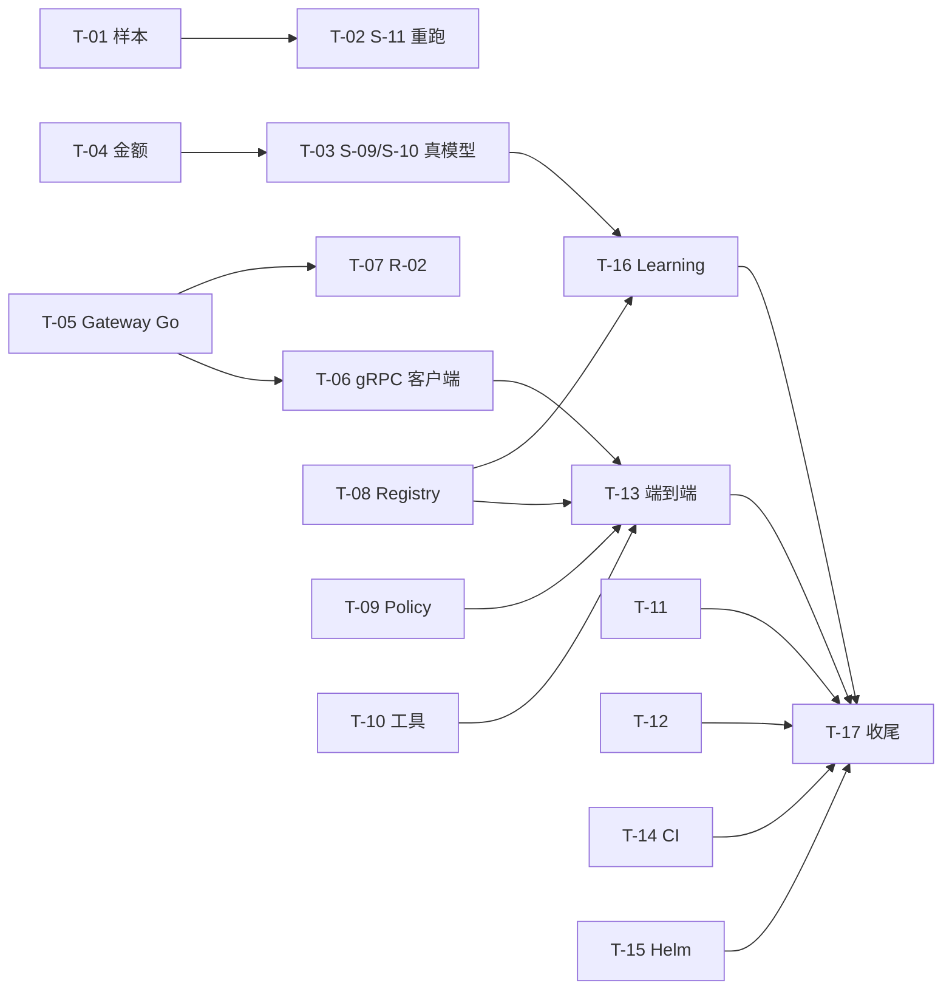

# TMP：直通初步完成整个项目的后续计划

> **临时文档。** 目标达成后整份删除（`git rm docs/plan/TMP-completion-plan.md`），不要把它当成长期设计依据。长期依据仍是设计书与 [strong-tier-plan.md](strong-tier-plan.md)。
> 写于 2026-10-21，基于当时的提交（`567b53c`）和仓库现状。"现状"一栏只看了目录、文件和提交记录，没有逐项跑过，开工前每项先核对一遍。

## 0. 什么叫"初步完成"

不追求生产就绪，只要下面五条同时成立：

1. **端到端用真模型跑通**：一个真实的任务从 Ingress 进来，经 Planner、Stage Runner、Node Executor、Reviewer，调真模型和真工具，最后交付。杀掉 Worker 后能恢复。
2. **阶段 3、4 的门槛有数字**：Planner、Reviewer、压缩三套评测在真模型上给出报告，达标或写明差距与原因。
3. **安全测试全绿**：租户越权与记忆投毒测试在 Postgres + Qdrant 后端上通过。
4. **R-01 到 R-06 评审做完**：每项给出"已处理 / 未处理 / 不确定"，未处理的修掉或登记。
5. **Learning Pipeline 有最小闭环**：从 trace 产出一个候选，过评测门槛才发布。

## 1. 已完成与现状

| 部分 | 状态 |
|---|---|
| S-01 至 S-13 全部强档实现项 | 已提交（S-11、S-12b、S-13 在最近三次提交里） |
| 离线评测 | S-08 评测集 64 条已人审确认；S-11 长任务样本 7 条已确认 |
| 真模型评测的通路 | 临时直连 Gateway 已写好（`evals/provider_gateway.py`），S-11 跑过一次 |
| Go 侧 | task-service 有 session、taskapi（含 policy.go）、events（SSE）、taskstore；`go-model-gateway` 只有一个打印 not implemented 的 `main.go` |
| 部署 | `deploy/` 只有 README，没有 Helm、KEDA；CI 只有 `nightly.yml` |
| 没在代码里找到的 | Registry 服务（proto 有、实现没找到）、Policy Engine 与默认 Hook（只在 task-service 的 policy.go 里见到入口）、MCP Gateway、SecretStore 接入以外的 R-04 部分、Learning Pipeline（`py-learning` 里只有 `evals`） |

## 2. 工作包

按依赖排序。编号 T 开头，是这份文档自己的编号，与 S、R 编号无关。"档位"沿用实施计划：强档只做难的、错了代价大的。

### 阶段 A：先把真模型评测做扎实（半天到一天）

**T-01 重新设计 S-11 样本，让每条都会触发摘要**　中档 · 低
- 问题：有效长度 8000 时，mask 之后总量很容易降到 70% 以下，开发集 5 条里只有 2 条触发摘要，留出集 0 条。没触发摘要，full 和 mask_only 的差别只剩随机波动。
- 做法：把 `effective_tokens` 降到 3000 到 4000，或加长保留字段；检查脚本里加一条"mask 之后仍超过 summarize_at"的断言，不满足的样本加载就报错。
- 完成：每条样本在 full 下至少触发一次摘要；新增的断言测试通过。
- **结果（2026-10-21，`6c0b2e1`）**：7 条样本的 `effective_tokens` 改为 4000（经人确认）。离线量过：只做 mask 之后最少也超出 summarize_at 12%，
  full 下 7 条全部摘要（3 条进一步 reset）。加载时检查这一条；报告记下每条样本走到阶梯的哪一步。

**T-02 S-11 重复跑与分析**　中档 · 低
- 开发集、留出集各跑 3 次，报告里给通过率的范围；单次差一两题不下结论。
- 单看 `ctx_coding_ci_rounding`：full 比 mask_only 多丢 2 题，读报告里的摘要内容，改摘要提示（只在开发集上调）。
- 完成：留出集上 full 不劣于 mask_only（取多次的中位数），或写明未达标的原因。
- **结果（2026-10-22，真模型 Opus 5.5 / Haiku 5.5，经临时 Gateway）**：门槛两个划分都通过，没有调提示。

  | 划分 | 策略 | Probe 通过率（中位数，范围） | 重复操作率 | 触发摘要 |
  | --- | --- | --- | --- | --- |
  | dev（5 条） | mask_only | 70%（70%–70%） | 0%（0%–0%） | 0 条 |
  | dev | full | 96%（91%–100%） | 0%（0%–20%） | 5 条 |
  | holdout（2 条） | mask_only | 50%（50%–50%） | 0% | 0 条 |
  | holdout | full | 83%（83%–83%） | 0% | 2 条 |

  `ctx_coding_ci_rounding` 在 4000 下 full 三次是 5/5、4/5、5/5，mask_only 每次 4/5，原来“full 多丢 2 题”的现象没有再出现。
  留出集只看了 1 次（3 遍）。

**T-03 S-09、S-10 真模型评测**　中档 · 低，强档看结果
- 用 `AR_EVAL_GATEWAY_FACTORY=agentruntime_learning.evals.provider_gateway:make` 跑 `planner_subject`、`worker_subject`。
- 门槛：Triage 准确率 ≥90%；Stage schema 通过率 100%；规则违例 0；Reviewer Verdict 准确率 ≥85%，且"该升级却原地重试"为 0；规划成本不超过 Task 预计成本的 5%（需要先让 Gateway 能算金额，见 T-04）。
- 完成：三份报告落盘，不达标的写进差距清单，不在评测集上调提示的留出集。
- **结果（2026-10-22，每个划分 3 遍，按中位数判，报告在 `services/py-learning/.eval-reports` 的 `repeat--*`）**：两项都未达标，差距如下。
  - 有效性：S-10 留出集的第 2、3 遍不作数。供应商账户额度在跑的过程中用完，之后每次调用都是 403 `insufficient_user_quota`，
    Planner 回退到 full 规划、Reviewer 回退到规则判定，评测照样“跑完”（第 3 遍总成本只有 $0.0018）。S-09 两个划分、S-10 开发集、
    S-10 留出集第 1 遍在额度用完之前跑完。评测报告现在会写出失败的模型调用次数与 code（`metrics.model_call_failures`），摘要里提醒。
    **额度补上之后要重跑 S-10 留出集。**
  - 起初的一轮 S-09、S-10 也作废了：临时 Gateway 不认 Planner 分诊用的 `small@low`，分诊调用一律失败（已修，`d5b0544`）。

  | 门槛 | S-09 dev | S-09 holdout | S-10 dev | S-10 holdout（只有第 1 遍有效） |
  | --- | --- | --- | --- | --- |
  | Triage 准确率 ≥ 90% | ✗ 88.5%（84.6–92.3） | ✗ 85.7%（85.7–92.9） | 84.6% | 85.7% |
  | Stage schema 通过率 100% | ✓ | ✓ | ✓ | ✓ |
  | 规则违例 0 | ✓ | ✓ | ✓ | ✓ |
  | replan 不重做已验证的 Node | ✓（1 遍出现过 1 次） | ✓ | — | — |
  | 规划成本 ≤ Task 预计成本 5%（最大一条） | ✗ 17.1%（均值 7.4%） | ✗ 37.3%（均值 15.2%） | 18.3% | — |
  | Reviewer 样本 Verdict 准确率 ≥ 85% | （基线） | （基线） | ✗ 50.0%（37.5–75.0） | 87.5% |
  | 该升级却原地重试 0 | — | — | ✗ 2（1–5） | 0 |

  差距清单（开发集逐条看过；留出集只看汇总）：
  1. **Triage 差 1.5 到 4.3 个百分点**。`research_retitle_fast`（fast）三遍都判 full；`naming_cup_light` 有 Recipe 却判成 fast（分诊给了
     `follow_up` + `effect none`，代码规则先走 fast）；`multiday_next_feature_light`、`ci_fix_recipe_hit`、`batch_label_light` 时而判 full
     （分诊置信度在阈值 0.8 附近摇摆）。方向：分诊提示里区分“改标题一类的续改”与“有 Recipe 的新任务”；fast 规则在命中 Recipe 时让位给 light。
  2. **规划成本占比远超 5%**。一次 full 规划约 1.25 万输入 token、2 千输出 token，Opus 5.5 标价下约 $0.09；评测集里预计成本 $0.3 到 $1.5 的
     Task 必然超标。方向：Planner 提示瘦身（Catalog 与 schema 占大头）、打开提示缓存（输入降到约十分之一，但输出约 $0.04 仍占大头）、
     strong@medium 改用 Sonnet 5.5，或请人重新确认 5% 这条对小 Task 是否按绝对额（例如不超过 $0.05）处理。单价用的是一方 API 标价，
     不是 a6api 的实价。
  3. **Reviewer Verdict 准确率 50%**（开发集；规则基线是 31%）。三遍里稳定出错的：该 reroute 判 continue（`rs_reroute_batch`）、
     该 escalate 判 continue（`rs_escalate_nonrefundable`）、该 repair 判 done（`rs_cosmetic_reflection`、`rs_judge_bias`）、
     该 replan 判 repair（`rs_fanout_conflict`、`rs_replan_assumption_broken`、`rs_revise_same_error`）、该 rollback 判 repair
     （`rs_rollback_corrupted_accounts`）。判定点（Task 用例里的 Round）的准确率是 92.3%，问题集中在附录 B.7 的症状样本上。
  4. **该升级却原地重试 1 到 5 次**：都出现在 3 的那几条样本上，Progress Check 没有把“同类错误反复出现”“假设被推翻”映射到
     replan 或 rollback。方向：把这几种症状写进规则（附录 B.8 的次数规则已经由代码判定，症状类的还靠模型）。
  这四条属于 S-09、S-10 的提示与规则，按实施计划是强档的活，调提示只在开发集上做。

**T-04 临时 Gateway 补金额**　轻 · 低
- 现在只记 token，不算金额，S-09 的规划成本占比算不出来。在配置里加每个模型的单价，换算成 `cost_usd_micros`。
- 完成：`Usage.cost_usd_micros` 有值，报告里每次成功成本可算。

### 阶段 B：真正的 Model Gateway（2 到 3 天）

**T-05 Model Gateway 单供应商直连（Go）**　中档 · 中，评审 R-02
- 实现 `ModelGatewayService.Generate`：按 Tier 选模型、转换 `ChatMessage`、结构化输出、工具调用、计量、错误分类；`cache_breakpoint` 翻译成供应商的缓存参数。
- 先接 OpenAI 兼容接口（与 `provider_gateway.py` 同一个供应商），不做多供应商。
- 在 history 最后一条消息上加滚动断点，对比命中率（`cache_read_tokens`）。
- 完成：`libs/go-core/conformance/modelprovidertest` 对它通过；Worker 通过 gRPC 调它；缓存命中率能在计量里看到。

**T-06 Worker 的 Gateway 客户端换成 gRPC**　中档 · 低
- `executor/model_gateway.py` 的生产实现是到 `go-model-gateway` 的 gRPC 客户端（文件里已写明）。评测改用同一个客户端，退役 `provider_gateway.py`，或留作离线对照。
- 完成：评测命令不变，只换 Gateway。

**T-07 R-02 评审**　强档 · 高
- 逐条看：先按租户约束过滤；期望成本公式；同档切换与限流；Task 中途不换主模型；judge 用不同家模型。
- 完成：评审结论写进 PR 或提交说明。
- **结果（2026-10-22）**：评审写在 [review-R-02-model-gateway.md](review-R-02-model-gateway.md)。白名单过滤、单次计价、transient
  重试与同档切换已处理；期望成本公式、限流、Task 固定主模型未处理；judge 换家在网关侧有机制，但 Reviewer 没有传 `avoid_vendor`，
  开发用 Profile 下与 Planner 同一家，实际未处理。另有计量少算已计费的失败调用、超时没对齐、网关不认证调用方三项风险。
  这次评审与实现出自同一会话，不算写审分离，R-02 还要另一家的强模型或人复审。
  评审的处理建议第 2 到 5 条已修（计量的 status 与偏好标记、已计费失败也记、超时对齐、model_not_found 切换），见评审第 5 节；
  第 1、6 条待人定方案。

### 阶段 C：补齐运行骨架上缺的模块（3 到 4 天）

**T-08 Registry**　中档 · 中
- proto 已有，实现没找到。Recipe、Model Profile、Node Template 的读写与版本；Learning 发布走这里。
- 完成：一致性测试；Planner 的 Node Catalog 从它读，不再只用评测集里的 catalog。

**T-09 Policy Engine 与默认 Hook**　中档 · 中，评审 R-01
- write_irreversible 的审批插入不可绕过；deny 不重试；驳回类 Hook 有次数上限；Hook 里没有复杂推理。
- 现状：`taskapi/policy.go` 有入口，Python 侧 `activities/stubs.py` 里是桩。
- 完成：S-05 的 effect 规则测试用真 Policy Engine 重跑；R-01 评审。

**T-10 ToolDriver 与平台内工具、MCP Gateway**　中档 · 中
- `libs/py-core/.../tool_driver.py` 是接口与开发实现。补几个真工具（读文件、跑命令、HTTP 取页面），再接 MCP 服务。
- 完成：tool_loop 能用至少三个真工具跑 S-11 那类长任务。

**T-11 SecretStore 接入与 Ingress/SSE 评审**　中档 · 中，评审 R-04、R-05
- 节点拿不到长期密钥，凭据不进日志与 trace；SSE 支持 Last-Event-ID 续传。
- 完成：两份评审结论。

**T-12 R-03 Context Builder 评审**　强档 · 高
- 分区顺序与缓存断点；外置内容只以路径出现；阈值按有效长度设。笔记 `docs/note/context-compression.md` 里已有一份自述，可以拿来对照。
- 完成：评审结论。

### 阶段 D：端到端与部署（2 到 3 天）

**T-13 真模型端到端**　强档 · 中
- 一个完整任务（例如 CI 修复或批量发票归类）从 Ingress 到交付，用真 Gateway、真工具。
- 杀掉 Worker 后能恢复（S-07 套件已有，换成真 Gateway 重跑一遍）。
- 完成：一份端到端录像或日志；故障注入套件通过。

**T-14 CI 与本地开发环境**　轻 · 低
- 把"本地 clone 跑测试"写成脚本；CI 增加 py-learning、py-worker、py-memory 的日常测试，不只是夜间任务。
- 完成：PR 上自动跑测试。

**T-15 Helm 与 KEDA、Telemetry**　中档 · 低
- 能 `helm template` 出合法的清单即可，不要求真部署。Telemetry 打点与 Collector 配置补齐。
- 完成：`helm lint` 通过。

### 阶段 E：Learning Pipeline 最小闭环（2 到 3 天）

**T-16 Learning Pipeline**　中档 · 中，评审 R-06
- 从 trace 里挑一个任务族，产出一个候选 Recipe 或路由调整；跑评测；过门槛才经 Registry 发布。
- 后台任务单独记预算；运行中的 Task 不受影响。
- 完成：一次"候选未过门槛，发布被拒"和一次"过门槛，发布成功"的演示。

### 阶段 F：收尾

**T-17 全量回归与清理**
- 全部 Go 与 Python 测试在本地 clone 跑一遍；夜间任务那组（Postgres、Qdrant）也要过。
- 补笔记：每个模块一篇 `docs/note/*.md`，末尾附面试速查，沿用 `context-compression.md` 的格式。
- 删除本文件和 `provider_gateway.py` 的临时说明，更新 CLAUDE.md 的命令表。

## 3. 依赖与顺序

A、B 可以并行：A 只用评测目录和临时 Gateway，B 在 Go 里。C 的几项互相独立，但 T-13 要等 T-06、T-08、T-09、T-10 都好。

## 4. 主要风险

1. **真模型评测不稳**：样本少、模型有随机性。每项门槛至少跑 3 次取中位数，并在报告里保留单次结果。
2. **T-05 是关键路径**：Go 侧要写供应商适配器，之前没有先例；接口以 `modelprovider.go` 和 `modelprovidertest` 的一致性测试为准，先让它过测试再接真供应商。
3. **评测集会被越调越好**：调提示只在开发集，留出集平时不看；每改一次提示记一次留出集结果的次数。
4. **`Z:` 上跑不了测试**：所有测试在本地 clone 跑，改动在 `Z:` 提交后再拉到本地，不要在两边同时改。
5. **密钥**：当前 key 出现在对话记录里，进入 T-13 前换一个新的；密钥只放仓库外的 `~/.agentruntime/model-provider.env`。

## 5. 里程碑

| 里程碑 | 包含 | 判断标准 |
|---|---|---|
| M1 评测站稳 | T-01 到 T-04 | 三套真模型评测各有一份可复现的报告 |
| M2 真 Gateway | T-05 到 T-07 | Worker 经 Go Gateway 调真模型，缓存命中率可见 |
| M3 骨架补齐 | T-08 到 T-12 | Registry、Policy、工具、五项评审完成 |
| M4 端到端 | T-13 到 T-15 | 真任务跑通并能恢复，CI 与 Helm 合格 |
| M5 初步完成 | T-16、T-17 | 第 0 节五条同时成立；删除本文件 |

## 6. 完成后

- 删除本文件：`git rm docs/plan/TMP-completion-plan.md`。
- 把仍未完成的事项登记到 `docs/reference/risks-and-open-questions.md`，不要留在这里。
