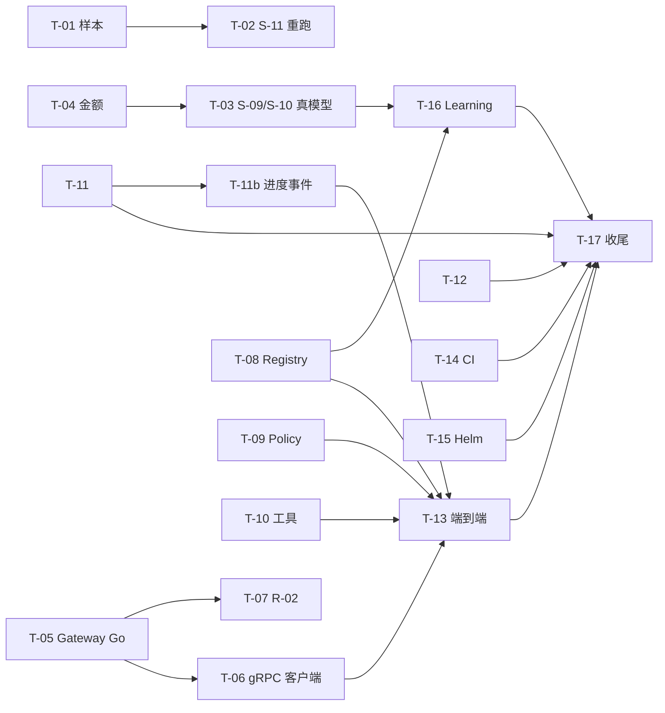

# TMP：直通初步完成整个项目的后续计划

> **临时文档。** 目标达成后整份删除（`git rm docs/plan/TMP-completion-plan.md`），不要把它当成长期设计依据。长期依据仍是设计书与 [strong-tier-plan.md](strong-tier-plan.md)。
> 写于 2026-10-21，基于当时的提交（`567b53c`）和仓库现状。"现状"一栏只看了目录、文件和提交记录，没有逐项跑过，开工前每项先核对一遍。

## 0. 什么叫"初步完成"

不追求生产就绪，只要下面五条同时成立：

1. **端到端用真模型跑通**：一个真实的任务从 Ingress 进来，经 Planner、Stage Runner、Node Executor、Reviewer，调真模型和真工具，最后交付。杀掉 Worker 后能恢复。
2. **阶段 3、4 的门槛有数字**：Planner、Reviewer、压缩三套评测在真模型上给出报告，达标或写明差距与原因。
3. **安全测试全绿**：租户越权与记忆投毒测试在 Postgres + Qdrant 后端上通过。
4. **R-01 到 R-06 评审做完**：每项给出"已处理 / 未处理 / 不确定"，未处理的修掉或登记。
5. **Learning Pipeline 有最小闭环**：从 trace 产出一个候选，过评测门槛才发布。

## 1. 已完成与现状

| 部分 | 状态 |
|---|---|
| S-01 至 S-13 全部强档实现项 | 已提交（S-11、S-12b、S-13 在最近三次提交里） |
| 离线评测 | S-08 评测集 64 条已人审确认；S-11 长任务样本 7 条已确认 |
| 真模型评测的通路 | 临时直连 Gateway 已写好（`evals/provider_gateway.py`），S-11 跑过一次 |
| Go 侧 | task-service 有 session、taskapi（含 policy.go）、events（SSE）、taskstore；`go-model-gateway` 只有一个打印 not implemented 的 `main.go` |
| 部署 | `deploy/` 只有 README，没有 Helm、KEDA；CI 只有 `nightly.yml` |
| 没在代码里找到的 | Registry 服务（proto 有、实现没找到）、Policy Engine 与默认 Hook（只在 task-service 的 policy.go 里见到入口）、MCP Gateway、SecretStore 接入以外的 R-04 部分、Learning Pipeline（`py-learning` 里只有 `evals`） |

## 2. 工作包

按依赖排序。编号 T 开头，是这份文档自己的编号，与 S、R 编号无关。"档位"沿用实施计划：强档只做难的、错了代价大的。

### 阶段 A：先把真模型评测做扎实（半天到一天）

**T-01 重新设计 S-11 样本，让每条都会触发摘要**　中档 · 低
- 问题：有效长度 8000 时，mask 之后总量很容易降到 70% 以下，开发集 5 条里只有 2 条触发摘要，留出集 0 条。没触发摘要，full 和 mask_only 的差别只剩随机波动。
- 做法：把 `effective_tokens` 降到 3000 到 4000，或加长保留字段；检查脚本里加一条"mask 之后仍超过 summarize_at"的断言，不满足的样本加载就报错。
- 完成：每条样本在 full 下至少触发一次摘要；新增的断言测试通过。
- **结果（2026-10-21，`6c0b2e1`）**：7 条样本的 `effective_tokens` 改为 4000（经人确认）。离线量过：只做 mask 之后最少也超出 summarize_at 12%，
  full 下 7 条全部摘要（3 条进一步 reset）。加载时检查这一条；报告记下每条样本走到阶梯的哪一步。

**T-02 S-11 重复跑与分析**　中档 · 低
- 开发集、留出集各跑 3 次，报告里给通过率的范围；单次差一两题不下结论。
- 单看 `ctx_coding_ci_rounding`：full 比 mask_only 多丢 2 题，读报告里的摘要内容，改摘要提示（只在开发集上调）。
- 完成：留出集上 full 不劣于 mask_only（取多次的中位数），或写明未达标的原因。
- **结果（2026-10-22，真模型 Opus 5.5 / Haiku 5.5，经临时 Gateway）**：门槛两个划分都通过，没有调提示。

  | 划分 | 策略 | Probe 通过率（中位数，范围） | 重复操作率 | 触发摘要 |
  | --- | --- | --- | --- | --- |
  | dev（5 条） | mask_only | 70%（70%–70%） | 0%（0%–0%） | 0 条 |
  | dev | full | 96%（91%–100%） | 0%（0%–20%） | 5 条 |
  | holdout（2 条） | mask_only | 50%（50%–50%） | 0% | 0 条 |
  | holdout | full | 83%（83%–83%） | 0% | 2 条 |

  `ctx_coding_ci_rounding` 在 4000 下 full 三次是 5/5、4/5、5/5，mask_only 每次 4/5，原来“full 多丢 2 题”的现象没有再出现。
  留出集只看了 1 次（3 遍）。
- **T-12 修复之后重跑（2026-10-24，同一套模型与临时 Gateway，各 3 遍）**：门槛两个划分仍都通过。

  | 划分 | 策略 | Probe 通过率（中位数，范围） | 重复操作率 | 触发摘要 |
  | --- | --- | --- | --- | --- |
  | dev（5 条） | mask_only | 70%（70%–70%） | 0% | 0 条 |
  | dev | full | 96%（96%–100%） | 0% | 5 条 |
  | holdout（2 条） | mask_only | 50%（50%–50%） | 0% | 0 条 |
  | holdout | full | 83%（83%–83%） | 0% | 2 条 |

  与 T-12 之前相比只有 dev 的 full 范围从 91%–100% 变为 96%–100%，样本少，不归因。留出集第 2 次看（3 遍）。

**T-03 S-09、S-10 真模型评测**　中档 · 低，强档看结果
- 用 `AR_EVAL_GATEWAY_FACTORY=agentruntime_learning.evals.provider_gateway:make` 跑 `planner_subject`、`worker_subject`。
- 门槛：Triage 准确率 ≥90%；Stage schema 通过率 100%；规则违例 0；Reviewer Verdict 准确率 ≥85%，且"该升级却原地重试"为 0；规划成本不超过 Task 预计成本的 5%（需要先让 Gateway 能算金额，见 T-04）。
- 完成：三份报告落盘，不达标的写进差距清单，不在评测集上调提示的留出集。
- **结果（2026-10-22，每个划分 3 遍，按中位数判，报告在 `services/py-learning/.eval-reports` 的 `repeat--*`）**：两项都未达标，差距如下。
  - 有效性：S-10 留出集的第 2、3 遍不作数。供应商账户额度在跑的过程中用完，之后每次调用都是 403 `insufficient_user_quota`，
    Planner 回退到 full 规划、Reviewer 回退到规则判定，评测照样“跑完”（第 3 遍总成本只有 $0.0018）。S-09 两个划分、S-10 开发集、
    S-10 留出集第 1 遍在额度用完之前跑完。评测报告现在会写出失败的模型调用次数与 code（`metrics.model_call_failures`），摘要里提醒。
    **额度补上之后要重跑 S-10 留出集。**
  - 起初的一轮 S-09、S-10 也作废了：临时 Gateway 不认 Planner 分诊用的 `small@low`，分诊调用一律失败（已修，`d5b0544`）。

  | 门槛 | S-09 dev | S-09 holdout | S-10 dev | S-10 holdout（只有第 1 遍有效） |
  | --- | --- | --- | --- | --- |
  | Triage 准确率 ≥ 90% | ✗ 88.5%（84.6–92.3） | ✗ 85.7%（85.7–92.9） | 84.6% | 85.7% |
  | Stage schema 通过率 100% | ✓ | ✓ | ✓ | ✓ |
  | 规则违例 0 | ✓ | ✓ | ✓ | ✓ |
  | replan 不重做已验证的 Node | ✓（1 遍出现过 1 次） | ✓ | — | — |
  | 规划成本 ≤ Task 预计成本 5%（最大一条） | ✗ 17.1%（均值 7.4%） | ✗ 37.3%（均值 15.2%） | 18.3% | — |
  | Reviewer 样本 Verdict 准确率 ≥ 85% | （基线） | （基线） | ✗ 50.0%（37.5–75.0） | 87.5% |
  | 该升级却原地重试 0 | — | — | ✗ 2（1–5） | 0 |

  差距清单（开发集逐条看过；留出集只看汇总）：
  1. **Triage 差 1.5 到 4.3 个百分点**。`research_retitle_fast`（fast）三遍都判 full；`naming_cup_light` 有 Recipe 却判成 fast（分诊给了
     `follow_up` + `effect none`，代码规则先走 fast）；`multiday_next_feature_light`、`ci_fix_recipe_hit`、`batch_label_light` 时而判 full
     （分诊置信度在阈值 0.8 附近摇摆）。方向：分诊提示里区分“改标题一类的续改”与“有 Recipe 的新任务”；fast 规则在命中 Recipe 时让位给 light。
  2. **规划成本占比远超 5%**。一次 full 规划约 1.25 万输入 token、2 千输出 token，Opus 5.5 标价下约 $0.09；评测集里预计成本 $0.3 到 $1.5 的
     Task 必然超标。方向：Planner 提示瘦身（Catalog 与 schema 占大头）、打开提示缓存（输入降到约十分之一，但输出约 $0.04 仍占大头）、
     strong@medium 改用 Sonnet 5.5，或请人重新确认 5% 这条对小 Task 是否按绝对额（例如不超过 $0.05）处理。单价用的是一方 API 标价，
     不是 a6api 的实价。
  3. **Reviewer Verdict 准确率 50%**（开发集；规则基线是 31%）。三遍里稳定出错的：该 reroute 判 continue（`rs_reroute_batch`）、
     该 escalate 判 continue（`rs_escalate_nonrefundable`）、该 repair 判 done（`rs_cosmetic_reflection`、`rs_judge_bias`）、
     该 replan 判 repair（`rs_fanout_conflict`、`rs_replan_assumption_broken`、`rs_revise_same_error`）、该 rollback 判 repair
     （`rs_rollback_corrupted_accounts`）。判定点（Task 用例里的 Round）的准确率是 92.3%，问题集中在附录 B.7 的症状样本上。
  4. **该升级却原地重试 1 到 5 次**：都出现在 3 的那几条样本上，Progress Check 没有把“同类错误反复出现”“假设被推翻”映射到
     replan 或 rollback。方向：把这几种症状写进规则（附录 B.8 的次数规则已经由代码判定，症状类的还靠模型）。
  这四条属于 S-09、S-10 的提示与规则，按实施计划是强档的活，调提示只在开发集上做。
- **S-10 留出集重跑（2026-10-24，额度补上之后，3 遍都有效：模型调用失败 0）**：报告 `repeat--task-loop--worker--holdout--20261024T055131.696766Z.json`。
  Reviewer 样本 Verdict 准确率 75.0%（中位数，单次 75.0%–75.0%），门槛 85%，差 10 个百分点；该升级却原地重试 1 次（1–2），门槛 0；判定点 Verdict 准确率 93.8%
  （93.8%–100%）；Triage 85.7%（85.7%–92.9%）；schema 通过率 100%；规划成本占比最大一条 30.9%（25.5%–30.9%），均值 12.1%；每次成功成本 $0.228（$0.206–$0.319）。
  S-10 门槛未达标，差距与开发集同源（差距清单第 3、4 条）；10-22 第 1 遍的 87.5% 是单次波动。提示没有改过，留出集这是第 2 次看。

**T-04 临时 Gateway 补金额**　轻 · 低
- 现在只记 token，不算金额，S-09 的规划成本占比算不出来。在配置里加每个模型的单价，换算成 `cost_usd_micros`。
- 完成：`Usage.cost_usd_micros` 有值，报告里每次成功成本可算。
- **结果（2026-10-21，`6c0b2e1`）**：临时 Gateway 按模型单价（`AR_MODEL_PROVIDER_PRICE_*`，默认一方标价）换算 `cost_usd_micros`；评测报告的
  每次成功成本与规划成本占比由它算出（T-03 的表）。

### 阶段 B：真正的 Model Gateway（2 到 3 天）

**T-05 Model Gateway 单供应商直连（Go）**　中档 · 中，评审 R-02
- 实现 `ModelGatewayService.Generate`：按 Tier 选模型、转换 `ChatMessage`、结构化输出、工具调用、计量、错误分类；`cache_breakpoint` 翻译成供应商的缓存参数。
- 先接 OpenAI 兼容接口（与 `provider_gateway.py` 同一个供应商），不做多供应商。
- 在 history 最后一条消息上加滚动断点，对比命中率（`cache_read_tokens`）。
- 完成：`libs/go-core/conformance/modelprovidertest` 对它通过；Worker 通过 gRPC 调它；缓存命中率能在计量里看到。
- **结果（2026-10-22，`daf45aa`）**：细化见 [model-gateway-direct.md](model-gateway-direct.md)。`libs/go-core/adapters/openaicompat`（生成、流式、
  Score、Embed；密钥经 SecretStore，BYOK 优先）过 `modelprovidertest`，真实端点的一致性测试在额度用完之前通过；`services/go-model-gateway`
  （选档、transient 重试与同档切换、按实际 Profile 计价、每次调用一行计量，含 `cache_read_tokens`）。history 的滚动断点没加，等 T-13 看到真模型的
  命中率再定（R-03 评审）。

**T-06 Worker 的 Gateway 客户端换成 gRPC**　中档 · 低
- `executor/model_gateway.py` 的生产实现是到 `go-model-gateway` 的 gRPC 客户端（文件里已写明）。评测改用同一个客户端，退役 `provider_gateway.py`，或留作离线对照。
- 完成：评测命令不变，只换 Gateway。
- **结果（2026-10-22，`daf45aa`）**：`executor/grpc_gateway.py` 的 `GrpcModelGateway` 按 `ar-error-bin` 还原错误类别；设了 `AR_MODEL_GATEWAY_ADDRESS`
  时 Node Executor、Planner、Reviewer、tool_loop 都经它；评测用 `AR_EVAL_GATEWAY_FACTORY=agentruntime_worker.executor.grpc_gateway:from_env`。
  `provider_gateway.py` 留作离线对照，T-17 删它的临时说明。

**T-07 R-02 评审**　强档 · 高
- 逐条看：先按租户约束过滤；期望成本公式；同档切换与限流；Task 中途不换主模型；judge 用不同家模型。
- 完成：评审结论写进 PR 或提交说明。
- **结果（2026-10-22）**：评审写在 [review-R-02-model-gateway.md](review-R-02-model-gateway.md)。白名单过滤、单次计价、transient
  重试与同档切换已处理；期望成本公式、限流、Task 固定主模型未处理；judge 换家在网关侧有机制，但 Reviewer 没有传 `avoid_vendor`，
  开发用 Profile 下与 Planner 同一家，实际未处理。另有计量少算已计费的失败调用、超时没对齐、网关不认证调用方三项风险。
  这次评审与实现出自同一会话，不算写审分离，R-02 还要另一家的强模型或人复审。
  评审的处理建议第 2 到 5 条已修（计量的 status 与偏好标记、已计费失败也记、超时对齐、model_not_found 切换），见评审第 5 节；
  第 1、6 条人定方案后已修（2026-10-24，评审第 7 节：Reviewer 按结果的 `meta.vendor` 避开生成者，契约加了这个可选字段；缺租户报 denied）。
  另一家复审（OpenAI gpt-6-sol，[reviews/R-02-gpt-6-sol.md](reviews/R-02-gpt-6-sol.md)）结论一致、没有新的高严重问题，**R-02 评审完成**。

### 阶段 C：补齐运行骨架上缺的模块（3 到 4 天）

**T-08 Registry**　中档 · 中
- proto 已有，实现没找到。Recipe、Model Profile、Node Template 的读写与版本；Learning 发布走这里。
- 完成：一致性测试；Planner 的 Node Catalog 从它读，不再只用评测集里的 catalog。
- 结果（2026-10-22）：细化与取舍见 `docs/plan/registry.md`。契约（五个 schema）c0117be；实现在 task-service 的 `internal/registry`
  （业务库一张表，SQLite 与 Postgres 同一组验收测试；Publish 以影子发布、Promote 要达标的评测证据、发布令牌在 SecretStore；
  `AR_REGISTRY_ADDR` 启用、`registry-seed` 开发种子），Worker 的 `agentruntime_worker.registry`（`resolve_catalog` 与 Planner 的
  Node Catalog、Recipe 改读 Registry，`AR_REGISTRY_ADDRESS` 启用）。`ar-error-bin` 的编码挪到 `libs/go-core/connecterr`。
  登记到后续：`expand_template`；Model Gateway 改读 Registry；租户策略的收紧与放宽语义；全局 Registry 修订号（设计书 3.1.2，要改 proto）；
  运行时按 Registry 核对 Atomic Node 的 effect（建议并入 T-09）。本机没有 Postgres，Postgres 一侧的用例由夜间 CI 跑。

**T-09 Policy Engine 与默认 Hook**　中档 · 中，评审 R-01
- write_irreversible 的审批插入不可绕过；deny 不重试；驳回类 Hook 有次数上限；Hook 里没有复杂推理。
- 现状：`taskapi/policy.go` 有入口，Python 侧 `activities/stubs.py` 里是桩。
- 完成：S-05 的 effect 规则测试用真 Policy Engine 重跑；R-01 评审。
- 结果（2026-10-23）：细化与取舍见 `docs/plan/policy-engine.md`。Worker 的 `agentruntime_worker.policy` 代替桩，默认就用；
  默认 Hook（budget_check、idempotency_check、single_writer_lock、trace_result、checkpoint、audit_log）与 pii_redaction、
  acceptance_recheck；租户策略与 Recipe 声明的 Hook 经 Registry 合并进 StagePolicy；接上 before_finish（驳回 2 次后问人）与
  on_task_received、on_task_start、on_task_end；接了 Registry 时 Stage Runner 执行前按登记的模板核对 executor、effect。
  S-05 的 effect 矩阵已用真 Policy Engine 重跑。R-01 评审还没做（要写审分离：另一家的强模型或人）。
  登记到后续：工具的 effect 仍由桩工具目录给出（T-10）；提示注入检测（S-13）；before_compact；Task 级挂载点的 modify、inject。
- **R-01 评审（2026-10-24）**：写在 [review-R-01-policy-engine.md](review-R-01-policy-engine.md)。审批插入、deny 不重试（Hook 与 Executor 两处）、
  before_finish 的上限、Hook 是纯函数都已处理；未处理的是 `run_hooks` 的 local activity 没有重试上限（Collector 不可用时所有 Task 卡在 after_node）、
  tool_loop 的单次工具调用不经过任何 Hook、失败的 Node 没有审计、`budget_check` 不算 tool_loop、Planner、Reviewer 与子工作流的花费；另有审批问题不带输入。
  独立性同 R-03：新会话、同一家模型。另一家复审（OpenAI gpt-6-sol，[reviews/R-01-gpt-6-sol.md](reviews/R-01-gpt-6-sol.md)）补了三条：脱敏在
  trace_result 之后才作用、不认识的 Hook 结果被当成放行、trace 按字符截断。**R-01 评审完成**；人定方案后这六条与成本口径都已修（评审第 6 节，
  新版本分支 `r01-audit-and-budget`），其余登记。

**T-10 ToolDriver 与平台内工具、MCP Gateway**　中档 · 中
- `libs/py-core/.../tool_driver.py` 是接口与开发实现。补几个真工具（读文件、跑命令、HTTP 取页面），再接 MCP 服务。
- 完成：tool_loop 能用至少三个真工具跑 S-11 那类长任务。
- 结果（2026-10-23）：细化与取舍见 `docs/plan/tool-driver.md`。Worker 的 `agentruntime_worker.tools`：平台内工具 `repo_read`、`repo_list`、
  `repo_grep`、`repo_edit`、`shell_run`、`web_fetch`（按配置登记，工作区按租户与 workspace 划分，`web_fetch` 有主机名单、拒绝内网、不跟随重定向）；
  MCP Gateway（进程内、stdio，按登记文件包装 MCP 工具，effect 人工登记）；`ToolCatalog` 让 `resolve_catalog`（桩模板与 Registry 两种）的
  工具 effect 取自 ToolDriver 的登记，关掉 T-09 登记的“工具 effect 是桩”的缺口；Node Executor 实现 `call_tool`（规则同 program 节点，
  调用时按登记复核 effect）；tool_loop 给模型的工具定义取自登记。Temporal 测试里 tool_loop 用桩模型脚本驱动真工具跑完读、改、跑测试、取网页。
  “完成”要求的真模型长任务演示还没做（供应商额度用完，2026-10-22）。
  登记到后续：MCP Gateway 单独部署、HTTP 传输、MCP 工具的权限；工具版本固定到 Task；`shell_run` 的资源限制与网络隔离；记忆检索等平台内工具。

**T-11 SecretStore 接入与 Ingress/SSE 评审**　中档 · 中，评审 R-04、R-05
- 节点拿不到长期密钥，凭据不进日志与 trace；SSE 支持 Last-Event-ID 续传。
- 完成：两份评审结论。
- 结果（2026-10-23）：评审写在 [review-R-04-secretstore.md](review-R-04-secretstore.md) 与 [review-R-05-ingress-sse.md](review-R-05-ingress-sse.md)。
  R-04：模型调用与工具调用拿不到长期密钥，短期凭据用完即吊销，Secret 类型与 Telemetry 脱敏到位；未处理的是开发 Sandbox 把 Worker 的整个环境
  透传给模型写的代码、工具回显凭据没有出口检查、吊销失败无记录、没有批量吊销与生产实现。R-05：Last-Event-ID 续传、event_id 稳定、
  结束后从业务库补发都已处理；未处理的是只推受理与结束两类事件（4.14 的思考过程、工具状态、token 增量、等待人工回复都没有）、
  SSE 不限流、令牌过期后流不断、同租户任何用户都能审批、对不上的人工回复被静默丢弃。评审在新会话里做，没看实现过程，
  但实现出自强档，严格的写审分离还要另一家的强模型或人复审。
  人确认决定后已修（各评审第 5 节）：开发 Sandbox 只传白名单环境变量；工具回显的凭据换成掩码；吊销失败记 trace 与日志；SSE 令牌过期即断、
  经 Ingress 限流（`stream_events`）；取消与人工回复只接受提交者或带 `task.approve` scope 的用户（tasks 加 `submitted_by`，迁移 3）。
  进度事件推流单列为 T-11b。

**T-12 R-03 Context Builder 评审**　强档 · 高
- 分区顺序与缓存断点；外置内容只以路径出现；阈值按有效长度设。笔记 `docs/note/context-compression.md` 里已有一份自述，可以拿来对照。
- 完成：评审结论。
- 结果（2026-10-23）：评审写在 [review-R-03-context-builder.md](review-R-03-context-builder.md)。分区顺序、三个断点、前缀稳定、offload 与 mask
  已处理；未处理的是外置内容没有取回的工具、Goal Node 的输入原样进 brief、status 的 500 token 上限会截掉精确状态、阈值不算工具定义、
  有效长度不按模型（Model Profile 缺 effective_ctx），以及 model 节点不经 Context Builder。
  独立性同 T-11。人确认决定后已修（评审第 5 节）：大的 Goal 输入外置；精确状态单独成段、有自己的上限；阈值算上工具定义；平台内工具
  `context_read` 按路径取回外置内容，真正的 Planner 给 tool_loop 的 Goal Node 加上它；持久摘要的“未决”“下一步”交给模型更新、以最新一次替换。
  history 的滚动断点等 T-13 看到真模型的缓存命中率再定。S-11 的真模型评测要在额度补上后重跑。

**T-11b 进度事件推流**　中档 · 中（R-05 评审 D10）
- 设计书 4.14：SSE 推思考过程、工具状态与 token 增量。现在只推受理与结束两类事件，客户端看不到进度，也看不到“等待人工回复”。
- 先做 round_started、human_input_required（带 question_id 与选项）、verdict、node_finished；token 与思考的增量后做。
- 难点：事件在 Python Worker 里产生，event_id 由 task-service 的业务库分配，要定事件从哪里写、id 怎么分配（例如 Worker 经 task-service 的
  内部接口追加，或在 session 队列上加 activity）；Task 工作流里加推送要走版本分支并补重放测试。
- 完成：客户端从 SSE 看得到进度与等待中的问题，凭这里的 question_id 发人工回复；断线续传照常。
- 结果（2026-10-23）：决定 D1–D10 经人确认。Python 的 Task 工作流经跨语言 activity `publish_task_event`（session 队列，契约见
  names.proto 的 `ActivityName`）把进度事件交给 Go 的 Session Worker：业务库分配 event_id、推进 Cache，SSE 不用改。推
  round_started、stage_started、node_finished（Stage 的顶层 Node）、human_input_required（带 question_id、kind、选项与 deadline）、
  verdict；载荷的 schema 是 `schemas/task_event_payload.schema.json`，不带结果与 rationale。每个事件都等推送完成；去重键
  `r<Round>/<事件>[/<Node 或问题>]`；推送失败不影响 Task，这一 Round 余下的不再推；Task 结束后到的事件丢弃。只有顶层 Task 推，
  子工作流与子 Task 不推。版本分支 `t11b-progress-events`，新 golden `events_progress`。契约改动过了 `buf breaking`，基线已更新。
  登记到后续：node_started、tool_status、思考与 token 增量（要 activity 一侧的推流路径，附录 K.1）；每个事件一个 activity 的历史开销。

### 阶段 D：端到端与部署（2 到 3 天）

**T-13 真模型端到端**　强档 · 中
- 一个完整任务（例如 CI 修复或批量发票归类）从 Ingress 到交付，用真 Gateway、真工具。
- 杀掉 Worker 后能恢复（S-07 套件已有，换成真 Gateway 重跑一遍）。
- 完成：一份端到端录像或日志；故障注入套件通过。
- 结果（2026-10-24）：细化见 [live-e2e.md](live-e2e.md)，决定与测试经人确认。`scripts/dev_stack.py` 拉起整套；开发种子 `deploy/dev/registry-seed.json`；
  场景 1、4 另加经真 Go Model Gateway 的用例。真模型的 CI 修复两条 live 用例都通过（完整跑完 $0.17；tool_loop 中途杀 Worker 后恢复 $0.14，工具调用不重复），
  端到端日志在 `tests/e2e/.live-reports/`。第一次运行查出并修好：适配器对不满足严格模式的 schema 也发 strict、非流式请求带了 SSE 的 Accept（Reviewer 全部
  bad_response）、完整规划超过 90 秒（模型决策 activity 放宽到 5 分钟）、失败信息带出开发 SecretStore 的内容。真 Planner 的 Node Catalog 补上了工具。
  登记到后续：模型决策与工具 activity 不发心跳（崩溃后约 5 分钟才重试）；Planner、Reviewer 的回退外面看不出来；Anthropic 模型的缓存命中为 0（转发服务丢掉了
  `cache_control`），history 的滚动断点还定不了。

**T-14 CI 与本地开发环境**　轻 · 低
- 把"本地 clone 跑测试"写成脚本；CI 增加 py-learning、py-worker、py-memory 的日常测试，不只是夜间任务。
- 完成：PR 上自动跑测试。
- 结果（2026-10-23）：决定 D1–D12 经人确认。`scripts/check.py`（只用标准库）是本地与 CI 共用的检查：步骤 proto、contract、go、
  py-core、py-memory、py-learning、py-worker、e2e、faults；pr 档不含 faults。Python 步骤前统一 `uv sync` 一次；contract 不再跑
  Go 模块的测试（交给 go）；缺工具的步骤失败并写明缺什么；Windows 上仓库在网络盘又没设本地虚拟环境时拒绝；`--clone` 在当前提交的
  本地克隆里跑（换行符设置跟源检出一致，用克隆自己的 `.venv`）。`.github/workflows/ci.yml` 在 PR 与 main 上分五个 job（contract、
  go、python、py-worker、e2e）调用它，合起来恰好是 pr 档；工具版本与夜间任务一致，缺工具即失败，JUnit 报告总是上传。夜间任务不变。
  登记到后续：本地拉起整套（Temporal、task-service、Worker）的脚本放到 T-13；夜间任务里时好时坏的
  `test_duplicate_task_finished_does_not_release_the_write_lock_twice`（Session 工作流 UnhandledCommand）另查。
  查明（2026-10-23）：Session 工作流要 Continue-As-New 时恰好收到重复的 task_finished 信号，服务端以 UNHANDLED_COMMAND
  拒绝这次结束命令，工作流处理完信号后重试成功；功能断言都通过，只是事件历史检查把这次被拒算成异常。工作流本身不改；
  `tests/e2e/e2e_support/history.py` 只放行 UNHANDLED_COMMAND 且之后有工作流任务成功完成、这次运行正常结束（completed 或
  continued_as_new）的 WorkflowTaskFailed，其余照旧失败；规则的测试在 `tests/e2e/test_history_rules.py`（不需要端到端环境）。
  T-15 进来后契约 job 缺 `otelcol-contrib` 而失败：ci.yml 的契约 job 装上与 Chart 里 Collector 镜像同一版本的 otelcol-contrib
  （`OTELCOL_VERSION`，现为 0.135.0），`tests/deploy` 的 Collector 配置在 CI 里用它自己的 validate 校验（`test_ci_workflow.py` 核对版本一致）。
  夜间任务 2026-10-23 回放失败（`s05-human-channel` 的标记对不上）：作为 S-04 的缺陷修复处理，决定 D1–D6 经人确认。原因：Hook 的
  local activity 运行时来了 Temporal 查询（客户端轮询 QueryTask），SDK 只带着 local activity 的 marker 先提交工作流任务，之后的代码
  落进下一个工作流任务；回放时结果在上一个工作流任务里就交给工作流，紧接着第一次问的版本分支看不到标记，走了旧路径
  （temporalio 1.34.0，sdk-rust#1616 没有覆盖）。本机重复 human_gate 40 次：轮询时 10 份回放失败，不轮询时 0 份；
  Task 级 Hook 之后的 `t11b-progress-events` 同样会中。修复：版本分支一律定义在 `workflows/patches.py`，新的运行在第一个工作流任务里
  按 `AT_START`（只能在末尾追加）一次问完（版本分支 `s04-patches-at-start`）；之前的历史没有这个标记，照旧在原位置问。
  测试：`test_patches_at_start.py`（每个版本分支都登记、新历史开头问完）、`test_split_after_local_activity.py`（`history_split` 在
  local activity 之后造出切分：修复前的历史切开后回放失败，与真实录下的切分形状一致；新历史在每个 local activity 之后切开都能回放）、
  新 golden `patches_at_start`、夜间用例 `tests/e2e/faults/test_replay_under_status_polling.py`（轮询状态下重复 20 次后回放）。
  修复之前已经录下切分的历史任何版本都回放不了（开发与 CI 环境里没有要保留的）。

**T-15 Helm 与 KEDA、Telemetry**　中档 · 低
- 能 `helm template` 出合法的清单即可，不要求真部署。Telemetry 打点与 Collector 配置补齐。
- 完成：`helm lint` 通过。
- 结果（2026-10-23）：细化与取舍见 `docs/plan/deploy-telemetry.md`（第 4 节的决定经人确认，实现记录在第 7 节）。Telemetry 的
  OpenTelemetry 实现（Python `agentruntime_core.adapters.otel`、Go `adapters/oteltelemetry`，OTLP/HTTP，过同一套一致性测试，另加 GenAI token
  计数不脱敏的一条）；附录 J.1 的打点：Node Executor 的 `chat`、`execute_tool {工具}`，收尾写回补记 `invoke_workflow` 与 `runtime.round`（带 Stage 形状），
  Model Gateway 每次调用一个 span；Chart `deploy/helm/agent-runtime`（Worker 按队列分池加 KEDA temporal 触发器、Learning 的 ScaledJob、Collector 三路导出），
  `helm lint --strict` 通过，结构检查在 `tests/deploy`（含 `otelcol-contrib validate`）；本机装齐工具后不跳过地补测全绿（见细化第 7 节）。
  没验证：真集群安装、镜像。

### 阶段 E：Learning Pipeline 最小闭环（2 到 3 天）

**T-16 Learning Pipeline**　中档 · 中，评审 R-06
- 从 trace 里挑一个任务族，产出一个候选 Recipe 或路由调整；跑评测；过门槛才经 Registry 发布。
- 后台任务单独记预算；运行中的 Task 不受影响。
- 完成：一次"候选未过门槛，发布被拒"和一次"过门槛，发布成功"的演示。
- 结果（2026-10-23）：细化与取舍见 `docs/plan/learning-pipeline.md`（第 4 节的决定经人确认，实现记录在第 6 节）。
  `python -m agentruntime_learning.pipeline run`：读 T-15 的 Task、Round span（OTLP JSON 或控制台格式），按租户过滤并在平台作用域留审计，
  从完整规划的成功 Task 归纳候选 Recipe（做法签名只看结构），观测式评测按附录 J.3 的非劣效门槛（Wilson 下界、成本上界、每组至少 100 条），
  过了才 Publish（租户作用域、影子）再带证据 Promote，没过不调 Registry 的写方法；失败归因经 Model Gateway 的 small@low，单独记预算。
  演示（`tests/e2e/test_learning_pipeline.py`，真的 task-service Registry）：一个任务族发布被拒、Registry 里没有它的 Recipe；另一个过门槛成为
  该租户的默认版本，另一个租户看不到。和影子评测的出入、没做的（Kafka 消费、offline 工作流、灰度与回滚、归因反哺）见细化第 2、4 节；
  R-06 评审还没做（要写审分离）。`scripts/check.py`（T-14）的 contract 步骤顺带跑 `tests/deploy`，工具多了 helm。
- **R-06 评审（2026-10-24）**：写在 [review-R-06-learning-pipeline.md](review-R-06-learning-pipeline.md)。门槛先于发布、Registry 的第二道、样本下限、
  选择偏差、租户过滤都已处理；未处理的是每次成功成本只算成功 Task 的均值（不含失败，与 H.2 不一致）、Task 成本不含 tool_loop、Planner、Reviewer、
  运行中的 Task 重规划时看得到新晋升的 Recipe（Planner 列 Recipe 不按固定版本）、单次调用不超支要靠网关执行 `max_cost_usd_micros`（还没有）。
  独立性同 R-01。另一家复审（[reviews/R-06-gpt-6-sol.md](reviews/R-06-gpt-6-sol.md)）补了四条小问题。**R-06 评审完成**；第 1 到 3 条与补的四条已修（`5fad2ba`），
  第 4 条随 R-01 的成本口径一起改，第 5、6 条登记。

### 阶段 F：收尾

**T-17 全量回归与清理**
- 全部 Go 与 Python 测试在本地 clone 跑一遍；夜间任务那组（Postgres、Qdrant）也要过。
- 补笔记：每个模块一篇 `docs/note/*.md`，末尾附面试速查，沿用 `context-compression.md` 的格式。
- 删除本文件和 `provider_gateway.py` 的临时说明，更新 CLAUDE.md 的命令表。

## 3. 依赖与顺序

A、B 可以并行：A 只用评测目录和临时 Gateway，B 在 Go 里。C 的几项互相独立，但 T-13 要等 T-06、T-08、T-09、T-10、T-11b 都好。

## 4. 主要风险

1. **真模型评测不稳**：样本少、模型有随机性。每项门槛至少跑 3 次取中位数，并在报告里保留单次结果。
2. **T-05 是关键路径**：Go 侧要写供应商适配器，之前没有先例；接口以 `modelprovider.go` 和 `modelprovidertest` 的一致性测试为准，先让它过测试再接真供应商。
3. **评测集会被越调越好**：调提示只在开发集，留出集平时不看；每改一次提示记一次留出集结果的次数。
4. **`Z:` 上跑不了测试**：所有测试在本地 clone 跑，改动在 `Z:` 提交后再拉到本地，不要在两边同时改。
5. **密钥**：当前 key 出现在对话记录里，进入 T-13 前换一个新的；密钥只放仓库外的 `~/.agentruntime/model-provider.env`。

## 5. 里程碑

| 里程碑 | 包含 | 判断标准 |
|---|---|---|
| M1 评测站稳 | T-01 到 T-04 | 三套真模型评测各有一份可复现的报告 |
| M2 真 Gateway | T-05 到 T-07 | Worker 经 Go Gateway 调真模型，缓存命中率可见 |
| M3 骨架补齐 | T-08 到 T-12、T-11b | Registry、Policy、工具、五项评审完成；SSE 看得到进度 |
| M4 端到端 | T-13 到 T-15 | 真任务跑通并能恢复，CI 与 Helm 合格 |
| M5 初步完成 | T-16、T-17 | 第 0 节五条同时成立；删除本文件 |

## 6. 完成后

- 删除本文件：`git rm docs/plan/TMP-completion-plan.md`。
- 把仍未完成的事项登记到 `docs/reference/risks-and-open-questions.md`，不要留在这里。
