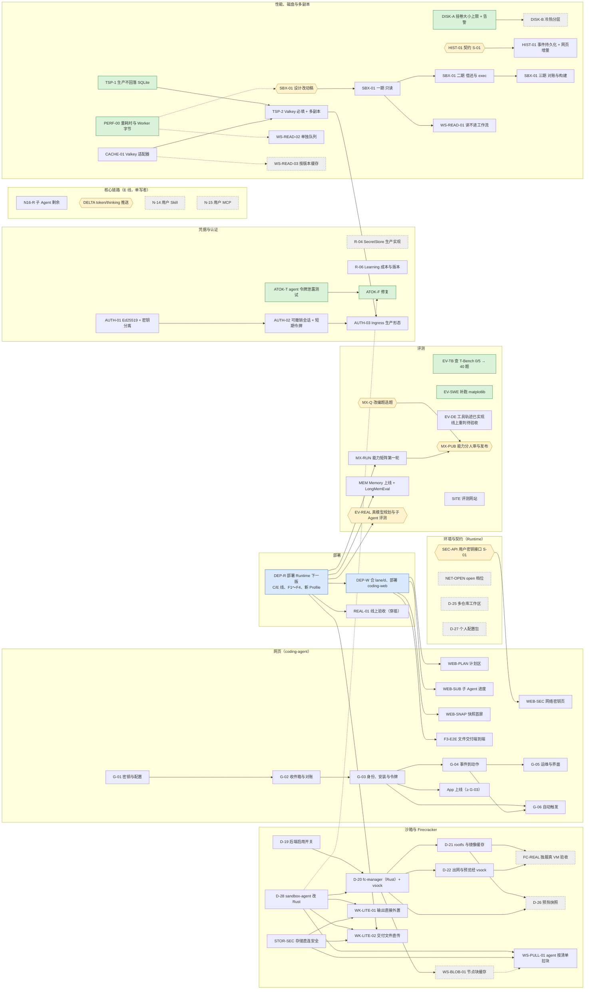

# 全部计划的总表与 DAG（2026-11-03）

> 用户要求：把所有计划（含项目原有的）统计在一起，整理一份 DAG。
> 口径：agent-runtime `origin/main` 的 `7ec2453` 加本分支（`claude/agent-runtime-resume-ku809d`）上的计划草案；coding-agent 以它的 main 与 `docs/plan/` 为准。
> 来源：[work-dag-2026-11-03.md](work-dag-2026-11-03.md)（线与第一波 DAG）、[handoff-2026-11-03.md](handoff-2026-11-03.md)、[lane-merge-2026-11-03.md](lane-merge-2026-11-03.md)、[remaining-work-execution-plan-2026-11-02.md](remaining-work-execution-plan-2026-11-02.md)、[post-acceptance-work-items-2026-11-03.md](post-acceptance-work-items-2026-11-03.md)、[feedback-2026-11-01.md](feedback-2026-11-01.md)（N-xx）、[cloud-deploy.md](cloud-deploy.md) 与 [gate 清单](cloud-deploy-gates-2026-11-02.md)（D-01～D-17）、[firecracker-backend.md](firecracker-backend.md)（D-19～D-22、D-26、D-28）、[environment-config.md](environment-config.md)（D-23～D-27）、[sub-agent.md](sub-agent.md)、[eval-site.md](eval-site.md)、[workspace-read-latency-and-disk-2026-11-03.md](workspace-read-latency-and-disk-2026-11-03.md)、[auth-tokens-2026-11-03.md](auth-tokens-2026-11-03.md)，以及 coding-agent 的 `docs/plan/github-app.md`（G-01～G-06）。
> 本文只汇总与排依赖，不改各项的内容与决定；各项以原文档为准。状态有变时改原文档，再回来改这里。

## 1. 已完成（不再画进 DAG）

| 范围 | 内容 |
| --- | --- |
| 强档计划 | S-01～S-13；T-xx（Model Gateway、Registry、Policy Engine、工具、Telemetry、Learning Pipeline 等）；R-01、R-05 的大部分 |
| 云上部署 | D-01～D-17 的代码；cgent.link 单节点集群在线（Helm 第 23 版，R2 已接上，D-09）；线上验收按 gate 清单部分完成 |
| 反馈修复 | N-01～N-03、N-05～N-13、N-17 |
| 人工验收后的工作项 | ENV-01（只读查询）、MODEL-BUDGET-01/02、ROUTING-01、CONTEXT-01 |
| 第一波（任务 17～24） | 17 判分走 Gateway、22 网关等预算表、19 B1/B2 能力矩阵代码、21 coding-agent 环境配置与 Workspace 界面；C 线（ENV-02、N-10）与 E 线（N-04、N-19、N-20、N-16 的一部分）2026-11-03 人审后合进 main |
| F 线 | F1 模型目录同步、F2 Memory 的评测与线上检索器、F3 文件交付的 Runtime 一侧与 Reviewer 的 highlights、F4 注册防滥用与花费面板 |

## 2. 待部署（已在 main，没上线）

2026-11-04 第 24 版（DEP-R，`6cc16b8`，记录在 `cloud-deploy.md`）上了：C、E 两条线；F1～F4；`bb832bf`；26 个 Profile 与重算的白名单；首事件延迟与花费面板、告警；TSP-1/TSP-2/CACHE-01（生产模式、Valkey）；AUTH-01（仍收开发令牌）；D-19、DISK-A、STOR-SEC、HIST-01、PERF-00、R-06、G-03-9、WS-READ-03。

还没上的：WS-READ-02（`71b9226`，加 Worker 池）与之后合进 main 的；沙箱里的 agent（ATOK-F，要真沙箱探一次）；Memory Service 的新镜像（MEM）；看板 ff3a385 之后的；AUTH-01 切换的第 1 步起（`auth-tokens-2026-11-03.md` 第 4 节）。之后 coding-agent 合 `lane/d`（同时把 `.env` 上限改成 16 KiB、64 个），再部署 coding-web（DEP-W）。

## 3. 未完成的工作项

档：近 = 建议近期做；中；远 = 等前置或资源。状态：待做、草案（等人确认）、人定（卡在人的决定或评审）、外部（卡在外部资源）、推迟。

| 编号 | 内容 | 出处 | 依赖 | 状态 | 档 |
| --- | --- | --- | --- | --- | --- |
| DEP-R | 部署 Runtime 下一版（第 2 节） | lane-merge | — | 已完成（2026-11-04 第 24 版，`6cc16b8`） | 近 |
| DEP-W | coding-agent 合 lane/d，部署 coding-web | lane-merge | DEP-R | 待做 | 近 |
| EV-TB | 查 Terminal-Bench 0/5 的原因，再跑 40 题 | handoff | — | 原因已查清（[记录](ev-tb-0of5-2026-11-04.md)）：环境配额满了，五题都退回 universal，没用上官方镜像；顺带修了失败原因里的签名地址。再跑之前要人放宽配额、查镜像仓库为什么是空的；适配器识别“环境没用上”可以先做 | 近 |
| EV-SWE | SWE-bench 补跑 matplotlib-13989 | handoff | — | 待做 | 近 |
| EV-DE | DeepEval 把工具调用轨迹放进用例 | handoff | — | **代码完成**（`c1a307a`）；线上重判待验收，见 [记录](ev-de-tool-evidence-2026-11-04.md) | 中 |
| MX-RUN | 能力矩阵第一轮（贵模型走淘汰赛） | work-dag 19-run | DEP-R（新 Profile） | 待做（花钱） | 中 |
| MX-Q | S-09～S-11 格子的改编题：选题与补标签 | work-dag | — | 人定 | 中 |
| MX-PUB | 能力分人审后经 Registry 发布 | work-dag 19-publish | MX-RUN、MX-Q | 人定 | 中 |
| SITE | 评测网站（主页、结果、数据集） | eval-site（H 线） | — | 代码已完成（`5035d85`、`2abcba2`，见 eval-site.md 末节）；上线要人建只读令牌、部署新的 learning 镜像 | 中 |
| MEM | Memory 上线（Milvus、真 embedding、Worker→Memory），LongMemEval 验收 | P1-D、F2 | DEP-R | 待做（要资源） | 中 |
| EV-REAL | 真模型下规划质量与子 Agent 拆分的评测 | lane-merge | DEP-R | 人定（花钱） | 中 |
| WEB-PLAN | 网页：计划区（`plan_updated`、快照里的 plan） | lane-merge（N-04） | DEP-W | 已完成（coding-agent `7983507`，没部署；快照里的 plan 随 WEB-SNAP） | 中 |
| WEB-SUB | 网页：并行子 Agent 的进度 | lane-merge（N-16） | DEP-W | 已完成（coding-agent `28082cd`，没部署） | 中 |
| WEB-SNAP | 网页：用快照画首屏、处理 409 | lane-merge（N-19） | DEP-W | 已完成（coding-agent `2b793a1`，没部署；取不到快照时照旧逐个回放，所以可以先于 Runtime 部署） | 中 |
| F3-E2E | 文件交付的端到端 | n18-file-delivery-f3 | DEP-W | 已完成（`ca4fc2e`，没部署） | 中 |
| SEC-API | 用户密钥的写入、列举、删除接口（S-01） | lane-merge（ENV-02） | 契约人审 | 已完成（契约 `56f21cd` 2026-11-04 人审通过；`ae8efc3` 测试、`f3b02df` 实现；没部署） | 中 |
| WEB-SEC | 网页：网络密钥页 | coding-agent | SEC-API | 已完成（coding-agent `609e986`，没部署）；默认关着（`CODING_NETWORK_SECRETS=1` 才打开）：环境引用密钥是 D-23 第二阶段，要人先选首个真实服务与客户端 | 中 |
| NET-OPEN | `open` 档位的公网授权（S-01） | lane-merge | 契约人审 | 推迟 | 远 |
| D-25 | 多仓库工作区（S-01） | environment-config | 契约人审 | 草案 | 远 |
| D-27 | 个人配置包（skills 等） | environment-config | — | 占位 | 远 |
| N16-R | N-16 剩下的：brief、来源卡片与综合节点、预算份额、mid 档、评测对照（E 线，单写者） | sub-agent | — | 草案 | 中 |
| DELTA | `token_delta`、`thinking_delta` 的推送入口与平台令牌 | lane-merge（N-20） | 安全评审 | 人定 | 中 |
| N-14 | 用户自定义 Skill（Registry 新条目，S-01） | feedback 第 4 节 | 契约人审 | 草案 | 远 |
| N-15 | 用户自己的 MCP Server（S-01） | feedback 第 4 节 | 契约人审 | 草案 | 远 |
| R-04 | SecretStore 的生产实现 | post-acceptance、P1-B | — | 待做（要资源） | 远 |
| R-06 | Learning Pipeline 的成本与版本固定 | P1-B | — | 不等存储选型的两条已完成（`f1b017b` 测试、`ccf29a5` 实现：计量记 `price_at`、Profile 文件缺单价拒绝加载；没部署）；剩下**人定**：成本事件的权威存储、usage 延迟的处理；另有 `scripts/sync_model_profiles.py` 把 models.dev 缺的单价写成 0，要人定缺价时是报错还是跳过 | 远 |
| G-01～G-06 | GitHub App：密钥与配置 → 收件箱 → 身份与令牌 → 事件到动作 → 运维；G-06 自动触发在 G-03、G-04 之后；上线至少 G-01～G-03 | coding-agent github-app | — | G-01 已完成（coding-agent `175100d`，没部署）；G-02 已完成（coding-agent `a3b1331`，没部署）；G-03 的 coding-agent 一侧已完成（`a93fa5a`）；第 9 条的 Runtime 一侧已修（G-03-9，`2e924a3`，没部署；专门的安全评审仍待人排期）；G-04 已完成（`4e223b5`，没部署）；G-05 已完成（coding-agent `8f296eb` 服务端、`7770026` 账号页、`67ee776` 卸载 30 天后去掉安装 ID；Grafana 告警在本仓库；没部署；测试 App 要人注册）；G-06 已完成（coding-agent `f0a229a`，没部署；上线前要在 App 设置里加 Issues 读写与 `issue_comment` 事件） | 中 |
| D-19 | 后端登记的启用开关与能力 | firecracker-backend | — | 已完成（`f9f0c4d`，没部署） | 中 |
| D-28 | sandbox-agent 按原接口改写为 Rust | firecracker-backend | — | 草案（Rust 依赖清单要人审） | 中 |
| D-20 | fc-manager（Rust）与 vsock agent | firecracker-backend | D-19、D-28 | 草案 | 中 |
| D-21 | 客户机 rootfs 与镜像缓存 | firecracker-backend | D-20 | 草案 | 远 |
| D-22 | 出网与预览经 vsock | firecracker-backend | D-20 | 草案 | 远 |
| FC-REAL | 独服上真 VM 的验收（耗时、密度） | firecracker-backend | D-21、D-22 | 待做 | 远 |
| D-26 | 预热快照 | firecracker-backend | D-20、D-21 | 草案 | 远 |
| PERF-00 | 分段量 Workspace 操作与历史加载的耗时；含 WK-LITE-03（进出 Worker 的字节数） | workspace-read 第 2、7 节 | — | Runtime 一侧已完成（`d180ae3` 测试、`fb971d2` 实现、`460b167` 面板检查；没部署）；coding-agent 的历史加载已完成（PERF-00-CA，coding-agent `6fc5e16` 测试、`6efb098` 实现；没部署） | 近 |
| DISK-A | WS-DISK-01 ① 挂卷也执行大小上限、③ 卷用量告警 | workspace-read | — | 已完成（`55ebf81`，没部署；超限按设计稿拒绝写类工具，“拒绝还是只警告”仍可由人改） | 近 |
| DISK-B | WS-DISK-01 ② 冷热分层（先存档成功再删本地） | workspace-read | DISK-A | 已完成（契约 `a66a673` 2026-11-04 人审通过；`8f434d5` 测试、`690770a` 与 `0a8feb2` 实现；没部署）。部署默认值 `worker.workspaceColdAfterDays` 是 0（不转冷），具体天数仍由人定 | 远 |
| TSP-1 | TS-PROD-01 ① 生产模式没有 Postgres DSN 拒绝启动 | workspace-read | — | 已完成（`00ef868`，没部署） | 近 |
| CACHE-01 | Cache 的 Valkey 适配器与部署 | workspace-read | — | 已完成（`5a7334f`，没部署） | 中 |
| TSP-2 | TS-PROD-01 ②③ Cache 必须是 Valkey、连接池、task-service 多副本 | workspace-read | TSP-1、CACHE-01 | 已完成（`08e6745`，没部署；部署前先建 Valkey 的 Secret、重跑 `deploy/data/install.sh`） | 中 |
| HIST-01 | 事件按 event_id 持久化，按 Session 批量取（S-01）；网页增量加载 | workspace-read | 契约人审（只有批量取的接口） | 持久化与读回已完成（`5d8c071`：SSE 从业务库补发、结束的 Task 重放全部、快照读业务库；没部署）；批量取的契约 2026-11-04 人审通过（`5760a9f`，基线已更新），实现待做；网页的增量加载在它之后 | 中 |
| SBX-01 | Sandbox Service：设计改动稿 → 一期只读 → 二期借还与 exec（核心链路）→ 三期对账与构建 | workspace-read | 设计改动稿人审 | 设计改动稿已写（[sbx-01-sandbox-service-2026-11-03.md](sbx-01-sandbox-service-2026-11-03.md)），等人审；一期之后的实现等审 | 中 |
| WS-READ-01 | 只读操作经 Sandbox Service，不进工作流、不新建沙箱 | workspace-read | SBX-01 一期 | 草案 | 中 |
| WS-READ-02 | Workspace 操作单独一个队列与 Worker 池 | workspace-read | 契约人审（names.proto 加队列） | 已完成（契约 `ebf963e` 2026-11-04 人审通过；`1c322b2` 测试、`71b9226` 实现；没部署）。上线后旧的 task、program 队列上的登记留到改之前起的操作跑完再去掉 | 中 |
| WS-READ-03 | 文件树与 diff 按工作区 generation 缓存 | workspace-read | （多副本时 CACHE-01） | 已完成（`d35923b`，没部署） | 远 |
| WS-BLOB-01 | 存档块的节点本地 LRU 读缓存 | workspace-read | D-20（Firecracker 的块服务） | 草案 | 远 |
| STOR-SEC | 存储直连的安全要求：PUT 签 checksum、If-None-Match、Content-Length，日志打码，精确主机放行 | workspace-read 第 8 节 | — | 已完成能先做的（`b65ab01`：`ObjectStore.SignedUpload`，两种语言；出网网关审计与日志不带查询串的测试）。真实 R2 上三个头是否强制执行要跑 `AR_LIVE_S3`（写真实的桶，要人点头）；精确主机放行与“只在那一次操作里开授权”随 WS-PULL-01 做 | 中 |
| WS-PULL-01 | agent 按清单拉块、只传缺的块 | workspace-read 第 6 节 | D-28、STOR-SEC；Firecracker 下另要 D-20、WS-BLOB-01 | 草案 | 远 |
| WK-LITE-01 | 命令输出由 agent 直接外置 | workspace-read 第 7 节 | D-28、STOR-SEC | 草案 | 远 |
| WK-LITE-02 | 交付文件由 agent 直传 | workspace-read 第 7 节 | D-28、STOR-SEC、DEP-R（F3） | 草案 | 远 |
| ATOK-T | AGENT-TOK-01：测用户命令能否从 `/proc/1/environ` 读到 agent 令牌 | auth-tokens | — | 已完成（`a194d8b`；风险属实，见第 8 节） | 近 |
| ATOK-F | AGENT-TOK-01 的修复（Go 版；Rust 版在 D-28 里同一条验收） | auth-tokens | ATOK-T | 已完成（`69a9a30`，Go 版；没部署） | 近 |
| AUTH-01 | Ed25519 签名的标准 JWT，Runtime 只持公钥；第三方令牌的加密密钥独立 | auth-tokens | — | 已完成（代码；没部署，切换步骤见 auth-tokens 第 4 节） | 中 |
| AUTH-02 | 浏览器只拿可撤销的会话 id，调 Runtime 时现签短期令牌 | auth-tokens | AUTH-01 | 已完成（coding-agent `953fc29`；没部署） | 中 |
| AUTH-03 | Ingress 的生产形态：身份服务或签发服务、网关的全局限流、PKCE | auth-tokens | AUTH-02、TSP-2 | 人定：PKCE、JWKS、全局限流已做（coding-agent `c3d8845`）；身份服务选型见 auth-tokens 第 5 节 | 远 |
| REAL-01 | 线上全组件验收（穿插着跑） | post-acceptance、gate 清单 | 各项部署 | 外部（部分：Cloudflare 桥令牌、预览证书） | 中 |
| SBX-RS-01 | Rust 版 agent 的原型实测 | workspace-read 第 5 节 | — | 取消（改为 D-28） | — |

## 4. DAG

方框的颜色：绿 = 近期建议、蓝 = 部署、白 = 待做或草案、六边形 = 人定或评审、灰 = 推迟或卡外部资源、橙 = 正在实现（第 8 节）。只画未完成的；已完成的见第 1 节。

虚线是“建议先有”而不是硬依赖：PERF-00 的数字决定 SBX-01、WS-READ-02 的轻重；WS-READ-03 在多副本时才需要 CACHE-01；Firecracker 下 WS-PULL-01 经块缓存取块；ATOK-F 的 Rust 版随 D-28 一起做。

## 5. 不能同时改的文件（单写者与重叠）

| 冲突点 | 涉及 | 规则 |
| --- | --- | --- |
| 核心链路（`workflows/task.py`、`stage_runner.py`、`node_executor.py`） | N16-R、DELTA、SBX-01 二期（`shell_run`、`repo_*` 改调服务） | CLAUDE.md：同一时间只由一个 agent 改；SBX-01 二期排在 N16-R 之后，或由 E 线来做 |
| Broker 与后端登记（`agentruntime_worker/sandbox/`、`tools/sandboxes.py`） | D-19、SBX-01、DISK-A、WS-READ-02 | 同一时间一条线；D-19 先做 |
| coding-agent 的 `oauth.go`、`accounts.go`、`store.go` | G-01～G-03、AUTH-01、AUTH-02 | 由 G 线一起做，或 AUTH 排在 G-03 之后 |
| sandbox-agent | D-28、ATOK-F、WS-PULL-01、WK-LITE-01/02 | D-28 期间 Go 版只修 ATOK-F，新接口只加在 Rust 版 |
| `/proto`、`/schemas` | SEC-API、NET-OPEN、D-25、N-14、N-15、HIST-01 | 每项单独成组，走 S-01 |

## 6. 建议的近期顺序

1. **DEP-R → DEP-W**：解开最多下游（网页四项、能力矩阵、Memory 上线、真模型评测、REAL-01）。
2. **便宜的安全项，可以和 1 并行**：DISK-A（盘满会拖垮同节点的数据库）、TSP-1、ATOK-T（确认后再 ATOK-F）。
3. **PERF-00**：先有数字，再定 SBX-01、WS-READ-02 的轻重。
4. **评测收尾**：EV-TB、EV-SWE；MX-Q 人定后跑 MX-RUN。
5. **两条长线并行起步**：G-01～G-03（App 上线的前提）；D-19 与 D-28（Firecracker 的前提，D-28 的 Rust 依赖清单先人审）。

## 7. 要人定的

- 契约人审（S-01）：WS-READ-02、HIST-01、SEC-API、DISK-B 已于 2026-11-04 通过（兼容性基线已更新）；之后的 NET-OPEN、D-25、N-14、N-15。
- 设计改动：SBX-01（设计书 4.10）；Rust 进技术栈（4.15，D-20、D-28 的依赖清单）；Ingress（4.14，AUTH-03）；附录 A 的环境配置术语（ENV-02）。
- 花钱：MX-RUN、EV-REAL、EV-TB 的 40 题。
- 其他：MX-Q 的选题与标签；DELTA 的内部入口（安全评审）；F4 告警的通知渠道；DISK-B 的闲置天数与 `max_bytes` 超限的处理；Valkey 是否持久化。

## 8. 正在实现（认领）

开工前先在这里登记并推送，做完改成“已完成”并写上提交；别的会话看到“进行中”的不要同时改它独占的文件。

| 编号 | 线 | 谁 | 开始 | 独占的文件 | 状态 |
| --- | --- | --- | --- | --- | --- |
| EV-DE | 评测线 | Codex 桌面会话 | 2026-11-04 | `services/py-learning` 的 `evals/deliverables.py`、`evals/bridges/deepeval_bridge.py`、`evals/frameworks.py` 的 Windows 环境白名单、`benchmarks/swebench.py` 的事件采集扩展点及对应评测测试、deliverables README | 已完成代码与离线验收（认领先推送 `3a47cfa`，实现 `c1a307a`）；线上重判待验收。见 [实施记录](ev-de-tool-evidence-2026-11-04.md) |
| TSP-1 | TSP 线（TSP-1 → CACHE-01 → TSP-2），直接在 main 上提交 | Claude 桌面会话（Opus 5.5） | 2026-11-03 | `services/go-task-service/internal/config`、`cmd/task-service/main.go` 的 Provider 选择 | 已完成（`aee014a` 测试、`00ef868` 实现；没部署） |
| CACHE-01 | TSP 线 | Claude 桌面会话（Opus 5.5） | 2026-11-03 | 新包 `libs/go-core/adapters/valkey`（标准库自写 RESP 客户端，不引新依赖）；`deploy/data` 里新加的 Valkey；task-service 的 Cache 选择（`internal/config`、`cmd/task-service/main.go`） | 已完成（`377bcd8` 测试、`5a7334f` 实现；没部署，部署前要先建 `valkey-agentruntime`、`agent-runtime-valkey` 两个 Secret） |
| TSP-2 | TSP 线 | Claude 桌面会话（Opus 5.5） | 2026-11-03 | task-service 的 `internal/config`、`cmd/task-service/main.go`；Chart 的 `task-service.yaml` 与 values 里 task-service、`secrets.valkeyUrl` 的部分；`libs/go-core/adapters/postgres` 的连接池选项；`tests/e2e` 里新加的两副本用例 | 已完成（`c956594` 测试、`08e6745` 实现；没部署）。TSP 线到此为止：下游 AUTH-03 还要等 AUTH-02 |
| ATOK-T | ATOK 线（ATOK-T → ATOK-F），直接在 main 上提交 | Claude 桌面会话（Opus 5.5，另一个） | 2026-11-03 | `services/go-sandbox-agent`（`cmd/sandbox-agent`、`internal/agent`）；`libs/py-core/tests/adapters/test_k8s_sandbox.py` 新加的一条 | 已完成：`a194d8b` 测试、`69a9a30` 修法（agent 启动时 `PR_SET_DUMPABLE=0`）。GitHub 的 Linux runner（uid 1001）上修法前测试读到了令牌、修法后通过；kind 的那一条修法前也读到了。没部署 |
| PERF-00 | PERF 线（PERF-00 的 Runtime 一侧，含 WK-LITE-03；coding-agent 的历史加载另做），直接在 main 上提交 | 同上 | 2026-11-03 | `services/py-worker` 的 `workspace/operations.py`、`workspace/archive.py`、`tools/platform.py`（只加计时与字节计数，不改行为）、新模块 `workspace/timing.py`；`deploy/data/dashboards/agent-runtime.yaml`（`sandbox/broker.py` 与 py-core 最后没有改） | Runtime 一侧已完成（`d180ae3` 测试、`fb971d2` 实现、`460b167` 面板检查；没部署，基线等部署后取一周）；coding-agent 的历史加载没人认领 |
| AUTH-01 | AUTH 线（AUTH-01 → AUTH-02 → AUTH-03），直接在 main 上提交；先做 Runtime 一侧，coding-agent 一侧（签发与第三方令牌的独立密钥）在确认 G 线没在改 `oauth.go`、`accounts.go`、`store.go` 之后接着做 | Claude 桌面会话（Opus 5.5，ATOK 与 PERF 的那个） | 2026-11-03 | 新包 `libs/go-core/adapters/jwtingress`；task-service 的 Ingress 选择（`internal/config` 里 `AR_INGRESS_*` 的部分、`cmd/task-service/main.go` 的 Ingress 构造与新的 `keygen` 子命令）；Chart 里 task-service 的 Ingress 配置与 `taskService.ingress`；coding-agent 的 `internal/server/server.go`（令牌的签发与校验）、`accounts.go`（第三方令牌的加密密钥）、`cmd/coding-web/main.go` 的环境变量 | 已完成：Runtime 一侧 `885a13f` 测试、`0e9ad9f` 实现；coding-agent 一侧 `ece577f` 测试、`c5e5af3` 实现（JWT 私钥与第三方令牌的独立密钥都是可选的，不配时行为不变）。没部署：切换步骤见 [auth-tokens 第 4 节](auth-tokens-2026-11-03.md) |
| AUTH-02 | AUTH 线，直接在 coding-agent 的 main 上提交 | 同上 | 2026-11-03 | coding-agent 的 `internal/server/server.go` 里 Cookie 与 `authed` 的部分、`accounts.go` 登录成功后建会话的那一处、新文件 `internal/server/browser_sessions.go`、`messages_en.go` 三条文案、`cmd/coding-web/main.go` 的会话有效期变量（网页的静态文件不动） | 已完成（coding-agent `4bda335` 测试、`953fc29` 实现；没部署）：Cookie 里只有会话 id，退出登录与“退出所有设备”（`POST /api/sessions/revoke-all`）立即生效，调 Runtime 时现签 5 分钟的令牌；旧的令牌 Cookie 在有效期内换成会话 |
| AUTH-03 | AUTH 线，两个仓库的 main | 同上 | 2026-11-03 | coding-agent 的 OAuth（`internal/server/oauth.go` 的授权地址与换令牌、`accounts.go` 的回调里核 state 的那一处）与新的 JWKS 端点；`docs/plan/auth-tokens-2026-11-03.md` 的身份服务评估 | 不用人定的部分已完成（coding-agent `03b944b` 测试、`c3d8845` 实现：GitHub、GitLab、Gitea、Google 的 PKCE，`/.well-known/jwks.json`；全局限流在 AUTH-01 里经 Valkey）。剩下身份服务的选型与设计书 4.14，人定，评估见 [auth-tokens 第 5 节](auth-tokens-2026-11-03.md)。AUTH 线到此为止 |
| G-01 | G 线（G-01 → G-02 → G-03 …，coding-agent 的 `docs/plan/github-app.md`），直接在 coding-agent 的 main 上提交 | 同上 | 2026-11-03 | coding-agent 新文件 `internal/server/githubapp.go`（App 的配置与校验）、`accounts.go` 的令牌密钥（`CODING_TOKEN_KEY_PREVIOUS`）、`cmd/coding-web/main.go` 的 `CODING_GITHUB_APP_*`、`CODING_GITHUB_WEBHOOK_SECRET*` 变量、`deploy/k8s/coding-web.yaml` 的私钥挂载 | 已完成（coding-agent `58fec67` 测试、`175100d` 实现；Runtime 的 Chart 检查 `test_github_app_key_is_not_in_the_runtime_chart`；没部署）。与计划不同：私钥单独放 Secret `coding-github-app`（`coding-oauth` 是 envFrom 的），见 github-app.md 的 G-01 |
| G-02 | G 线 | 同上 | 2026-11-03 | coding-agent 新包 `internal/github`（收件箱、处理与对账，Postgres）、`internal/server` 里挂 Webhook 路由的一处、`cmd/coding-web` 的 `github-replay` 子命令与 `CODING_GITHUB_DSN`、`go.mod` | 已完成（coding-agent `92d8421` 测试、`a3b1331` 实现；没部署，上线要建库并给 `CODING_GITHUB_DSN`）。第 6 条的“处理函数执行两次结果相同”等 G-04，告警指标等 G-05 |
| G-03 | G 线 | 同上 | 2026-11-03 | coding-agent 新文件 `internal/github` 里的安装与令牌（`installations.go`、`tokens.go`）、`internal/server` 的 Setup URL 与 `authorizeRepo`（新文件 `githubrepo.go`），以及 `publish.go`、`projects.go` 里取 Git 凭据的地方；Runtime 一侧第 9 条（工作副本 `.git/config` 拿不到令牌）的测试 | coding-agent 一侧已完成（`18df737` 测试、`a93fa5a` 实现；没部署，上线要 Client secret）：实际都在 `internal/server/githubrepo.go`，没有另建 `internal/github` 的文件。**第 9 条没做**：Workspace 操作带凭据时，工作副本里 Agent 能改的 Git 配置会不会影响凭据，要做一次专门的安全评审（Runtime 的 `workspace/operations.py`），留给人排期 |
| G-04 | G 线 | 同上 | 2026-11-03 | coding-agent 新文件 `internal/server/githubevents.go`（各事件的处理函数，注册进 G-02 的收件箱）、`store.go` 里工作区与会话的远端状态字段、`cmd/coding-web/main.go` 里注册处理函数的一处 | 已完成（coding-agent `ee29d0d` 测试、`4e223b5` 实现；没部署）。界面上的展示归 G-05 |
| G-05 | G 线（先做服务端：指标、安装的对账、卸载时的清理、给界面用的状态接口；界面等 WEB-SUB 放开 `app.js`、`i18n.js` 之后再做） | 同上 | 2026-11-03 | coding-agent 新文件 `internal/server/githubops.go`、`internal/github` 的计数、`cmd/coding-web/main.go` 里 Telemetry 与对账的接线；Runtime 的 `deploy/data/values/grafana.yaml` 里 coding-web 的告警 | 服务端已完成（coding-agent `66e3e9a` 测试、`8f296eb` 实现；本仓库的告警见 `tests/deploy/test_coding_web_alerts.py`；没部署）。顺带修了 G-04 的一处：卸载后重新安装、移除后又加回仓库而事件丢了时，项目不再一直停在 `app_removed`、`repo_removed`。界面（第 3 条）已完成（`f8b216b` 测试、`7770026` 实现：账号页里的 GitHub App 一段，真浏览器的用例过；`i18n.js` 只提交了自己的 `github.*`，别的会话没提交的 `reason.*` 没动）；“安装记录保留 30 天”（第 5 节第 6 条）已完成（`9e2306b` 测试、`67ee776` 实现：没有单独的安装记录，对账在卸载 30 天后去掉项目上的安装 ID）。第 5 条的测试 App 要人注册 |
| G-06 | G 线（自动触发；代码对着替身 GitHub 做，上线前要人在 App 设置里加 Issues 读写与 `issue_comment` 事件），直接在 coding-agent 的 main 上提交 | 同上 | 2026-11-03 | coding-agent 新文件 `internal/server/githubtrigger.go` 与它的测试；`githubevents.go` 里登记 `issue_comment`、`ghEvent` 加评论与 Issue 的字段；`store.go` 的 `Session` 加触发记录；`cmd/coding-web/main.go` 起后台的推进循环（不碰 `server.go`、`tasks.go`、`publish.go`、网页文件） | 已完成（coding-agent `d52d8c6` 测试、`f0a229a` 实现；没部署）。与认领时不同：触发记录单独存 `<数据目录>/github-triggers.json`，`store.go` 没改。实现时定的默认（都取保守的一边）见 github-app.md 的 G-06：GitHub 一侧全用安装令牌、PR 由 App 开；触发者要有 Coding Agent 账号与这个仓库的项目；每仓库每小时 3 次、5 美元；fork 的 PR 一律不运行；推送失败或中断不重试。还要人做：App 加 Issues 读写与 `issue_comment`；注入样本进评测集（标注要人确认）；coding-agent 的 CLAUDE.md 里“由人点按钮触发”那句 |
| D-19 | Firecracker 线（D-19；D-20 之后要等 D-28 的 Rust 依赖清单人审），直接在 main 上提交 | Claude 桌面会话（Opus 5.5） | 2026-11-03 | `services/py-worker` 的 `tools/sandboxes.py`、`sandbox/broker.py` 里选后端的部分（`_create`、`_candidates`）、`sandbox/reconcile.py`；Chart 的 `worker.shell.backends` 样例；`scripts/dev_stack.py` 的登记样例 | 已完成（`51716da` 测试、`f9f0c4d` 实现；没部署）。验收 6（一致性测试按启用的后端各跑一遍）没做：一致性测试按适配器在 py-core 里跑，不按登记文件 |
| DISK-A | DISK 线（DISK-A；DISK-B 要人定闲置天数），直接在 main 上提交 | Claude 桌面会话（Opus 5.5） | 2026-11-03 | `services/py-worker` 的 `tools/platform.py` 里写类工具（`repo_edit`、`shell_run`）前后的大小核对、新模块 `workspace/size_guard.py`、`sandbox/reconcile.py` 里报卷用量；`deploy/data/values/grafana.yaml` 的告警与 `dashboards/agent-runtime.yaml` 的面板 | 已完成（`8db9053` 测试、`55ebf81` 实现；没部署）。量大小放在写类工具前后（不改核心链路），没超时同一 Worker 进程内至少隔 30 秒量一次 |
| STOR-SEC | STOR 线（STOR-SEC；WS-PULL-01、WK-LITE-01/02 还要等 D-28），直接在 main 上提交 | Claude 桌面会话（Opus 5.5） | 2026-11-03 | ObjectStore 的预签名：`libs/py-core` 的 `adapters/sigv4.py`、`s3_object_store.py`、`s3test.py`、`dev/object_store.py`、`providers/object_store.py` 与一致性测试；`libs/go-core` 的 `adapters/s3objects`、`providers/objectstore`、开发实现与一致性测试；出网网关审计不带查询串的测试 | 已完成能先做的（`be35ec2` 测试、`b65ab01` 实现）；剩下的见第 3 节 |
| WS-READ-03 | READ 线（WS-READ-03；WS-READ-02 要改 names.proto 的队列，走 S-01；WS-READ-01 等 SBX-01），直接在 main 上提交 | Claude 桌面会话（Opus 5.5） | 2026-11-03 | 业务库 `workspaces` 的 `generation`（迁移 210，`workspace/archive.py`）；`workspace/operations.py` 的分发、`tools/platform.py` 的写类工具之后加一；task-service 的 `internal/workspaceapi` 读操作的缓存与 `cmd/task-service/main.go` 的接线 | 已完成（`fef97f9` 测试、`d35923b` 实现；没部署）。generation 在每次写类工具与 Workspace API 的写操作之后加一（不是“可写节点结束”，免得动核心链路）；缓存 5 分钟兜底，单个结果最多 256 KiB |
| WS-READ-02 | READ 线 | Claude 桌面会话（Opus 5.5） | 2026-11-03 | `proto/agentruntime/workflow/v1/names.proto` 的 TaskQueue（契约草案，S-01）；之后：task-service 起 Workspace 操作的队列、Worker 的 `QUEUE_COMPONENTS` 与 Workspace 操作工作流、Chart 的 `worker.pools`、`scripts/dev_stack.py` 与 `tests/e2e` 的 Worker 队列 | 已完成（`1c322b2` 测试、`71b9226` 实现；没部署）：task-service 新起的操作在 workspace 队列；工作流的 activity 排在自己所在的队列（workspace 时用 workspace，否则沿用 program，旧历史回放不变）；Worker 在 workspace 上登记两者，task、program 上照旧登记给在途的旧操作；Chart 加 workspace 池（KEDA 看工作流与 activity 两种积压）；dev_stack、e2e 与 CLAUDE.md 订阅 workspace。Worker 56 条、部署 322 条、端到端 4 条通过 |
| HIST-01 | HIST 线（Runtime 一侧；coding-agent 的增量加载另做） | Claude 桌面会话（Opus 5.5） | 2026-11-03 | task-service 的 `internal/session`（发事件的 activity）、`internal/events`（SSE 端点）、`internal/taskstore` 的新迁移（事件表）；之后 Task API 批量取事件的契约草案 | Runtime 一侧已完成（`8996cb1` 测试、`5d8c071` 实现：迁移 7 的 task_events，先写库再写推流，重试沿用 event_id，逐字增量不进库）；`ListSessionEvents` 契约 2026-11-04 人审通过，**实现进行中**（2026-11-04 重新认领：`internal/taskapi/session_events.go`、`internal/taskstore` 加一个查 task_finished 的方法，与新测试）；事件表的保留期清理没做（Task 本身也还没有清理） |
| SBX-01 | SBX 线（设计改动稿；一期等人审） | Claude 桌面会话（Opus 5.5） | 2026-11-03 | 新文档 `docs/plan/sbx-01-sandbox-service-2026-11-03.md`（只写稿，不改代码） | 稿已写，等人审（第 9 节是要人定的五条） |
| SEC-API | SEC 线（契约草案；实现等 S-01，之后 WEB-SEC） | Claude 桌面会话（Opus 5.5） | 2026-11-03 | 新文件 `proto/agentruntime/workspace/v1/user_secrets.proto` 与生成代码（契约）；实现：`libs/go-core/providers/secretstore` 新加只在 Go 侧的可选接口 `Writer`（写、删；共用的 Store 接口不变）、`libs/go-core/dev/filesecrets` 实现它并在文件变了时重新读（出网网关是另一个进程，要看到新写的与删掉的）、task-service 新包 `internal/usersecrets`（服务、业务库里名字与时间的表）与 `cmd/task-service/main.go` 的接线 | 已完成（`ae8efc3` 测试、`f3b02df` 实现；没部署）：值在 `AR_SECRETS_FILE` 的租户作用域 `user-secrets/<用户>/<name>`，名字与时间在业务库 `user_secrets`（迁移 401）；SQLite 与 Postgres 各跑一遍；开发实现的 Read 每次重新读文件（生产 SecretStore 仍是 R-04）。错误按 Task API 的映射（`taskapi.ConnectError`，修正见 `usersecrets` 的后续提交）：没认证 Unauthenticated，稳定的 code（user_secret_limit、user_secrets_unavailable 等）在 google.rpc.ErrorInfo 里，应用经 HTTP + JSON 读得到。WEB-SEC 可以开始 |
| R-06（部分） | 价格版本固定的第一步：Model Gateway 的计量记录加 `price_at`；Profile 文件缺任一项单价时拒绝加载（与 `schemas/model_profile.schema.json` 一致，不再静默按 0 计） | Claude 桌面会话（Opus 5.5） | 2026-11-03 | `services/go-model-gateway/internal/profiles/profiles.go`、`internal/gateway/gateway.go` 的 MeterRecord 与新测试 | 已完成（`f1b017b`、`ccf29a5`） |
| G-03-9 | G-03 第 9 条的 Runtime 一侧：带凭据的 git（推送、对账、同步）不读工作副本的 `.git/config`。本机已复现：Agent 在 `.git/config` 写 `url.<ext::命令>.insteadOf` 加 `protocol.ext.allow=always`，推送时 `ls-remote` 执行它，`GIT_CONFIG_VALUE_*` 里的 Authorization 头落进 Agent 能读的文件 | Claude 桌面会话（Opus 5.5） | 2026-11-03 | `services/py-worker` 的 `workspace/operations.py` 里 `_git` 与推送、同步取远端的部分；新测试 `tests/test_workspace_git_config.py` | 已完成（`8580117` 测试、`2e924a3` 修法；没部署）：对账、推送、同步取远端改在环境里一个临时的裸仓库下跑（远端沙箱在环境自己的 `/tmp`，本地后端在 Worker 的临时目录），`GIT_OBJECT_DIRECTORY` 指回工作副本，不读全局配置，关掉 gc；shallow 进出都拷。没做：克隆与取提交仍在刚建的目录里跑（配置是这次操作写的）；只读操作（diff、log 等）照旧读工作副本的配置，但那时环境里没有凭据，只有这次操作的出网授权；在真 K8s 与 Cloudflare 环境里没跑过 |
| PERF-00-CA | PERF-00 的 coding-agent 一侧：网页量打开会话到历史画完的耗时与请求数（快照或逐个回放），报给 coding-web，经 G-05 的 Metrics 记成 `coding.history_load.duration_ms`、`coding.history_load.requests`（标签只有 mode）；只加计量，不改行为。直接在 coding-agent 的 main 上提交 | Claude 桌面会话（Opus 5.5） | 2026-11-03 | coding-agent 新文件 `internal/server/client_metrics.go` 与它的测试、`server.go` 里一条路由登记；`internal/web/static/app.js` 里 `api()`、`loadRun` 开事件流处的计数与 `replayTasks`；新测试 `internal/web/history_load_test.go`（不碰 `i18n.js`、`codes_test.go`） | 已完成（coding-agent `6fc5e16` 测试、`6efb098` 实现；服务端 3 条与真浏览器 2 条都过；没部署）。请求数只数取快照与开事件流，不含同时发出的改动、环境等请求；没加 Grafana 面板（Runtime 的面板检查只收 Runtime 发的指标），基线直接查 VictoriaMetrics 的 `coding_history_load_duration_ms` |
| DISK-B | DISK 线：WS-DISK-01 ② 的租户策略契约草案（S-01）：`workspace.cold_after_days`（挂卷的工作区闲置超过这么多天先存档、核对成功后删本地，下次用到时恢复；不写时不转冷）。实现与默认值等人定 | Claude 桌面会话（Opus 5.5） | 2026-11-03 | `schemas/tenant_policy.schema.json` 的 `workspace` 一节与 `schemas/examples/tenant_policy.examples.json` | 已完成（`8f434d5` 测试、`690770a`（提交说明写成了 wip）与 `0a8feb2` 实现；没部署）：对账的 activity 最多一小时扫一次挂卷的工作区，闲置够天数、没有环境占着的 active → cooling → 借环境存快照、与环境里的清单核对 → cold → 删本地目录，任何一步失败退回 active；挂卷时借 cold 的工作区先抢 restoring、清空目录、从快照恢复；repo_* 直接读目录，冷的同样经 broker 恢复，并按十分钟一次碰目录的修改时间（读也算用过）；cold 在 API 里是 ARCHIVED。新测试 11 条、相关回归 271 条通过（另 4 条是本机环境：没有 bash、硬链接、PATH 上没有 python，DISK-B 之前同样失败）。没覆盖：真 K8s 与 Cloudflare 上没跑；没有业务库记录的工作区（只经工具建的）不转冷；只读的借用与转冷之间仍有很小的竞争窗口 |
| F3-E2E | F 线（F3-E2E → WEB-PLAN → WEB-SUB），直接在 main 上提交 | Claude 桌面会话（Opus 5.5，F 线） | 2026-11-03 | agent-runtime 新加的 `tests/e2e/test_file_delivery.py`；`tests/e2e/e2e_support/api.py` 的 `submit` 加 `workspace_id`；`services/py-worker/src/agentruntime_worker/activities/stubs.py` 加一个 `deliver_file` 桩计划、桩 tool_loop 可按节点输入先调工具（只加，不改已有的桩计划） | 已完成（`ca4fc2e`：dev_stack 起整套，桩计划调真的 deliver_file；两条用例都过；没部署） |
| WEB-PLAN | F 线（F3-E2E → WEB-PLAN → WEB-SUB），直接在 coding-agent 的 main 上提交 | Claude 桌面会话（Opus 5.5，F 线） | 2026-11-03 | coding-agent 的 `internal/web/static/app.js` 里计划区的部分（新函数，接 `plan_updated`）、`i18n.js` 的 `plan.*` 文字、`style.css` 的计划区样式、新测试 `internal/web/plan_test.go`；不碰 AUTH-01 的 `server.go`、`accounts.go`、`main.go` | 已完成：测试 `f8ff7fd`、实现 `7983507`（coding-agent）；真浏览器用例过；没部署 |
| WEB-SUB | F 线 | Claude 桌面会话（Opus 5.5，F 线） | 2026-11-03 | coding-agent 的 `internal/web/static/app.js` 里子 Agent 进度的部分（新函数，按 node_id 归组 sub_agent 的 tool_status、context_usage）、`i18n.js` 的 `subagent.*` 文字、`style.css` 的进度样式、新测试 `internal/web/subagent_test.go`；不碰 AUTH 与 G 线的 server 文件 | 已完成：测试 `b4bf4a6`、实现 `28082cd`（coding-agent）；真浏览器用例过；没部署。F 线这一段到此为止，WEB-SNAP 等 AUTH-01 的 coding-agent 一侧（`server.go`） |
| WEB-SNAP | F 线（WEB-PLAN、WEB-SUB 之后），直接在 coding-agent 的 main 上提交 | Claude 桌面会话（Opus 5.5，F 线） | 2026-11-03 | coding-agent 的 `internal/server/server.go` 里新加的两条路由登记、新文件 `internal/server/snapshot.go`（快照的转发；事件转发接 `last_event_id`、上游 409 换成 `resnapshot_required` 事件，改 `tasks.go` 的 `handleEvents`）、`taskapi.go` 加取快照的方法；`internal/web/static/app.js` 里会话首屏与事件流续传的部分；新测试 `internal/server/snapshot_test.go`、`internal/web/snapshot_test.go` | 已完成：测试 `0bb5940`、实现 `2b793a1`（coding-agent）；后端 4 条与真浏览器的用例都过；没部署 |
| DEP-R | 部署线（DEP-R → DEP-W），用户 2026-11-03 在对话里同意 | Claude 桌面会话（Opus 5.5，F 线） | 2026-11-03 | 线上 Helm release `ar`（agent-runtime 命名空间）、服务器上的 `/root/ar-release/rev26`、镜像构建；部署期间别的会话不要 `helm upgrade` 或改线上的 ConfigMap、Secret | DEP-R 已完成（第 24 版，`6cc16b8`）；DEP-W 待用户同意 |
| EV-TB | 查 Terminal-Bench 0/5 的原因（用户 2026-11-04 同意只读查看服务器）；顺带修查到的一处泄漏：环境构建失败的原因里带着镜像仓库 CDN 签名地址的查询串 | Claude 桌面会话（Opus 5.5，G 线的那个） | 2026-11-04 | 新文档 `docs/plan/ev-tb-0of5-2026-11-04.md`；`services/py-worker` 的 `sandbox/env_builder.py` 的 `redact`、`sandbox/environments.py` 里存失败原因的那一处与新测试；线上只读，不改 | 已完成（见 [记录](ev-tb-0of5-2026-11-04.md)；修法没部署）。再跑 40 题要人放宽 `swebench` 的环境配额、查环境镜像仓库为什么是空的 |
| EV-TB-2 | EV-TB 第 3 节第 2 条：基准的适配器（SWE-bench 与 Terminal-Bench 共用的 runner）在 Task 结束后经 EnvironmentService 查这个工作区的沙箱用的是不是项目环境的镜像，没用上的记成“环境没用上”，报告里单列、不算进解决率 | Claude 桌面会话（Opus 5.5，G 线的那个） | 2026-11-04 | `services/py-learning` 的 `benchmarks/client.py`（加 ListEnvironments）、`benchmarks/swebench.py` 的 runner 与报告、`benchmarks/terminalbench.py` 的报告，与它们的测试 | 已完成（`7d42ad3` 测试、`438d2bb` 实现；没部署，下次在服务器上跑评测时用新的源码）：记录里有 `environment_used`，报告单列 `environment_fallback_ids` 与只算用上了的题的 `resolve_rate_with_environment`。本机 `test_terminalbench.py` 里判分的 3 条在没有这次改动的 HEAD 上一样失败（Windows），与这次无关 |
| WEB-SEC | 网页的网络密钥页（接 SEC-API 的 UserSecretService：列出、写入、删除；值只进不出）。D-23 第二阶段（选定首个真实服务与客户端、环境里引用密钥）之前不算“已支持”：默认关着，`CODING_NETWORK_SECRETS=1` 才打开，页上写明还不能被环境引用。直接在 coding-agent 的 main 上提交 | Claude 桌面会话（Opus 5.5，G 线的那个） | 2026-11-04 | coding-agent 新文件 `internal/server/user_secrets.go` 与它的测试、`server.go` 里的开关、路由与 `/api/config` 的一项、`cmd/coding-web/main.go` 的变量；`internal/web/static/app.js` 里新的密钥对话框、`i18n.js` 新加的 `secrets.*`（别的会话没提交的 `reason.*` 不动）、`style.css` 的几条、新测试 `internal/web/user_secrets_test.go` | 已完成（coding-agent `94b7724` 测试、`609e986` 实现；没部署）：`/api/secrets` 的列出、写入、删除转调 UserSecretService（带用户现签的令牌，名字与值先按契约核对，值不进响应、日志与数据目录）；账号页的入口与对话框（值的输入框是 password、保存后清空，真浏览器的用例过）。`i18n.js` 只提交了自己的 `secrets.*`。环境里引用密钥（`secret_headers`）是 D-23 第二阶段，没做 |
| HIST-01-B | HIST-01 的 `ListSessionEvents`（契约 2026-11-04 人审通过）：一次取回一个 Session 里若干 Task 在游标之后的事件，读业务库的 task_events | Claude 桌面会话（Opus 5.5，G 线的那个） | 2026-11-04 | task-service 的 `internal/taskapi/session_events.go` 与新测试；`internal/taskstore` 加一个查 task_finished 是否已记下的方法 | 进行中 |
