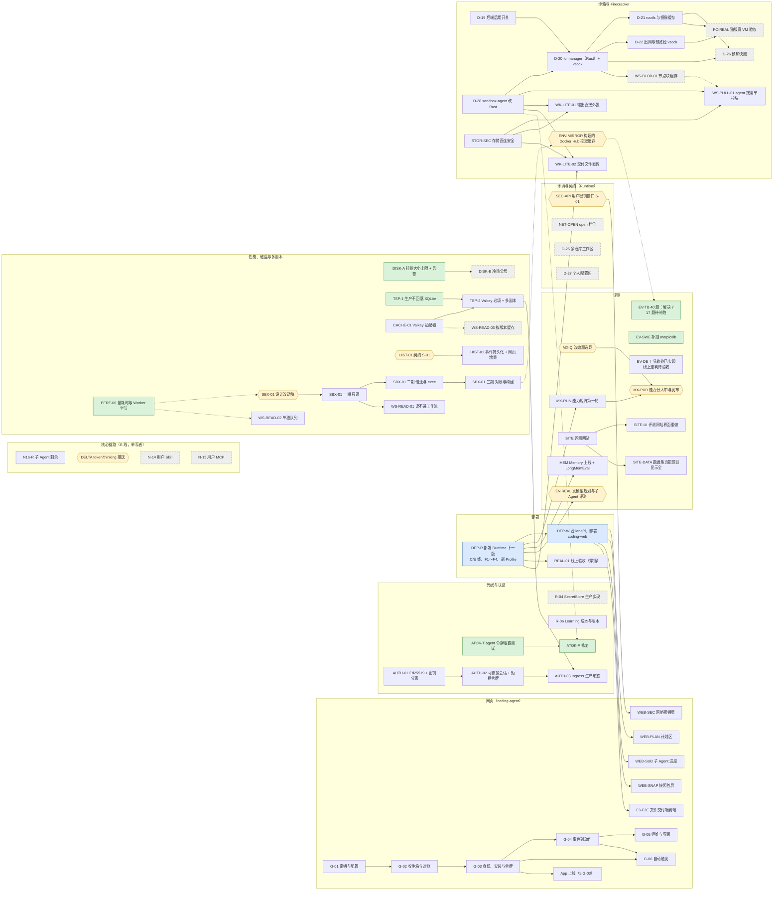

# 全部计划的总表与 DAG（2026-11-03）

> 用户要求：把所有计划（含项目原有的）统计在一起，整理一份 DAG。
> 口径：agent-runtime `origin/main` 的 `7ec2453` 加本分支（`claude/agent-runtime-resume-ku809d`）上的计划草案；coding-agent 以它的 main 与 `docs/plan/` 为准。
> 来源：[work-dag-2026-11-03.md](work-dag-2026-11-03.md)（线与第一波 DAG）、[handoff-2026-11-03.md](handoff-2026-11-03.md)、[lane-merge-2026-11-03.md](lane-merge-2026-11-03.md)、[remaining-work-execution-plan-2026-11-02.md](remaining-work-execution-plan-2026-11-02.md)、[post-acceptance-work-items-2026-11-03.md](post-acceptance-work-items-2026-11-03.md)、[feedback-2026-11-01.md](feedback-2026-11-01.md)（N-xx）、[cloud-deploy.md](cloud-deploy.md) 与 [gate 清单](cloud-deploy-gates-2026-11-02.md)（D-01～D-17）、[firecracker-backend.md](firecracker-backend.md)（D-19～D-22、D-26、D-28）、[environment-config.md](environment-config.md)（D-23～D-27）、[sub-agent.md](sub-agent.md)、[eval-site.md](eval-site.md)、[workspace-read-latency-and-disk-2026-11-03.md](workspace-read-latency-and-disk-2026-11-03.md)、[auth-tokens-2026-11-03.md](auth-tokens-2026-11-03.md)，以及 coding-agent 的 `docs/plan/github-app.md`（G-01～G-06）。
> 本文只汇总与排依赖，不改各项的内容与决定；各项以原文档为准。状态有变时改原文档，再回来改这里。

> 2026-11-04 用户委托的[代审结论与判定规则](delegated-review-2026-11-04.md)已落盘，覆盖 SEC-API、NET-OPEN、D-25、N-14、N-15、WS-READ-02、AUTH-03、D-28、SBX-01、MX-RUN、EV-REAL、EV-TB、DEP-R/DEP-W/REAL-01、G-03 Client secret 与 R-06。该记录明确通过范围、待关闭条件及后续修复/部署的状态差异，不将代审等同于实现或上线验收完成。

> [第二轮专项代审](delegated-review-followup-2026-11-04.md)记录了 G-03-9 凭据操作放行条件、四份契约的代审范围，以及 SBX、R-06、EV-TB、HIST-01、PREVIEW-1 的复核结果。

## 0. v1 终点线（2026-11-05，先看这一节）

> 用户 2026-11-05：“任务怎么越做越多了”“帮我改也别给我定了，这个权限交给你你来抉择”。由 Claude 定这一节；要改直接改这里。
> 同日用户又定了两条：① “Skill MCP subagent 这种任务才是重中之重”“还有 Fc sandbox 等等这些都是重中之重”；② “测试我认为都不太重要了，能砍就砍……v1 做实现，下一版再来测试，很多测试都太防御性了白浪费资源”。
> 起因：本表 11-03 建表时 57 项，到 11-05 关掉 35 项，但线上冒烟与评测又冒出 10 项、用户另提 2 项，表反而到了 69 项；建表时就没有“做完”的定义。

**规则**

1. 只有下表的 V1-xx 算 v1 要做的；第 3 节里其余未完成的条目一律是 **backlog**（不删，原文照旧，v1 完成之前不开工、不算进“还剩多少”）。
2. **v1 只做实现，不写新测试**（覆盖 CLAUDE.md“怎么接一个任务”第 3、4 步与第 7.2 节的“先写测试再实现”）；评测、对照、基准补跑都放到 v2。只留两条底线：
   - 已有的测试照常跑；新代码让旧测试挂了，当场改断言或删掉那条，不让它挡路，也不跳过整个套件。
   - Temporal 的重放检查保留（现有 golden 自动回放，不用写新的）：它挡的是上线后进行中的 Task 回放失败、集体卡住。改命令序列照旧加版本分支。
3. 新发现的问题，只有满足其一才进本表：挡住下面的完成标准；安全问题（越权、泄密）；丢用户数据。其余记进第 3 节当 backlog。
4. 代码写完不算完成，**上线、在线上用得起来才算**。
5. 第 8 节的认领规矩照旧。
6. **线上发布不用再问用户**（用户 2026-11-05：“每次 helm upgrade 动线上集群也不要问我了”）：`helm upgrade`、换镜像、改线上配置与租户策略、在线上跑冒烟都直接做。发布前按 `cloud-deploy.md` 的步骤备份当前 values 与修订号，发布后照常记进 `cloud-deploy.md`；出问题先 `helm rollback` 回上一版，再查原因。
7. 第 3 节里写着“要资源”“要人定”“等人看”的，先按用户 2026-11-05 的授权由 Claude 定掉再做；真缺外部的东西（令牌权限、第三方账号上的设置）才算等。

**v1 要做的**

核心（重中之重，并行开工）：

| 编号 | 内容 | 对应第 3 节 | 状态 |
| --- | --- | --- | --- |
| V1-MCP | **MCP（N-15）的实现**，按契约 `556c881`（[n15-mcp-contract](n15-mcp-contract.md)）：task-service 挂上 `McpConnectionService`（业务库的连接与工具表、租户策略 `mcp` 的运行时校验、netguard 拨号、凭据只引用 UserSecretService）；Task 提交时发租约、结束与删除时收回；Worker 的 MCP Gateway 加 Streamable HTTP（按连接与 Worker 持会话、断了重连），Planner 的目录与 tool_loop 的工具定义取自租约，write_irreversible 逐次人工审批；coding-agent 加“我的 MCP”页（建连接、看工具、逐个打开并定 effect），网络密钥页为它打开（MCP 的鉴权头引用它）。Runtime 与网页两条线并行 | N-15、WEB-SEC | 已完成（2026-11-05，第 33、34 版上线；完成标准第 1 条线上走过，见 cloud-deploy.md 的“V1-MCP 线上验收”。没做：平台默认策略加 `mcp` 等用户定） |
| V1-SUB | **子 Agent（N16-R）默认打开**：`AR_SUB_AGENT_POLICY` 的默认改成 rules 并上线（评测对照挪到 v2）；线上出问题按租户或全局设回 off | N16-R | 已上线（第 32 版，2026-11-05）；线上派出子 Agent 的验收（完成标准 3）待做 |
| V1-SKILL | **Skill（N-14）在线上用起来**：第 31 版已上线、没人在线上用过。平台层种几条有用的 Skill（写测试、提交 PR、读懂陌生仓库等的做法）；线上建一个用户 Skill 走一遍，用不起来的地方在 v1 里修 | N-14、WEB-SKILLS | 待做 |
| V1-FC | **Firecracker 后端上线**：D-20 第二段（Go Sandbox Service 里的 firecracker 适配器、客户机里的 vsock agent，接 fc-manager）→ D-21（客户机 rootfs：OCI 镜像转 ext4、镜像缓存）→ D-22（出网与预览经 vsock 到出网网关）→ 在线上独服装 fc-manager、登记 firecracker 后端，先给评测与测试租户用，跑得起来再开给默认档 → D-26（预热快照）。FC-REAL 的“耗时、密度”测量挪到 v2 | D-20、D-21、D-22、FC-REAL、D-26 | 代码与宿主已完成，等一步上线（2026-11-05）：D-20 第二段、D-21、D-22、D-26 的预热池都在 main（`a50ef4e`～`00ae26d`），fc-manager 已装在独服上、真 VM 跑通（firecracker-backend.md）；第 33 版里 firecracker 登记为 `enabled: false`，因为 SecretStore 还没有 `sandbox/fc-manager-token`（写生产密钥被自动权限检查拦下，要用户放行或自己跑 `/root/ar-release/v1-fc/add-fc-token.sh`）。之后：Chart 设 `enabled: true`、`real01` 策略第 3 版、完成标准第 4 条线上走一遍。D-26 的内存快照挪到 v2 |
| V1-SBX | **沙箱线**：WK-LITE-01（命令输出由 agent 直接外置）、WK-LITE-02（交付文件由 agent 直传）、WS-PULL-01（agent 按清单只拉缺的块）、WS-BLOB-01（节点本地块缓存，Firecracker 下用）、SBX-ZOMBIE（agent 当 PID 1 时回收孤儿，与 Firecracker 客户机的 init 一起做）、ENV-MIRROR（构建的 Docker Hub 拉取缓存；Claude 定：出网记平台账、所有租户都用、放在数据盘上上限 15 GiB 按最近使用淘汰，节点盘 78% 留出余量） | 同名各项 | SBX-ZOMBIE、ENV-MIRROR 已完成并上线（第 33 版：`f02ee96` agent 当 PID 1 时回收孤儿；`f083115` Docker Hub 拉取缓存，构建命名空间里取 manifest 经缓存 200）。WK-LITE-01/02、WS-PULL-01、WS-BLOB-01 由 Claude 定挪到 v2：SBX-01 之后存档与恢复的字节已经不经 Worker（ObjectStore ⇄ Sandbox Service ⇄ agent），剩下的只省服务这一跳；WK-LITE-01/02 要给 `sandbox.v1` 加字段（外置输出的引用、上传结果），按 CLAUDE.md 要走 S-01 的人审 |

上线与必须修的：

| 编号 | 内容 | 对应第 3 节 | 状态 |
| --- | --- | --- | --- |
| V1-DEP | 整版发布 main（Helm 第 32 版起，DEP-R32）：SBX-01 与 WS-READ-01（Chart 的 sandbox-service，要 `secrets.relationalDsn`、`secrets.storeClaim`；不灰度，回退是回滚 Release，见 sbx-01-handoff 第 7 节）、`95a3a9e` 之后的提交、learning 新镜像；coding-web 换到 coding-agent main。之后核心各项做好一块发一版，不攒 | SBX-01 等“没部署”的 | 进行中：第 32 版（SBX-01、WS-READ-01、V1-SUB、V1-I18N）、第 33 版（N-15 MCP、Firecracker 的代码但后端 `enabled: false`、SBX-ZOMBIE、ENV-MIRROR）已上线，见 cloud-deploy.md |
| V1-F3 | F3-SANDBOX：`deliver_file` 经 Sandbox Service 取沙箱里的文件 | F3-SANDBOX | 待做 |
| V1-REV | REVIEW-FALLBACK：查清 Reviewer 的模型判定为什么被自己的校验拒掉并修；修不了的模型从 Reviewer 候选里去掉 | REVIEW-FALLBACK | 待查 |
| V1-SITE | 评测网站：SITE、SITE-DATA 随 V1-DEP 的 learning 镜像上线（只读令牌第 22 版已建，Secret `agent-runtime-eval-site`）；SITE-UI 的设计稿（https://claude.ai/artifact/VtHiCkT3fHaxtvnaRRd5Zr）由 Claude 定为通过，照稿改 `evals/site_pages` 三页，页面冒烟测试挪到 v2 | SITE、SITE-DATA、SITE-UI | 待做 |
| V1-MEM | Memory 上线（M-01～M-03，按 7.1 已定：Milvus 3.0.2 单机版、`text-embedding-3-large`、所有租户白名单加 3-large）：`deploy/data` 装 Milvus，Memory Service 换新镜像（同时给 `external.milvus.uri`、`memory.embeddingVersion`，去掉 `external.qdrant.url`），Worker 设 `AR_MEMORY_ADDRESS`。PVC 照 7.1 给 50Gi（2026-11-05 核对：根盘 457G 用了 70%、剩 135G，内存 125G 可用 115G，够）；上线时不能有基线评测在跑。LongMemEval 验收挪到 v2 | MEM | 待做 |
| V1-SEC | R-04 生产 SecretStore。Claude 定：不引 Vault、OpenBao、云 KMS（单节点 k3s，多一个要运维的组件）；在现有文件实现上加信封加密：每个作用域一把数据密钥加密值（AES-256-GCM），数据密钥由 KEK 加密，KEK 来自 K8s Secret 挂进需要的服务、不进共用卷；接口不变，旧的明文文件启动时一次性迁移。Go 与 Python 两边一起改 | R-04 | 待做 |
| V1-AUTH | AUTH-01 切换（auth-tokens 第 4 节）：第 1～3 步随 V1-DEP 一起做（生成密钥对、Runtime 加 `issuers`、coding-web 加 JWT 私钥与 `CODING_TOKEN_KEY`）；一周后做第 4 步（`devTokens` 改 refuse、coding-web 去掉 `AR_DEV_SIGNING_KEY`） | AUTH-01 | 待做 |
| V1-I18N | coding-web 的 `i18n.js` 加 `workspace_not_ready` 的说法 | WS-CREATE-RACE 剩下的客户端部分 | 已完成并上线（coding-agent `2f84868`，第 32 版） |

**只有用户能做的**（2026-11-05 汇总；其余一律由 Claude 做、不等人。做完一条在这里划掉）

| # | 事 | 解开什么 | 不做的话 |
| --- | --- | --- | --- |
| U-1 | Cloudflare：给现有令牌 `CF_NSNZDDOTCOM_ALL_KEY` 加 Account 的 Containers 编辑、Workers Scripts 编辑；顺带确认它有没有 `cgent.link` 的 DNS 编辑（有的话 U-2 的 DNS 记录由 Claude 加） | Cloudflare 桥换新镜像（Rust 版 agent，REAL-01） | 桥一直是 Go 版 agent，K8s 与 Firecracker 不受影响 |
| U-2 | Resend：注册、建 API Key、加域名 `cgent.link`，把 Key 放到服务器上（如 `/root/.config/agentruntime/resend.key`，不贴进聊天）；DNS 记录照 Resend 给的加（或由 Claude 用 U-1 的令牌加） | F4 告警发邮件（发件人 `alerts@cgent.link`） | 告警只在 Grafana 里看得到 |
| U-3 | GitHub App 设置：权限加 Issues 读写，订阅 `issue_comment` 事件；各安装（你自己的账号或组织）点同意新权限 | G-06：在 Issue 里 @ 机器人自动开 Task | 自动触发用不了，其余 App 功能照常 |
| U-4 | 设计书原文档（Claude Docs）的更新：二选一，你自己按各计划里“设计书的改动建议”改；或者在对话里授权 Claude 用 Claude Docs 的工具直接改并重新导出（给出文档链接） | 设计书与代码一致（4.10、4.14、4.15、附录 A、Memory 的 C1、Sandbox Service） | 不挡 v1，只是设计书越来越旧 |
| U-6 | 把 `sandbox/fc-manager-token` 加进 `agent-runtime-secrets`：在服务器上自己跑 `/root/ar-release/v1-fc/add-fc-token.sh`（备份 SOPS 文件与线上 Secret、加这一个键、重新加密、只 apply 这一个 Secret，不打印值）；或者在 Claude Code 的权限设置里放行这类操作，由 Claude 跑。两个会话写生产密钥都被自动权限检查拦下了（2026-11-05） | Firecracker 后端打开（第 33 版已登记，`enabled: false`），V1-FC 的线上验收 | Firecracker 一直关着 |
| U-6 | 同意（或在设置里放行）给平台默认的租户策略加 `mcp`：`default/v3` = 线上 `default/v2` 加 `mcp: {allowed: true, hosts: 常见顶级域的 *. 通配, max_connections: 10, max_effect: read}`（种子 `/root/ar-release/mcp/default-v3-seed.json`，回退 `default-v2-rollback-seed.json`）。Claude 发布时被会话的权限检查拦下（改所有租户的策略） | 网页上的普通用户能用“我的 MCP”（只读工具；不可逆写还要租户的 effect 上限到 write_irreversible） | 只有策略里写了 `mcp` 的租户能用（现在只有测试租户 `mcp01`） |
| U-5（可选） | 模型中转站控制台里设月度花费上限 | 开放注册的兜底 | 平台内的每日、每月预算照样生效 |

不再要用户做的：G-05 的测试 App（属于测试，挪到 v2）；两条 Reviewer 样本的标注复核（评测，挪到 v2）；`evals.cgent.link` 的 DNS（已经有了）；GitHub App 的 Client secret（第 25 版已部署）。

**完成标准**（全部在线上做到，v1 就算完；每条手动走一遍，记进 `cloud-deploy.md`，不另写自动化测试）

1. MCP：用户在网页上加一个公网的 MCP Server（带鉴权头），打开一个 read 工具，Task 里调用成功；打开一个 write_irreversible 工具，调用前要审批，拒绝后不执行；删掉连接后进行中的 Task 再调被拒。
2. Skill：线上一个用户 Skill 被 Task 读到并照着做。
3. 子 Agent：默认打开，线上一个要并行调研的 Task 派出子 Agent 并有综合节点。
4. Firecracker：一个租户的 Task 在 firecracker 后端上跑完 `shell_run`、`repo_*`、交付文件，联网经出网网关、预览地址打得开。
5. 默认档租户经 coding-web：建会话（克隆仓库）→ 改代码并交付文件的 Task → done，文件能在网页上下载（含 V1-F3）。
6. Reviewer：线上 10 个 Task 里按规则回退（`rule_fallback`）的不超过 20%。
7. 最后一版上线后 48 小时内没有需要回滚的故障。

**挪到 v2 的**：WK-LITE-01/02、WS-PULL-01、WS-BLOB-01、D-26 的内存快照（理由见上表 V1-SBX、firecracker-backend.md 的 D-26）；所有新测试与补测试、EV-TB 补跑 17 题、N16-R 的评测对照、FC-REAL 的耗时与密度测量、EV-REAL、EV-DE 线上重判、MX-PUB、SITE-UI 的页面冒烟测试、LongMemEval、STOR-SEC 的真实 R2 核对。

**仍是 backlog 的**（v1 不做）：D-25、NET-OPEN、D-27、R-06 的修订号、WS-CF-524（coding-web 走集群内地址不受影响）；G-05/G-06 要人在 GitHub 上做的、F4 告警邮件的 Resend Key 等人给资源，到了就做。

## 1. 已完成（不再画进 DAG）

| 范围 | 内容 |
| --- | --- |
| 强档计划 | S-01～S-13；T-xx（Model Gateway、Registry、Policy Engine、工具、Telemetry、Learning Pipeline 等）；R-01、R-05 的大部分 |
| 云上部署 | D-01～D-17 的代码；cgent.link 单节点集群在线（Helm 第 23 版，R2 已接上，D-09）；线上验收按 gate 清单部分完成 |
| 反馈修复 | N-01～N-03、N-05～N-13、N-17 |
| 人工验收后的工作项 | ENV-01（只读查询）、MODEL-BUDGET-01/02、ROUTING-01、CONTEXT-01 |
| 第一波（任务 17～24） | 17 判分走 Gateway、22 网关等预算表、19 B1/B2 能力矩阵代码、21 coding-agent 环境配置与 Workspace 界面；C 线（ENV-02、N-10）与 E 线（N-04、N-19、N-20、N-16 的一部分）2026-11-03 人审后合进 main |
| F 线 | F1 模型目录同步、F2 Memory 的评测与线上检索器、F3 文件交付的 Runtime 一侧与 Reviewer 的 highlights、F4 注册防滥用与花费面板 |

## 2. 待部署（已在 main，没上线）

2026-11-04 第 24 版（DEP-R，`6cc16b8`，记录在 `cloud-deploy.md`）上了：C、E 两条线；F1～F4；`bb832bf`；26 个 Profile 与重算的白名单；首事件延迟与花费面板、告警；TSP-1/TSP-2/CACHE-01（生产模式、Valkey）；AUTH-01（仍收开发令牌）；D-19、DISK-A、STOR-SEC、HIST-01、PERF-00、R-06、G-03-9、WS-READ-03。

2026-11-04 第 26 版（`169570a`）又上了：WS-READ-02（workspace 队列与 Worker 池）、SEC-API、HIST-01 的批量取、DISK-B（14 天）、R-06-B、EV-TB 的修复、PREVIEW-1、评测网站、沙箱 agent 的 ATOK-F；coding-web `bee449a`（HIST-01-WEB）。2026-11-04 第 27 版（`de1c0ba`）又上了：DLV-CHECK、DELTA（coding-web `ec36caa` 的 WEB-DELTA）、R-06-C、SITE-DATA、MX-Q 的评测代码。

2026-11-05 第 31 版（DEP-R31，`95a3a9e`）又上了：WS-CREATE-RACE、BUDGET-DEFAULT 与 TOOLS-KIMI（网关不再单独固定，跟 image.tag）、N-14（task-service 迁移 `task_service_task_skill_pins`；coding-web `f68943b` 的 WEB-SKILLS）、N16-R（默认 off）、D-28 的 Rust 版 sandbox-agent（K8s 沙箱与环境构建的 `sandbox-agent:95a3a9e`；沙箱运行环境的镜像仍是 0.1.0）、NET-OPEN 与 N-15 的桩、R-06-D、EV-TB-NET。还没上的：Memory Service 的新镜像（MEM）、AUTH-01 切换的第 1 步起、Cloudflare 桥的新镜像（仍是 Go 版 agent，令牌缺 Containers 编辑权限）、Go 的 Sandbox Service（SBX-01，还没有 Chart）、`95a3a9e` 之后的提交（如 TOOL-INT-FLOAT）。

## 3. 未完成的工作项

档：近 = 建议近期做；中；远 = 等前置或资源。状态：待做、草案（等人确认）、人定（卡在人的决定或评审）、外部（卡在外部资源）、推迟。

| 编号 | 内容 | 出处 | 依赖 | 状态 | 档 |
| --- | --- | --- | --- | --- | --- |
| DEP-R | 部署 Runtime 下一版（第 2 节） | lane-merge | — | 已完成（2026-11-04 第 24 版，`6cc16b8`） | 近 |
| DEP-W | coding-agent 合 lane/d，部署 coding-web | lane-merge | DEP-R | 已完成（2026-11-04，coding-agent `b4bb9a9`；GitHub App 仍关着） | 近 |
| EV-TB | 查 Terminal-Bench 0/5 的原因，再跑 40 题 | handoff | — | 部分完成（2026-11-05，第 8 节 EV-TB-RUN，[记录第 3.1 节](ev-tb-0of5-2026-11-04.md)）：第 29 版上 40 题解决 7 题（17.5%），跑完的 23 题里 22 题用上项目环境，36.43 美元；第二批 17 题被 `swebench` 当天的出网上限（20 GB）拒了没跑，要放宽上限或分两天补跑，根本办法见 ENV-MIRROR。之前：0/5 的原因已查清（环境配额满了，五题都退回 universal）；适配器识别“环境没用上”已完成（EV-TB-2，`438d2bb`） | 近 |
| EV-SWE | SWE-bench 补跑 matplotlib-13989 | handoff | — | 已跑（2026-11-04，服务器上一次没在第 8 节认领的运行，`/opt/evals/w1/swe-13989-b`）：done、3 轮、0.11 美元，没解决（0/1） | 近 |
| TOOLS-KIMI | **线上 Agent 不调工具、编造结果**：经中转站 a6api 调 `kimi-k3.1-pro` 时，请求里同时有工具与输出 schema（tool_loop 的 Goal Node 带 `output_schema` 就是这样）它就不调工具，直接按 schema 编一个结果。11-04 10:46 UTC 之前同样的请求它会调工具（两个 SWE-bench Task 的 tool_loop 带 schema，11 次与 3 次调了工具）；18:01 的 Terminal-Bench 一题 21 步全部直接 finish，结果里写“tool execution did not occur”，Reviewer 规则回退 20 轮。经网关直接探测（工具 + schema）：kimi 不调、编了文件名；gemini-4-argon、gpt-6.1-sol、deepseek-v4-pro 都调了 `shell_run`。v26→v27 之间 tool_loop、网关、适配层、路由与 Model Profile 都没改，变的是上游。凡是 act 选到 kimi 的租户都受影响（`swebench` 上 claude-sonnet-5-5 不在白名单，钉了也落到 kimi） | EV-TB-RUN | — | 已修并上线（TOOLS-KIMI-FIX，Helm 第 28 版 DEP-GW28，只换网关；用户选的 D6，不止血）；线上探测 kimi 带工具与 schema 时调了工具；第 28 版上重跑 Terminal-Bench 一题，Task 发了 183 个工具事件，端到端也好了 | 近 |
| EV-DE | DeepEval 把工具调用轨迹放进用例 | handoff | — | **代码完成**（`c1a307a`）；线上重判待验收，见 [记录](ev-de-tool-evidence-2026-11-04.md) | 中 |
| MX-RUN | 能力矩阵第一轮（贵模型走淘汰赛） | work-dag 19-run | DEP-R（新 Profile） | 待做（花钱）。计划已写好：`services/py-learning/capability-plans/round1.json`（plan、judge、route 三格与 BFCL；plan、route 带 MX-Q 的改编题；gpt-6-astra、fable-5.1 先 20×1 淘汰赛），`capability estimate` 估约 32.5 美元（贵模型晋级另加约 8 美元）；等用户在对话里点头再跑。**已跑完**（服务器上一次没在第 8 节认领的运行，`/opt/evals/mx/round1`，120.09 美元，到了上限；没打开改编题，transform 格没跑），结果见 [capability-matrix-evals 第 13 节](capability-matrix-evals.md)（MX-RUN-REC） | 中 |
| MX-Q | S-09～S-11 格子的改编题：选题与补标签 | work-dag | — | 已批准（2026-11-04 用户：“等人定的一律通过”，第 7.2 节），可以开工；原状态：人定。已完成（`c3dd34a`，第 8 节）：plan、route 两格加上 22 道改编原题，各够 40 道 | 中 |
| MX-PUB | 能力分人审后经 Registry 发布 | work-dag 19-publish | MX-RUN、MX-Q | 已批准（2026-11-04 用户：“等人定的一律通过”，第 7.2 节），可以开工；原状态：人定。**暂停在人定**（2026-11-05，MX-RUN-REC）：第一轮按规则可发布 23 个分数，但 plan 格不该发：25 题里 12 题所有模型都是 0 分，不少规划被 Planner 的校验拒掉（gpt-6-astra 57/75 回退），能发布的只有三个贵模型、分数都低于先验，发了路由会避开测过的模型。建议只发 act、route 与 judge 的两个，见 [capability-matrix-evals 第 13 节](capability-matrix-evals.md) | 中 |
| SITE | 评测网站（主页、结果、数据集） | eval-site（H 线） | — | 代码已完成（`5035d85`、`2abcba2`，见 eval-site.md 末节）；上线要人建只读令牌、部署新的 learning 镜像 | 中 |
| SITE-UI | 评测网站的界面设计重做（用户 2026-11-04：“现在还是非常丑”）：主页、结果、数据集三页的信息层级、排版、配色与深浅色、图表样式统一、手机宽度；数据与接口（`/api/*.json`、同步）不变；补上没写的页面冒烟测试（headless 浏览器） | 用户 2026-11-04 | SITE | 设计稿已出（2026-11-04，Claude 的设计画布 https://claude.ai/artifact/VtHiCkT3fHaxtvnaRRd5Zr ：主页、评测结果、数据集与框架、数据集的手机宽度；IBM Plex、白底墨字、蓝色是链接与操作、琥珀色只给“草稿·未经人审”；数字是现在 evalsets 的真数，结果与分数是占位）。**等人看**，定了再改 `evals/site_pages` 的页面并补页面冒烟测试，随下一版 learning 镜像上线 | 中 |
| SITE-DATA | 数据集页把题目显示全：成对比较的题（JudgeBench、RewardBench 2 等）只显示了题目与标注 `A>B`，两个候选回答在 `extra` 的 `response_A`、`response_B` 里没显示，看着像判断题配错了答案（用户 2026-11-04 发现）。按数据集的题型画：成对比较并排显示题目、回答 A、回答 B 与“更好的是 A”；多轮对话（τ²-bench）显示对话与工具；其余把 `extra` 里给人看的字段列出来。顺带核对每个数据集的导出没漏字段 | 用户 2026-11-04 | SITE | 已完成（第 8 节 SITE-DATA；没部署）：十种题型，见 [eval-site 第 7 节](eval-site.md)；适配器没带的上游元数据要重新导出，没做 | 中 |
| MEM | Memory 上线（Milvus、真 embedding、Worker→Memory），LongMemEval 验收 | P1-D、F2 | DEP-R | 待做（要资源） | 中 |
| EV-REAL | 真模型下规划质量与子 Agent 拆分的评测 | lane-merge | DEP-R | 已批准（2026-11-04 用户：“等人定的一律通过”，第 7.2 节），可以开工；原状态：人定（花钱） | 中 |
| WEB-PLAN | 网页：计划区（`plan_updated`、快照里的 plan） | lane-merge（N-04） | DEP-W | 已完成（coding-agent `7983507`，没部署；快照里的 plan 随 WEB-SNAP） | 中 |
| WEB-SUB | 网页：并行子 Agent 的进度 | lane-merge（N-16） | DEP-W | 已完成（coding-agent `28082cd`，没部署） | 中 |
| WEB-SNAP | 网页：用快照画首屏、处理 409 | lane-merge（N-19） | DEP-W | 已完成（coding-agent `2b793a1`，没部署；取不到快照时照旧逐个回放，所以可以先于 Runtime 部署） | 中 |
| F3-E2E | 文件交付的端到端 | n18-file-delivery-f3 | DEP-W | 已完成（`ca4fc2e`，没部署） | 中 |
| SEC-API | 用户密钥的写入、列举、删除接口（S-01） | lane-merge（ENV-02） | 契约人审 | 已完成（契约 `56f21cd` 2026-11-04 人审通过；`ae8efc3` 测试、`f3b02df` 实现；没部署） | 中 |
| WEB-SEC | 网页：网络密钥页 | coding-agent | SEC-API | 已完成（coding-agent `609e986`，没部署）；默认关着（`CODING_NETWORK_SECRETS=1` 才打开）：环境引用密钥是 D-23 第二阶段，要人先选首个真实服务与客户端 | 中 |
| NET-OPEN | `open` 档位的公网授权（S-01） | lane-merge | 具体 wire 走 S-01 | 具体 wire 的契约 `3c0bd0f` 2026-11-04 人审通过（用户：“所有要批准的选项都批准”），兼容性基线已更新（第 8 节 NET-OPEN-WIRE，[net-open-contract](net-open-contract.md)）；之前：已批准（2026-11-04 用户：“等人定的一律通过”，第 7.2 节），设计语义代审通过 | 远 |
| D-25 | 多仓库工作区（S-01） | environment-config | 具体 wire 走 S-01 | 已批准（2026-11-04 用户：“等人定的一律通过”，第 7.2 节），可以开工；原状态：冻结基线代审通过；wire 需明确未提交改动的 detach 行为。具体 wire 的契约 `e8ca91e` 2026-11-04 人审通过（用户在对话里：“Approve all three”），兼容性基线已更新，接着写实现（第 8 节 D-25-WIRE；detach 有改动时 `repo_dirty`，除非 `discard_changes`） | 远 |
| D-27 | 个人配置包（skills 等） | environment-config | — | 占位 | 远 |
| N16-R | N-16 剩下的：brief、来源卡片与综合节点、预算份额、mid 档、评测对照（E 线，单写者） | sub-agent | — | 已批准（2026-11-04 用户：“等人定的一律通过”，第 7.2 节），可以开工；原状态：草案。第一、二段已完成（`99037da`、`e0ff673`，开关 `AR_SUB_AGENT_POLICY`，默认 off；第 8 节）：brief、综合节点、份额、mid 档、来源卡片；第三段超份额收尾（`1bc36e1`）。单个 tier 的契约 `af5fced` 2026-11-04 人审通过（用户在对话里：“Approve all three”）；tier 的实现已完成（`434ca7e`）；剩下评测对照（花钱） | 中 |
| DELTA | `token_delta`、`thinking_delta` 的推送入口与平台令牌 | lane-merge（N-20） | 安全评审 | 已批准（2026-11-04 用户：“等人定的一律通过”，第 7.2 节），可以开工；原状态：人定（2026-11-04）：做，默认打开；约束见 7.1。**已完成**（2026-11-04，第 8 节；没部署） | 中 |
| N-14 | 用户自定义 Skill（Registry 新条目，S-01） | feedback 第 4 节 | 具体 wire 走 S-01 | 契约 `c1836ba`（[n14-skill-contract](n14-skill-contract.md)）2026-11-04 人审通过（用户在对话里：“Approve all three”），代审要明确的五条照草案，兼容性基线已更新；实现见第 8 节 N-14-IMPL（Runtime 一侧已完成 `3d69835`、`274d7c1`，没部署；coding-agent 的界面还没做）；之前：已批准（2026-11-04 用户：“等人定的一律通过”，第 7.2 节），版本固定与扩展边界代审通过 | 远 |
| N-15 | 用户自己的 MCP Server（S-01） | feedback 第 4 节 | 具体 wire 走 S-01 | 具体 wire 的契约 `556c881` 2026-11-04 人审通过（用户：“所有要批准的选项都批准”），兼容性基线已更新（第 8 节 N-15-WIRE，[n15-mcp-contract](n15-mcp-contract.md)）；之前：已批准（2026-11-04 用户：“等人定的一律通过”，第 7.2 节），归属、授权与撤销语义代审通过 | 远 |
| R-04 | SecretStore 的生产实现 | post-acceptance、P1-B | — | 待做（要资源） | 远 |
| R-06 | Learning Pipeline 的成本与版本固定 | P1-B | — | 不等存储选型的两条已完成（`f1b017b` 测试、`ccf29a5` 实现：计量记 `price_at`、Profile 文件缺单价拒绝加载；没部署）；剩下的已由[代审记录](delegated-review-2026-11-04.md)第 7 节定下：发布门槛与同步脚本的缺价已完成（R-06-B）；`model_usage` 每次尝试冻结单价、结算记下用量已完成（R-06-C，`135ef503`；用量未知时留着预留原本就是这样）；Learning 的成本改读 `model_usage` 已完成（R-06-D，没部署）。剩下 Registry 修订号进账本（Gateway 手上没有修订号，要先定从哪里来） | 远 |
| G-01～G-06 | GitHub App：密钥与配置 → 收件箱 → 身份与令牌 → 事件到动作 → 运维；G-06 自动触发在 G-03、G-04 之后；上线至少 G-01～G-03 | coding-agent github-app | — | G-01 已完成（coding-agent `175100d`，没部署）；G-02 已完成（coding-agent `a3b1331`，没部署）；G-03 的 coding-agent 一侧已完成（`a93fa5a`）；第 9 条的 Runtime 修复 `2e924a3` 已随第 24 版部署；[专项安全代审](delegated-review-followup-2026-11-04.md)已完成，原 URL 重写路径复验通过，sync 预检回调隔离与目标后端验收待关闭；G-04 已完成（`4e223b5`，没部署）；G-05 已完成（coding-agent `8f296eb` 服务端、`7770026` 账号页、`67ee776` 卸载 30 天后去掉安装 ID；Grafana 告警在本仓库；没部署；测试 App 要人注册）；G-06 已完成（coding-agent `f0a229a`，没部署；上线前要在 App 设置里加 Issues 读写与 `issue_comment` 事件） | 中 |
| D-19 | 后端登记的启用开关与能力 | firecracker-backend | — | 已完成（`f9f0c4d`，没部署） | 中 |
| D-28 | sandbox-agent 按原接口改写为 Rust | firecracker-backend | — | 已完成并上线（Helm 第 31 版，DEP-R31，2026-11-05：K8s 沙箱与环境构建换成 `sandbox-agent:95a3a9e`；Cloudflare 桥仍是 Go 版；测试 `b71e578`、`65c0f74`，实现 `ded75be`，切换 `3cff64e`）：两版过同一套黑盒测试；清单外加了 `regex`，按 7.2 视为已批。线上探过 Kata：以 10001 读不到 agent 的 `environ`、打不开 `mem`（`cmdline` 可读，与 Go 版一样，令牌不在里面）；超时的命令整组被杀（剩下的是没人回收的僵尸，见 SBX-ZOMBIE）。gVisor 上 agent 起得来、健康检查过（用户的一个环境 1.7 秒就绪），`/proc` 的探测还没做（`swebench` 当天出网额度用完，别的 gVisor 租户是真用户） | 中 |
| D-20 | fc-manager（Rust）与 vsock agent | firecracker-backend | D-19、D-28 | 第一段已完成（2026-11-04，没部署：fc-manager、客户机内核、systemd 单元，对着假 jailer 的测试）；下一段：Go Sandbox Service 里的 firecracker 适配器（等 SBX-01-IMPL 的骨架）与 D-28 的 vsock agent；FC-REAL 在独服上跑要人同意 | 近 |
| D-21 | 客户机 rootfs 与镜像缓存 | firecracker-backend | D-20 | 已批准（2026-11-04 用户：“等人定的一律通过”，第 7.2 节），可以开工；原状态：草案。**排在 SBX-01 合进 main 之后**（2026-11-05 核对）：转换器要复用的 `oci_registry` 在 `claude/sbx-01-wip` 上已删掉、改写进 Go Sandbox Service，现在在 main 上做会和接手 SBX-01 的人冲突 | 近 |
| D-22 | 出网与预览经 vsock | firecracker-backend | D-20 | 已批准（2026-11-04 用户：“等人定的一律通过”，第 7.2 节），可以开工；原状态：草案。**排在 SBX-01 合进 main 之后**（2026-11-05 核对）：代理与包镜像的变量（Worker 的 `sandbox.credentials`）与后端适配器在 `claude/sbx-01-wip` 上都搬进了 Go Sandbox Service | 近 |
| FC-REAL | 独服上真 VM 的验收（耗时、密度） | firecracker-backend | D-21、D-22 | 待做 | 近 |
| D-26 | 预热快照 | firecracker-backend | D-20、D-21 | 已批准（2026-11-04 用户：“等人定的一律通过”，第 7.2 节），可以开工；原状态：草案 | 远 |
| PERF-00 | 分段量 Workspace 操作与历史加载的耗时；含 WK-LITE-03（进出 Worker 的字节数） | workspace-read 第 2、7 节 | — | Runtime 一侧已完成（`d180ae3` 测试、`fb971d2` 实现、`460b167` 面板检查；没部署）；coding-agent 的历史加载已完成（PERF-00-CA，coding-agent `6fc5e16` 测试、`6efb098` 实现；没部署） | 近 |
| DISK-A | WS-DISK-01 ① 挂卷也执行大小上限、③ 卷用量告警 | workspace-read | — | 已完成（`55ebf81`，没部署；超限按设计稿拒绝写类工具，“拒绝还是只警告”仍可由人改） | 近 |
| DISK-B | WS-DISK-01 ② 冷热分层（先存档成功再删本地） | workspace-read | DISK-A | 已完成（契约 `a66a673` 2026-11-04 人审通过；`8f434d5` 测试、`690770a` 与 `0a8feb2` 实现；没部署）。部署默认值 `worker.workspaceColdAfterDays` 是 0（不转冷），具体天数仍由人定 | 远 |
| TSP-1 | TS-PROD-01 ① 生产模式没有 Postgres DSN 拒绝启动 | workspace-read | — | 已完成（`00ef868`，没部署） | 近 |
| CACHE-01 | Cache 的 Valkey 适配器与部署 | workspace-read | — | 已完成（`5a7334f`，没部署） | 中 |
| TSP-2 | TS-PROD-01 ②③ Cache 必须是 Valkey、连接池、task-service 多副本 | workspace-read | TSP-1、CACHE-01 | 已完成（`08e6745`，没部署；部署前先建 Valkey 的 Secret、重跑 `deploy/data/install.sh`） | 中 |
| HIST-01 | 事件按 event_id 持久化，按 Session 批量取（S-01）；网页增量加载 | workspace-read | 契约人审（只有批量取的接口） | 持久化与读回已完成（`5d8c071`：SSE 从业务库补发、结束的 Task 重放全部、快照读业务库；没部署）；批量取 `ListSessionEvents` 已完成（契约 `5760a9f` 2026-11-04 人审通过；实现与测试 `c8865b0`；没部署）；网页的增量加载已完成（HIST-01-WEB，coding-agent `35c9289` 测试、`715223e` 实现；没部署） | 中 |
| SBX-01 | Sandbox Service：设计改动稿 → 一期只读 → 二期借还与 exec（核心链路）→ 三期对账与构建 | workspace-read | 设计改动稿人审 | **已完成（2026-11-05，合进 main 到 `94ef8fc`）**：Go 的 Sandbox Service（`services/go-sandbox-service`）、Worker 全部改调服务、Python 的 Broker 与 py-core 的沙箱后端适配器删掉、对账与 D-17 构建搬进服务、WS-READ-01、Chart 的 sandbox-service；做了什么、与设计和原实现不一样的地方、没验证到的见 [sbx-01-handoff-2026-11-05.md](sbx-01-handoff-2026-11-05.md) 第 5～7 节。没部署：要整版发布（不灰度，回退是回滚 Release），Chart 要 `secrets.relationalDsn` 与 `secrets.storeClaim`；kind 上的 K8s 测试只在 CI 里跑 | 中 |
| WS-READ-01 | 只读操作经 Sandbox Service，不进工作流、不新建沙箱 | workspace-read | SBX-01 一期 | 已完成（2026-11-05，随 SBX-01-IMPL 合进 main 到 `94ef8fc`）：task-service 设了 `AR_SANDBOX_SERVICE_ADDRESS` 时列目录、读文件、提交记录、diff 直接调服务，WS-READ-03 的缓存照旧 | 中 |
| WS-READ-02 | Workspace 操作单独一个队列与 Worker 池 | workspace-read | 契约人审（names.proto 加队列） | 已完成（契约 `ebf963e` 2026-11-04 人审通过；`1c322b2` 测试、`71b9226` 实现；没部署）。上线后旧的 task、program 队列上的登记留到改之前起的操作跑完再去掉 | 中 |
| WS-READ-03 | 文件树与 diff 按工作区 generation 缓存 | workspace-read | （多副本时 CACHE-01） | 已完成（`d35923b`，没部署） | 远 |
| WS-BLOB-01 | 存档块的节点本地 LRU 读缓存 | workspace-read | D-20（Firecracker 的块服务） | 已批准（2026-11-04 用户：“等人定的一律通过”，第 7.2 节），可以开工；原状态：草案 | 远 |
| STOR-SEC | 存储直连的安全要求：PUT 签 checksum、If-None-Match、Content-Length，日志打码，精确主机放行 | workspace-read 第 8 节 | — | 已完成能先做的（`b65ab01`：`ObjectStore.SignedUpload`，两种语言；出网网关审计与日志不带查询串的测试）。真实 R2 上三个头是否强制执行要跑 `AR_LIVE_S3`（写真实的桶，要人点头）；精确主机放行与“只在那一次操作里开授权”随 WS-PULL-01 做 | 中 |
| WS-PULL-01 | agent 按清单拉块、只传缺的块 | workspace-read 第 6 节 | D-28、STOR-SEC；Firecracker 下另要 D-20、WS-BLOB-01 | 已批准（2026-11-04 用户：“等人定的一律通过”，第 7.2 节），可以开工；原状态：草案。**排在 SBX-01 合进 main 之后**（2026-11-05 核对）：要改的 shell_run、交付与 Worker 到 agent 的那一段在 `claude/sbx-01-wip` 上都改调 Go Sandbox Service 了 | 远 |
| WK-LITE-01 | 命令输出由 agent 直接外置 | workspace-read 第 7 节 | D-28、STOR-SEC | 已批准（2026-11-04 用户：“等人定的一律通过”，第 7.2 节），可以开工；原状态：草案。**排在 SBX-01 合进 main 之后**（2026-11-05 核对）：要改的 shell_run、交付与 Worker 到 agent 的那一段在 `claude/sbx-01-wip` 上都改调 Go Sandbox Service 了 | 远 |
| WK-LITE-02 | 交付文件由 agent 直传 | workspace-read 第 7 节 | D-28、STOR-SEC、DEP-R（F3） | 已批准（2026-11-04 用户：“等人定的一律通过”，第 7.2 节），可以开工；原状态：草案。**排在 SBX-01 合进 main 之后**（2026-11-05 核对）：要改的 shell_run、交付与 Worker 到 agent 的那一段在 `claude/sbx-01-wip` 上都改调 Go Sandbox Service 了 | 远 |
| ATOK-T | AGENT-TOK-01：测用户命令能否从 `/proc/1/environ` 读到 agent 令牌 | auth-tokens | — | 已完成（`a194d8b`；风险属实，见第 8 节） | 近 |
| ATOK-F | AGENT-TOK-01 的修复（Go 版；Rust 版在 D-28 里同一条验收） | auth-tokens | ATOK-T | 已完成（`69a9a30`，Go 版；没部署） | 近 |
| AUTH-01 | Ed25519 签名的标准 JWT，Runtime 只持公钥；第三方令牌的加密密钥独立 | auth-tokens | — | 已完成（代码；没部署，切换步骤见 auth-tokens 第 4 节） | 中 |
| AUTH-02 | 浏览器只拿可撤销的会话 id，调 Runtime 时现签短期令牌 | auth-tokens | AUTH-01 | 已完成（coding-agent `953fc29`；没部署） | 中 |
| AUTH-03 | Ingress 的生产形态：身份服务或签发服务、网关的全局限流、PKCE | auth-tokens | AUTH-02、TSP-2 | 2026-11-04 人定维持现状（不上身份服务）；PKCE、JWKS、全局限流已做（coding-agent `c3d8845`） | 远 |
| REAL-01 | 线上全组件验收（穿插着跑） | post-acceptance、gate 清单 | 各项部署 | 外部（部分）。2026-11-04：用户准用 `CF_NSNZDDOTCOM_ALL_KEY`。桥的新镜像（`sandbox-universal:6cc16b8`，带新 agent）已在服务器上构建，推到 Cloudflare 镜像仓库时令牌拿不到推送凭据（`Authentication error`）：要给令牌加 Containers 的编辑权限（推镜像、`wrangler deploy` 还要 Workers Scripts 编辑）。预览地址已上线（第 25 版）：用户买了单独的 `cgentpreview.website`，免费通配证书加 Origin CA 的源站证书，经 Cloudflare 到网关已通，真正的预览还要一个真 Task 验。真 Task 冒烟 2026-11-04 在第 26 版上跑过（done，0.11 美元；ATOK-F 线上验过；文件交付没发生，见 DLV-CHECK）。第 27 版上冒烟 2：Claim-Check 经 R2 验过（Temporal 历史里的输入是 194 字节的引用，`agentruntime-claim-check`）；文件交付失败见 F3-SANDBOX；逐字增量这次没触发（final_answer 被跳过）。数据库恢复（轻量版，不停写也能做）：即时备份第一次上传 R2 读超时失败，重试成功（约 1.5 分钟）；从 R2 恢复出 `pg-restore` 约 1 分钟就绪，五个库的表清单一致，关键表行数一致（`model_usage` 少的 13 行是备份之后写的），之后删掉；逐行指纹的完整演练仍要维护窗口。SOPS 文件已与集群对齐（24 个 Secret，`coding-oauth` 不再带私钥）。冒烟 3、4（用户同意，测试租户 real01，Kata，只放行 example.com，策略 v2 打开预览）：出网网关验过——example.com 按授权放行，`169.254.169.254`、`10.43.0.1` 以 `ip_literal` 拒绝，名单外的主机以 `no_grant`、`host_not_granted` 拒绝，逐连接都有审计记录；预览验过——Task 运行中经 `cgentpreview.website` 访问被放行并转到沙箱的 8000 端口（带令牌 302 换 Cookie，不带 401），Task 结束的同一秒收回（`preview_not_granted`）；Kata 存档与恢复验过（存档后读回建工作区时的文件与 Task 写的文件）；默认档租户的 Task 在 BUDGET-DEFAULT 修好之后跑通。新发现见 WS-CREATE-RACE、TOOL-INT-FLOAT。其余 gate 不缺资源，只是没在线上跑 | 中 |
| DLV-CHECK | 交付的真假：模型说“已交付”却没调 `deliver_file` 时，Reviewer 要按这一轮的 delivered（round_highlights）与 `task_artifacts` 核对，不能只看回答的文字；Planner 在用户明说要交付文件时给 Goal 加上交付的要求 | 第 26 版的冒烟（cloud-deploy.md） | — | 已完成（`a9deb9c` 测试、`310061e` 实现；没部署；见第 8 节） | 近 |
| F3-SANDBOX | 线上交付不了文件：`deliver_file` 的 `DirectoryReader` 读 Worker 本机的 `<AR_TOOL_WORKSPACE_ROOT>/<租户>/<工作区>`，而线上 `repo_edit`、`shell_run` 写在沙箱的环境里，两边看到的不是同一处（Kata、Cloudflare 是存档模式，文件只在环境里；只有 gVisor 挂本机目录）（第 27 版冒烟 2：`repo_edit` 写 `report.md` 成功三次，`deliver_file` 三次都是 `file_not_found`）。改成经与 repo_* 相同的路径（沙箱环境或 Workspace 的读文件）取文件；这块代码现在由 SBX-01-IMPL 独占，与它协调 | 第 27 版的冒烟 2（cloud-deploy.md） | SBX-01-IMPL | 待做 | 近 |
| BUDGET-DEFAULT | 默认档（白名单里没列出的租户，每天 3 美元）的 Task 在 Planner 的第一次模型调用就被拒：`tenant_budget_exceeded`，实际花费 0（第 27 版冒烟 3，测试租户 real01：只有 triage 的 0.00025 美元成功，之后每次都拒、网关不记计量）。默认档租户最后一个完成的 Task 是 2026-10-31，预算账本 11-03 上线之后没有。先查预留额的估算（输入与 max_tokens 按强档单价算、加上未结算的预留）是不是一次就超过日额度；开放注册的用户都在这一档 | 第 27 版的冒烟 3（cloud-deploy.md） | Claude 桌面会话（Opus 5.5），2026-11-04 认领：查清并修在 Model Gateway（`internal/gateway` 的输出上限与预留、`cmd/model-gateway` 的一个环境变量） | 进行中：查清了——请求没写 max_output_tokens 时按 Profile 的 max_output 预留，kimi-k3.1-pro 是 1,048,576 个 token、每百万 10 美元，一次预留 10.49 美元，超过 3 美元的日额度（gpt-6-astra、fable-5.1 是 6.40）。改成没写时用网关的默认上限（可见输出 16384 加思考预算，不超过 Profile 的；`AR_MODEL_DEFAULT_MAX_OUTPUT`，0 回到原来的做法），发给供应商与预留同一个数。代码已完成（`3556e9b5`，网关全部测试过，含新测试：日额度 0.9 美元时原来被拒、现在照常调用）；已上线（Helm 第 30 版，DEP-BD30，2026-11-05）：默认档租户 `real01` 的冒烟 Task done，没有被拒；第 31 版起随整版发布（网关不再单独固定） | 近 |
| WS-CF-524 | 经 `api.cgent.link` 调 Workspace API 时，Kata 上建环境超过 Cloudflare 代理的 100 秒，客户端拿到 524（操作本身在服务端做完了）。coding-web 走集群内地址不受影响；对外的客户端要改成异步（先返回、再查结果），或这类调用不经代理 | 第 27 版的冒烟 3 | — | 已定（2026-11-04 用户批准、Claude 选）：做异步——长的 Workspace 操作先返回操作号，客户端轮询结果（契约走 S-01，人审按 7.2 视为已过）；不开绕过 Cloudflare 代理的主机名（会暴露源站 IP、失去 Cloudflare 的防护）。待做 | 中 |
| WS-CREATE-RACE | 工作区还在建（CreateWorkspace 在服务端没做完）时就在它上面开 Task，建工作区时的初始文件会丢（冒烟 3 第二次：客户端经 Cloudflare 拿到 524 就提交了 Task，存档后读不到 `hello.txt`；改走集群内地址、建完再提交就都在）。Task 准入时工作区不是 active 就排队或拒（`workspace_not_ready`），不要另起一个空环境 | 冒烟 3（cloud-deploy.md） | — | 已修（78075e19，2026-11-04）：CreateWorkspace 起工作流前在 Cache 里记“在建”，工作流结束才清；SubmitTask 见到就拒，`workspace_not_ready`（Unavailable，稍后重试）。已上线（Helm 第 31 版，DEP-R31，2026-11-05）；客户端（coding-web）见到这个错误要等一会儿再提交。2026-11-05 核对：评测客户端（`benchmarks/client.py`）等 CreateWorkspace 返回才提交、建失败就整题记错，不用改；coding-web 建会话也是同步等 CreateWorkspace，只在浏览器经 Cloudflare 超时（524）后马上提交时才会碰到，要改的是界面上这个原因码的说法（`internal/web/static/i18n.js`，那里正有别的会话没提交的改动，等它提交后再加） | 近 |
| TOOL-INT-FLOAT | 模型常把整数写成 `8000.0`、`10.0`，`request_network` 的 `preview_port`、`minutes` 按 integer 校验就报 `invalid_arguments`（冒烟 3 第一次）。工具参数校验时接受值是整数的浮点数，或在提示里写明 | 冒烟 3 | — | 已完成（第 8 节 TOOL-INT-FLOAT；没部署）：查下来整数浮点数本来就照收（冒烟 3 那次成功了），被拒的是 `minutes: 10`（不在 15、30、60 里）；改为 `invalid_arguments` 写出哪个参数、违反了什么，不回显参数的值 | 远 |
| ENV-MIRROR | 环境构建（D-17）配 Docker Hub 的拉取缓存：现在每次构建都在新的 Kata VM 里起新的 BuildKit，没有层缓存，同一个官方镜像每题整份重下（11-05 Terminal-Bench 23 次构建约 42 GB，打满了 `swebench` 一天 20 GB 的出网上限，17 题没提交成）。在集群里起一个拉取缓存（`registry:2.8.3` 的 proxy 模式，与环境镜像仓库同一个镜像，不加依赖），构建时 BuildKit 把 `docker.io` 的 mirror 指向它，缓存自己去 Docker Hub 拉也经出网网关。要人定三件事：缓存的出网记在平台账上还是发起构建的租户账上；缓存放哪块盘、容量上限多大（这台节点的盘已 78%，kubelet 到 85% 驱逐）；先只给评测租户用还是所有租户都用。构建 Job 的配置在 `agentruntime_worker/sandbox/env_builder.py`，归 SBX-01-IMPL | EV-TB-RUN（[ev-tb 第 3.1 节](ev-tb-0of5-2026-11-04.md)） | SBX-01-IMPL（构建代码） | 待做（要人定） | 近 |
| REVIEW-FALLBACK | **Reviewer 的模型判定大多被自己的校验拒掉**，最后按规则判（`rule_fallback`）：第 31 版冒烟里生成者是 kimi 的轮次，Reviewer 避开同一家、落到 mimo-v2.6-pro 与 gemini-4-argon，两次回答都没过 `prompts.answer_problems`（gemini 只回 29～51 个 token），按规则判 continue，real01 那个 Task 因此连跑 4 轮（取消）；换到 kimi 的那一轮一次就过。不是第 31 版引入的：`model_usage` 里 11-02 至 11-05 的 `review` 调用 2 分钟内紧跟着重问的比例 qwen3.8-max 233/234、gemini 254/320、mimo 156/197、grok 166/206、deepseek-v4-pro 161/201，kimi 490/772（这个数含下一轮紧跟着的评审，偏高）。先查被拒的原因（中转站的结构化输出、schema 与提示、输出上限），再定 Reviewer 的候选模型是不是只留过得了的 | 第 31 版冒烟（cloud-deploy.md） | — | 待查 | 近 |
| SBX-ZOMBIE | K8s 沙箱里 agent 是 PID 1，不回收孤儿：超时或取消时整组杀掉的进程（后台的 `sleep` 之类）变成僵尸留到环境销毁（第 31 版冒烟：一次超时留下 2 个，状态 Z、父进程 1）。Go 版也一样，不是 D-28 引入的。僵尸只占进程号，长寿的会话环境里命令多了会碰到 pids 上限；做法二选一：agent 当 PID 1 时只回收不是自己在等的子进程（不能抢走 `wait4` 等的那个），或者 Pod 里放一个极小的 init（会多一个镜像里的二进制）。D-20 要的 `--init` 也要回收，可以一起做 | 第 31 版冒烟（cloud-deploy.md） | D-28（Rust 版 agent） | 待做 | 中 |
| SBX-RS-01 | Rust 版 agent 的原型实测 | workspace-read 第 5 节 | — | 取消（改为 D-28） | — |

## 4. DAG

v1 要做的只有第 0 节那几项，本图是全量（含 backlog）。方框的颜色：绿 = 近期建议、蓝 = 部署、白 = 待做或草案、六边形 = 人定或评审、灰 = 推迟或卡外部资源、橙 = 正在实现（第 8 节）。只画未完成的；已完成的见第 1 节。

虚线是“建议先有”而不是硬依赖：PERF-00 的数字决定 SBX-01、WS-READ-02 的轻重；WS-READ-03 在多副本时才需要 CACHE-01；Firecracker 下 WS-PULL-01 经块缓存取块；ATOK-F 的 Rust 版随 D-28 一起做；ENV-MIRROR 改的构建代码归 SBX-01-IMPL，EV-TB 剩下的 17 题不等它也能跑（放宽出网上限或分两天）。

## 5. 不能同时改的文件（单写者与重叠）

| 冲突点 | 涉及 | 规则 |
| --- | --- | --- |
| 核心链路（`workflows/task.py`、`stage_runner.py`、`node_executor.py`） | N16-R、DELTA、SBX-01（`shell_run`、`repo_*` 改调服务） | CLAUDE.md：同一时间只由一个 agent 改；2026-11-04 起 `shell_run`、`repo_*` 的部分由 SBX-01-IMPL 独占（见第 8 节），N16-R、DELTA 只改与工具无关的部分或排在后面 |
| Broker 与后端登记（`agentruntime_worker/sandbox/`、`tools/sandboxes.py`） | D-19、SBX-01、DISK-A、WS-READ-02 | 同一时间一条线；D-19 先做 |
| coding-agent 的 `oauth.go`、`accounts.go`、`store.go` | G-01～G-03、AUTH-01、AUTH-02 | 由 G 线一起做，或 AUTH 排在 G-03 之后 |
| sandbox-agent | D-28、ATOK-F、WS-PULL-01、WK-LITE-01/02 | D-28 期间 Go 版只修 ATOK-F，新接口只加在 Rust 版 |
| `/proto`、`/schemas` | SEC-API、NET-OPEN、D-25、N-14、N-15、HIST-01 | 每项单独成组，走 S-01 |

## 6. 建议的近期顺序

1. **DEP-R → DEP-W**：解开最多下游（网页四项、能力矩阵、Memory 上线、真模型评测、REAL-01）。
2. **便宜的安全项，可以和 1 并行**：DISK-A（盘满会拖垮同节点的数据库）、TSP-1、ATOK-T（确认后再 ATOK-F）。
3. **PERF-00**：先有数字，再定 SBX-01、WS-READ-02 的轻重。
4. **评测收尾**：EV-TB、EV-SWE；MX-Q 人定后跑 MX-RUN。
5. **两条长线并行起步**：G-01～G-03（App 上线的前提）；D-19 与 D-28（Firecracker 的前提，D-28 的 Rust 依赖清单先人审）。

## 7. 要人定的

三份人审 2026-11-04 都已过：SBX-01 五条照建议、但不分期一次做完；Rust 依赖清单按清单批准；AUTH-03 维持现状。设计书原文档的更新（4.10、4.14、4.15、附录 A）也由人做。之后的 NET-OPEN、D-25、N-14、N-15 契约照旧走 S-01。

### 7.1 2026-11-04 用户授权 Claude 代定的

用户原话：“花钱的随便花”“其他的你帮我做决定就行”“批准”（批准线上沙箱换 ATOK-F 的 agent 并在 Worker 的 Pod 里跑探测脚本）。下面是这次定下的，要改直接改这里。

| 事项 | 决定 | 理由 |
| --- | --- | --- |
| 免费档白名单（第 24 版已上，8 → 18 个） | 接受 | 每天 3 美元、每月 20 美元的预算已兜住花费；多给选择不加风险 |
| MX-Q 改编题 | 由 Claude 从 `public-adapted-drafts` 选题、补标签，全部标“未确认”；人抽查过的才进可发布的分数，没抽查前 MX-PUB 不发布 | 照 work-dag 的建议；不让没经人看的标签进 Registry |
| DELTA（`token_delta`、`thinking_delta` 的推送入口） | 做，**默认打开**（2026-11-04 用户问“默认为啥关闭”，改定）；约束不变：内部端口只对 Worker 所在命名空间开放（NetworkPolicy）；平台令牌按调用方各一个，放 SecretStore 平台作用域；增量只进 Valkey 的流、保留不超过 10 分钟，不进业务库、Temporal 历史与 trace；保留按租户关掉的开关（出问题时关，而不是回滚）；先写验收测试 | 原来定默认关是怕新功能直接压到所有租户；用户要的是体验，有按租户的关掉开关兜底就够了 |
| F4 告警的通知渠道 | Grafana 的邮件联络点，经 **Resend 的 SMTP 中继**（`smtp.resend.com:587`，强制 STARTTLS；用户名 `resend`，口令是 Resend 的 API Key），不写代码、不加依赖；Key 与收件地址都在 Secret `grafana-resend`（`deploy/data/values/grafana.yaml`、`tests/deploy/test_alert_email.py`） | 2026-11-04 用户定 Resend，令牌之后给。**要人做**：给 API Key；在 Resend 验证 `cgent.link`（Cloudflare 加它给的 DNS 记录），发件人是 `alerts@cgent.link`。Key 给之前 Secret 里是占位值，告警只在 Grafana 里看得到 |
| DISK-B 的闲置天数 | 14 天 | 两周没动的会话副本基本不会再用；转冷后第一次打开多等一次恢复 |
| DISK-A 超限 | 维持现状：拒绝写类工具并告诉用户 | 只警告挡不住盘满 |
| Valkey 是否持久化 | **不持久化**（2026-11-04 用户定，撤回之前的 AOF 与 2Gi 的 PVC；`deploy/data/valkey.yaml`） | 要紧的都在业务库：event_id 由业务库分配，事件先写 `task_events` 再推流，SSE 与快照从业务库补，准入的锁也在 Postgres；重启只丢限流窗口的计数、去重标记与只读缓存。开 AOF 要和 Postgres 抢同一块盘，还会把事件内容与 DELTA 的逐字增量落盘（DELTA 定的是增量不进任何持久存储）。以后 Valkey 成了某样东西唯一的存放处再议 |
| Valkey 口令与 App 的新密钥 | 写进 `secrets.enc.yaml`（随第 25 版）：Valkey 的两个 Secret，以及 APP-LIVE 新建的 `pg-coding-github`、`coding-github-db`、`coding-github-app` 与 `coding-oauth` 的 `CODING_TOKEN_KEY` | 现在只在服务器文件与 Secret 里，换机器会丢 |
| AUTH-01 切换 | coding-web 换成 JWT 签发并验证之后，task-service 的 `ingress.devTokens` 改成 refuse | 开发令牌的对称密钥是 AUTH-01 要拆掉的东西 |
| EV-TB 的环境配额 | `swebench`、`evals` 租户的 `max_images` 放宽到 20；跑 40 题之前先把环境建好 | 0/5 的原因就是配额满了退回 universal |
| SITE | 随第 25 版部署新的 learning 镜像；只读令牌第 22 版已建（Secret `agent-runtime-eval-site`） | 不缺资源 |
| MEM（Memory 上线） | 做，单独一版（第 26 版）：Milvus 3.0.2 单机版、PVC 50Gi、`text-embedding-3-large`；所有租户的白名单加 3-large（`swebench` 也加，之后的基准报告注明 Memory 已打开） | 与 Runtime 的其他改动分开，出问题好查 |
| 花钱的上限 | 用户说随便花；为防跑飞仍按项设上限：真 Task 冒烟 ≤ 2 美元、EV-SWE 补跑 ≤ 5、DeepEval 线上重判 ≤ 10、LongMemEval ≤ 20、EV-REAL ≤ 40、Terminal-Bench 40 题 ≤ 80、MX-RUN 按 `estimate`、≤ 200；合计约 360 美元 | 单项超了先停下报告，不是不让花 |

### 7.3 2026-11-04 Claude 接过另一个会话的部署线（DEP-BD30 之后）

用户：“是否可以接过这个工作，所有要批准的选项我都看了，都批准”。批准的：NET-OPEN 的契约 `3c0bd0f`、N-15 的契约 `556c881`（兼容性基线按 main 重建）；WS-CF-524 选异步的 Workspace 操作。
下一次完整上线要去掉第 28、30 版加的 `modelGateway.imageTag`（网关钉在 `de1c0ba-tkbd`），否则网关不跟着换。

### 7.2 2026-11-04 用户：“等人定的一律通过”

- 第 3 节里状态是草案、人定、推迟的条目一律批准，可以开工（每项前面已改）：MX-Q、MX-PUB（不再等人抽查，MX-RUN 的分数按规则发布）、EV-REAL、DELTA、NET-OPEN、D-25、N16-R、N-14、N-15、D-20～D-22、D-26、WS-BLOB-01、WS-PULL-01、WK-LITE-01/02。D-27 还只是占位，没有可批的设计。
- 契约照旧过 S-01 的自动检查（`buf breaking`、契约测试），人审视为已过（同 SBX-01，用户“直接通过”）；花钱的仍按 7.1 的上限；CLAUDE.md 的“先写测试再实现”照旧，只是写完测试不必停下等确认。
- Firecracker 提前（用户：“我都提出了很长时间了”）：D-20、D-21、D-22、FC-REAL 改为近期。硬件不缺：线上独服有 KVM（Kata 已在跑）。顺序上的约束：D-20 原定的 Python 适配器要改写进 SBX-01 的 Go Sandbox Service（SBX-01 把后端适配器都搬过去）；Rust 的 workspace 由 D-28 在建，fc-manager 作为它的一个成员加入，与 D-28 协调根 `Cargo.toml`。可以先做的：`services/rs-fc-manager`（宿主服务：建、删、列 VM，到客户机 agent 的 vsock 反向代理，jailer、cgroup、并发上限）、`deploy/images/firecracker` 的客户机内核、`deploy/cluster/fc-manager.service`，以及对着假 fc-manager 的测试。

## 8. 正在实现（认领）

开工前先在这里登记并推送，做完改成“已完成”并写上提交；别的会话看到“进行中”的不要同时改它独占的文件。

| 编号 | 线 | 谁 | 开始 | 独占的文件 | 状态 |
| --- | --- | --- | --- | --- | --- |
| EV-DE | 评测线 | Codex 桌面会话 | 2026-11-04 | `services/py-learning` 的 `evals/deliverables.py`、`evals/bridges/deepeval_bridge.py`、`evals/frameworks.py` 的 Windows 环境白名单、`benchmarks/swebench.py` 的事件采集扩展点及对应评测测试、deliverables README | 已完成代码与离线验收（认领先推送 `3a47cfa`，实现 `c1a307a`）；线上重判待验收。见 [实施记录](ev-de-tool-evidence-2026-11-04.md) |
| TSP-1 | TSP 线（TSP-1 → CACHE-01 → TSP-2），直接在 main 上提交 | Claude 桌面会话（Opus 5.5） | 2026-11-03 | `services/go-task-service/internal/config`、`cmd/task-service/main.go` 的 Provider 选择 | 已完成（`aee014a` 测试、`00ef868` 实现；没部署） |
| CACHE-01 | TSP 线 | Claude 桌面会话（Opus 5.5） | 2026-11-03 | 新包 `libs/go-core/adapters/valkey`（标准库自写 RESP 客户端，不引新依赖）；`deploy/data` 里新加的 Valkey；task-service 的 Cache 选择（`internal/config`、`cmd/task-service/main.go`） | 已完成（`377bcd8` 测试、`5a7334f` 实现；没部署，部署前要先建 `valkey-agentruntime`、`agent-runtime-valkey` 两个 Secret） |
| TSP-2 | TSP 线 | Claude 桌面会话（Opus 5.5） | 2026-11-03 | task-service 的 `internal/config`、`cmd/task-service/main.go`；Chart 的 `task-service.yaml` 与 values 里 task-service、`secrets.valkeyUrl` 的部分；`libs/go-core/adapters/postgres` 的连接池选项；`tests/e2e` 里新加的两副本用例 | 已完成（`c956594` 测试、`08e6745` 实现；没部署）。TSP 线到此为止：下游 AUTH-03 还要等 AUTH-02 |
| ATOK-T | ATOK 线（ATOK-T → ATOK-F），直接在 main 上提交 | Claude 桌面会话（Opus 5.5，另一个） | 2026-11-03 | `services/go-sandbox-agent`（`cmd/sandbox-agent`、`internal/agent`）；`libs/py-core/tests/adapters/test_k8s_sandbox.py` 新加的一条 | 已完成：`a194d8b` 测试、`69a9a30` 修法（agent 启动时 `PR_SET_DUMPABLE=0`）。GitHub 的 Linux runner（uid 1001）上修法前测试读到了令牌、修法后通过；kind 的那一条修法前也读到了。没部署 |
| PERF-00 | PERF 线（PERF-00 的 Runtime 一侧，含 WK-LITE-03；coding-agent 的历史加载另做），直接在 main 上提交 | 同上 | 2026-11-03 | `services/py-worker` 的 `workspace/operations.py`、`workspace/archive.py`、`tools/platform.py`（只加计时与字节计数，不改行为）、新模块 `workspace/timing.py`；`deploy/data/dashboards/agent-runtime.yaml`（`sandbox/broker.py` 与 py-core 最后没有改） | Runtime 一侧已完成（`d180ae3` 测试、`fb971d2` 实现、`460b167` 面板检查；没部署，基线等部署后取一周）；coding-agent 的历史加载没人认领 |
| AUTH-01 | AUTH 线（AUTH-01 → AUTH-02 → AUTH-03），直接在 main 上提交；先做 Runtime 一侧，coding-agent 一侧（签发与第三方令牌的独立密钥）在确认 G 线没在改 `oauth.go`、`accounts.go`、`store.go` 之后接着做 | Claude 桌面会话（Opus 5.5，ATOK 与 PERF 的那个） | 2026-11-03 | 新包 `libs/go-core/adapters/jwtingress`；task-service 的 Ingress 选择（`internal/config` 里 `AR_INGRESS_*` 的部分、`cmd/task-service/main.go` 的 Ingress 构造与新的 `keygen` 子命令）；Chart 里 task-service 的 Ingress 配置与 `taskService.ingress`；coding-agent 的 `internal/server/server.go`（令牌的签发与校验）、`accounts.go`（第三方令牌的加密密钥）、`cmd/coding-web/main.go` 的环境变量 | 已完成：Runtime 一侧 `885a13f` 测试、`0e9ad9f` 实现；coding-agent 一侧 `ece577f` 测试、`c5e5af3` 实现（JWT 私钥与第三方令牌的独立密钥都是可选的，不配时行为不变）。没部署：切换步骤见 [auth-tokens 第 4 节](auth-tokens-2026-11-03.md) |
| AUTH-02 | AUTH 线，直接在 coding-agent 的 main 上提交 | 同上 | 2026-11-03 | coding-agent 的 `internal/server/server.go` 里 Cookie 与 `authed` 的部分、`accounts.go` 登录成功后建会话的那一处、新文件 `internal/server/browser_sessions.go`、`messages_en.go` 三条文案、`cmd/coding-web/main.go` 的会话有效期变量（网页的静态文件不动） | 已完成（coding-agent `4bda335` 测试、`953fc29` 实现；没部署）：Cookie 里只有会话 id，退出登录与“退出所有设备”（`POST /api/sessions/revoke-all`）立即生效，调 Runtime 时现签 5 分钟的令牌；旧的令牌 Cookie 在有效期内换成会话 |
| AUTH-03 | AUTH 线，两个仓库的 main | 同上 | 2026-11-03 | coding-agent 的 OAuth（`internal/server/oauth.go` 的授权地址与换令牌、`accounts.go` 的回调里核 state 的那一处）与新的 JWKS 端点；`docs/plan/auth-tokens-2026-11-03.md` 的身份服务评估 | 不用人定的部分已完成（coding-agent `03b944b` 测试、`c3d8845` 实现：GitHub、GitLab、Gitea、Google 的 PKCE，`/.well-known/jwks.json`；全局限流在 AUTH-01 里经 Valkey）。剩下身份服务的选型与设计书 4.14，人定，评估见 [auth-tokens 第 5 节](auth-tokens-2026-11-03.md)。AUTH 线到此为止 |
| G-01 | G 线（G-01 → G-02 → G-03 …，coding-agent 的 `docs/plan/github-app.md`），直接在 coding-agent 的 main 上提交 | 同上 | 2026-11-03 | coding-agent 新文件 `internal/server/githubapp.go`（App 的配置与校验）、`accounts.go` 的令牌密钥（`CODING_TOKEN_KEY_PREVIOUS`）、`cmd/coding-web/main.go` 的 `CODING_GITHUB_APP_*`、`CODING_GITHUB_WEBHOOK_SECRET*` 变量、`deploy/k8s/coding-web.yaml` 的私钥挂载 | 已完成（coding-agent `58fec67` 测试、`175100d` 实现；Runtime 的 Chart 检查 `test_github_app_key_is_not_in_the_runtime_chart`；没部署）。与计划不同：私钥单独放 Secret `coding-github-app`（`coding-oauth` 是 envFrom 的），见 github-app.md 的 G-01 |
| G-02 | G 线 | 同上 | 2026-11-03 | coding-agent 新包 `internal/github`（收件箱、处理与对账，Postgres）、`internal/server` 里挂 Webhook 路由的一处、`cmd/coding-web` 的 `github-replay` 子命令与 `CODING_GITHUB_DSN`、`go.mod` | 已完成（coding-agent `92d8421` 测试、`a3b1331` 实现；没部署，上线要建库并给 `CODING_GITHUB_DSN`）。第 6 条的“处理函数执行两次结果相同”等 G-04，告警指标等 G-05 |
| G-03 | G 线 | 同上 | 2026-11-03 | coding-agent 新文件 `internal/github` 里的安装与令牌（`installations.go`、`tokens.go`）、`internal/server` 的 Setup URL 与 `authorizeRepo`（新文件 `githubrepo.go`），以及 `publish.go`、`projects.go` 里取 Git 凭据的地方；Runtime 一侧第 9 条（工作副本 `.git/config` 拿不到令牌）的测试 | coding-agent 一侧已完成（`18df737` 测试、`a93fa5a` 实现；没部署，上线要 Client secret）：实际都在 `internal/server/githubrepo.go`，没有另建 `internal/github` 的文件。**第 9 条没做**：Workspace 操作带凭据时，工作副本里 Agent 能改的 Git 配置会不会影响凭据，要做一次专门的安全评审（Runtime 的 `workspace/operations.py`），留给人排期 |
| G-04 | G 线 | 同上 | 2026-11-03 | coding-agent 新文件 `internal/server/githubevents.go`（各事件的处理函数，注册进 G-02 的收件箱）、`store.go` 里工作区与会话的远端状态字段、`cmd/coding-web/main.go` 里注册处理函数的一处 | 已完成（coding-agent `ee29d0d` 测试、`4e223b5` 实现；没部署）。界面上的展示归 G-05 |
| G-05 | G 线（先做服务端：指标、安装的对账、卸载时的清理、给界面用的状态接口；界面等 WEB-SUB 放开 `app.js`、`i18n.js` 之后再做） | 同上 | 2026-11-03 | coding-agent 新文件 `internal/server/githubops.go`、`internal/github` 的计数、`cmd/coding-web/main.go` 里 Telemetry 与对账的接线；Runtime 的 `deploy/data/values/grafana.yaml` 里 coding-web 的告警 | 服务端已完成（coding-agent `66e3e9a` 测试、`8f296eb` 实现；本仓库的告警见 `tests/deploy/test_coding_web_alerts.py`；没部署）。顺带修了 G-04 的一处：卸载后重新安装、移除后又加回仓库而事件丢了时，项目不再一直停在 `app_removed`、`repo_removed`。界面（第 3 条）已完成（`f8b216b` 测试、`7770026` 实现：账号页里的 GitHub App 一段，真浏览器的用例过；`i18n.js` 只提交了自己的 `github.*`，别的会话没提交的 `reason.*` 没动）；“安装记录保留 30 天”（第 5 节第 6 条）已完成（`9e2306b` 测试、`67ee776` 实现：没有单独的安装记录，对账在卸载 30 天后去掉项目上的安装 ID）。第 5 条的测试 App 要人注册 |
| G-06 | G 线（自动触发；代码对着替身 GitHub 做，上线前要人在 App 设置里加 Issues 读写与 `issue_comment` 事件），直接在 coding-agent 的 main 上提交 | 同上 | 2026-11-03 | coding-agent 新文件 `internal/server/githubtrigger.go` 与它的测试；`githubevents.go` 里登记 `issue_comment`、`ghEvent` 加评论与 Issue 的字段；`store.go` 的 `Session` 加触发记录；`cmd/coding-web/main.go` 起后台的推进循环（不碰 `server.go`、`tasks.go`、`publish.go`、网页文件） | 已完成（coding-agent `d52d8c6` 测试、`f0a229a` 实现；没部署）。与认领时不同：触发记录单独存 `<数据目录>/github-triggers.json`，`store.go` 没改。实现时定的默认（都取保守的一边）见 github-app.md 的 G-06：GitHub 一侧全用安装令牌、PR 由 App 开；触发者要有 Coding Agent 账号与这个仓库的项目；每仓库每小时 3 次、5 美元；fork 的 PR 一律不运行；推送失败或中断不重试。还要人做：App 加 Issues 读写与 `issue_comment`；注入样本进评测集（标注要人确认）；coding-agent 的 CLAUDE.md 里“由人点按钮触发”那句 |
| D-19 | Firecracker 线（D-19；D-20 之后要等 D-28 的 Rust 依赖清单人审），直接在 main 上提交 | Claude 桌面会话（Opus 5.5） | 2026-11-03 | `services/py-worker` 的 `tools/sandboxes.py`、`sandbox/broker.py` 里选后端的部分（`_create`、`_candidates`）、`sandbox/reconcile.py`；Chart 的 `worker.shell.backends` 样例；`scripts/dev_stack.py` 的登记样例 | 已完成（`51716da` 测试、`f9f0c4d` 实现；没部署）。验收 6（一致性测试按启用的后端各跑一遍）没做：一致性测试按适配器在 py-core 里跑，不按登记文件 |
| DISK-A | DISK 线（DISK-A；DISK-B 要人定闲置天数），直接在 main 上提交 | Claude 桌面会话（Opus 5.5） | 2026-11-03 | `services/py-worker` 的 `tools/platform.py` 里写类工具（`repo_edit`、`shell_run`）前后的大小核对、新模块 `workspace/size_guard.py`、`sandbox/reconcile.py` 里报卷用量；`deploy/data/values/grafana.yaml` 的告警与 `dashboards/agent-runtime.yaml` 的面板 | 已完成（`8db9053` 测试、`55ebf81` 实现；没部署）。量大小放在写类工具前后（不改核心链路），没超时同一 Worker 进程内至少隔 30 秒量一次 |
| STOR-SEC | STOR 线（STOR-SEC；WS-PULL-01、WK-LITE-01/02 还要等 D-28），直接在 main 上提交 | Claude 桌面会话（Opus 5.5） | 2026-11-03 | ObjectStore 的预签名：`libs/py-core` 的 `adapters/sigv4.py`、`s3_object_store.py`、`s3test.py`、`dev/object_store.py`、`providers/object_store.py` 与一致性测试；`libs/go-core` 的 `adapters/s3objects`、`providers/objectstore`、开发实现与一致性测试；出网网关审计不带查询串的测试 | 已完成能先做的（`be35ec2` 测试、`b65ab01` 实现）；剩下的见第 3 节 |
| WS-READ-03 | READ 线（WS-READ-03；WS-READ-02 要改 names.proto 的队列，走 S-01；WS-READ-01 等 SBX-01），直接在 main 上提交 | Claude 桌面会话（Opus 5.5） | 2026-11-03 | 业务库 `workspaces` 的 `generation`（迁移 210，`workspace/archive.py`）；`workspace/operations.py` 的分发、`tools/platform.py` 的写类工具之后加一；task-service 的 `internal/workspaceapi` 读操作的缓存与 `cmd/task-service/main.go` 的接线 | 已完成（`fef97f9` 测试、`d35923b` 实现；没部署）。generation 在每次写类工具与 Workspace API 的写操作之后加一（不是“可写节点结束”，免得动核心链路）；缓存 5 分钟兜底，单个结果最多 256 KiB |
| WS-READ-02 | READ 线 | Claude 桌面会话（Opus 5.5） | 2026-11-03 | `proto/agentruntime/workflow/v1/names.proto` 的 TaskQueue（契约草案，S-01）；之后：task-service 起 Workspace 操作的队列、Worker 的 `QUEUE_COMPONENTS` 与 Workspace 操作工作流、Chart 的 `worker.pools`、`scripts/dev_stack.py` 与 `tests/e2e` 的 Worker 队列 | 已完成（`1c322b2` 测试、`71b9226` 实现；没部署）：task-service 新起的操作在 workspace 队列；工作流的 activity 排在自己所在的队列（workspace 时用 workspace，否则沿用 program，旧历史回放不变）；Worker 在 workspace 上登记两者，task、program 上照旧登记给在途的旧操作；Chart 加 workspace 池（KEDA 看工作流与 activity 两种积压）；dev_stack、e2e 与 CLAUDE.md 订阅 workspace。Worker 56 条、部署 322 条、端到端 4 条通过 |
| HIST-01 | HIST 线（Runtime 一侧；coding-agent 的增量加载另做） | Claude 桌面会话（Opus 5.5） | 2026-11-03 | task-service 的 `internal/session`（发事件的 activity）、`internal/events`（SSE 端点）、`internal/taskstore` 的新迁移（事件表）；之后 Task API 批量取事件的契约草案 | Runtime 一侧已完成（`8996cb1` 测试、`5d8c071` 实现：迁移 7 的 task_events，先写库再写推流，重试沿用 event_id，逐字增量不进库）；`ListSessionEvents` 已完成（`c8865b0`：按每个 Task 的游标读 task_events，别的租户、别的 Session 的当作不存在，多取一条判 more，库里有 task_finished 时 finished，没有第 1 个事件时 events_unavailable；task-service 全部测试通过；没部署）；事件表的保留期清理没做（Task 本身也还没有清理） |
| SBX-01 | SBX 线（设计改动稿；一期等人审） | Claude 桌面会话（Opus 5.5） | 2026-11-03 | 新文档 `docs/plan/sbx-01-sandbox-service-2026-11-03.md`（只写稿，不改代码） | 稿已人审（2026-11-04，不分期一次做完） |
| SBX-01-IMPL | SBX 线：SBX-01 一次做完（服务骨架与只读方法、借还与执行、Worker 改调服务、对账与环境构建搬进服务、删掉 Python 的 Broker 与后端适配器）连同 WS-READ-01（task-service 的只读操作改调服务）；不按租户灰度（2026-11-04 用户纠正），整个部署一起切，回退是回滚 Release；直接在 main 上提交 | Claude 云会话（Opus 5.5，session_01PWdwP56wyLZTHCG7mRs38m，由 session_01PWdwP39KYW91VZsPmpmb6k 代开） | 2026-11-04 | **独占核心链路里 `shell_run`、`repo_*` 的部分**（`tools/platform.py`、Node Executor 调这些工具的地方）；`agentruntime_worker/sandbox/`、`tools/sandboxes.py`、`workspace/operations.py`、`workspace/archive.py`；py-core 的沙箱适配器（`adapters/k8s_sandbox.py`、`cloudflare_sandbox.py`、`kube.py`、`sandbox_agent.py`、`oci_registry.py`）；新服务 `services/go-sandbox-service`；新契约 `proto/agentruntime/sandbox/v1/`（草案，S-01）；task-service 的 `internal/workspaceapi` 读操作。别的线（N16-R、DELTA）这期间不改 `tools/platform.py` 与沙箱目录 | **已完成（2026-11-05，合进 main 到 `94ef8fc`）**：Go 的 Sandbox Service（`services/go-sandbox-service`）、Worker 全部改调服务、Python 的 Broker 与 py-core 的沙箱后端适配器删掉、对账与 D-17 构建搬进服务、WS-READ-01、Chart 的 sandbox-service；做了什么、与设计和原实现不一样的地方、没验证到的见 [sbx-01-handoff-2026-11-05.md](sbx-01-handoff-2026-11-05.md) 第 5～7 节。没部署：要整版发布（不灰度，回退是回滚 Release），Chart 要 `secrets.relationalDsn` 与 `secrets.storeClaim`；kind 上的 K8s 测试只在 CI 里跑；独占的文件随之释放 |
| SEC-API | SEC 线（契约草案；实现等 S-01，之后 WEB-SEC） | Claude 桌面会话（Opus 5.5） | 2026-11-03 | 新文件 `proto/agentruntime/workspace/v1/user_secrets.proto` 与生成代码（契约）；实现：`libs/go-core/providers/secretstore` 新加只在 Go 侧的可选接口 `Writer`（写、删；共用的 Store 接口不变）、`libs/go-core/dev/filesecrets` 实现它并在文件变了时重新读（出网网关是另一个进程，要看到新写的与删掉的）、task-service 新包 `internal/usersecrets`（服务、业务库里名字与时间的表）与 `cmd/task-service/main.go` 的接线 | 已完成（`ae8efc3` 测试、`f3b02df` 实现；没部署）：值在 `AR_SECRETS_FILE` 的租户作用域 `user-secrets/<用户>/<name>`，名字与时间在业务库 `user_secrets`（迁移 401）；SQLite 与 Postgres 各跑一遍；开发实现的 Read 每次重新读文件（生产 SecretStore 仍是 R-04）。错误按 Task API 的映射（`taskapi.ConnectError`，修正见 `usersecrets` 的后续提交）：没认证 Unauthenticated，稳定的 code（user_secret_limit、user_secrets_unavailable 等）在 google.rpc.ErrorInfo 里，应用经 HTTP + JSON 读得到。WEB-SEC 可以开始 |
| R-06（部分） | 价格版本固定的第一步：Model Gateway 的计量记录加 `price_at`；Profile 文件缺任一项单价时拒绝加载（与 `schemas/model_profile.schema.json` 一致，不再静默按 0 计） | Claude 桌面会话（Opus 5.5） | 2026-11-03 | `services/go-model-gateway/internal/profiles/profiles.go`、`internal/gateway/gateway.go` 的 MeterRecord 与新测试 | 已完成（`f1b017b`、`ccf29a5`） |
| R-06-B | R-06 按[代审记录](delegated-review-2026-11-04.md)第 7 节已定的两条：① Learning 发布的非劣效门槛：成本有 pending/unknown、基线零成功或每成功成本无法定义时不自动晋级（交人工判断）；按候选成功率 Wilson 下界 ≥ 基线观测值 − 0.02、候选每成功成本上界 ≤ 基线 × 1.05 判；② `scripts/sync_model_profiles.py` 遇到要更新或加入的项缺单价时报错并保留原文件，不写 0、不静默跳过 | Claude 桌面会话（Opus 5.5，G 线的那个） | 2026-11-04 | `services/py-learning/src/agentruntime_learning/pipeline/evaluation.py` 与 `tests/test_pipeline_evaluation.py`；`scripts/sync_model_profiles.py` 与 `tests/deploy/test_model_profiles_sync.py` | 已完成（见本行的提交；没部署）：① `non_inferiority` 有成本未知的 Task（span 上没有 `runtime.cost_usd`，`TaskTrace.cost_known` 为假）或现行组零成功时不通过、`needs_human` 为真（代审复现的“候选全成、基线全败”不再通过）；样本、成功率与成本门槛照旧。② 同步脚本缺单价时报错、两个文件都不改（`--add` 退出码 2，其余 1），写明的 0 照收，嵌入模型的 cache_read 按 0；`scripts/sync_model_catalog.py` 也照这条：缺价的新版本当作没有一方价格（不加、不顶替旧版本），已有的 Profile 价格不动并在报告里列出 |
| R-06-C | R-06 按代审第 7 节第 2 条：每次 provider attempt 预留时在 `model_usage` 里冻结价格证据（三项费率、币种与单位、`price_at`），结算时记下 usage（输入、输出、缓存读的 token），历史费用可复算；不建新账本。第 1、4 条现有代码已满足（`model_usage` 是唯一记录；用量未知时留着预留、不退）；Learning 改读 `model_usage` 不在这一步 | Claude 桌面会话（Opus 5.5，G 线的那个） | 2026-11-04 | `libs/go-core/modelbudget/ledger.go`（迁移 302、`ReservationRequest.Price`、新的 `SettleUsage`，`Settle` 的签名不变）与它的测试；`services/go-model-gateway/internal/gateway/budget.go` 与 `budget_test.go` | 已完成（`9635307e` 测试、`135ef503` 实现；没部署）：迁移 302 给 `model_usage` 加九列（币种 USD、单位 `usd_micros_per_1m_tokens`、`price_at`、三项费率按整数的微美元每百万 token、三项 token），都可空，301 写的旧行读作 NULL、照旧计入额度；Gateway 每次尝试按实际计价的 Profile 冻结单价，结算经新的可选接口 `UsageSettler.SettleUsage` 记下用量（重试要金额与用量都相同，不同报 Conflict；用量未知时照旧留着预留，用量列是 NULL 不是 0）；`Price.USDMicros` 只用整数按 Profile 的公式复算，与结算的金额一致。SQLite 与 Postgres 各跑一遍；modelbudget、Gateway 全部与 task-service 的 taskapi、cmd 测试通过。没做：Learning 改读 `model_usage`；Registry 的修订号（Gateway 手上没有） |
| G-03-9 | G-03 第 9 条的 Runtime 一侧：带凭据的 git（推送、对账、同步）不读工作副本的 `.git/config`。本机已复现：Agent 在 `.git/config` 写 `url.<ext::命令>.insteadOf` 加 `protocol.ext.allow=always`，推送时 `ls-remote` 执行它，`GIT_CONFIG_VALUE_*` 里的 Authorization 头落进 Agent 能读的文件 | Claude 桌面会话（Opus 5.5） | 2026-11-03 | `services/py-worker` 的 `workspace/operations.py` 里 `_git` 与推送、同步取远端的部分；新测试 `tests/test_workspace_git_config.py` | 已完成（`8580117` 测试、`2e924a3` 修法；没部署）：对账、推送、同步取远端改在环境里一个临时的裸仓库下跑（远端沙箱在环境自己的 `/tmp`，本地后端在 Worker 的临时目录），`GIT_OBJECT_DIRECTORY` 指回工作副本，不读全局配置，关掉 gc；shallow 进出都拷。没做：克隆与取提交仍在刚建的目录里跑（配置是这次操作写的）；只读操作（diff、log 等）照旧读工作副本的配置，但那时环境里没有凭据，只有这次操作的出网授权；在真 K8s 与 Cloudflare 环境里没跑过 |
| PERF-00-CA | PERF-00 的 coding-agent 一侧：网页量打开会话到历史画完的耗时与请求数（快照或逐个回放），报给 coding-web，经 G-05 的 Metrics 记成 `coding.history_load.duration_ms`、`coding.history_load.requests`（标签只有 mode）；只加计量，不改行为。直接在 coding-agent 的 main 上提交 | Claude 桌面会话（Opus 5.5） | 2026-11-03 | coding-agent 新文件 `internal/server/client_metrics.go` 与它的测试、`server.go` 里一条路由登记；`internal/web/static/app.js` 里 `api()`、`loadRun` 开事件流处的计数与 `replayTasks`；新测试 `internal/web/history_load_test.go`（不碰 `i18n.js`、`codes_test.go`） | 已完成（coding-agent `6fc5e16` 测试、`6efb098` 实现；服务端 3 条与真浏览器 2 条都过；没部署）。请求数只数取快照与开事件流，不含同时发出的改动、环境等请求；没加 Grafana 面板（Runtime 的面板检查只收 Runtime 发的指标），基线直接查 VictoriaMetrics 的 `coding_history_load_duration_ms` |
| HIST-01-WEB | HIST-01 的网页一侧：取不到快照时先用 `ListSessionEvents` 批量取最近几个任务的事件（跟着 more 翻页），画出来之后只对没结束的任务从游标续传事件流；Runtime 给不了的（不存在、events_unavailable、端点 404）退回逐个回放。历史加载的计量加 mode `events`。直接在 coding-agent 的 main 上提交 | Claude 桌面会话（Opus 5.5） | 2026-11-04 | coding-agent 新文件 `internal/server/session_events.go` 与它的测试、`server.go` 里一条路由登记、`client_metrics.go` 的 mode；`internal/web/static/app.js` 里 `replayTasks` 一带；新测试 `internal/web/session_events_test.go`，`plan_test.go` 的 streamSite 加一个可选的 events 端点（不碰 `i18n.js`、`codes_test.go`） | 已完成（coding-agent `35c9289` 测试、`715223e` 实现；服务端 3 条与真浏览器 3 条新用例、coding-agent 全部测试通过；没部署）。有快照时仍先用快照（WEB-SNAP），批量取只在快照取不到时用；历史加载的计量多了 mode `events`；go.mod 里 Runtime 的 proto 模块与 protobuf 改成直接依赖 |
| DISK-B | DISK 线：WS-DISK-01 ② 的租户策略契约草案（S-01）：`workspace.cold_after_days`（挂卷的工作区闲置超过这么多天先存档、核对成功后删本地，下次用到时恢复；不写时不转冷）。实现与默认值等人定 | Claude 桌面会话（Opus 5.5） | 2026-11-03 | `schemas/tenant_policy.schema.json` 的 `workspace` 一节与 `schemas/examples/tenant_policy.examples.json` | 已完成（`8f434d5` 测试、`690770a`（提交说明写成了 wip）与 `0a8feb2` 实现；没部署）：对账的 activity 最多一小时扫一次挂卷的工作区，闲置够天数、没有环境占着的 active → cooling → 借环境存快照、与环境里的清单核对 → cold → 删本地目录，任何一步失败退回 active；挂卷时借 cold 的工作区先抢 restoring、清空目录、从快照恢复；repo_* 直接读目录，冷的同样经 broker 恢复，并按十分钟一次碰目录的修改时间（读也算用过）；cold 在 API 里是 ARCHIVED。新测试 11 条、相关回归 271 条通过（另 4 条是本机环境：没有 bash、硬链接、PATH 上没有 python，DISK-B 之前同样失败）。没覆盖：真 K8s 与 Cloudflare 上没跑；没有业务库记录的工作区（只经工具建的）不转冷；只读的借用与转冷之间仍有很小的竞争窗口 |
| F3-E2E | F 线（F3-E2E → WEB-PLAN → WEB-SUB），直接在 main 上提交 | Claude 桌面会话（Opus 5.5，F 线） | 2026-11-03 | agent-runtime 新加的 `tests/e2e/test_file_delivery.py`；`tests/e2e/e2e_support/api.py` 的 `submit` 加 `workspace_id`；`services/py-worker/src/agentruntime_worker/activities/stubs.py` 加一个 `deliver_file` 桩计划、桩 tool_loop 可按节点输入先调工具（只加，不改已有的桩计划） | 已完成（`ca4fc2e`：dev_stack 起整套，桩计划调真的 deliver_file；两条用例都过；没部署） |
| WEB-PLAN | F 线（F3-E2E → WEB-PLAN → WEB-SUB），直接在 coding-agent 的 main 上提交 | Claude 桌面会话（Opus 5.5，F 线） | 2026-11-03 | coding-agent 的 `internal/web/static/app.js` 里计划区的部分（新函数，接 `plan_updated`）、`i18n.js` 的 `plan.*` 文字、`style.css` 的计划区样式、新测试 `internal/web/plan_test.go`；不碰 AUTH-01 的 `server.go`、`accounts.go`、`main.go` | 已完成：测试 `f8ff7fd`、实现 `7983507`（coding-agent）；真浏览器用例过；没部署 |
| WEB-SUB | F 线 | Claude 桌面会话（Opus 5.5，F 线） | 2026-11-03 | coding-agent 的 `internal/web/static/app.js` 里子 Agent 进度的部分（新函数，按 node_id 归组 sub_agent 的 tool_status、context_usage）、`i18n.js` 的 `subagent.*` 文字、`style.css` 的进度样式、新测试 `internal/web/subagent_test.go`；不碰 AUTH 与 G 线的 server 文件 | 已完成：测试 `b4bf4a6`、实现 `28082cd`（coding-agent）；真浏览器用例过；没部署。F 线这一段到此为止，WEB-SNAP 等 AUTH-01 的 coding-agent 一侧（`server.go`） |
| WEB-SNAP | F 线（WEB-PLAN、WEB-SUB 之后），直接在 coding-agent 的 main 上提交 | Claude 桌面会话（Opus 5.5，F 线） | 2026-11-03 | coding-agent 的 `internal/server/server.go` 里新加的两条路由登记、新文件 `internal/server/snapshot.go`（快照的转发；事件转发接 `last_event_id`、上游 409 换成 `resnapshot_required` 事件，改 `tasks.go` 的 `handleEvents`）、`taskapi.go` 加取快照的方法；`internal/web/static/app.js` 里会话首屏与事件流续传的部分；新测试 `internal/server/snapshot_test.go`、`internal/web/snapshot_test.go` | 已完成：测试 `0bb5940`、实现 `2b793a1`（coding-agent）；后端 4 条与真浏览器的用例都过；没部署 |
| DEP-R | 部署线（DEP-R → DEP-W），用户 2026-11-03 在对话里同意 | Claude 桌面会话（Opus 5.5，F 线） | 2026-11-03 | 线上 Helm release `ar`（agent-runtime 命名空间）、服务器上的 `/root/ar-release/rev26`、镜像构建；部署期间别的会话不要 `helm upgrade` 或改线上的 ConfigMap、Secret | 已完成：DEP-R 第 24 版（`6cc16b8`）；DEP-W coding-web `b4bb9a9`（coding-agent `8894a52` 合 lane/d、`b4bb9a9` .env 上限） |
| DEP-R26 | 部署线：Runtime 第 26 版（main `169570a`：WS-READ-02 加 workspace 的 Worker 池、SEC-API、DISK-B（默认不转冷）、HIST-01 的批量取、EV-TB 与 R-06-B、PREVIEW-1）与 coding-web 换到 coding-agent main（HIST-01-WEB 等）；用户 2026-11-04 在对话里同意（“Yes, release 25”，APP-LIVE 之后） | Claude 桌面会话（Opus 5.5） | 2026-11-04 | 线上 Helm release `ar`、服务器上的 `/root/ar-release/rev28`、镜像构建、coding-web 的 Deployment；部署期间别的会话不要 `helm upgrade` 或改线上的 ConfigMap、Secret | **撤回**（2026-11-04 14:52）：另一个会话同时在做同一版（`rev28`，Runtime `169570a`、coding-agent `bee449a`，DISK-B 14 天），这边没做任何集群改动。上传时误覆盖了 `rev28/SHA256SUMS`（只剩 ar 一行），已按两个包的当前哈希改回两行并核对通过；`ar-169570a.tgz` 被同一提交的 `git archive` 覆盖（内容是同一提交，那边在覆盖之前已经解压完）；另外拷进去的两个脚本已删。部署交给那个会话 |
| DELTA | 逐字增量的推送（7.1 已定：做、默认打开）：task-service 新的内部端口（`AR_INTERNAL_ADDR`）收 Worker 推来的 `token_delta`、`thinking_delta`（平台令牌按调用方各一个，在 SecretStore 平台作用域，task-service 启动时补齐缺的），只进 Valkey 的流（保留 10 分钟），不分配 event_id、不进业务库、Temporal 历史与 trace；SSE 只把连上之后的增量推给在线的连接（带 offset 去重）；按租户关掉的开关是部署的 `AR_DELTA_DISABLED_TENANTS`（不改租户策略的契约）；Worker 的 deliver 节点在没有输出 schema 时默认走流式，分片按时间与字数合并后尽力推送；Chart 加内部端口的 Service 与只放 Worker 的 NetworkPolicy；coding-web 画增量放在最后。直接在 main 上提交 | Claude 桌面会话（Opus 5.5） | 2026-11-04 | task-service 新包 `internal/deltas`、`internal/events` 里 SSE 合并增量的一处、`internal/config` 与 `cmd/task-service/main.go` 的内部端口；Worker 新模块 `agentruntime_worker/executor/deltas.py` 与 `model_gateway.generate_streaming` 的回调接线（不碰工具调用的部分，那里归 SBX-01-IMPL）；Chart 的 task-service 内部端口、NetworkPolicy、Worker 的环境变量；之后 coding-agent 的 `app.js` 里画增量的部分 | 已完成（2026-11-04）：task-service `af419f1`、`1358f7e`；Worker、Chart、`dev_stack.py` 与文档见本条之后的提交；coding-web `96fda69`、`a636758`（WEB-DELTA）。没部署；没做的：tool_loop 的回答（工具调用部分归 SBX-01-IMPL）不推增量；断线重连不补发进行中节点已经推过的部分（草稿从连上时开始，前面标省略） |
| EV-TB | 查 Terminal-Bench 0/5 的原因（用户 2026-11-04 同意只读查看服务器）；顺带修查到的一处泄漏：环境构建失败的原因里带着镜像仓库 CDN 签名地址的查询串 | Claude 桌面会话（Opus 5.5，G 线的那个） | 2026-11-04 | 新文档 `docs/plan/ev-tb-0of5-2026-11-04.md`；`services/py-worker` 的 `sandbox/env_builder.py` 的 `redact`、`sandbox/environments.py` 里存失败原因的那一处与新测试；线上只读，不改 | 已完成（见 [记录](ev-tb-0of5-2026-11-04.md)；修法没部署）。再跑 40 题要人放宽 `swebench` 的环境配额、查环境镜像仓库为什么是空的 |
| EV-TB-2 | EV-TB 第 3 节第 2 条：基准的适配器（SWE-bench 与 Terminal-Bench 共用的 runner）在 Task 结束后经 EnvironmentService 查这个工作区的沙箱用的是不是项目环境的镜像，没用上的记成“环境没用上”，报告里单列、不算进解决率 | Claude 桌面会话（Opus 5.5，G 线的那个） | 2026-11-04 | `services/py-learning` 的 `benchmarks/client.py`（加 ListEnvironments）、`benchmarks/swebench.py` 的 runner 与报告、`benchmarks/terminalbench.py` 的报告，与它们的测试 | 已完成（`7d42ad3` 测试、`438d2bb` 实现；没部署，下次在服务器上跑评测时用新的源码）：记录里有 `environment_used`，报告单列 `environment_fallback_ids` 与只算用上了的题的 `resolve_rate_with_environment`。本机 `test_terminalbench.py` 里判分的 3 条在没有这次改动的 HEAD 上一样失败（Windows），与这次无关 |
| WEB-SEC | 网页的网络密钥页（接 SEC-API 的 UserSecretService：列出、写入、删除；值只进不出）。D-23 第二阶段（选定首个真实服务与客户端、环境里引用密钥）之前不算“已支持”：默认关着，`CODING_NETWORK_SECRETS=1` 才打开，页上写明还不能被环境引用。直接在 coding-agent 的 main 上提交 | Claude 桌面会话（Opus 5.5，G 线的那个） | 2026-11-04 | coding-agent 新文件 `internal/server/user_secrets.go` 与它的测试、`server.go` 里的开关、路由与 `/api/config` 的一项、`cmd/coding-web/main.go` 的变量；`internal/web/static/app.js` 里新的密钥对话框、`i18n.js` 新加的 `secrets.*`（别的会话没提交的 `reason.*` 不动）、`style.css` 的几条、新测试 `internal/web/user_secrets_test.go` | 已完成（coding-agent `94b7724` 测试、`609e986` 实现；没部署）：`/api/secrets` 的列出、写入、删除转调 UserSecretService（带用户现签的令牌，名字与值先按契约核对，值不进响应、日志与数据目录）；账号页的入口与对话框（值的输入框是 password、保存后清空，真浏览器的用例过）。`i18n.js` 只提交了自己的 `secrets.*`。环境里引用密钥（`secret_headers`）是 D-23 第二阶段，没做 |
| HIST-01-B | HIST-01 的 `ListSessionEvents`（契约 2026-11-04 人审通过）：一次取回一个 Session 里若干 Task 在游标之后的事件，读业务库的 task_events | Claude 桌面会话（Opus 5.5，G 线的那个） | 2026-11-04 | task-service 的 `internal/taskapi/session_events.go` 与新测试；`internal/taskstore` 加一个查 task_finished 是否已记下的方法 | 撤回（2026-11-04）：HIST-01 的会话同时重新认领了（`113a607`），由它做；这边没有提交任何代码 |
| HIST-01-W | HIST-01 的网页一侧：coding-agent 打开会话时用 `ListSessionEvents` 一次取回各 Task 的事件（代替逐个回放 SSE），之后只对没结束的 Task 从各自的游标续接 SSE；取不到（Runtime 还没有、events_unavailable）时照旧用快照或逐个回放。直接在 coding-agent 的 main 上提交 | Claude 桌面会话（Opus 5.5，G 线的那个） | 2026-11-04 | coding-agent 新文件 `internal/server/session_events.go`（转调）与它的测试、`server.go` 里一条路由、`taskapi.go` 不动；`internal/web/static/app.js` 里打开会话取历史的部分（`loadRun`、`replayTasks` 一带）与新测试 `internal/web/session_events_test.go` | 撤回（2026-11-04）：另一个会话同时认领了 HIST-01-WEB（`73cdd04`）并已在做，由它做；这边没有提交任何代码 |
| D-28 | Firecracker 线（D-28：sandbox-agent 按原接口改写为 Rust；D-20 在它之后，不在本项），直接在 main 上提交；用户 2026-11-04 按清单批准 Rust 依赖 | Claude 云会话（Opus 5.5） | 2026-11-04 | 新目录 `services/rs-sandbox-agent`、`libs/rs-sys`、根目录 Cargo workspace（`Cargo.toml`、`Cargo.lock`、`rust-toolchain.toml`、`deny.toml`）；新黑盒测试 `tests/sandbox-agent`；`scripts/check.py` 的 rust 一步与 CI 对应的 job；`deploy/images` 里 sandbox-agent 的构建阶段、`kindtest.py`、`cloudflaretest.py` 里编译 agent 的部分。期间 `services/go-sandbox-agent` 只修 bug，新接口只加在 Rust 版 | 已完成（2026-11-05；测试 `b71e578`、`65c0f74`，实现 `ded75be`，切换 `3cff64e`，文档本提交；没部署）。验收 1～4、6 与 Cloudflare 假桥的那一半验收 5 已过；kind 那一半在这里跑不了（cgroup v1），留给夜间任务。清单外的 `regex` 待人确认。SBX-01 的 `go-sandbox-service` 测试仍编译 Go 版 agent，两版并存期间可用 |
| APP-LIVE | GitHub App 上线（总表第 4 节的“App 上线”；用户 2026-11-04 同意，GitHub 一侧用户已配好）：收件箱的库与角色、私钥挪进 Secret `coding-github-app` 按文件挂载、`CODING_GITHUB_APP_SLUG`、`CODING_GITHUB_DSN`、`CODING_TOKEN_KEY`，去掉 DEP-W 的 5 个空值，换钥脚本改写新 Secret | Claude 桌面会话（Opus 5.5，F 线） | 2026-11-04 | 线上 `deploy/coding-web`、Secret `coding-oauth`、`coding-github-app`、`coding-github-db`、`data/pg-coding-github`、Postgres 集群 `pg` 的 managed roles 与新 Database、服务器上 `/root/ar-secrets` 的 coding-web 文件；仓库里 `deploy/data/postgres.yaml` 与 `secrets.example.yaml` 的对应部分 | 已完成（见 `cloud-deploy.md`）：App 在线上打开，收件箱的库在 `pg` 的 `coding_github`，私钥按文件挂载；GitHub 一侧的设置经 API 核对过。还没有安装，第一条真实投递要等人在 GitHub 上把 App 装到账号或仓库 |
| SITE-DATA | 数据集页按题型画全题目（总表第 3 节的 SITE-DATA）：`site.json` 给每个数据集写题型（成对比较、多选一的回答、单选题、工具调用、多轮智能体、补丁、终端任务、简答，自编的规划、Reviewer、压缩、交付、检索），`site_catalog` 按题型把题整理成页面要画的几块（候选回答并排并标出哪个更好、选项与正确答案、对话与可用工具、期望的调用、补丁与测试、`extra` 里给人看的字段），页面照着画、没有题型时照旧；先在 eval-site.md 列出各数据集的题型与字段，顺带核对导出漏没漏字段。不改页面的整体样式（归 SITE-UI）。直接在 main 上提交 | Claude 桌面会话（Opus 5.5，G 线的那个） | 2026-11-04 | `services/py-learning/src/agentruntime_learning/evals/site_catalog.py`、`evals/site_pages/datasets.html` 里画展开内容的部分、`evalsets/site.json` 各数据集新加的 `layout`（不动题目与标注）、`tests/test_eval_site_catalog.py`；`docs/plan/eval-site.md` 新的一节 | 已完成（见本行的提交；没部署，随下一版 learning 镜像上线；evalsets 的 `layout` 推到 main 后旧镜像不认，照旧画）：新模块 `evals/site_views.py` 与测试 `tests/test_eval_site_views.py`（实际没改 `test_eval_site_catalog.py`）；十种题型与各自画的字段见 [eval-site 第 7 节](eval-site.md)。仓库里 12 个 jsonl 数据集的每道题核对过一行里的每个值都在页面上；有题型的题不再重复发原样的 detail。顺带：窄屏下来源标记可换行（原来把整页撑到 1447 像素宽）。没做：适配器没带的上游元数据（JudgeBench 的 `response_model` 等，要在服务器上重新导出）；页面冒烟测试归 SITE-UI。py-learning 739 过；失败的 5 条与 7 个 error 在没有这次改动的 HEAD 上一样（Kafka 客户端没装、Terminal-Bench 判分在 Windows 上、`test_capability_component.py` 的 s09 规划格子：`general_refund_rate_analysis` 期望并行宽度至少 3、得到 1） |
| R-06-D | R-06 按代审第 7 节第 1、5 条：Learning 的成本改读 `model_usage`（与 Gateway 结算同一事实源），按 task_id 合计每次尝试的实际金额；有还没结算的尝试、或账本里没有这个 Task 的记录，算成本未知（交人工判断，R-06-B 的门槛）。`--cost-source`（auto、model_usage、trace）：auto 在配了业务库（`AR_RELATIONAL_DSN` 或 `AR_DATA_DIR`）时读账本，否则照旧读 trace，报告写明用的是哪个；Chart 给 Learning 的 Job 加业务库的 DSN。直接在 main 上提交 | Claude 桌面会话（Opus 5.5，G 线的那个） | 2026-11-04 | `services/py-learning` 的新模块 `pipeline/costs.py` 与测试 `tests/test_pipeline_costs.py`、`pipeline/run.py` 里接成本的一处与报告字段、`pipeline/__main__.py` 的参数；Chart 的 `templates/learning.yaml` 的环境变量与 `tests/deploy/test_helm_chart.py` 的一条；`docs/plan/learning-pipeline.md` 一段 | 已完成（见本行的提交；没部署）：细节见 [learning-pipeline 第 8 节](learning-pipeline.md)。部署测试实际加在 `tests/deploy/test_cloud.py`（云上的 Job 与网关读同一个连接串），`test_helm_chart.py` 没改。读不了账本时退出码 4、不提交消费组的位置。py-learning 753 过（失败与 error 同 SITE-DATA 记下的那些，没有这次改动的 HEAD 上一样）；部署 338 过，失败的 1 条是本机没装 `otelcol-contrib`。之后补了读账本的四条在临时 Postgres（非超级用户、行级安全）上各跑一遍，都过。没做：Registry 修订号；线上没跑 |
| EV-ENV | EV-SWE 与 EV-TB 共同的前置：项目环境（D-17）在线上用不上。先只读查清环境镜像仓库为什么是空的而业务库记着 ready（`ev-tb-0of5` 第 2 节第 1 条），再按查到的修：配额按 7.1 放宽到 20（`values-cloud.yaml` 的 `worker.shell.environments.limits.maxImages`，Chart 里是所有租户共用的一个数），记着 ready 但仓库里没有的镜像改为不可用（经代码里已有的路径，不直接删行）。用户 2026-11-04 在对话里同意跑 D1～D3（“Yes, run D1–D3”） | Claude 桌面会话（Opus 5.5，G 线的那个） | 2026-11-04 | 线上环境镜像仓库、业务库里 `swebench`、`evals` 租户的 `sandbox_images` 行、`values-cloud.yaml` 的 environments 一节；要 `helm upgrade` 时先在这里写明，期间别的会话不要升级 | **已完成（2026-11-05）**：项目环境在线上用上了。配额在第 29 版放宽到 50（DEP-TB29 ③；7.1 定的 20 不够 40 题），Kata 里的构建修了扩展属性（DEP-TB29 ①），拉层经出网网关已通；Terminal-Bench 跑完的 23 题里 22 题用上项目环境（EV-TB-RUN）。只读复查（11-05 07:00 UTC）：环境镜像仓库现在收得到推送（存储 8.4 GB，近 30 小时推送 manifest 72 次）；`swebench` 有 25 条 ready（其中 24 条是 11-05 建的）、2 条 building、6 条 failed。没查清的：10-31 那 54 个镜像只在节点的 containerd 里、仓库里没有，是怎么进去的（单节点上照样能用）。没做“记着 ready 但仓库里没有的改为不可用”：那 53 条已被别的会话标成 deleted。留给后面的三件事：① `sandbox-builds` 里两个构建 Job 从 06:10 跑到 07:02 还没完，就是那 2 条 building，一直占着配额，要看是不是卡住了，原因没查；② 盘 78%（containerd 150 GB，k3s 本地存储 13 GB，环境镜像仓库在后者里），离 kubelet 驱逐的 85% 不远，再建一批镜像之前要先清；③ 构建每次都整份重下官方镜像，见第 3 节 ENV-MIRROR。之前只读查到（2026-11-04 晚）：① 配额现在不挡了：`swebench` 的 54 条 ready 已有 53 条是 deleted（今天别的会话清的），building 与 ready 只剩 1 条；`evals` 没有记录。② 环境镜像仓库从 10-28 起一次推送都没收到（日志 32 行、存储 4 KB），但节点的 containerd 里有那 54 个 `127.0.0.1:30500/envs/swebench/env` 镜像，单节点上照样用得上；怎么进去的没查清，多节点或 kubelet 回收镜像时会拉不到。③ 今天 10:41 的一次 Terminal-Bench 构建失败在出网网关给 `auth.docker.io/token` 回了 502；网关 16:17 随第 27 版重启，之后没试过。④ 跑 40 题要 40 个镜像，`max_images` 是所有租户共用的一个数，7.1 定的 20 不够 |
| EV-SWE-RUN | EV-SWE：用含 `a9fac75` 的客户端续跑 `/opt/swebench/runs/t18-rev19` 里的 matplotlib-13989（上限 5 美元，7.1） | 同上 | 2026-11-04 | 服务器上 `/opt/swebench/runs/t18-rev19` 与 `/opt/evals` 里新的源码与 venv | 撤回（2026-11-04）：服务器上今天已有一次没在这里认领的运行做了（`/opt/evals/w1/swe-13989-b`，`ev_swe_rc=0`），这边不重跑 |
| EV-TB-RUN | EV-TB：Terminal-Bench 2.0 跑 40 题（上限 80 美元，7.1）；先把要用的环境建好，系统管理类、要服务状态的题不选或走 Harbor | 同上 | 2026-11-04 | 服务器上 `/opt/evals/tb2`（别的运行用的 `/opt/evals/tb` 不动） | **部分完成（2026-11-05）**：40 题解决 7 题（17.5%），跑完 23 题，第二批 17 题因 `swebench` 当天出网流量超了 20 GB 的上限没提交成（构建每次整份重下官方镜像，当天 42 GB）；花 36.43 美元。结果与下一步见 [ev-tb 第 3.1 节](ev-tb-0of5-2026-11-04.md)：剩下 17 题要放宽出网上限或分两天，根本办法是给构建配 Docker Hub 的拉取缓存。之前：第 29 版上一题核对通过（`one-c`：环境镜像建好并用上，`environment_used: true`，1.66 美元，没解决）；40 题（51 道可移植题里按种子 0 选）分两批各 20 题跑（`/opt/evals/tb2/tb40.sh`，`tb40-a`、`tb40-b`，每批 37.5 美元、单题 3 美元、并发 4、带联网授权），批间删掉判分拉进 Docker 的官方镜像，磁盘到 78% 就不开第二批（这台节点的 kubelet 到 85% 就驱逐）。之前：暂停（2026-11-04）：第一题（build-cython-ext）跑完、1.59 美元、20 轮，没用上环境，原因不是环境：Agent 一次工具都没调（见第 3 节 TOOLS-KIMI），所以也没触发构建。第 28 版上重跑（`/opt/evals/tb2/one-b`）：这次调了工具（183 个工具事件），1 小时到点取消，0.69 美元，没解决；又碰到两件事，解决之前不往下跑：① 环境构建拉层已通，但 BuildKit 导出时 `failed to get xattr …: operation not supported`（Kata 里的文件系统不支持扩展属性，这个官方镜像里有带扩展属性的文件），退回 universal；构建在 `agentruntime_worker/sandbox/`，归 SBX-01-IMPL；② 题目要从 GitHub 克隆，出网网关以 `no_grant` 拒绝（这个 Task 没有联网授权），官方跑法能联网，这类题现在判不公平。另外 40 题要约 40 个镜像，`max_images` 是所有租户共用的一个数，7.1 的 20 不够。**提给用户审的三处线上改动（2026-11-04，D7、D8）**：① 构建：根因是 `kata` RuntimeClass（handler `kata-clh-runtime-rs`，配置 `/opt/kata/share/defaults/kata-containers/runtime-rs/runtimes/clh-runtime-rs/configuration-clh-runtime-rs.toml`）的 `virtio_fs_extra_args` 没有 `--xattr`；建议加 `--xattr` 与 `--xattrmap=:prefix:all::user.virtiofs.::bad:all:::`（虚拟机里写的扩展属性在宿主上一律落在 `user.virtiofs.` 前缀下，宿主文件原有的扩展属性对虚拟机隐藏，宿主不会因此多出 security、trusted 一类的属性），只影响之后新起的 Kata Pod，并写进 `deploy/cluster/install.sh`（kata-deploy 升级会覆盖）；另一种是改构建 Job 让 BuildKit 用虚拟机内存里的 tmpfs，要动 SBX-01-IMPL 独占的 `agentruntime_worker/sandbox/env_builder.py`，构建也要更多内存。② 联网：`swebench` 租户策略（现行第 4 版只放行 `github.com`）发布第 5 版，`sandbox.network.hosts` 改为 `github.com`、`codeload.github.com`、`objects.githubusercontent.com`、`raw.githubusercontent.com`、`download.pytorch.org`（按 89 题的题目说明扫出来的；PyPI、npm、Go 走包镜像，不用放行；YouTube、koth.org 之类只有 1 题用到的不放），跑的时候 `--network-hosts` 用同一份。③ 配额：`worker.shell.environments.limits.maxImages` 从 5 改成 50（Helm，所有租户共用；40 个环境镜像按每个 1～2 GB 约加 60 GB，盘从 66% 到约 79%，低于 kubelet 回收镜像的 85%） |
| MX-RUN | 能力矩阵第一轮：`capability-plans/round1.json`（估约 32.5 美元，贵模型晋级另加约 8 美元；7.1 的上限 200） | 同上 | 2026-11-04 | 服务器上 `/opt/evals` 里新的运行目录；跑完的分数与 `docs/plan/capability-matrix-evals.md` 新的一节（发布归 MX-PUB） | 撤回（2026-11-04）：服务器上已有一个没在这里认领的进程在跑同一个计划（`capability run --plan /opt/evals/mx/round1.json --out /opt/evals/mx/round1 --budget-usd 120`，当地 13:31 起，`results.jsonl` 还在写），这边不另起 |
| TOOLS-KIMI-FIX | TOOLS-KIMI 的 D5（用户 2026-11-04 的两个选项里都有）：Generate 同时带工具与输出 schema 时，网关不再把 schema 交给上游的 response_format，改为多给模型一个收尾工具 `submit_result`（参数就是那份 schema），模型调它时把参数还原成结构化结果；同时还调了真工具时只交真工具；只回了文字时能解析成 JSON 对象的照收，否则 `bad_structured_output`（Worker 的 tool_loop 会带着改正说明重问）。schema 不是 object、或已有同名工具时照旧。StreamGenerate 不变。直接在 main 上提交，不部署（随下一版） | Claude 桌面会话（Opus 5.5，G 线的那个） | 2026-11-04 | `services/go-model-gateway/internal/gateway/gateway.go` 的 Generate 一段、新文件 `internal/gateway/finish_tool.go` 与测试 `finish_tool_test.go` | 已完成（见本行的提交；**没部署**，下一版网关镜像带上才在线上生效）：五组测试过，网关全部测试过。真模型上核对过改动后发给上游的请求形状（工具加 `submit_result`、不带 response_format，经线上网关手工拼出）：kimi-k3.1-pro 连试 3 次都先调了 `shell_run`，gemini-4-argon、deepseek-v4-pro 也是；同样的请求带 response_format 时 kimi 不调工具、编结果。没做：StreamGenerate 不变（流式只给没有 schema 的 deliver 节点用）；收尾工具交的结果不在网关按 schema 校验（与原来 response_format 的做法一样，由调用方校验） |
| DEP-GW28 | 部署线：只换网关，上线 TOOLS-KIMI-FIX（用户 2026-11-04 在对话里选了“D6 只换网关”）。Chart 加 `modelGateway.imageTag`（同 `memory.imageTag`），发布用第 27 版的源码 `de1c0ba` 加上网关修复与这处 Chart 改动，镜像 `model-gateway:de1c0ba-tk`（= de1c0ba + `2742179d`、`9c9cd009`），渲染结果与第 27 版比只有网关的镜像一行；Helm 第 28 版，目录 `/root/ar-release/rev30` | Claude 桌面会话（Opus 5.5，G 线的那个） | 2026-11-04 | 线上 Helm release `ar`（只有网关的 Deployment 会变）、服务器上的 `/root/ar-release/rev30`；部署期间别的会话不要 `helm upgrade` 或改线上的 ConfigMap、Secret | 已完成（Helm 第 28 版，记录见 `cloud-deploy.md` 的第 28 版）：只有网关的 Deployment 变了，线上清单与 `manifest-rev30.yaml` 一致；经线上网关探测，kimi 带工具与 schema 时两次都调了工具。**下一版正常发布时去掉 `modelGateway.imageTag`**（values 里的这一项会把网关钉在 `de1c0ba-tk`）。回滚 `helm rollback ar 27` |
| EV-TB-NET | D8 的代码一半（用户 2026-11-04 选了“现在推进 D7、D8”）：评测的 Task 提交时可以带联网申请（Task API 的 `network_request`：主机、分钟、理由；租户策略的 approver 是 submitter 时提交本身就是批准）。共用的 `Settings` 加 `network_hosts`、`network_minutes`，客户端的 `submit` 带上，Terminal-Bench 的 `run` 加 `--network-hosts`、`--network-minutes`。不带时与原来一样。线上 `swebench` 租户策略的放行列表另由用户审（第 3 节 EV-TB 一行） | Claude 桌面会话（Opus 5.5，G 线的那个） | 2026-11-04 | `services/py-learning` 的 `benchmarks/client.py` 的 `submit`、`benchmarks/swebench.py` 的 `Settings` 与提交那一处、`benchmarks/__main__.py` 的 terminalbench 参数，与它们的测试（`tests/swebench_support.py` 的假 Runtime、`test_benchmark_client.py`、`test_terminalbench.py`） | 已完成（`b4781485` 测试、`5cc15991` 实现；评测代码在服务器上用新源码才生效）：主机只收域名（可以 `*.` 开头），IP、端口、路径一律拒绝，分钟只收 15、30、60；给了主机才写进 `run.json` 的设置（以前的运行续跑不受影响）。py-learning 全部测试过（失败与 error 只剩 Kafka 客户端没装、Windows 上判分的那几条） |
| DEP-TB29 | 部署线：Terminal-Bench 的三处线上改动（用户 2026-11-04 在对话里“三处都批”，方案见第 3 节 EV-TB 一行）：① 节点上 Kata（handler `kata-clh-runtime-rs`）的 virtiofsd 加 `--xattr` 与把扩展属性映射到 `user.virtiofs.` 前缀的 `--xattrmap`，写进 `deploy/cluster/install.sh`；② `swebench` 租户策略第 5 版，`sandbox.network.hosts` 加 GitHub 的三个下载域名与 `download.pytorch.org`；③ Helm 第 29 版，`worker.shell.environments.limits.maxImages` 5 → 50。之后跑 Terminal-Bench（上限 80 美元） | Claude 桌面会话（Opus 5.5，G 线的那个） | 2026-11-04 | 线上 Helm release `ar`（第 29 版）、节点上的 Kata 配置文件、Registry 里 `swebench` 的租户策略、服务器上 `/root/ar-release/rev31`、`/opt/evals/tb2`；仓库里 `deploy/cluster/install.sh` 的 Kata 一段、`values-cloud.yaml` 的 `maxImages`；部署期间别的会话不要 `helm upgrade` 或改线上的 ConfigMap、Secret | 三处都已上线（记录见 `cloud-deploy.md` 的第 29 版）：Kata 的 virtiofsd 加了 `--xattr` 与映射，一次性 Kata Pod 核对过三类扩展属性；`swebench` 租户策略第 5 版生效；Helm 第 29 版，Worker 读到 `max_images` 50。仓库里 `install.sh`、`values-cloud.yaml` 同步（`c41e1c2c` 测试、`2d946803`）。接着跑 Terminal-Bench：先一题核对用上环境与联网，再 40 题 |
| PREVIEW-1 | 预览地址改成一级子域名 `<环境>.cgent.link`（免费证书覆盖，用户 2026-11-04 定），先修 Cookie 隔离：网关转发预览响应时去掉 Set-Cookie 的 Domain、不许写 `ar_preview`；之后 `preview.cgent.link` 列出自己的预览地址（设计待人定） | Claude 桌面会话（Opus 5.5，从部署线分出的） | 2026-11-04 | `services/go-egress-gateway/internal/proxy/preview.go` 与 `preview_test.go`；之后 `values-cloud.yaml` 的 `egressGateway.previewDomain`、Cloudflare 的 `*.cgent.link` 记录 | Cookie 隔离已完成（实现见提交 fix(egress-gateway)，没部署）；不做预览列表与 `preview.cgent.link`（用户 2026-11-04 定）。剩下：`values-cloud.yaml` 的 `previewDomain` 改 `cgent.link`、Cloudflare 的 `*.cgent.link` 记录、核对源站证书，随第 25 版上线 |
| DLV-CHECK | 交付的真假（第 26 版冒烟发现：没调 `deliver_file` 却说“交付成功”）：Stage Runner 这一轮成功交付的文件（`runner.delivered`，与重要输出同一来源）记进 Task 的 `VerificationRecord`，随 `verification` 交给 Reviewer；回答说把文件交付了、这个 Task 却一个也没交付时，判 done 拦一次（`rule_done_undelivered`，改判 continue），Reviewer 的提示写明 `delivered` 才算数；Planner 的规则：用户明说要文件时，做文件的 Goal Node 要带 `deliver_file`，done_when 写明交付哪些文件。不改 `/schemas`、不改命令序列。直接在 main 上提交 | Claude 桌面会话（Opus 5.5） | 2026-11-04 | `services/py-worker` 的 `workflows/verification.py`、`workflows/task.py` 里取 `runner.delivered` 的一行、`reviewer/rules.py` 判 done 的一处、`reviewer/prompts.py` 与 `planner/prompts.py` 的各一条规则，新测试 `tests/test_dlv_check.py`；不碰工具调用的部分（归 SBX-01-IMPL） | 已完成（`a9deb9c` 测试、`310061e` 实现；没部署）。与认领时不同：交付记在 `VerificationRecord.called()` 里（只有工具没报错的 `deliver_file`），`task.py` 与 Stage Runner 都没改；顺带把 `deliver_file` 算作“不改文件”，交付在验证之后不再抹掉“改完运行过命令”。coding-web 的说法 `reason.rule_done_undelivered` 两种语言（coding-agent `ec36caa`，只提交了这三行，别的会话没提交的 `reason.*` 原样留着）。没做的：重要输出的 `delivered` 仍按 `_note_paths`，返回 error 观察的交付也会标上（Stage Runner 的工具调用部分，归 SBX-01-IMPL）；子 Agent 里的交付不记 |
| D-20 | Firecracker 线：D-20 的第一段（宿主服务 fc-manager、客户机内核、systemd 单元，测试对着假的 jailer 与 firecracker）；Python 适配器不做，改写进 SBX-01 的 Go Sandbox Service，是下一段。直接在 main 上提交 | Claude 桌面会话（Opus 5.5，由 Firecracker 线的会话代开） | 2026-11-04 | 新目录 `services/rs-fc-manager`（D-28 的根 Cargo workspace 落到 main 之前自成 workspace，落地后改成它的成员）；`deploy/images/firecracker/`；`deploy/cluster/fc-manager.service`、`install.sh` 里 Firecracker 与 fc-manager 的一段、`versions.conf` 的 `FIRECRACKER_VERSION`；新测试 `tests/deploy/test_firecracker.py`；`.github/workflows/rs-fc-manager.yml`（D-28 的 rust 一步接上后并进去）；`firecracker-backend.md` 的 D-20 与第 10 节。不碰 `services/rs-sandbox-agent`、`libs/rs-sys`、根 `Cargo.toml`（D-28）与沙箱适配器、`agentruntime_worker/sandbox`（SBX-01-IMPL） | 已完成（`ac3f243` 测试、`79ef29f` 实现、`04e0e2c` 部署测试、`3eb02c6` 部署件；没部署）：GitHub 的 Linux runner 上单元 24 条、验收 19 条全过（`.github/workflows/rs-fc-manager.yml`）。重启时定为终止不接管；HTTP 自己写、不做 TLS（firecracker-backend.md 第 10 节）。D-28 的根 workspace 没到 main，crate 暂时自成 workspace，交接见 firecracker-backend.md 的“D-20 第一段”。没做：适配器（进 Go Sandbox Service）、真 VM（FC-REAL，要 D-28 的 vsock agent 与 D-21 的 rootfs，在独服上跑要人同意）、Worker 到 fc-manager 的 NetworkPolicy |
| MX-Q | 能力矩阵 plan 与 route 两格加上 `evalsets/public-adapted-drafts` 里的改编题（natural-plan、travelplanner、swebench 三套，两批草稿共 22 道原题）：计划里 `{"eval": "s09", "options": {"adapted": [...]}}` 打开，题号带套名前缀，各题用自己那套的 Catalog；同一道原题派生的追问、replan 只取原题（README 第 8 条：不重复计为独立样本）；记录里写 `confirmed` 与 `adapted`，评测集版本把这几套算进去（续跑时防混）；不打开时与原来完全一样。S-11 的长任务要 LongBench v2，不在这里。标签仍是 draft（7.2：MX-PUB 按规则发布，不等人抽查）。直接在 main 上提交 | Claude 桌面会话（Opus 5.5） | 2026-11-04 | `services/py-learning` 的 `capability/evals/s09.py` 与新测试 `tests/test_capability_adapted.py`；`docs/plan/capability-matrix-evals.md` 加一节 | 已完成（`51d7914` 测试、`c3dd34a` 实现；见 capability-matrix-evals 第 12 节）：plan 格子 47 道、route 格子 58 道。顺带修了 `test_capability_component.py` 在 main 上失败的“规划全对”用例（参照写在 N-04 之前没有 `steps`，假模型补上；评测集没改）。下一步是 MX-RUN（花钱） |
| N16-R | N-16 剩下的第一段（sub-agent.md 第 4、5、6 节里不改契约、不改命令序列的部分），开关 `AR_SUB_AGENT_POLICY=rules`（默认 off，第 10 节第 1 条：评测对照通过后再默认打开）：Planner 的提示与校验要每个 sub_agent 在 inputs 里写 brief（objective、scope、output 必填），两个以上 sub_agent 时要有一个 after 列出它们全部的综合节点，fast、light 不派；份额 = min(brief.budget.usd、Node 的 budget.usd、Task 剩余 ÷ sub_agent 数) 写进 Node 的 `budget.usd`；运行时按 Node 的 `budget.usd` 给子工作流的美元预算（只改子工作流的输入）；子 Agent 的 tool_loop 用 mid 档（附录 F）。不做：来源卡片的格式校验与 Reviewer 的卡片冲突规则、超份额时带部分结果收尾（要多一步模型调用、加版本分支）、评测对照（花钱）。直接在 main 上提交 | Claude 桌面会话（Opus 5.5） | 2026-11-04 | `services/py-worker` 的 `planner/validate.py`、`planner/prompts.py`、`planner/planner.py` 的配置与规划后处理一处、`planner/activities.py` 的组装、`config.py` 的开关、`executor/tool_loop.py` 选 Tier 的一处、`workflows/stage_runner.py` 的 `_sub_agent`（只改子工作流的美元预算）；新测试 `tests/test_planner_sub_agent.py`、`tests/test_sub_agent_budget.py`。不碰工具调用的部分（归 SBX-01-IMPL） | 第一段已完成（`586357e` 测试、`99037da` 实现；没部署，开关默认 off；见 sub-agent.md 第 12 节）。剩下：来源卡片的校验与 Reviewer 的卡片冲突规则、超份额时带部分结果收尾（加版本分支）、单个 sub_agent 的 tier（goal_node 没有这个字段，S-01）、评测集新题与评测对照（花钱）。**第二段进行中**：brief 要来源卡片时 Planner 给 sub_agent 填卡片的 output_schema（结构化输出在 tool_loop 的 activity 里按它校验、不合格带改正说明重问，不改命令序列）；Reviewer 把交回零张卡片算空结果，Progress Check 的提示写明卡片冲突而综合节点没提到时判 repair；改 `planner/validate.py`、`reviewer/signals.py`、`reviewer/prompts.py`，新测试 `tests/test_sub_agent_cards.py`。第二段已完成（`d1509aa` 测试、`e0ff673` 实现；没部署）。N16-R 剩下：超份额时带部分结果收尾（加版本分支）、单个 sub_agent 的 tier（S-01）、评测集新题（人审）与评测对照（花钱），之后再决定开关是否默认打开。**第三段进行中**：超份额收尾——子 Agent 按份额（Node 的 budget.usd）停下时不再直接 denied，而是不带工具再问一步、按要求的格式交回已有的结论（结果标 partial），模型还要调工具或这一步失败时照旧 denied；只对份额生效（Task 的预算用完照旧）；版本分支 `SUB_AGENT_WRAP_UP_PATCH` 追加到 `AT_START` 末尾；改 `workflows/patches.py`、`workflows/stage_runner.py` 的 tool_loop 预算检查与 `SubAgentInput`、`_sub_agent`，新测试 `tests/test_sub_agent_wrap_up.py`。第三段已完成（`ae1f487` 测试、`1bc36e1` 实现；没部署）。N16-R 剩下：单个 sub_agent 的 tier（goal_node 加字段，S-01；契约 `af5fced` 2026-11-04 人审通过（用户在对话里：“Approve all three”）：`tier` 只许出现在 mode 为 sub_agent 的 Goal Node 上，别处禁止；已实现（`434ca7e`）：Planner 校验它不大于 mid@low、tool_loop 在 activity 里按它选档，开关关着时不变）、评测集新题（人审）与评测对照（花钱），之后再决定开关是否默认打开 |
| D-25-WIRE | D-25 的具体 wire（契约草案，S-01，等人审）：`workspace.v1` 加 `WorkspaceLayout`（root、multi，建时定、不转换）、`WorkspaceRepo`（name、url、ref、path、access、primary、head、branch）、`AttachRepo`、`DetachRepo`（有未提交改动或没推送的提交时 FailedPrecondition `repo_dirty`，除非 `discard_changes`）、`ListRepos`；Diff、Commit、Push、Sync、Log、Discard 加 `repo`（multi 必填、root 必须为空）；`workflow.v1.WorkspaceOperation` 加三项；租户策略 `workspace.max_repos`。只写契约与正反例，不写实现。直接在 main 上提交 | Claude 桌面会话（Opus 5.5） | 2026-11-04 | `proto/agentruntime/workspace/v1/workspace.proto`、`proto/agentruntime/workflow/v1/workspace.proto`、生成代码、`schemas/tenant_policy.schema.json` 与它的正反例、`docs/plan/d25-multirepo-contract-baseline.md` 加一节 | 契约已完成：`e8ca91e` 2026-11-04 人审通过（用户在对话里：“Approve all three”），兼容性基线已更新；buf lint 与 breaking 过，生成代码更新；task-service 的三个新方法与 MULTI 的建工作区先回 Unimplemented（`multi_repo_unavailable`），只为编译；Go 全部模块能编译，契约测试 357 过。审过之后写实现（Worker 的 workspace 操作、task-service 的校验与凭据、存档恢复与复制覆盖整个布局、golden 回放），再更新兼容性基线 |
| SITE-SMOKE | SITE-UI 里不等设计定稿的一块：评测网站的页面冒烟测试（eval-site 第 5 节最后一行）。真的 dashboard_server 读仓库的 evalsets，测试前面一层代理给页面注入探针，headless 的 Chrome 或 Edge 打开（找不到就跳过，`AR_TEST_BROWSER` 可指定）：主页与数据集页没有脚本错误、数字与 evalsets 一致、切分组、搜索、展开一题、中英切换、手机宽度（390）不横向滚动；/results 能打开。只用标准库，不加依赖。找到的问题顺手修在页面上。直接在 main 上提交 | Claude 桌面会话（Opus 5.5） | 2026-11-04 | 新测试 `services/py-learning/tests/test_eval_site_pages.py`；要修时 `evals/site_pages/` 的页面 | 已完成（`40461fb`）：本机 Edge 下 5 条全过，页面不用改；SITE-UI 改版时照它验收 |
| N-14-WIRE | N-14 的具体 wire（契约草案，S-01，等人审）：Registry 加种类 `SKILL` 与 `GetSkill`、`ListSkills`（目录只有名字与说明，不带正文）；三层：平台、租户（经 Registry 的 Publish，要发布令牌）、用户（新的公开服务 `skill.v1.SkillService`，经 Ingress 认证，只能管自己的）；同名时上层优先，下层不能发布上层已有的名字；版本发布即生效、不可变；`PinnedVersions.skills` 固定成 `platform/vN`、`tenant/vN`、`user/vN`；正文按新的 `schemas/skill.schema.json`（说明、指令、文本文件，不能声明 effect、联网、凭据或脚本）。只写契约与正反例，不写实现。直接在 main 上提交 | Claude 桌面会话（Opus 5.5） | 2026-11-04 | `proto/agentruntime/registry/v1/registry.proto`、`proto/agentruntime/workflow/v1/task.proto` 的 `PinnedVersions`、新文件 `proto/agentruntime/skill/v1/skill.proto`、生成代码、新的 `schemas/skill.schema.json` 与正反例、Registry 里两个新方法的 Unimplemented 桩、新文档 `docs/plan/n14-skill-contract.md` | 契约已完成：`c1836ba` 2026-11-04 人审通过（用户在对话里：“Approve all three”），五条照草案，兼容性基线已更新；buf lint 与 breaking 过，生成代码更新；Registry 的 `GetSkill`、`ListSkills` 先回 Unimplemented，Publish 照旧不收 SKILL，`SkillService` 没挂；Go 全部模块能编译，Registry 测试过，契约测试 599 过。审过之后写实现（Registry 的三层与固定、`SkillService`、Planner 的目录、tool_loop 的 `skill_read`、coding-agent 的“我的 Skill”），再更新兼容性基线。代审要明确的五条见该文档 |
| NET-OPEN-WIRE | NET-OPEN 的具体 wire（契约草案，S-01，等人审）：`taskapi.v1.NetworkRequest` 加 `scope`（`NetworkScope`：不写就是 HOSTS，旧客户端不变；PUBLIC 是所有公网域名，hosts 必须为空）；租户策略 `sandbox.network.modes`（deny、allowlist、open，不写为 deny 与 allowlist，只有含 open 的租户才能申请 PUBLIC）；`request_network` 的参数、`sandbox_grants.scope` 与网关的准入只写进文档，实现时再做。只写契约与正反例，不写实现。直接在 main 上提交 | Claude 桌面会话（Opus 5.5） | 2026-11-04 | `proto/agentruntime/taskapi/v1/task_api.proto` 的 `NetworkRequest`、生成代码、`schemas/defs.schema.json` 与 `schemas/tenant_policy.schema.json` 的 `sandbox.network.modes` 与正反例、task-service 提交时对 PUBLIC 的拒绝（`network_scope_unavailable`，实现之前）、新文档 `docs/plan/net-open-contract.md` | 契约草案已提交（`3c0bd0f`），2026-11-04 人审通过（第 7.3 节），兼容性基线已更新；实现没做，v1 之后（第 0 节 backlog）。提交时的记录：buf lint 与 breaking 过，生成代码更新；task-service 收到 PUBLIC 先 denied（`network_scope_unavailable`），`modes` 只经 Registry 校验、运行时还不读；taskapi 测试过，契约测试 604 过。兼容性基线没有收它（基线更新到 `04679ed`，含 D-25 与 N-14）。代审要明确的三条见该文档 |
| N-14-IMPL | N-14 的实现（契约 `c1836ba`，2026-11-04 人审通过）：Registry 收 SKILL（平台、租户、用户三层，同名上层优先，发布即生效，内容不变不出新版本，用户层每人 100 个），`GetSkill`、`ListSkills`，`ResolvePinnedVersions` 固定看得到的当前 Skill（`platform/vN`、`tenant/vN`、`user/vN`）；task-service 在 Task API 的端口挂 `SkillService`（经 Ingress，只能管自己的）；Worker 的 Registry 客户端读 Skill，Planner 的目录加一节“Skill：名字 — 说明”（在现有的规划 activity 里读，不改命令序列），tool_loop 的 `skill_read`（effect read，按固定的版本）。先写测试再实现。直接在 main 上提交 | Claude 桌面会话（Opus 5.5） | 2026-11-04 | task-service 的 `internal/registry`（skills.go、validate.go 的 SKILL 一支、service.go 的 resolve）、新包 `internal/skillapi`、`cmd/task-service` 挂载 `SkillService` 的一处；Worker 的 `registry/client.py` 的 Skill 部分、`planner/prompts.py` 的目录一节、新模块 `tools/skills.py` 与登记它的一处（不碰 SBX-01-IMPL 独占的 shell_run、repo_* 部分）；新测试 `internal/registry/skills_test.go`、`internal/skillapi/*_test.go`、`services/py-worker/tests/test_skills.py` | Runtime 一侧已完成（`3d69835`：Registry、SkillService、`tasks.skill_pins`；`274d7c1`：Worker 的目录与 skill_read）：task-service 的 Go 测试全过，Worker 相关的 227 个过；没部署。另外动了 `internal/taskstore`（迁移 8）、`internal/taskapi` 提交时记 skill_pins 的一处、`registry/catalog.py`、`planner/activities.py`。coding-agent 的“我的 Skill”见 WEB-SKILLS（`f68943b`）。端到端用例 `tests/e2e/test_skills.py` 过（真的 task-service、Registry 与 Worker）。没做的：tool_loop 真调一次 skill_read 的端到端（要会调工具的模型） |
| N-15-WIRE | N-15 的具体 wire（契约草案，S-01，等人审）：新的公开服务 `mcp.v1.McpConnectionService`（经 Ingress，用户只能管自己的连接）：建连接（https 地址、可选的网络密钥引用，建时连一次列出工具，工具一律先关着）、列出、读、刷新工具、逐个打开工具并确定 effect 与超时（只收 read、write_irreversible；远端注解只能往高调）、删除（撤销：已发出的租约立即失效）；租户策略加 `mcp`（allowed、hosts、每人连接数、effect 上限）。租约、网关与调用路径只写进文档。只写契约与正反例，不写实现。直接在 main 上提交 | Claude 桌面会话（Opus 5.5） | 2026-11-04 | 新文件 `proto/agentruntime/mcp/v1/mcp.proto`、生成代码、`schemas/defs.schema.json` 与 `schemas/tenant_policy.schema.json` 的 `mcp` 一节与正反例、新文档 `docs/plan/n15-mcp-contract.md` | 契约草案已提交（`556c881`），2026-11-04 人审通过（第 7.3 节），兼容性基线已更新；实现没做，v1 之后（第 0 节 backlog）。提交时的记录：buf lint 与 breaking 过，生成代码更新；服务没挂（调用得到 Unimplemented），租户策略的 `mcp` 只经 Registry 校验；契约测试 605 过（另 4 条在干净的 main 上同样失败：SBX-01 的沙箱实现还没有一致性测试包、`localsandbox` 在 Windows 上编不过、克隆的换行让生成代码看着过期）。代审要明确的五条见该文档 |
| WEB-SKILLS | N-14 在 coding-agent 里的一页“我的 Skill”：账号页多一个入口，对话框列出看得到的 Skill（平台、团队、我的，标出被遮住的），新建与编辑我的（名字、说明、做法；编辑时原有的文件照旧带上），收回我的。服务端转调 Runtime 的 `SkillService`（带这个用户现签的令牌）；Runtime 没有它（Unimplemented、skills_unavailable）时列表回 `available: false`，页上写明。Runtime 的错误码（name_taken、skill_limit、invalid_name 等）翻成两种语言。先写测试再实现。直接在 coding-agent 的 main 上提交 | Claude 桌面会话（Opus 5.5） | 2026-11-04 | coding-agent 新文件 `internal/server/skills.go`、`internal/server/skills_test.go`、`internal/web/skills_test.go`；`server.go` 里四条路由；`runtime_errors.go` 与 `messages_en.go` 的几条；`internal/web/static/app.js` 账号页的入口与新的 `openSkills`；`i18n.js` 的 `skills.*`（同文件里别的会话没提交的几行不动、不一起提交）；`style.css` 的几条 | 已完成（coding-agent `f68943b`）：服务端测试 4 条、页面测试 3 条（本机 Edge 真跑，中英两种语言）过，coding-agent 全部测试过（服务端包里一条浏览器探针在两个包同时起浏览器时超时过一次，重跑过）；`i18n.js` 里别的会话没提交的 6 行（rule_fast_path 等，Runtime 里还没有这几个代码）没动、没一起提交。没部署 |
| DEP-BD30 | 部署 BUDGET-DEFAULT 的网关修复（Helm 第 30 版，只换网关；用户 2026-11-04 在对话里点了“Deploy it”）：第 28 版网关的源码树（`de1c0ba` 加 TOOLS-KIMI 的修复）打上 `3556e9b` 里网关的部分，镜像 `model-gateway:de1c0ba-tkbd`；values 是第 29 版应用过的那份加 `modelGateway.imageTag`；渲染与第 29 版比只有网关的镜像一行；没有在跑的 TaskWorkflow 才升级；之后在默认档的测试租户上跑一个真 Task 冒烟 | Claude 桌面会话（Opus 5.5） | 2026-11-05 | 服务器上 `/root/ar-release/rev32`、`values-rev32*.yaml`、`manifest-rev32.yaml`；期间别的会话不要 `helm upgrade` | 已完成（2026-11-05）：Helm 第 30 版，网关 `model-gateway:de1c0ba-tkbd`，线上清单与计划的一致，日志没有错误；默认档租户 `real01` 的冒烟 Task done（0.09 美元，kimi 每次预留 0.28～0.41 美元、之前 10.49，没有 `tenant_budget_exceeded`）。见 cloud-deploy.md 第 30 版。回滚 `helm rollback ar 29` |
| WS-CREATE-RACE | 修法（只改 task-service，Worker 的 `workspace/` 归 SBX-01-IMPL）：CreateWorkspace 起工作流之前在共用的 Cache 里记下“在建”（兜底过期时间同工作流的执行超时），工作流真正结束时（不跟着客户端断开）才清掉；SubmitTask 带 workspace_id 时有这个标记就拒，`workspace_not_ready`（Transient，稍后重试） | Claude 桌面会话（Opus 5.5，F 线） | 2026-11-05 | 新包 `services/go-task-service/internal/workspaceready`；`internal/workspaceapi/server.go` 的 `run`；`internal/taskapi/server.go` 的 `Deps` 与 `submit` 开头；`cmd/task-service/main.go` 给 taskapi 的 Cache；新测试 `internal/taskapi/workspace_ready_test.go`、`internal/workspaceapi/create_marker_test.go` | 已完成（78075e19；go test 全过，Postgres 的子测试本机没有 initdb 跳过；未部署） |
| DEP-R31 | 部署线：Runtime 整版发布（Helm 第 31 版，用户 2026-11-05 在对话里同意“准备”；`helm upgrade` 另等用户同意）：main `95a3a9e`，带 WS-CREATE-RACE、BUDGET-DEFAULT 与 TOOLS-KIMI（去掉 `modelGateway.imageTag`，网关跟 image.tag）、N-14（task-service 迁移 `task_service_task_skill_pins`）、N16-R（默认 off）、D-28 的 Rust 版 sandbox-agent（沙箱的镜像重新构建；Cloudflare 桥仍是旧镜像）、NET-OPEN 与 N-15 的桩、R-06-D、EV-TB-NET；Go 的 Sandbox Service（SBX-01）没有 Chart，不上 | Claude 桌面会话（Opus 5.5） | 2026-11-05 | 服务器上 `/root/ar-release/rev33`、`values-rev33*.yaml`、`manifest-rev33.yaml`、`/opt/agentruntime` 的代码副本与镜像构建；期间别的会话不要 `helm upgrade` | 已完成（2026-11-05，用户在对话里点了“Yes, deploy it”）：Helm 第 31 版，Runtime `95a3a9e`、coding-web `f68943b`；线上清单与计划的一致，`tasks.skill_pins` 已加，四个对外地址 200，日志没有错误；egress-gateway、pkg-mirror、task-service、coding-web 各重启一次（启动第一秒连不上业务库或 Temporal，第 26、27 版也一样）。冒烟三个 Task 共 0.60 美元，结果见 cloud-deploy.md 第 31 版；新发现 REVIEW-FALLBACK、SBX-ZOMBIE。回滚 `helm rollback ar 30` 加 coding-web 的 rollout undo |
| TOOL-INT-FLOAT | 先只读查了冒烟 3、4 的事件：值是整数的浮点数（`minutes: 15.0`、`preview_port: 8000.0`）本来就通过校验，冒烟 3 那次 `request_network` 成功了（JSON Schema 2020-12 把 15.0 算作整数，jsonschema 照此实现）；报 `invalid_arguments` 的是冒烟 4 的 `minutes: 10`，不在 15、30、60 里，该拒。所以改为：`invalid_arguments` 的说明写出哪个参数、违反了什么（只取自 schema：可选值、类型、上下限、必填、可用的参数名），不回显参数的值，模型看了能自己改对；补上整数浮点数照收、非整数与布尔照拒的回归测试。直接在 main 上提交 | Claude 桌面会话（Opus 5.5，G 线的那个） | 2026-11-05 | `libs/py-core/src/agentruntime_core/dev/tool_driver.py` 的参数校验一处与 `libs/py-core/tests/dev/test_tool_driver.py` | 已完成（`966793bd` 测试、实现见本行的提交；没部署）：说明形如“参数不符合工具的 input_schema：minutes 只能是 15、30、60 之一”，多处不合格时只说第一处（按位置排序）、其余计数，总长不超过 400 个字符；位置里的字段名只写 schema 声明过的，没定义的参数只列出可用的参数名。另外改了 `providers/tool_driver.py` 的语义说明一行。py-core 882 过（135 个 error 全是 K8s 与 Cloudflare 沙箱的测试本机没有 docker，`test_milvus_store.py` 因共用 venv 没装 pymilvus 没跑）；py-worker 里用到 ToolDriver 的 10 个文件 168 过。没做：审批问题里参数照样显示成 `15.0`（Struct 里的数都是浮点数，只是显示）；`request_network` 的说明里没写可选的分钟数（schema 的 enum 已给模型） |
| MX-RUN-REC | 能力矩阵第一轮的结果入库与发布前核对：服务器上那次没在这里认领的运行（`/opt/evals/mx/round1`，11-04 13:31 起）已跑完、打完分、发布也 dry-run 过，结果还没进仓库。把结果写进 capability-matrix-evals 新的一节，逐格核对能不能发布；写明 plan 格的异常（25 题里 12 题所有模型都是 0 分，按规则可发布的只有三个贵模型，分数都低于 0.5 的先验），发布哪些格子交给人定。服务器只读，不发布 | Claude 桌面会话（Opus 5.5，G 线的那个） | 2026-11-05 | `docs/plan/capability-matrix-evals.md` 新的一节；本表第 3 节的 MX-RUN、MX-PUB 两行 | 已完成（见本行的提交）：[capability-matrix-evals 第 13 节](capability-matrix-evals.md)。四格的领先与可发布的个数已写明；plan 格异常的三条（12 题所有模型 0 分、不少规划被 Planner 的校验拒掉、只剩贵模型可发布且低于先验）也写明了；建议发 act、route 与 judge 的两个，plan 格不发，**等人定**。服务器只读，没发布。没查的：那 12 题是 Planner 与标注对不上还是标注太严；fable 5.1 在 BFCL 上 0 分的原因 |
| S09-DRIFT | 查能力矩阵第一轮 plan 格的异常（capability-matrix-evals 第 13 节第 1、2 条）：25 题里 12 题 13 个模型全是 0 分、不少规划被 Planner 的校验拒掉。只读代码与标注、用假模型离线重现，不花钱：看是 Planner 的提示、校验与评测给的上下文（Catalog、Recipe）对不上标注，还是标注太严；查到评测侧的毛病就修在评测侧，要改标注或 Planner 的提示时写明交人定。直接在 main 上提交 | Claude 桌面会话（Opus 5.5，G 线的那个） | 2026-11-05 | `services/py-learning` 的 `capability/evals/s09.py`、`evals/worker_subject.py` 组装上下文的部分与新测试；不改 evalsets 的标注、不改 py-worker 的 Planner | 已完成（只读，没改代码；见 [capability-matrix-evals 第 13 节](capability-matrix-evals.md)）：不是漂移，一直如此。plan 格一道题要 `score_planner` 全部检查都过才记 1，形状也在内，而 S-09 门槛从不看形状；那 12 题要的是附录 B 的写法（template 展开、revise、human、gate、该交付时带 deliver），Planner 的提示只给 schema、没讲这些。11-02 用 Sonnet 5.5、11-04 用 kimi 跑的 S-09 报告里同样没过（在 N-04 之前就这样）。要人定：plan 格改按项计部分分或只按门槛那几项计；或者在提示里补附录 B 的写法；发布规则加“可发布的候选不到一半就整格不发” |
| V1-MCP | MCP 线（N-15 的实现，契约 `556c881`），在 worktree `claude/v1-mcp` 里做、rebase 后推 main | Claude 云会话 | 2026-11-05 | task-service 新包 `internal/mcp` 与它的迁移、`cmd/task-service/main.go` 里挂 `McpConnectionService` 的几行；Worker 的 `agentruntime_worker` 里 MCP Gateway（Streamable HTTP）与租约读取；coding-agent 的“我的 MCP”页 | 已完成：task-service `dea948d6`、Worker `e931b947`、修复 `97334bdb`、`9d3ebfbb`；coding-agent `04c91e7`、`fff9d4e`；测试 Server `64457d7c`。第 33、34 版上线，线上验收见 cloud-deploy.md |
| V1-FC | Firecracker 线（D-20 第二段 → D-21 → D-22 → 线上装 fc-manager → D-26），worktree `claude/v1-fc`，直接推 main | Claude 会话（V1-FC/V1-SBX） | 2026-11-05 | `services/go-sandbox-service` 里新的 firecracker 适配器（`libs/go-core/adapters/fcsandbox`）与登记的 firecracker 种类；`services/rs-fc-manager`；`services/rs-sandbox-agent` 的 `--init` 与 vsock；`deploy/images/firecracker`；`deploy/cluster/fc-manager.*`、`install.sh` 第 3b 步 | 代码与宿主已完成（`a50ef4e`、`9c99836`、`00ae26d`），等 SecretStore 的 `sandbox/fc-manager-token` 之后启用并走线上验收（第 0 节） |
| V1-SBX | 沙箱线（SBX-ZOMBIE、ENV-MIRROR、WK-LITE-01/02、WS-PULL-01、WS-BLOB-01），与 V1-FC 同一会话穿插 | Claude 会话（V1-FC/V1-SBX） | 2026-11-05 | `services/rs-sandbox-agent` 新加的路由；`services/go-sandbox-service/internal/envbuild` 的拉取缓存 | SBX-ZOMBIE（`f02ee96`）、ENV-MIRROR（`f083115`）已完成并随第 33 版上线；其余四项挪到 v2（第 0 节） |
| V1-DEP（DEP-R32） | 部署线：整版发布 main（Helm 第 32 版，目录 `/root/ar-release/rev34`）：SBX-01 与 WS-READ-01、`95a3a9e` 之后的提交（含 V1-SUB 子 Agent 默认 rules）、coding-web 换到 coding-agent main（含 V1-I18N）。之后各线做好的随下一版发（只有这条线跑 `helm upgrade`） | Claude 云会话（部署线，session_01PWdwP4ocRp6SJdHXCQshmq） | 2026-11-05 | 线上 Helm release `ar`、`/root/ar-release/rev34` 起、`/opt/agentruntime` 的代码副本、`deploy/cluster` 的 sandboxes.yaml 与 builds.yaml 的线上对象 | 进行中 |
