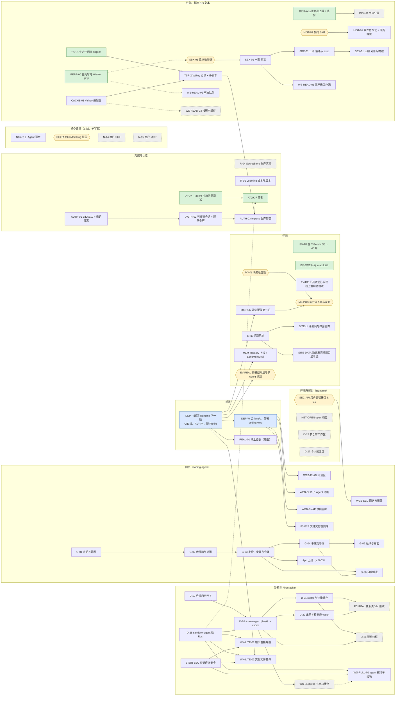

# 全部计划的总表与 DAG（2026-11-03）

> 用户要求：把所有计划（含项目原有的）统计在一起，整理一份 DAG。
> 口径：agent-runtime `origin/main` 的 `7ec2453` 加本分支（`claude/agent-runtime-resume-ku809d`）上的计划草案；coding-agent 以它的 main 与 `docs/plan/` 为准。
> 来源：[work-dag-2026-11-03.md](work-dag-2026-11-03.md)（线与第一波 DAG）、[handoff-2026-11-03.md](handoff-2026-11-03.md)、[lane-merge-2026-11-03.md](lane-merge-2026-11-03.md)、[remaining-work-execution-plan-2026-11-02.md](remaining-work-execution-plan-2026-11-02.md)、[post-acceptance-work-items-2026-11-03.md](post-acceptance-work-items-2026-11-03.md)、[feedback-2026-11-01.md](feedback-2026-11-01.md)（N-xx）、[cloud-deploy.md](cloud-deploy.md) 与 [gate 清单](cloud-deploy-gates-2026-11-02.md)（D-01～D-17）、[firecracker-backend.md](firecracker-backend.md)（D-19～D-22、D-26、D-28）、[environment-config.md](environment-config.md)（D-23～D-27）、[sub-agent.md](sub-agent.md)、[eval-site.md](eval-site.md)、[workspace-read-latency-and-disk-2026-11-03.md](workspace-read-latency-and-disk-2026-11-03.md)、[auth-tokens-2026-11-03.md](auth-tokens-2026-11-03.md)，以及 coding-agent 的 `docs/plan/github-app.md`（G-01～G-06）。
> 本文只汇总与排依赖，不改各项的内容与决定；各项以原文档为准。状态有变时改原文档，再回来改这里。

> 2026-11-04 用户委托的[代审结论与判定规则](delegated-review-2026-11-04.md)已落盘，覆盖 SEC-API、NET-OPEN、D-25、N-14、N-15、WS-READ-02、AUTH-03、D-28、SBX-01、MX-RUN、EV-REAL、EV-TB、DEP-R/DEP-W/REAL-01、G-03 Client secret 与 R-06。该记录明确通过范围、待关闭条件及后续修复/部署的状态差异，不将代审等同于实现或上线验收完成。

> [第二轮专项代审](delegated-review-followup-2026-11-04.md)记录了 G-03-9 凭据操作放行条件、四份契约的代审范围，以及 SBX、R-06、EV-TB、HIST-01、PREVIEW-1 的复核结果。

## 1. 已完成（不再画进 DAG）

| 范围 | 内容 |
| --- | --- |
| 强档计划 | S-01～S-13；T-xx（Model Gateway、Registry、Policy Engine、工具、Telemetry、Learning Pipeline 等）；R-01、R-05 的大部分 |
| 云上部署 | D-01～D-17 的代码；cgent.link 单节点集群在线（Helm 第 23 版，R2 已接上，D-09）；线上验收按 gate 清单部分完成 |
| 反馈修复 | N-01～N-03、N-05～N-13、N-17 |
| 人工验收后的工作项 | ENV-01（只读查询）、MODEL-BUDGET-01/02、ROUTING-01、CONTEXT-01 |
| 第一波（任务 17～24） | 17 判分走 Gateway、22 网关等预算表、19 B1/B2 能力矩阵代码、21 coding-agent 环境配置与 Workspace 界面；C 线（ENV-02、N-10）与 E 线（N-04、N-19、N-20、N-16 的一部分）2026-11-03 人审后合进 main |
| F 线 | F1 模型目录同步、F2 Memory 的评测与线上检索器、F3 文件交付的 Runtime 一侧与 Reviewer 的 highlights、F4 注册防滥用与花费面板 |

## 2. 待部署（已在 main，没上线）

2026-11-04 第 24 版（DEP-R，`6cc16b8`，记录在 `cloud-deploy.md`）上了：C、E 两条线；F1～F4；`bb832bf`；26 个 Profile 与重算的白名单；首事件延迟与花费面板、告警；TSP-1/TSP-2/CACHE-01（生产模式、Valkey）；AUTH-01（仍收开发令牌）；D-19、DISK-A、STOR-SEC、HIST-01、PERF-00、R-06、G-03-9、WS-READ-03。

2026-11-04 第 26 版（`169570a`）又上了：WS-READ-02（workspace 队列与 Worker 池）、SEC-API、HIST-01 的批量取、DISK-B（14 天）、R-06-B、EV-TB 的修复、PREVIEW-1、评测网站、沙箱 agent 的 ATOK-F；coding-web `bee449a`（HIST-01-WEB）。2026-11-04 第 27 版（`de1c0ba`）又上了：DLV-CHECK、DELTA（coding-web `ec36caa` 的 WEB-DELTA）、R-06-C、SITE-DATA、MX-Q 的评测代码。还没上的：Memory Service 的新镜像（MEM）、AUTH-01 切换的第 1 步起、Cloudflare 桥的新镜像（令牌缺 Containers 编辑权限）。

## 3. 未完成的工作项

档：近 = 建议近期做；中；远 = 等前置或资源。状态：待做、草案（等人确认）、人定（卡在人的决定或评审）、外部（卡在外部资源）、推迟。

| 编号 | 内容 | 出处 | 依赖 | 状态 | 档 |
| --- | --- | --- | --- | --- | --- |
| DEP-R | 部署 Runtime 下一版（第 2 节） | lane-merge | — | 已完成（2026-11-04 第 24 版，`6cc16b8`） | 近 |
| DEP-W | coding-agent 合 lane/d，部署 coding-web | lane-merge | DEP-R | 已完成（2026-11-04，coding-agent `b4bb9a9`；GitHub App 仍关着） | 近 |
| EV-TB | 查 Terminal-Bench 0/5 的原因，再跑 40 题 | handoff | — | 原因已查清（[记录](ev-tb-0of5-2026-11-04.md)）：环境配额满了，五题都退回 universal，没用上官方镜像；顺带修了失败原因里的签名地址。再跑之前要放宽配额（7.1 已定放宽到 20）、查镜像仓库为什么是空的；适配器识别“环境没用上”已完成（EV-TB-2，`438d2bb`） | 近 |
| EV-SWE | SWE-bench 补跑 matplotlib-13989 | handoff | — | 待做 | 近 |
| EV-DE | DeepEval 把工具调用轨迹放进用例 | handoff | — | **代码完成**（`c1a307a`）；线上重判待验收，见 [记录](ev-de-tool-evidence-2026-11-04.md) | 中 |
| MX-RUN | 能力矩阵第一轮（贵模型走淘汰赛） | work-dag 19-run | DEP-R（新 Profile） | 待做（花钱）。计划已写好：`services/py-learning/capability-plans/round1.json`（plan、judge、route 三格与 BFCL；plan、route 带 MX-Q 的改编题；gpt-6-astra、fable-5.1 先 20×1 淘汰赛），`capability estimate` 估约 32.5 美元（贵模型晋级另加约 8 美元）；等用户在对话里点头再跑 | 中 |
| MX-Q | S-09～S-11 格子的改编题：选题与补标签 | work-dag | — | 已批准（2026-11-04 用户：“等人定的一律通过”，第 7.2 节），可以开工；原状态：人定。已完成（`c3dd34a`，第 8 节）：plan、route 两格加上 22 道改编原题，各够 40 道 | 中 |
| MX-PUB | 能力分人审后经 Registry 发布 | work-dag 19-publish | MX-RUN、MX-Q | 已批准（2026-11-04 用户：“等人定的一律通过”，第 7.2 节），可以开工；原状态：人定 | 中 |
| SITE | 评测网站（主页、结果、数据集） | eval-site（H 线） | — | 代码已完成（`5035d85`、`2abcba2`，见 eval-site.md 末节）；上线要人建只读令牌、部署新的 learning 镜像 | 中 |
| SITE-UI | 评测网站的界面设计重做（用户 2026-11-04：“现在还是非常丑”）：主页、结果、数据集三页的信息层级、排版、配色与深浅色、图表样式统一、手机宽度；数据与接口（`/api/*.json`、同步）不变；补上没写的页面冒烟测试（headless 浏览器） | 用户 2026-11-04 | SITE | 设计稿已出（2026-11-04，Claude 的设计画布 https://claude.ai/artifact/VtHiCkT3fHaxtvnaRRd5Zr ：主页、评测结果、数据集与框架、数据集的手机宽度；IBM Plex、白底墨字、蓝色是链接与操作、琥珀色只给“草稿·未经人审”；数字是现在 evalsets 的真数，结果与分数是占位）。**等人看**，定了再改 `evals/site_pages` 的页面并补页面冒烟测试，随下一版 learning 镜像上线 | 中 |
| SITE-DATA | 数据集页把题目显示全：成对比较的题（JudgeBench、RewardBench 2 等）只显示了题目与标注 `A>B`，两个候选回答在 `extra` 的 `response_A`、`response_B` 里没显示，看着像判断题配错了答案（用户 2026-11-04 发现）。按数据集的题型画：成对比较并排显示题目、回答 A、回答 B 与“更好的是 A”；多轮对话（τ²-bench）显示对话与工具；其余把 `extra` 里给人看的字段列出来。顺带核对每个数据集的导出没漏字段 | 用户 2026-11-04 | SITE | 已完成（第 8 节 SITE-DATA；没部署）：十种题型，见 [eval-site 第 7 节](eval-site.md)；适配器没带的上游元数据要重新导出，没做 | 中 |
| MEM | Memory 上线（Milvus、真 embedding、Worker→Memory），LongMemEval 验收 | P1-D、F2 | DEP-R | 待做（要资源） | 中 |
| EV-REAL | 真模型下规划质量与子 Agent 拆分的评测 | lane-merge | DEP-R | 已批准（2026-11-04 用户：“等人定的一律通过”，第 7.2 节），可以开工；原状态：人定（花钱） | 中 |
| WEB-PLAN | 网页：计划区（`plan_updated`、快照里的 plan） | lane-merge（N-04） | DEP-W | 已完成（coding-agent `7983507`，没部署；快照里的 plan 随 WEB-SNAP） | 中 |
| WEB-SUB | 网页：并行子 Agent 的进度 | lane-merge（N-16） | DEP-W | 已完成（coding-agent `28082cd`，没部署） | 中 |
| WEB-SNAP | 网页：用快照画首屏、处理 409 | lane-merge（N-19） | DEP-W | 已完成（coding-agent `2b793a1`，没部署；取不到快照时照旧逐个回放，所以可以先于 Runtime 部署） | 中 |
| F3-E2E | 文件交付的端到端 | n18-file-delivery-f3 | DEP-W | 已完成（`ca4fc2e`，没部署） | 中 |
| SEC-API | 用户密钥的写入、列举、删除接口（S-01） | lane-merge（ENV-02） | 契约人审 | 已完成（契约 `56f21cd` 2026-11-04 人审通过；`ae8efc3` 测试、`f3b02df` 实现；没部署） | 中 |
| WEB-SEC | 网页：网络密钥页 | coding-agent | SEC-API | 已完成（coding-agent `609e986`，没部署）；默认关着（`CODING_NETWORK_SECRETS=1` 才打开）：环境引用密钥是 D-23 第二阶段，要人先选首个真实服务与客户端 | 中 |
| NET-OPEN | `open` 档位的公网授权（S-01） | lane-merge | 具体 wire 走 S-01 | 已批准（2026-11-04 用户：“等人定的一律通过”，第 7.2 节），可以开工；原状态：设计语义代审通过；实现推迟 | 远 |
| D-25 | 多仓库工作区（S-01） | environment-config | 具体 wire 走 S-01 | 已批准（2026-11-04 用户：“等人定的一律通过”，第 7.2 节），可以开工；原状态：冻结基线代审通过；wire 需明确未提交改动的 detach 行为 | 远 |
| D-27 | 个人配置包（skills 等） | environment-config | — | 占位 | 远 |
| N16-R | N-16 剩下的：brief、来源卡片与综合节点、预算份额、mid 档、评测对照（E 线，单写者） | sub-agent | — | 已批准（2026-11-04 用户：“等人定的一律通过”，第 7.2 节），可以开工；原状态：草案。第一、二段已完成（`99037da`、`e0ff673`，开关 `AR_SUB_AGENT_POLICY`，默认 off；第 8 节）：brief、综合节点、份额、mid 档、来源卡片；第三段超份额收尾（`1bc36e1`）。剩下单个 tier（S-01）与评测对照（花钱） | 中 |
| DELTA | `token_delta`、`thinking_delta` 的推送入口与平台令牌 | lane-merge（N-20） | 安全评审 | 已批准（2026-11-04 用户：“等人定的一律通过”，第 7.2 节），可以开工；原状态：人定（2026-11-04）：做，默认打开；约束见 7.1。**已完成**（2026-11-04，第 8 节；没部署） | 中 |
| N-14 | 用户自定义 Skill（Registry 新条目，S-01） | feedback 第 4 节 | 具体 wire 走 S-01 | 已批准（2026-11-04 用户：“等人定的一律通过”，第 7.2 节），可以开工；原状态：版本固定与扩展边界代审通过；待具体契约 | 远 |
| N-15 | 用户自己的 MCP Server（S-01） | feedback 第 4 节 | 具体 wire 走 S-01 | 已批准（2026-11-04 用户：“等人定的一律通过”，第 7.2 节），可以开工；原状态：归属、授权与撤销语义代审通过；待远程连接契约 | 远 |
| R-04 | SecretStore 的生产实现 | post-acceptance、P1-B | — | 待做（要资源） | 远 |
| R-06 | Learning Pipeline 的成本与版本固定 | P1-B | — | 不等存储选型的两条已完成（`f1b017b` 测试、`ccf29a5` 实现：计量记 `price_at`、Profile 文件缺单价拒绝加载；没部署）；剩下的已由[代审记录](delegated-review-2026-11-04.md)第 7 节定下：发布门槛与同步脚本的缺价已完成（R-06-B）；`model_usage` 每次尝试冻结单价、结算记下用量已完成（R-06-C，`135ef503`；用量未知时留着预留原本就是这样）；Learning 的成本改读 `model_usage` 已完成（R-06-D，没部署）。剩下 Registry 修订号进账本（Gateway 手上没有修订号，要先定从哪里来） | 远 |
| G-01～G-06 | GitHub App：密钥与配置 → 收件箱 → 身份与令牌 → 事件到动作 → 运维；G-06 自动触发在 G-03、G-04 之后；上线至少 G-01～G-03 | coding-agent github-app | — | G-01 已完成（coding-agent `175100d`，没部署）；G-02 已完成（coding-agent `a3b1331`，没部署）；G-03 的 coding-agent 一侧已完成（`a93fa5a`）；第 9 条的 Runtime 修复 `2e924a3` 已随第 24 版部署；[专项安全代审](delegated-review-followup-2026-11-04.md)已完成，原 URL 重写路径复验通过，sync 预检回调隔离与目标后端验收待关闭；G-04 已完成（`4e223b5`，没部署）；G-05 已完成（coding-agent `8f296eb` 服务端、`7770026` 账号页、`67ee776` 卸载 30 天后去掉安装 ID；Grafana 告警在本仓库；没部署；测试 App 要人注册）；G-06 已完成（coding-agent `f0a229a`，没部署；上线前要在 App 设置里加 Issues 读写与 `issue_comment` 事件） | 中 |
| D-19 | 后端登记的启用开关与能力 | firecracker-backend | — | 已完成（`f9f0c4d`，没部署） | 中 |
| D-28 | sandbox-agent 按原接口改写为 Rust | firecracker-backend | — | 依赖清单 2026-11-04 人审通过，可以开工 | 中 |
| D-20 | fc-manager（Rust）与 vsock agent | firecracker-backend | D-19、D-28 | 第一段已完成（2026-11-04，没部署：fc-manager、客户机内核、systemd 单元，对着假 jailer 的测试）；下一段：Go Sandbox Service 里的 firecracker 适配器（等 SBX-01-IMPL 的骨架）与 D-28 的 vsock agent；FC-REAL 在独服上跑要人同意 | 近 |
| D-21 | 客户机 rootfs 与镜像缓存 | firecracker-backend | D-20 | 已批准（2026-11-04 用户：“等人定的一律通过”，第 7.2 节），可以开工；原状态：草案 | 近 |
| D-22 | 出网与预览经 vsock | firecracker-backend | D-20 | 已批准（2026-11-04 用户：“等人定的一律通过”，第 7.2 节），可以开工；原状态：草案 | 近 |
| FC-REAL | 独服上真 VM 的验收（耗时、密度） | firecracker-backend | D-21、D-22 | 待做 | 近 |
| D-26 | 预热快照 | firecracker-backend | D-20、D-21 | 已批准（2026-11-04 用户：“等人定的一律通过”，第 7.2 节），可以开工；原状态：草案 | 远 |
| PERF-00 | 分段量 Workspace 操作与历史加载的耗时；含 WK-LITE-03（进出 Worker 的字节数） | workspace-read 第 2、7 节 | — | Runtime 一侧已完成（`d180ae3` 测试、`fb971d2` 实现、`460b167` 面板检查；没部署）；coding-agent 的历史加载已完成（PERF-00-CA，coding-agent `6fc5e16` 测试、`6efb098` 实现；没部署） | 近 |
| DISK-A | WS-DISK-01 ① 挂卷也执行大小上限、③ 卷用量告警 | workspace-read | — | 已完成（`55ebf81`，没部署；超限按设计稿拒绝写类工具，“拒绝还是只警告”仍可由人改） | 近 |
| DISK-B | WS-DISK-01 ② 冷热分层（先存档成功再删本地） | workspace-read | DISK-A | 已完成（契约 `a66a673` 2026-11-04 人审通过；`8f434d5` 测试、`690770a` 与 `0a8feb2` 实现；没部署）。部署默认值 `worker.workspaceColdAfterDays` 是 0（不转冷），具体天数仍由人定 | 远 |
| TSP-1 | TS-PROD-01 ① 生产模式没有 Postgres DSN 拒绝启动 | workspace-read | — | 已完成（`00ef868`，没部署） | 近 |
| CACHE-01 | Cache 的 Valkey 适配器与部署 | workspace-read | — | 已完成（`5a7334f`，没部署） | 中 |
| TSP-2 | TS-PROD-01 ②③ Cache 必须是 Valkey、连接池、task-service 多副本 | workspace-read | TSP-1、CACHE-01 | 已完成（`08e6745`，没部署；部署前先建 Valkey 的 Secret、重跑 `deploy/data/install.sh`） | 中 |
| HIST-01 | 事件按 event_id 持久化，按 Session 批量取（S-01）；网页增量加载 | workspace-read | 契约人审（只有批量取的接口） | 持久化与读回已完成（`5d8c071`：SSE 从业务库补发、结束的 Task 重放全部、快照读业务库；没部署）；批量取 `ListSessionEvents` 已完成（契约 `5760a9f` 2026-11-04 人审通过；实现与测试 `c8865b0`；没部署）；网页的增量加载已完成（HIST-01-WEB，coding-agent `35c9289` 测试、`715223e` 实现；没部署） | 中 |
| SBX-01 | Sandbox Service：设计改动稿 → 一期只读 → 二期借还与 exec（核心链路）→ 三期对账与构建 | workspace-read | 设计改动稿人审 | 人审通过（2026-11-04），**不分期、一次做完**（见 sbx-01 文档第 9 节）；契约草案 `42fe4fe` 2026-11-04 人审通过（用户：“直接通过”），基线已更新；实现进行中（SBX-01-IMPL，见第 8 节） | 中 |
| WS-READ-01 | 只读操作经 Sandbox Service，不进工作流、不新建沙箱 | workspace-read | SBX-01 一期 | 随 SBX-01-IMPL 一起做，进行中 | 中 |
| WS-READ-02 | Workspace 操作单独一个队列与 Worker 池 | workspace-read | 契约人审（names.proto 加队列） | 已完成（契约 `ebf963e` 2026-11-04 人审通过；`1c322b2` 测试、`71b9226` 实现；没部署）。上线后旧的 task、program 队列上的登记留到改之前起的操作跑完再去掉 | 中 |
| WS-READ-03 | 文件树与 diff 按工作区 generation 缓存 | workspace-read | （多副本时 CACHE-01） | 已完成（`d35923b`，没部署） | 远 |
| WS-BLOB-01 | 存档块的节点本地 LRU 读缓存 | workspace-read | D-20（Firecracker 的块服务） | 已批准（2026-11-04 用户：“等人定的一律通过”，第 7.2 节），可以开工；原状态：草案 | 远 |
| STOR-SEC | 存储直连的安全要求：PUT 签 checksum、If-None-Match、Content-Length，日志打码，精确主机放行 | workspace-read 第 8 节 | — | 已完成能先做的（`b65ab01`：`ObjectStore.SignedUpload`，两种语言；出网网关审计与日志不带查询串的测试）。真实 R2 上三个头是否强制执行要跑 `AR_LIVE_S3`（写真实的桶，要人点头）；精确主机放行与“只在那一次操作里开授权”随 WS-PULL-01 做 | 中 |
| WS-PULL-01 | agent 按清单拉块、只传缺的块 | workspace-read 第 6 节 | D-28、STOR-SEC；Firecracker 下另要 D-20、WS-BLOB-01 | 已批准（2026-11-04 用户：“等人定的一律通过”，第 7.2 节），可以开工；原状态：草案 | 远 |
| WK-LITE-01 | 命令输出由 agent 直接外置 | workspace-read 第 7 节 | D-28、STOR-SEC | 已批准（2026-11-04 用户：“等人定的一律通过”，第 7.2 节），可以开工；原状态：草案 | 远 |
| WK-LITE-02 | 交付文件由 agent 直传 | workspace-read 第 7 节 | D-28、STOR-SEC、DEP-R（F3） | 已批准（2026-11-04 用户：“等人定的一律通过”，第 7.2 节），可以开工；原状态：草案 | 远 |
| ATOK-T | AGENT-TOK-01：测用户命令能否从 `/proc/1/environ` 读到 agent 令牌 | auth-tokens | — | 已完成（`a194d8b`；风险属实，见第 8 节） | 近 |
| ATOK-F | AGENT-TOK-01 的修复（Go 版；Rust 版在 D-28 里同一条验收） | auth-tokens | ATOK-T | 已完成（`69a9a30`，Go 版；没部署） | 近 |
| AUTH-01 | Ed25519 签名的标准 JWT，Runtime 只持公钥；第三方令牌的加密密钥独立 | auth-tokens | — | 已完成（代码；没部署，切换步骤见 auth-tokens 第 4 节） | 中 |
| AUTH-02 | 浏览器只拿可撤销的会话 id，调 Runtime 时现签短期令牌 | auth-tokens | AUTH-01 | 已完成（coding-agent `953fc29`；没部署） | 中 |
| AUTH-03 | Ingress 的生产形态：身份服务或签发服务、网关的全局限流、PKCE | auth-tokens | AUTH-02、TSP-2 | 2026-11-04 人定维持现状（不上身份服务）；PKCE、JWKS、全局限流已做（coding-agent `c3d8845`） | 远 |
| REAL-01 | 线上全组件验收（穿插着跑） | post-acceptance、gate 清单 | 各项部署 | 外部（部分）。2026-11-04：用户准用 `CF_NSNZDDOTCOM_ALL_KEY`。桥的新镜像（`sandbox-universal:6cc16b8`，带新 agent）已在服务器上构建，推到 Cloudflare 镜像仓库时令牌拿不到推送凭据（`Authentication error`）：要给令牌加 Containers 的编辑权限（推镜像、`wrangler deploy` 还要 Workers Scripts 编辑）。预览地址已上线（第 25 版）：用户买了单独的 `cgentpreview.website`，免费通配证书加 Origin CA 的源站证书，经 Cloudflare 到网关已通，真正的预览还要一个真 Task 验。真 Task 冒烟 2026-11-04 在第 26 版上跑过（done，0.11 美元；ATOK-F 线上验过；文件交付没发生，见 DLV-CHECK）。其余 gate 不缺资源，只是没在线上跑 | 中 |
| DLV-CHECK | 交付的真假：模型说“已交付”却没调 `deliver_file` 时，Reviewer 要按这一轮的 delivered（round_highlights）与 `task_artifacts` 核对，不能只看回答的文字；Planner 在用户明说要交付文件时给 Goal 加上交付的要求 | 第 26 版的冒烟（cloud-deploy.md） | — | 已完成（`a9deb9c` 测试、`310061e` 实现；没部署；见第 8 节） | 近 |
| SBX-RS-01 | Rust 版 agent 的原型实测 | workspace-read 第 5 节 | — | 取消（改为 D-28） | — |

## 4. DAG

方框的颜色：绿 = 近期建议、蓝 = 部署、白 = 待做或草案、六边形 = 人定或评审、灰 = 推迟或卡外部资源、橙 = 正在实现（第 8 节）。只画未完成的；已完成的见第 1 节。

虚线是“建议先有”而不是硬依赖：PERF-00 的数字决定 SBX-01、WS-READ-02 的轻重；WS-READ-03 在多副本时才需要 CACHE-01；Firecracker 下 WS-PULL-01 经块缓存取块；ATOK-F 的 Rust 版随 D-28 一起做。

## 5. 不能同时改的文件（单写者与重叠）

| 冲突点 | 涉及 | 规则 |
| --- | --- | --- |
| 核心链路（`workflows/task.py`、`stage_runner.py`、`node_executor.py`） | N16-R、DELTA、SBX-01（`shell_run`、`repo_*` 改调服务） | CLAUDE.md：同一时间只由一个 agent 改；2026-11-04 起 `shell_run`、`repo_*` 的部分由 SBX-01-IMPL 独占（见第 8 节），N16-R、DELTA 只改与工具无关的部分或排在后面 |
| Broker 与后端登记（`agentruntime_worker/sandbox/`、`tools/sandboxes.py`） | D-19、SBX-01、DISK-A、WS-READ-02 | 同一时间一条线；D-19 先做 |
| coding-agent 的 `oauth.go`、`accounts.go`、`store.go` | G-01～G-03、AUTH-01、AUTH-02 | 由 G 线一起做，或 AUTH 排在 G-03 之后 |
| sandbox-agent | D-28、ATOK-F、WS-PULL-01、WK-LITE-01/02 | D-28 期间 Go 版只修 ATOK-F，新接口只加在 Rust 版 |
| `/proto`、`/schemas` | SEC-API、NET-OPEN、D-25、N-14、N-15、HIST-01 | 每项单独成组，走 S-01 |

## 6. 建议的近期顺序

1. **DEP-R → DEP-W**：解开最多下游（网页四项、能力矩阵、Memory 上线、真模型评测、REAL-01）。
2. **便宜的安全项，可以和 1 并行**：DISK-A（盘满会拖垮同节点的数据库）、TSP-1、ATOK-T（确认后再 ATOK-F）。
3. **PERF-00**：先有数字，再定 SBX-01、WS-READ-02 的轻重。
4. **评测收尾**：EV-TB、EV-SWE；MX-Q 人定后跑 MX-RUN。
5. **两条长线并行起步**：G-01～G-03（App 上线的前提）；D-19 与 D-28（Firecracker 的前提，D-28 的 Rust 依赖清单先人审）。

## 7. 要人定的

三份人审 2026-11-04 都已过：SBX-01 五条照建议、但不分期一次做完；Rust 依赖清单按清单批准；AUTH-03 维持现状。设计书原文档的更新（4.10、4.14、4.15、附录 A）也由人做。之后的 NET-OPEN、D-25、N-14、N-15 契约照旧走 S-01。

### 7.1 2026-11-04 用户授权 Claude 代定的

用户原话：“花钱的随便花”“其他的你帮我做决定就行”“批准”（批准线上沙箱换 ATOK-F 的 agent 并在 Worker 的 Pod 里跑探测脚本）。下面是这次定下的，要改直接改这里。

| 事项 | 决定 | 理由 |
| --- | --- | --- |
| 免费档白名单（第 24 版已上，8 → 18 个） | 接受 | 每天 3 美元、每月 20 美元的预算已兜住花费；多给选择不加风险 |
| MX-Q 改编题 | 由 Claude 从 `public-adapted-drafts` 选题、补标签，全部标“未确认”；人抽查过的才进可发布的分数，没抽查前 MX-PUB 不发布 | 照 work-dag 的建议；不让没经人看的标签进 Registry |
| DELTA（`token_delta`、`thinking_delta` 的推送入口） | 做，**默认打开**（2026-11-04 用户问“默认为啥关闭”，改定）；约束不变：内部端口只对 Worker 所在命名空间开放（NetworkPolicy）；平台令牌按调用方各一个，放 SecretStore 平台作用域；增量只进 Valkey 的流、保留不超过 10 分钟，不进业务库、Temporal 历史与 trace；保留按租户关掉的开关（出问题时关，而不是回滚）；先写验收测试 | 原来定默认关是怕新功能直接压到所有租户；用户要的是体验，有按租户的关掉开关兜底就够了 |
| F4 告警的通知渠道 | Grafana 的邮件联络点，经 **Resend 的 SMTP 中继**（`smtp.resend.com:587`，强制 STARTTLS；用户名 `resend`，口令是 Resend 的 API Key），不写代码、不加依赖；Key 与收件地址都在 Secret `grafana-resend`（`deploy/data/values/grafana.yaml`、`tests/deploy/test_alert_email.py`） | 2026-11-04 用户定 Resend，令牌之后给。**要人做**：给 API Key；在 Resend 验证 `cgent.link`（Cloudflare 加它给的 DNS 记录），发件人是 `alerts@cgent.link`。Key 给之前 Secret 里是占位值，告警只在 Grafana 里看得到 |
| DISK-B 的闲置天数 | 14 天 | 两周没动的会话副本基本不会再用；转冷后第一次打开多等一次恢复 |
| DISK-A 超限 | 维持现状：拒绝写类工具并告诉用户 | 只警告挡不住盘满 |
| Valkey 是否持久化 | **不持久化**（2026-11-04 用户定，撤回之前的 AOF 与 2Gi 的 PVC；`deploy/data/valkey.yaml`） | 要紧的都在业务库：event_id 由业务库分配，事件先写 `task_events` 再推流，SSE 与快照从业务库补，准入的锁也在 Postgres；重启只丢限流窗口的计数、去重标记与只读缓存。开 AOF 要和 Postgres 抢同一块盘，还会把事件内容与 DELTA 的逐字增量落盘（DELTA 定的是增量不进任何持久存储）。以后 Valkey 成了某样东西唯一的存放处再议 |
| Valkey 口令与 App 的新密钥 | 写进 `secrets.enc.yaml`（随第 25 版）：Valkey 的两个 Secret，以及 APP-LIVE 新建的 `pg-coding-github`、`coding-github-db`、`coding-github-app` 与 `coding-oauth` 的 `CODING_TOKEN_KEY` | 现在只在服务器文件与 Secret 里，换机器会丢 |
| AUTH-01 切换 | coding-web 换成 JWT 签发并验证之后，task-service 的 `ingress.devTokens` 改成 refuse | 开发令牌的对称密钥是 AUTH-01 要拆掉的东西 |
| EV-TB 的环境配额 | `swebench`、`evals` 租户的 `max_images` 放宽到 20；跑 40 题之前先把环境建好 | 0/5 的原因就是配额满了退回 universal |
| SITE | 随第 25 版部署新的 learning 镜像；只读令牌第 22 版已建（Secret `agent-runtime-eval-site`） | 不缺资源 |
| MEM（Memory 上线） | 做，单独一版（第 26 版）：Milvus 3.0.2 单机版、PVC 50Gi、`text-embedding-3-large`；所有租户的白名单加 3-large（`swebench` 也加，之后的基准报告注明 Memory 已打开） | 与 Runtime 的其他改动分开，出问题好查 |
| 花钱的上限 | 用户说随便花；为防跑飞仍按项设上限：真 Task 冒烟 ≤ 2 美元、EV-SWE 补跑 ≤ 5、DeepEval 线上重判 ≤ 10、LongMemEval ≤ 20、EV-REAL ≤ 40、Terminal-Bench 40 题 ≤ 80、MX-RUN 按 `estimate`、≤ 200；合计约 360 美元 | 单项超了先停下报告，不是不让花 |

### 7.2 2026-11-04 用户：“等人定的一律通过”

- 第 3 节里状态是草案、人定、推迟的条目一律批准，可以开工（每项前面已改）：MX-Q、MX-PUB（不再等人抽查，MX-RUN 的分数按规则发布）、EV-REAL、DELTA、NET-OPEN、D-25、N16-R、N-14、N-15、D-20～D-22、D-26、WS-BLOB-01、WS-PULL-01、WK-LITE-01/02。D-27 还只是占位，没有可批的设计。
- 契约照旧过 S-01 的自动检查（`buf breaking`、契约测试），人审视为已过（同 SBX-01，用户“直接通过”）；花钱的仍按 7.1 的上限；CLAUDE.md 的“先写测试再实现”照旧，只是写完测试不必停下等确认。
- Firecracker 提前（用户：“我都提出了很长时间了”）：D-20、D-21、D-22、FC-REAL 改为近期。硬件不缺：线上独服有 KVM（Kata 已在跑）。顺序上的约束：D-20 原定的 Python 适配器要改写进 SBX-01 的 Go Sandbox Service（SBX-01 把后端适配器都搬过去）；Rust 的 workspace 由 D-28 在建，fc-manager 作为它的一个成员加入，与 D-28 协调根 `Cargo.toml`。可以先做的：`services/rs-fc-manager`（宿主服务：建、删、列 VM，到客户机 agent 的 vsock 反向代理，jailer、cgroup、并发上限）、`deploy/images/firecracker` 的客户机内核、`deploy/cluster/fc-manager.service`，以及对着假 fc-manager 的测试。

## 8. 正在实现（认领）

开工前先在这里登记并推送，做完改成“已完成”并写上提交；别的会话看到“进行中”的不要同时改它独占的文件。

| 编号 | 线 | 谁 | 开始 | 独占的文件 | 状态 |
| --- | --- | --- | --- | --- | --- |
| EV-DE | 评测线 | Codex 桌面会话 | 2026-11-04 | `services/py-learning` 的 `evals/deliverables.py`、`evals/bridges/deepeval_bridge.py`、`evals/frameworks.py` 的 Windows 环境白名单、`benchmarks/swebench.py` 的事件采集扩展点及对应评测测试、deliverables README | 已完成代码与离线验收（认领先推送 `3a47cfa`，实现 `c1a307a`）；线上重判待验收。见 [实施记录](ev-de-tool-evidence-2026-11-04.md) |
| TSP-1 | TSP 线（TSP-1 → CACHE-01 → TSP-2），直接在 main 上提交 | Claude 桌面会话（Opus 5.5） | 2026-11-03 | `services/go-task-service/internal/config`、`cmd/task-service/main.go` 的 Provider 选择 | 已完成（`aee014a` 测试、`00ef868` 实现；没部署） |
| CACHE-01 | TSP 线 | Claude 桌面会话（Opus 5.5） | 2026-11-03 | 新包 `libs/go-core/adapters/valkey`（标准库自写 RESP 客户端，不引新依赖）；`deploy/data` 里新加的 Valkey；task-service 的 Cache 选择（`internal/config`、`cmd/task-service/main.go`） | 已完成（`377bcd8` 测试、`5a7334f` 实现；没部署，部署前要先建 `valkey-agentruntime`、`agent-runtime-valkey` 两个 Secret） |
| TSP-2 | TSP 线 | Claude 桌面会话（Opus 5.5） | 2026-11-03 | task-service 的 `internal/config`、`cmd/task-service/main.go`；Chart 的 `task-service.yaml` 与 values 里 task-service、`secrets.valkeyUrl` 的部分；`libs/go-core/adapters/postgres` 的连接池选项；`tests/e2e` 里新加的两副本用例 | 已完成（`c956594` 测试、`08e6745` 实现；没部署）。TSP 线到此为止：下游 AUTH-03 还要等 AUTH-02 |
| ATOK-T | ATOK 线（ATOK-T → ATOK-F），直接在 main 上提交 | Claude 桌面会话（Opus 5.5，另一个） | 2026-11-03 | `services/go-sandbox-agent`（`cmd/sandbox-agent`、`internal/agent`）；`libs/py-core/tests/adapters/test_k8s_sandbox.py` 新加的一条 | 已完成：`a194d8b` 测试、`69a9a30` 修法（agent 启动时 `PR_SET_DUMPABLE=0`）。GitHub 的 Linux runner（uid 1001）上修法前测试读到了令牌、修法后通过；kind 的那一条修法前也读到了。没部署 |
| PERF-00 | PERF 线（PERF-00 的 Runtime 一侧，含 WK-LITE-03；coding-agent 的历史加载另做），直接在 main 上提交 | 同上 | 2026-11-03 | `services/py-worker` 的 `workspace/operations.py`、`workspace/archive.py`、`tools/platform.py`（只加计时与字节计数，不改行为）、新模块 `workspace/timing.py`；`deploy/data/dashboards/agent-runtime.yaml`（`sandbox/broker.py` 与 py-core 最后没有改） | Runtime 一侧已完成（`d180ae3` 测试、`fb971d2` 实现、`460b167` 面板检查；没部署，基线等部署后取一周）；coding-agent 的历史加载没人认领 |
| AUTH-01 | AUTH 线（AUTH-01 → AUTH-02 → AUTH-03），直接在 main 上提交；先做 Runtime 一侧，coding-agent 一侧（签发与第三方令牌的独立密钥）在确认 G 线没在改 `oauth.go`、`accounts.go`、`store.go` 之后接着做 | Claude 桌面会话（Opus 5.5，ATOK 与 PERF 的那个） | 2026-11-03 | 新包 `libs/go-core/adapters/jwtingress`；task-service 的 Ingress 选择（`internal/config` 里 `AR_INGRESS_*` 的部分、`cmd/task-service/main.go` 的 Ingress 构造与新的 `keygen` 子命令）；Chart 里 task-service 的 Ingress 配置与 `taskService.ingress`；coding-agent 的 `internal/server/server.go`（令牌的签发与校验）、`accounts.go`（第三方令牌的加密密钥）、`cmd/coding-web/main.go` 的环境变量 | 已完成：Runtime 一侧 `885a13f` 测试、`0e9ad9f` 实现；coding-agent 一侧 `ece577f` 测试、`c5e5af3` 实现（JWT 私钥与第三方令牌的独立密钥都是可选的，不配时行为不变）。没部署：切换步骤见 [auth-tokens 第 4 节](auth-tokens-2026-11-03.md) |
| AUTH-02 | AUTH 线，直接在 coding-agent 的 main 上提交 | 同上 | 2026-11-03 | coding-agent 的 `internal/server/server.go` 里 Cookie 与 `authed` 的部分、`accounts.go` 登录成功后建会话的那一处、新文件 `internal/server/browser_sessions.go`、`messages_en.go` 三条文案、`cmd/coding-web/main.go` 的会话有效期变量（网页的静态文件不动） | 已完成（coding-agent `4bda335` 测试、`953fc29` 实现；没部署）：Cookie 里只有会话 id，退出登录与“退出所有设备”（`POST /api/sessions/revoke-all`）立即生效，调 Runtime 时现签 5 分钟的令牌；旧的令牌 Cookie 在有效期内换成会话 |
| AUTH-03 | AUTH 线，两个仓库的 main | 同上 | 2026-11-03 | coding-agent 的 OAuth（`internal/server/oauth.go` 的授权地址与换令牌、`accounts.go` 的回调里核 state 的那一处）与新的 JWKS 端点；`docs/plan/auth-tokens-2026-11-03.md` 的身份服务评估 | 不用人定的部分已完成（coding-agent `03b944b` 测试、`c3d8845` 实现：GitHub、GitLab、Gitea、Google 的 PKCE，`/.well-known/jwks.json`；全局限流在 AUTH-01 里经 Valkey）。剩下身份服务的选型与设计书 4.14，人定，评估见 [auth-tokens 第 5 节](auth-tokens-2026-11-03.md)。AUTH 线到此为止 |
| G-01 | G 线（G-01 → G-02 → G-03 …，coding-agent 的 `docs/plan/github-app.md`），直接在 coding-agent 的 main 上提交 | 同上 | 2026-11-03 | coding-agent 新文件 `internal/server/githubapp.go`（App 的配置与校验）、`accounts.go` 的令牌密钥（`CODING_TOKEN_KEY_PREVIOUS`）、`cmd/coding-web/main.go` 的 `CODING_GITHUB_APP_*`、`CODING_GITHUB_WEBHOOK_SECRET*` 变量、`deploy/k8s/coding-web.yaml` 的私钥挂载 | 已完成（coding-agent `58fec67` 测试、`175100d` 实现；Runtime 的 Chart 检查 `test_github_app_key_is_not_in_the_runtime_chart`；没部署）。与计划不同：私钥单独放 Secret `coding-github-app`（`coding-oauth` 是 envFrom 的），见 github-app.md 的 G-01 |
| G-02 | G 线 | 同上 | 2026-11-03 | coding-agent 新包 `internal/github`（收件箱、处理与对账，Postgres）、`internal/server` 里挂 Webhook 路由的一处、`cmd/coding-web` 的 `github-replay` 子命令与 `CODING_GITHUB_DSN`、`go.mod` | 已完成（coding-agent `92d8421` 测试、`a3b1331` 实现；没部署，上线要建库并给 `CODING_GITHUB_DSN`）。第 6 条的“处理函数执行两次结果相同”等 G-04，告警指标等 G-05 |
| G-03 | G 线 | 同上 | 2026-11-03 | coding-agent 新文件 `internal/github` 里的安装与令牌（`installations.go`、`tokens.go`）、`internal/server` 的 Setup URL 与 `authorizeRepo`（新文件 `githubrepo.go`），以及 `publish.go`、`projects.go` 里取 Git 凭据的地方；Runtime 一侧第 9 条（工作副本 `.git/config` 拿不到令牌）的测试 | coding-agent 一侧已完成（`18df737` 测试、`a93fa5a` 实现；没部署，上线要 Client secret）：实际都在 `internal/server/githubrepo.go`，没有另建 `internal/github` 的文件。**第 9 条没做**：Workspace 操作带凭据时，工作副本里 Agent 能改的 Git 配置会不会影响凭据，要做一次专门的安全评审（Runtime 的 `workspace/operations.py`），留给人排期 |
| G-04 | G 线 | 同上 | 2026-11-03 | coding-agent 新文件 `internal/server/githubevents.go`（各事件的处理函数，注册进 G-02 的收件箱）、`store.go` 里工作区与会话的远端状态字段、`cmd/coding-web/main.go` 里注册处理函数的一处 | 已完成（coding-agent `ee29d0d` 测试、`4e223b5` 实现；没部署）。界面上的展示归 G-05 |
| G-05 | G 线（先做服务端：指标、安装的对账、卸载时的清理、给界面用的状态接口；界面等 WEB-SUB 放开 `app.js`、`i18n.js` 之后再做） | 同上 | 2026-11-03 | coding-agent 新文件 `internal/server/githubops.go`、`internal/github` 的计数、`cmd/coding-web/main.go` 里 Telemetry 与对账的接线；Runtime 的 `deploy/data/values/grafana.yaml` 里 coding-web 的告警 | 服务端已完成（coding-agent `66e3e9a` 测试、`8f296eb` 实现；本仓库的告警见 `tests/deploy/test_coding_web_alerts.py`；没部署）。顺带修了 G-04 的一处：卸载后重新安装、移除后又加回仓库而事件丢了时，项目不再一直停在 `app_removed`、`repo_removed`。界面（第 3 条）已完成（`f8b216b` 测试、`7770026` 实现：账号页里的 GitHub App 一段，真浏览器的用例过；`i18n.js` 只提交了自己的 `github.*`，别的会话没提交的 `reason.*` 没动）；“安装记录保留 30 天”（第 5 节第 6 条）已完成（`9e2306b` 测试、`67ee776` 实现：没有单独的安装记录，对账在卸载 30 天后去掉项目上的安装 ID）。第 5 条的测试 App 要人注册 |
| G-06 | G 线（自动触发；代码对着替身 GitHub 做，上线前要人在 App 设置里加 Issues 读写与 `issue_comment` 事件），直接在 coding-agent 的 main 上提交 | 同上 | 2026-11-03 | coding-agent 新文件 `internal/server/githubtrigger.go` 与它的测试；`githubevents.go` 里登记 `issue_comment`、`ghEvent` 加评论与 Issue 的字段；`store.go` 的 `Session` 加触发记录；`cmd/coding-web/main.go` 起后台的推进循环（不碰 `server.go`、`tasks.go`、`publish.go`、网页文件） | 已完成（coding-agent `d52d8c6` 测试、`f0a229a` 实现；没部署）。与认领时不同：触发记录单独存 `<数据目录>/github-triggers.json`，`store.go` 没改。实现时定的默认（都取保守的一边）见 github-app.md 的 G-06：GitHub 一侧全用安装令牌、PR 由 App 开；触发者要有 Coding Agent 账号与这个仓库的项目；每仓库每小时 3 次、5 美元；fork 的 PR 一律不运行；推送失败或中断不重试。还要人做：App 加 Issues 读写与 `issue_comment`；注入样本进评测集（标注要人确认）；coding-agent 的 CLAUDE.md 里“由人点按钮触发”那句 |
| D-19 | Firecracker 线（D-19；D-20 之后要等 D-28 的 Rust 依赖清单人审），直接在 main 上提交 | Claude 桌面会话（Opus 5.5） | 2026-11-03 | `services/py-worker` 的 `tools/sandboxes.py`、`sandbox/broker.py` 里选后端的部分（`_create`、`_candidates`）、`sandbox/reconcile.py`；Chart 的 `worker.shell.backends` 样例；`scripts/dev_stack.py` 的登记样例 | 已完成（`51716da` 测试、`f9f0c4d` 实现；没部署）。验收 6（一致性测试按启用的后端各跑一遍）没做：一致性测试按适配器在 py-core 里跑，不按登记文件 |
| DISK-A | DISK 线（DISK-A；DISK-B 要人定闲置天数），直接在 main 上提交 | Claude 桌面会话（Opus 5.5） | 2026-11-03 | `services/py-worker` 的 `tools/platform.py` 里写类工具（`repo_edit`、`shell_run`）前后的大小核对、新模块 `workspace/size_guard.py`、`sandbox/reconcile.py` 里报卷用量；`deploy/data/values/grafana.yaml` 的告警与 `dashboards/agent-runtime.yaml` 的面板 | 已完成（`8db9053` 测试、`55ebf81` 实现；没部署）。量大小放在写类工具前后（不改核心链路），没超时同一 Worker 进程内至少隔 30 秒量一次 |
| STOR-SEC | STOR 线（STOR-SEC；WS-PULL-01、WK-LITE-01/02 还要等 D-28），直接在 main 上提交 | Claude 桌面会话（Opus 5.5） | 2026-11-03 | ObjectStore 的预签名：`libs/py-core` 的 `adapters/sigv4.py`、`s3_object_store.py`、`s3test.py`、`dev/object_store.py`、`providers/object_store.py` 与一致性测试；`libs/go-core` 的 `adapters/s3objects`、`providers/objectstore`、开发实现与一致性测试；出网网关审计不带查询串的测试 | 已完成能先做的（`be35ec2` 测试、`b65ab01` 实现）；剩下的见第 3 节 |
| WS-READ-03 | READ 线（WS-READ-03；WS-READ-02 要改 names.proto 的队列，走 S-01；WS-READ-01 等 SBX-01），直接在 main 上提交 | Claude 桌面会话（Opus 5.5） | 2026-11-03 | 业务库 `workspaces` 的 `generation`（迁移 210，`workspace/archive.py`）；`workspace/operations.py` 的分发、`tools/platform.py` 的写类工具之后加一；task-service 的 `internal/workspaceapi` 读操作的缓存与 `cmd/task-service/main.go` 的接线 | 已完成（`fef97f9` 测试、`d35923b` 实现；没部署）。generation 在每次写类工具与 Workspace API 的写操作之后加一（不是“可写节点结束”，免得动核心链路）；缓存 5 分钟兜底，单个结果最多 256 KiB |
| WS-READ-02 | READ 线 | Claude 桌面会话（Opus 5.5） | 2026-11-03 | `proto/agentruntime/workflow/v1/names.proto` 的 TaskQueue（契约草案，S-01）；之后：task-service 起 Workspace 操作的队列、Worker 的 `QUEUE_COMPONENTS` 与 Workspace 操作工作流、Chart 的 `worker.pools`、`scripts/dev_stack.py` 与 `tests/e2e` 的 Worker 队列 | 已完成（`1c322b2` 测试、`71b9226` 实现；没部署）：task-service 新起的操作在 workspace 队列；工作流的 activity 排在自己所在的队列（workspace 时用 workspace，否则沿用 program，旧历史回放不变）；Worker 在 workspace 上登记两者，task、program 上照旧登记给在途的旧操作；Chart 加 workspace 池（KEDA 看工作流与 activity 两种积压）；dev_stack、e2e 与 CLAUDE.md 订阅 workspace。Worker 56 条、部署 322 条、端到端 4 条通过 |
| HIST-01 | HIST 线（Runtime 一侧；coding-agent 的增量加载另做） | Claude 桌面会话（Opus 5.5） | 2026-11-03 | task-service 的 `internal/session`（发事件的 activity）、`internal/events`（SSE 端点）、`internal/taskstore` 的新迁移（事件表）；之后 Task API 批量取事件的契约草案 | Runtime 一侧已完成（`8996cb1` 测试、`5d8c071` 实现：迁移 7 的 task_events，先写库再写推流，重试沿用 event_id，逐字增量不进库）；`ListSessionEvents` 已完成（`c8865b0`：按每个 Task 的游标读 task_events，别的租户、别的 Session 的当作不存在，多取一条判 more，库里有 task_finished 时 finished，没有第 1 个事件时 events_unavailable；task-service 全部测试通过；没部署）；事件表的保留期清理没做（Task 本身也还没有清理） |
| SBX-01 | SBX 线（设计改动稿；一期等人审） | Claude 桌面会话（Opus 5.5） | 2026-11-03 | 新文档 `docs/plan/sbx-01-sandbox-service-2026-11-03.md`（只写稿，不改代码） | 稿已人审（2026-11-04，不分期一次做完） |
| SBX-01-IMPL | SBX 线：SBX-01 一次做完（服务骨架与只读方法、借还与执行、Worker 改调服务、对账与环境构建搬进服务、删掉 Python 的 Broker 与后端适配器）连同 WS-READ-01（task-service 的只读操作改调服务）；按租户开关灰度，直接在 main 上提交 | Claude 云会话（Opus 5.5，session_01PWdwP56wyLZTHCG7mRs38m，由 session_01PWdwP39KYW91VZsPmpmb6k 代开） | 2026-11-04 | **独占核心链路里 `shell_run`、`repo_*` 的部分**（`tools/platform.py`、Node Executor 调这些工具的地方）；`agentruntime_worker/sandbox/`、`tools/sandboxes.py`、`workspace/operations.py`、`workspace/archive.py`；py-core 的沙箱适配器（`adapters/k8s_sandbox.py`、`cloudflare_sandbox.py`、`kube.py`、`sandbox_agent.py`、`oci_registry.py`）；新服务 `services/go-sandbox-service`；新契约 `proto/agentruntime/sandbox/v1/`（草案，S-01）；task-service 的 `internal/workspaceapi` 读操作；`schemas/tenant_policy.schema.json` 的灰度开关（S-01）。别的线（N16-R、DELTA）这期间不改 `tools/platform.py` 与沙箱目录 | 进行中。契约草案 `42fe4fe`（`proto/agentruntime/sandbox/v1/sandbox.proto` 与租户策略的 `sandbox.service`）2026-11-04 人审通过（用户：“直接通过”，不改），`proto/breaking-baseline.binpb` 已按它重建；之后再改契约照旧走 S-01 |
| SEC-API | SEC 线（契约草案；实现等 S-01，之后 WEB-SEC） | Claude 桌面会话（Opus 5.5） | 2026-11-03 | 新文件 `proto/agentruntime/workspace/v1/user_secrets.proto` 与生成代码（契约）；实现：`libs/go-core/providers/secretstore` 新加只在 Go 侧的可选接口 `Writer`（写、删；共用的 Store 接口不变）、`libs/go-core/dev/filesecrets` 实现它并在文件变了时重新读（出网网关是另一个进程，要看到新写的与删掉的）、task-service 新包 `internal/usersecrets`（服务、业务库里名字与时间的表）与 `cmd/task-service/main.go` 的接线 | 已完成（`ae8efc3` 测试、`f3b02df` 实现；没部署）：值在 `AR_SECRETS_FILE` 的租户作用域 `user-secrets/<用户>/<name>`，名字与时间在业务库 `user_secrets`（迁移 401）；SQLite 与 Postgres 各跑一遍；开发实现的 Read 每次重新读文件（生产 SecretStore 仍是 R-04）。错误按 Task API 的映射（`taskapi.ConnectError`，修正见 `usersecrets` 的后续提交）：没认证 Unauthenticated，稳定的 code（user_secret_limit、user_secrets_unavailable 等）在 google.rpc.ErrorInfo 里，应用经 HTTP + JSON 读得到。WEB-SEC 可以开始 |
| R-06（部分） | 价格版本固定的第一步：Model Gateway 的计量记录加 `price_at`；Profile 文件缺任一项单价时拒绝加载（与 `schemas/model_profile.schema.json` 一致，不再静默按 0 计） | Claude 桌面会话（Opus 5.5） | 2026-11-03 | `services/go-model-gateway/internal/profiles/profiles.go`、`internal/gateway/gateway.go` 的 MeterRecord 与新测试 | 已完成（`f1b017b`、`ccf29a5`） |
| R-06-B | R-06 按[代审记录](delegated-review-2026-11-04.md)第 7 节已定的两条：① Learning 发布的非劣效门槛：成本有 pending/unknown、基线零成功或每成功成本无法定义时不自动晋级（交人工判断）；按候选成功率 Wilson 下界 ≥ 基线观测值 − 0.02、候选每成功成本上界 ≤ 基线 × 1.05 判；② `scripts/sync_model_profiles.py` 遇到要更新或加入的项缺单价时报错并保留原文件，不写 0、不静默跳过 | Claude 桌面会话（Opus 5.5，G 线的那个） | 2026-11-04 | `services/py-learning/src/agentruntime_learning/pipeline/evaluation.py` 与 `tests/test_pipeline_evaluation.py`；`scripts/sync_model_profiles.py` 与 `tests/deploy/test_model_profiles_sync.py` | 已完成（见本行的提交；没部署）：① `non_inferiority` 有成本未知的 Task（span 上没有 `runtime.cost_usd`，`TaskTrace.cost_known` 为假）或现行组零成功时不通过、`needs_human` 为真（代审复现的“候选全成、基线全败”不再通过）；样本、成功率与成本门槛照旧。② 同步脚本缺单价时报错、两个文件都不改（`--add` 退出码 2，其余 1），写明的 0 照收，嵌入模型的 cache_read 按 0；`scripts/sync_model_catalog.py` 也照这条：缺价的新版本当作没有一方价格（不加、不顶替旧版本），已有的 Profile 价格不动并在报告里列出 |
| R-06-C | R-06 按代审第 7 节第 2 条：每次 provider attempt 预留时在 `model_usage` 里冻结价格证据（三项费率、币种与单位、`price_at`），结算时记下 usage（输入、输出、缓存读的 token），历史费用可复算；不建新账本。第 1、4 条现有代码已满足（`model_usage` 是唯一记录；用量未知时留着预留、不退）；Learning 改读 `model_usage` 不在这一步 | Claude 桌面会话（Opus 5.5，G 线的那个） | 2026-11-04 | `libs/go-core/modelbudget/ledger.go`（迁移 302、`ReservationRequest.Price`、新的 `SettleUsage`，`Settle` 的签名不变）与它的测试；`services/go-model-gateway/internal/gateway/budget.go` 与 `budget_test.go` | 已完成（`9635307e` 测试、`135ef503` 实现；没部署）：迁移 302 给 `model_usage` 加九列（币种 USD、单位 `usd_micros_per_1m_tokens`、`price_at`、三项费率按整数的微美元每百万 token、三项 token），都可空，301 写的旧行读作 NULL、照旧计入额度；Gateway 每次尝试按实际计价的 Profile 冻结单价，结算经新的可选接口 `UsageSettler.SettleUsage` 记下用量（重试要金额与用量都相同，不同报 Conflict；用量未知时照旧留着预留，用量列是 NULL 不是 0）；`Price.USDMicros` 只用整数按 Profile 的公式复算，与结算的金额一致。SQLite 与 Postgres 各跑一遍；modelbudget、Gateway 全部与 task-service 的 taskapi、cmd 测试通过。没做：Learning 改读 `model_usage`；Registry 的修订号（Gateway 手上没有） |
| G-03-9 | G-03 第 9 条的 Runtime 一侧：带凭据的 git（推送、对账、同步）不读工作副本的 `.git/config`。本机已复现：Agent 在 `.git/config` 写 `url.<ext::命令>.insteadOf` 加 `protocol.ext.allow=always`，推送时 `ls-remote` 执行它，`GIT_CONFIG_VALUE_*` 里的 Authorization 头落进 Agent 能读的文件 | Claude 桌面会话（Opus 5.5） | 2026-11-03 | `services/py-worker` 的 `workspace/operations.py` 里 `_git` 与推送、同步取远端的部分；新测试 `tests/test_workspace_git_config.py` | 已完成（`8580117` 测试、`2e924a3` 修法；没部署）：对账、推送、同步取远端改在环境里一个临时的裸仓库下跑（远端沙箱在环境自己的 `/tmp`，本地后端在 Worker 的临时目录），`GIT_OBJECT_DIRECTORY` 指回工作副本，不读全局配置，关掉 gc；shallow 进出都拷。没做：克隆与取提交仍在刚建的目录里跑（配置是这次操作写的）；只读操作（diff、log 等）照旧读工作副本的配置，但那时环境里没有凭据，只有这次操作的出网授权；在真 K8s 与 Cloudflare 环境里没跑过 |
| PERF-00-CA | PERF-00 的 coding-agent 一侧：网页量打开会话到历史画完的耗时与请求数（快照或逐个回放），报给 coding-web，经 G-05 的 Metrics 记成 `coding.history_load.duration_ms`、`coding.history_load.requests`（标签只有 mode）；只加计量，不改行为。直接在 coding-agent 的 main 上提交 | Claude 桌面会话（Opus 5.5） | 2026-11-03 | coding-agent 新文件 `internal/server/client_metrics.go` 与它的测试、`server.go` 里一条路由登记；`internal/web/static/app.js` 里 `api()`、`loadRun` 开事件流处的计数与 `replayTasks`；新测试 `internal/web/history_load_test.go`（不碰 `i18n.js`、`codes_test.go`） | 已完成（coding-agent `6fc5e16` 测试、`6efb098` 实现；服务端 3 条与真浏览器 2 条都过；没部署）。请求数只数取快照与开事件流，不含同时发出的改动、环境等请求；没加 Grafana 面板（Runtime 的面板检查只收 Runtime 发的指标），基线直接查 VictoriaMetrics 的 `coding_history_load_duration_ms` |
| HIST-01-WEB | HIST-01 的网页一侧：取不到快照时先用 `ListSessionEvents` 批量取最近几个任务的事件（跟着 more 翻页），画出来之后只对没结束的任务从游标续传事件流；Runtime 给不了的（不存在、events_unavailable、端点 404）退回逐个回放。历史加载的计量加 mode `events`。直接在 coding-agent 的 main 上提交 | Claude 桌面会话（Opus 5.5） | 2026-11-04 | coding-agent 新文件 `internal/server/session_events.go` 与它的测试、`server.go` 里一条路由登记、`client_metrics.go` 的 mode；`internal/web/static/app.js` 里 `replayTasks` 一带；新测试 `internal/web/session_events_test.go`，`plan_test.go` 的 streamSite 加一个可选的 events 端点（不碰 `i18n.js`、`codes_test.go`） | 已完成（coding-agent `35c9289` 测试、`715223e` 实现；服务端 3 条与真浏览器 3 条新用例、coding-agent 全部测试通过；没部署）。有快照时仍先用快照（WEB-SNAP），批量取只在快照取不到时用；历史加载的计量多了 mode `events`；go.mod 里 Runtime 的 proto 模块与 protobuf 改成直接依赖 |
| DISK-B | DISK 线：WS-DISK-01 ② 的租户策略契约草案（S-01）：`workspace.cold_after_days`（挂卷的工作区闲置超过这么多天先存档、核对成功后删本地，下次用到时恢复；不写时不转冷）。实现与默认值等人定 | Claude 桌面会话（Opus 5.5） | 2026-11-03 | `schemas/tenant_policy.schema.json` 的 `workspace` 一节与 `schemas/examples/tenant_policy.examples.json` | 已完成（`8f434d5` 测试、`690770a`（提交说明写成了 wip）与 `0a8feb2` 实现；没部署）：对账的 activity 最多一小时扫一次挂卷的工作区，闲置够天数、没有环境占着的 active → cooling → 借环境存快照、与环境里的清单核对 → cold → 删本地目录，任何一步失败退回 active；挂卷时借 cold 的工作区先抢 restoring、清空目录、从快照恢复；repo_* 直接读目录，冷的同样经 broker 恢复，并按十分钟一次碰目录的修改时间（读也算用过）；cold 在 API 里是 ARCHIVED。新测试 11 条、相关回归 271 条通过（另 4 条是本机环境：没有 bash、硬链接、PATH 上没有 python，DISK-B 之前同样失败）。没覆盖：真 K8s 与 Cloudflare 上没跑；没有业务库记录的工作区（只经工具建的）不转冷；只读的借用与转冷之间仍有很小的竞争窗口 |
| F3-E2E | F 线（F3-E2E → WEB-PLAN → WEB-SUB），直接在 main 上提交 | Claude 桌面会话（Opus 5.5，F 线） | 2026-11-03 | agent-runtime 新加的 `tests/e2e/test_file_delivery.py`；`tests/e2e/e2e_support/api.py` 的 `submit` 加 `workspace_id`；`services/py-worker/src/agentruntime_worker/activities/stubs.py` 加一个 `deliver_file` 桩计划、桩 tool_loop 可按节点输入先调工具（只加，不改已有的桩计划） | 已完成（`ca4fc2e`：dev_stack 起整套，桩计划调真的 deliver_file；两条用例都过；没部署） |
| WEB-PLAN | F 线（F3-E2E → WEB-PLAN → WEB-SUB），直接在 coding-agent 的 main 上提交 | Claude 桌面会话（Opus 5.5，F 线） | 2026-11-03 | coding-agent 的 `internal/web/static/app.js` 里计划区的部分（新函数，接 `plan_updated`）、`i18n.js` 的 `plan.*` 文字、`style.css` 的计划区样式、新测试 `internal/web/plan_test.go`；不碰 AUTH-01 的 `server.go`、`accounts.go`、`main.go` | 已完成：测试 `f8ff7fd`、实现 `7983507`（coding-agent）；真浏览器用例过；没部署 |
| WEB-SUB | F 线 | Claude 桌面会话（Opus 5.5，F 线） | 2026-11-03 | coding-agent 的 `internal/web/static/app.js` 里子 Agent 进度的部分（新函数，按 node_id 归组 sub_agent 的 tool_status、context_usage）、`i18n.js` 的 `subagent.*` 文字、`style.css` 的进度样式、新测试 `internal/web/subagent_test.go`；不碰 AUTH 与 G 线的 server 文件 | 已完成：测试 `b4bf4a6`、实现 `28082cd`（coding-agent）；真浏览器用例过；没部署。F 线这一段到此为止，WEB-SNAP 等 AUTH-01 的 coding-agent 一侧（`server.go`） |
| WEB-SNAP | F 线（WEB-PLAN、WEB-SUB 之后），直接在 coding-agent 的 main 上提交 | Claude 桌面会话（Opus 5.5，F 线） | 2026-11-03 | coding-agent 的 `internal/server/server.go` 里新加的两条路由登记、新文件 `internal/server/snapshot.go`（快照的转发；事件转发接 `last_event_id`、上游 409 换成 `resnapshot_required` 事件，改 `tasks.go` 的 `handleEvents`）、`taskapi.go` 加取快照的方法；`internal/web/static/app.js` 里会话首屏与事件流续传的部分；新测试 `internal/server/snapshot_test.go`、`internal/web/snapshot_test.go` | 已完成：测试 `0bb5940`、实现 `2b793a1`（coding-agent）；后端 4 条与真浏览器的用例都过；没部署 |
| DEP-R | 部署线（DEP-R → DEP-W），用户 2026-11-03 在对话里同意 | Claude 桌面会话（Opus 5.5，F 线） | 2026-11-03 | 线上 Helm release `ar`（agent-runtime 命名空间）、服务器上的 `/root/ar-release/rev26`、镜像构建；部署期间别的会话不要 `helm upgrade` 或改线上的 ConfigMap、Secret | 已完成：DEP-R 第 24 版（`6cc16b8`）；DEP-W coding-web `b4bb9a9`（coding-agent `8894a52` 合 lane/d、`b4bb9a9` .env 上限） |
| DEP-R26 | 部署线：Runtime 第 26 版（main `169570a`：WS-READ-02 加 workspace 的 Worker 池、SEC-API、DISK-B（默认不转冷）、HIST-01 的批量取、EV-TB 与 R-06-B、PREVIEW-1）与 coding-web 换到 coding-agent main（HIST-01-WEB 等）；用户 2026-11-04 在对话里同意（“Yes, release 25”，APP-LIVE 之后） | Claude 桌面会话（Opus 5.5） | 2026-11-04 | 线上 Helm release `ar`、服务器上的 `/root/ar-release/rev28`、镜像构建、coding-web 的 Deployment；部署期间别的会话不要 `helm upgrade` 或改线上的 ConfigMap、Secret | **撤回**（2026-11-04 14:52）：另一个会话同时在做同一版（`rev28`，Runtime `169570a`、coding-agent `bee449a`，DISK-B 14 天），这边没做任何集群改动。上传时误覆盖了 `rev28/SHA256SUMS`（只剩 ar 一行），已按两个包的当前哈希改回两行并核对通过；`ar-169570a.tgz` 被同一提交的 `git archive` 覆盖（内容是同一提交，那边在覆盖之前已经解压完）；另外拷进去的两个脚本已删。部署交给那个会话 |
| DELTA | 逐字增量的推送（7.1 已定：做、默认打开）：task-service 新的内部端口（`AR_INTERNAL_ADDR`）收 Worker 推来的 `token_delta`、`thinking_delta`（平台令牌按调用方各一个，在 SecretStore 平台作用域，task-service 启动时补齐缺的），只进 Valkey 的流（保留 10 分钟），不分配 event_id、不进业务库、Temporal 历史与 trace；SSE 只把连上之后的增量推给在线的连接（带 offset 去重）；按租户关掉的开关是部署的 `AR_DELTA_DISABLED_TENANTS`（不改租户策略的契约）；Worker 的 deliver 节点在没有输出 schema 时默认走流式，分片按时间与字数合并后尽力推送；Chart 加内部端口的 Service 与只放 Worker 的 NetworkPolicy；coding-web 画增量放在最后。直接在 main 上提交 | Claude 桌面会话（Opus 5.5） | 2026-11-04 | task-service 新包 `internal/deltas`、`internal/events` 里 SSE 合并增量的一处、`internal/config` 与 `cmd/task-service/main.go` 的内部端口；Worker 新模块 `agentruntime_worker/executor/deltas.py` 与 `model_gateway.generate_streaming` 的回调接线（不碰工具调用的部分，那里归 SBX-01-IMPL）；Chart 的 task-service 内部端口、NetworkPolicy、Worker 的环境变量；之后 coding-agent 的 `app.js` 里画增量的部分 | 已完成（2026-11-04）：task-service `af419f1`、`1358f7e`；Worker、Chart、`dev_stack.py` 与文档见本条之后的提交；coding-web `96fda69`、`a636758`（WEB-DELTA）。没部署；没做的：tool_loop 的回答（工具调用部分归 SBX-01-IMPL）不推增量；断线重连不补发进行中节点已经推过的部分（草稿从连上时开始，前面标省略） |
| EV-TB | 查 Terminal-Bench 0/5 的原因（用户 2026-11-04 同意只读查看服务器）；顺带修查到的一处泄漏：环境构建失败的原因里带着镜像仓库 CDN 签名地址的查询串 | Claude 桌面会话（Opus 5.5，G 线的那个） | 2026-11-04 | 新文档 `docs/plan/ev-tb-0of5-2026-11-04.md`；`services/py-worker` 的 `sandbox/env_builder.py` 的 `redact`、`sandbox/environments.py` 里存失败原因的那一处与新测试；线上只读，不改 | 已完成（见 [记录](ev-tb-0of5-2026-11-04.md)；修法没部署）。再跑 40 题要人放宽 `swebench` 的环境配额、查环境镜像仓库为什么是空的 |
| EV-TB-2 | EV-TB 第 3 节第 2 条：基准的适配器（SWE-bench 与 Terminal-Bench 共用的 runner）在 Task 结束后经 EnvironmentService 查这个工作区的沙箱用的是不是项目环境的镜像，没用上的记成“环境没用上”，报告里单列、不算进解决率 | Claude 桌面会话（Opus 5.5，G 线的那个） | 2026-11-04 | `services/py-learning` 的 `benchmarks/client.py`（加 ListEnvironments）、`benchmarks/swebench.py` 的 runner 与报告、`benchmarks/terminalbench.py` 的报告，与它们的测试 | 已完成（`7d42ad3` 测试、`438d2bb` 实现；没部署，下次在服务器上跑评测时用新的源码）：记录里有 `environment_used`，报告单列 `environment_fallback_ids` 与只算用上了的题的 `resolve_rate_with_environment`。本机 `test_terminalbench.py` 里判分的 3 条在没有这次改动的 HEAD 上一样失败（Windows），与这次无关 |
| WEB-SEC | 网页的网络密钥页（接 SEC-API 的 UserSecretService：列出、写入、删除；值只进不出）。D-23 第二阶段（选定首个真实服务与客户端、环境里引用密钥）之前不算“已支持”：默认关着，`CODING_NETWORK_SECRETS=1` 才打开，页上写明还不能被环境引用。直接在 coding-agent 的 main 上提交 | Claude 桌面会话（Opus 5.5，G 线的那个） | 2026-11-04 | coding-agent 新文件 `internal/server/user_secrets.go` 与它的测试、`server.go` 里的开关、路由与 `/api/config` 的一项、`cmd/coding-web/main.go` 的变量；`internal/web/static/app.js` 里新的密钥对话框、`i18n.js` 新加的 `secrets.*`（别的会话没提交的 `reason.*` 不动）、`style.css` 的几条、新测试 `internal/web/user_secrets_test.go` | 已完成（coding-agent `94b7724` 测试、`609e986` 实现；没部署）：`/api/secrets` 的列出、写入、删除转调 UserSecretService（带用户现签的令牌，名字与值先按契约核对，值不进响应、日志与数据目录）；账号页的入口与对话框（值的输入框是 password、保存后清空，真浏览器的用例过）。`i18n.js` 只提交了自己的 `secrets.*`。环境里引用密钥（`secret_headers`）是 D-23 第二阶段，没做 |
| HIST-01-B | HIST-01 的 `ListSessionEvents`（契约 2026-11-04 人审通过）：一次取回一个 Session 里若干 Task 在游标之后的事件，读业务库的 task_events | Claude 桌面会话（Opus 5.5，G 线的那个） | 2026-11-04 | task-service 的 `internal/taskapi/session_events.go` 与新测试；`internal/taskstore` 加一个查 task_finished 是否已记下的方法 | 撤回（2026-11-04）：HIST-01 的会话同时重新认领了（`113a607`），由它做；这边没有提交任何代码 |
| HIST-01-W | HIST-01 的网页一侧：coding-agent 打开会话时用 `ListSessionEvents` 一次取回各 Task 的事件（代替逐个回放 SSE），之后只对没结束的 Task 从各自的游标续接 SSE；取不到（Runtime 还没有、events_unavailable）时照旧用快照或逐个回放。直接在 coding-agent 的 main 上提交 | Claude 桌面会话（Opus 5.5，G 线的那个） | 2026-11-04 | coding-agent 新文件 `internal/server/session_events.go`（转调）与它的测试、`server.go` 里一条路由、`taskapi.go` 不动；`internal/web/static/app.js` 里打开会话取历史的部分（`loadRun`、`replayTasks` 一带）与新测试 `internal/web/session_events_test.go` | 撤回（2026-11-04）：另一个会话同时认领了 HIST-01-WEB（`73cdd04`）并已在做，由它做；这边没有提交任何代码 |
| D-28 | Firecracker 线（D-28：sandbox-agent 按原接口改写为 Rust；D-20 在它之后，不在本项），直接在 main 上提交；用户 2026-11-04 按清单批准 Rust 依赖 | Claude 云会话（Opus 5.5） | 2026-11-04 | 新目录 `services/rs-sandbox-agent`、`libs/rs-sys`、根目录 Cargo workspace（`Cargo.toml`、`Cargo.lock`、`rust-toolchain.toml`、`deny.toml`）；新黑盒测试 `tests/sandbox-agent`；`scripts/check.py` 的 rust 一步与 CI 对应的 job；`deploy/images` 里 sandbox-agent 的构建阶段、`kindtest.py`、`cloudflaretest.py` 里编译 agent 的部分。期间 `services/go-sandbox-agent` 只修 bug，新接口只加在 Rust 版 | 进行中 |
| APP-LIVE | GitHub App 上线（总表第 4 节的“App 上线”；用户 2026-11-04 同意，GitHub 一侧用户已配好）：收件箱的库与角色、私钥挪进 Secret `coding-github-app` 按文件挂载、`CODING_GITHUB_APP_SLUG`、`CODING_GITHUB_DSN`、`CODING_TOKEN_KEY`，去掉 DEP-W 的 5 个空值，换钥脚本改写新 Secret | Claude 桌面会话（Opus 5.5，F 线） | 2026-11-04 | 线上 `deploy/coding-web`、Secret `coding-oauth`、`coding-github-app`、`coding-github-db`、`data/pg-coding-github`、Postgres 集群 `pg` 的 managed roles 与新 Database、服务器上 `/root/ar-secrets` 的 coding-web 文件；仓库里 `deploy/data/postgres.yaml` 与 `secrets.example.yaml` 的对应部分 | 已完成（见 `cloud-deploy.md`）：App 在线上打开，收件箱的库在 `pg` 的 `coding_github`，私钥按文件挂载；GitHub 一侧的设置经 API 核对过。还没有安装，第一条真实投递要等人在 GitHub 上把 App 装到账号或仓库 |
| SITE-DATA | 数据集页按题型画全题目（总表第 3 节的 SITE-DATA）：`site.json` 给每个数据集写题型（成对比较、多选一的回答、单选题、工具调用、多轮智能体、补丁、终端任务、简答，自编的规划、Reviewer、压缩、交付、检索），`site_catalog` 按题型把题整理成页面要画的几块（候选回答并排并标出哪个更好、选项与正确答案、对话与可用工具、期望的调用、补丁与测试、`extra` 里给人看的字段），页面照着画、没有题型时照旧；先在 eval-site.md 列出各数据集的题型与字段，顺带核对导出漏没漏字段。不改页面的整体样式（归 SITE-UI）。直接在 main 上提交 | Claude 桌面会话（Opus 5.5，G 线的那个） | 2026-11-04 | `services/py-learning/src/agentruntime_learning/evals/site_catalog.py`、`evals/site_pages/datasets.html` 里画展开内容的部分、`evalsets/site.json` 各数据集新加的 `layout`（不动题目与标注）、`tests/test_eval_site_catalog.py`；`docs/plan/eval-site.md` 新的一节 | 已完成（见本行的提交；没部署，随下一版 learning 镜像上线；evalsets 的 `layout` 推到 main 后旧镜像不认，照旧画）：新模块 `evals/site_views.py` 与测试 `tests/test_eval_site_views.py`（实际没改 `test_eval_site_catalog.py`）；十种题型与各自画的字段见 [eval-site 第 7 节](eval-site.md)。仓库里 12 个 jsonl 数据集的每道题核对过一行里的每个值都在页面上；有题型的题不再重复发原样的 detail。顺带：窄屏下来源标记可换行（原来把整页撑到 1447 像素宽）。没做：适配器没带的上游元数据（JudgeBench 的 `response_model` 等，要在服务器上重新导出）；页面冒烟测试归 SITE-UI。py-learning 739 过；失败的 5 条与 7 个 error 在没有这次改动的 HEAD 上一样（Kafka 客户端没装、Terminal-Bench 判分在 Windows 上、`test_capability_component.py` 的 s09 规划格子：`general_refund_rate_analysis` 期望并行宽度至少 3、得到 1） |
| R-06-D | R-06 按代审第 7 节第 1、5 条：Learning 的成本改读 `model_usage`（与 Gateway 结算同一事实源），按 task_id 合计每次尝试的实际金额；有还没结算的尝试、或账本里没有这个 Task 的记录，算成本未知（交人工判断，R-06-B 的门槛）。`--cost-source`（auto、model_usage、trace）：auto 在配了业务库（`AR_RELATIONAL_DSN` 或 `AR_DATA_DIR`）时读账本，否则照旧读 trace，报告写明用的是哪个；Chart 给 Learning 的 Job 加业务库的 DSN。直接在 main 上提交 | Claude 桌面会话（Opus 5.5，G 线的那个） | 2026-11-04 | `services/py-learning` 的新模块 `pipeline/costs.py` 与测试 `tests/test_pipeline_costs.py`、`pipeline/run.py` 里接成本的一处与报告字段、`pipeline/__main__.py` 的参数；Chart 的 `templates/learning.yaml` 的环境变量与 `tests/deploy/test_helm_chart.py` 的一条；`docs/plan/learning-pipeline.md` 一段 | 已完成（见本行的提交；没部署）：细节见 [learning-pipeline 第 8 节](learning-pipeline.md)。部署测试实际加在 `tests/deploy/test_cloud.py`（云上的 Job 与网关读同一个连接串），`test_helm_chart.py` 没改。读不了账本时退出码 4、不提交消费组的位置。py-learning 753 过（失败与 error 同 SITE-DATA 记下的那些，没有这次改动的 HEAD 上一样）；部署 338 过，失败的 1 条是本机没装 `otelcol-contrib`。没做：Postgres 上没对着真库跑；Registry 修订号 |
| PREVIEW-1 | 预览地址改成一级子域名 `<环境>.cgent.link`（免费证书覆盖，用户 2026-11-04 定），先修 Cookie 隔离：网关转发预览响应时去掉 Set-Cookie 的 Domain、不许写 `ar_preview`；之后 `preview.cgent.link` 列出自己的预览地址（设计待人定） | Claude 桌面会话（Opus 5.5，从部署线分出的） | 2026-11-04 | `services/go-egress-gateway/internal/proxy/preview.go` 与 `preview_test.go`；之后 `values-cloud.yaml` 的 `egressGateway.previewDomain`、Cloudflare 的 `*.cgent.link` 记录 | Cookie 隔离已完成（实现见提交 fix(egress-gateway)，没部署）；不做预览列表与 `preview.cgent.link`（用户 2026-11-04 定）。剩下：`values-cloud.yaml` 的 `previewDomain` 改 `cgent.link`、Cloudflare 的 `*.cgent.link` 记录、核对源站证书，随第 25 版上线 |
| DLV-CHECK | 交付的真假（第 26 版冒烟发现：没调 `deliver_file` 却说“交付成功”）：Stage Runner 这一轮成功交付的文件（`runner.delivered`，与重要输出同一来源）记进 Task 的 `VerificationRecord`，随 `verification` 交给 Reviewer；回答说把文件交付了、这个 Task 却一个也没交付时，判 done 拦一次（`rule_done_undelivered`，改判 continue），Reviewer 的提示写明 `delivered` 才算数；Planner 的规则：用户明说要文件时，做文件的 Goal Node 要带 `deliver_file`，done_when 写明交付哪些文件。不改 `/schemas`、不改命令序列。直接在 main 上提交 | Claude 桌面会话（Opus 5.5） | 2026-11-04 | `services/py-worker` 的 `workflows/verification.py`、`workflows/task.py` 里取 `runner.delivered` 的一行、`reviewer/rules.py` 判 done 的一处、`reviewer/prompts.py` 与 `planner/prompts.py` 的各一条规则，新测试 `tests/test_dlv_check.py`；不碰工具调用的部分（归 SBX-01-IMPL） | 已完成（`a9deb9c` 测试、`310061e` 实现；没部署）。与认领时不同：交付记在 `VerificationRecord.called()` 里（只有工具没报错的 `deliver_file`），`task.py` 与 Stage Runner 都没改；顺带把 `deliver_file` 算作“不改文件”，交付在验证之后不再抹掉“改完运行过命令”。coding-web 的说法 `reason.rule_done_undelivered` 两种语言（coding-agent `ec36caa`，只提交了这三行，别的会话没提交的 `reason.*` 原样留着）。没做的：重要输出的 `delivered` 仍按 `_note_paths`，返回 error 观察的交付也会标上（Stage Runner 的工具调用部分，归 SBX-01-IMPL）；子 Agent 里的交付不记 |
| D-20 | Firecracker 线：D-20 的第一段（宿主服务 fc-manager、客户机内核、systemd 单元，测试对着假的 jailer 与 firecracker）；Python 适配器不做，改写进 SBX-01 的 Go Sandbox Service，是下一段。直接在 main 上提交 | Claude 桌面会话（Opus 5.5，由 Firecracker 线的会话代开） | 2026-11-04 | 新目录 `services/rs-fc-manager`（D-28 的根 Cargo workspace 落到 main 之前自成 workspace，落地后改成它的成员）；`deploy/images/firecracker/`；`deploy/cluster/fc-manager.service`、`install.sh` 里 Firecracker 与 fc-manager 的一段、`versions.conf` 的 `FIRECRACKER_VERSION`；新测试 `tests/deploy/test_firecracker.py`；`.github/workflows/rs-fc-manager.yml`（D-28 的 rust 一步接上后并进去）；`firecracker-backend.md` 的 D-20 与第 10 节。不碰 `services/rs-sandbox-agent`、`libs/rs-sys`、根 `Cargo.toml`（D-28）与沙箱适配器、`agentruntime_worker/sandbox`（SBX-01-IMPL） | 已完成（`ac3f243` 测试、`79ef29f` 实现、`04e0e2c` 部署测试、`3eb02c6` 部署件；没部署）：GitHub 的 Linux runner 上单元 24 条、验收 19 条全过（`.github/workflows/rs-fc-manager.yml`）。重启时定为终止不接管；HTTP 自己写、不做 TLS（firecracker-backend.md 第 10 节）。D-28 的根 workspace 没到 main，crate 暂时自成 workspace，交接见 firecracker-backend.md 的“D-20 第一段”。没做：适配器（进 Go Sandbox Service）、真 VM（FC-REAL，要 D-28 的 vsock agent 与 D-21 的 rootfs，在独服上跑要人同意）、Worker 到 fc-manager 的 NetworkPolicy |
| MX-Q | 能力矩阵 plan 与 route 两格加上 `evalsets/public-adapted-drafts` 里的改编题（natural-plan、travelplanner、swebench 三套，两批草稿共 22 道原题）：计划里 `{"eval": "s09", "options": {"adapted": [...]}}` 打开，题号带套名前缀，各题用自己那套的 Catalog；同一道原题派生的追问、replan 只取原题（README 第 8 条：不重复计为独立样本）；记录里写 `confirmed` 与 `adapted`，评测集版本把这几套算进去（续跑时防混）；不打开时与原来完全一样。S-11 的长任务要 LongBench v2，不在这里。标签仍是 draft（7.2：MX-PUB 按规则发布，不等人抽查）。直接在 main 上提交 | Claude 桌面会话（Opus 5.5） | 2026-11-04 | `services/py-learning` 的 `capability/evals/s09.py` 与新测试 `tests/test_capability_adapted.py`；`docs/plan/capability-matrix-evals.md` 加一节 | 已完成（`51d7914` 测试、`c3dd34a` 实现；见 capability-matrix-evals 第 12 节）：plan 格子 47 道、route 格子 58 道。顺带修了 `test_capability_component.py` 在 main 上失败的“规划全对”用例（参照写在 N-04 之前没有 `steps`，假模型补上；评测集没改）。下一步是 MX-RUN（花钱） |
| N16-R | N-16 剩下的第一段（sub-agent.md 第 4、5、6 节里不改契约、不改命令序列的部分），开关 `AR_SUB_AGENT_POLICY=rules`（默认 off，第 10 节第 1 条：评测对照通过后再默认打开）：Planner 的提示与校验要每个 sub_agent 在 inputs 里写 brief（objective、scope、output 必填），两个以上 sub_agent 时要有一个 after 列出它们全部的综合节点，fast、light 不派；份额 = min(brief.budget.usd、Node 的 budget.usd、Task 剩余 ÷ sub_agent 数) 写进 Node 的 `budget.usd`；运行时按 Node 的 `budget.usd` 给子工作流的美元预算（只改子工作流的输入）；子 Agent 的 tool_loop 用 mid 档（附录 F）。不做：来源卡片的格式校验与 Reviewer 的卡片冲突规则、超份额时带部分结果收尾（要多一步模型调用、加版本分支）、评测对照（花钱）。直接在 main 上提交 | Claude 桌面会话（Opus 5.5） | 2026-11-04 | `services/py-worker` 的 `planner/validate.py`、`planner/prompts.py`、`planner/planner.py` 的配置与规划后处理一处、`planner/activities.py` 的组装、`config.py` 的开关、`executor/tool_loop.py` 选 Tier 的一处、`workflows/stage_runner.py` 的 `_sub_agent`（只改子工作流的美元预算）；新测试 `tests/test_planner_sub_agent.py`、`tests/test_sub_agent_budget.py`。不碰工具调用的部分（归 SBX-01-IMPL） | 第一段已完成（`586357e` 测试、`99037da` 实现；没部署，开关默认 off；见 sub-agent.md 第 12 节）。剩下：来源卡片的校验与 Reviewer 的卡片冲突规则、超份额时带部分结果收尾（加版本分支）、单个 sub_agent 的 tier（goal_node 没有这个字段，S-01）、评测集新题与评测对照（花钱）。**第二段进行中**：brief 要来源卡片时 Planner 给 sub_agent 填卡片的 output_schema（结构化输出在 tool_loop 的 activity 里按它校验、不合格带改正说明重问，不改命令序列）；Reviewer 把交回零张卡片算空结果，Progress Check 的提示写明卡片冲突而综合节点没提到时判 repair；改 `planner/validate.py`、`reviewer/signals.py`、`reviewer/prompts.py`，新测试 `tests/test_sub_agent_cards.py`。第二段已完成（`d1509aa` 测试、`e0ff673` 实现；没部署）。N16-R 剩下：超份额时带部分结果收尾（加版本分支）、单个 sub_agent 的 tier（S-01）、评测集新题（人审）与评测对照（花钱），之后再决定开关是否默认打开。**第三段进行中**：超份额收尾——子 Agent 按份额（Node 的 budget.usd）停下时不再直接 denied，而是不带工具再问一步、按要求的格式交回已有的结论（结果标 partial），模型还要调工具或这一步失败时照旧 denied；只对份额生效（Task 的预算用完照旧）；版本分支 `SUB_AGENT_WRAP_UP_PATCH` 追加到 `AT_START` 末尾；改 `workflows/patches.py`、`workflows/stage_runner.py` 的 tool_loop 预算检查与 `SubAgentInput`、`_sub_agent`，新测试 `tests/test_sub_agent_wrap_up.py`。第三段已完成（`ae1f487` 测试、`1bc36e1` 实现；没部署）。N16-R 剩下：单个 sub_agent 的 tier（goal_node 加字段，S-01）、评测集新题（人审）与评测对照（花钱），之后再决定开关是否默认打开 |
