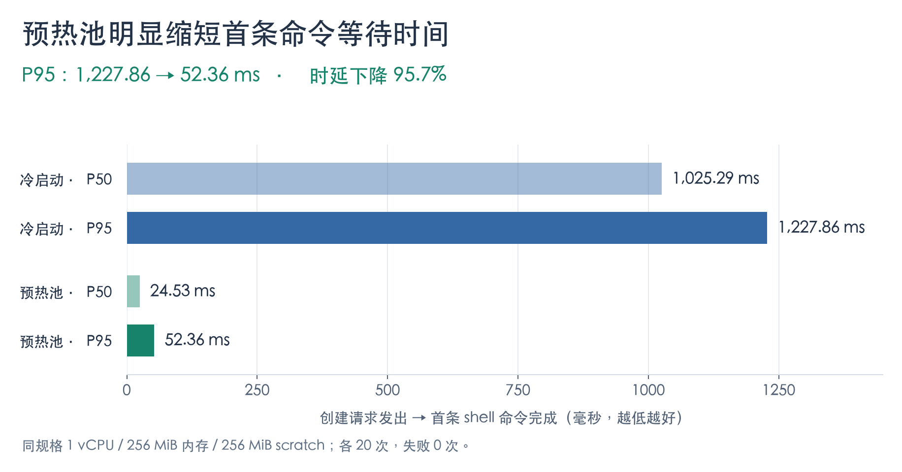
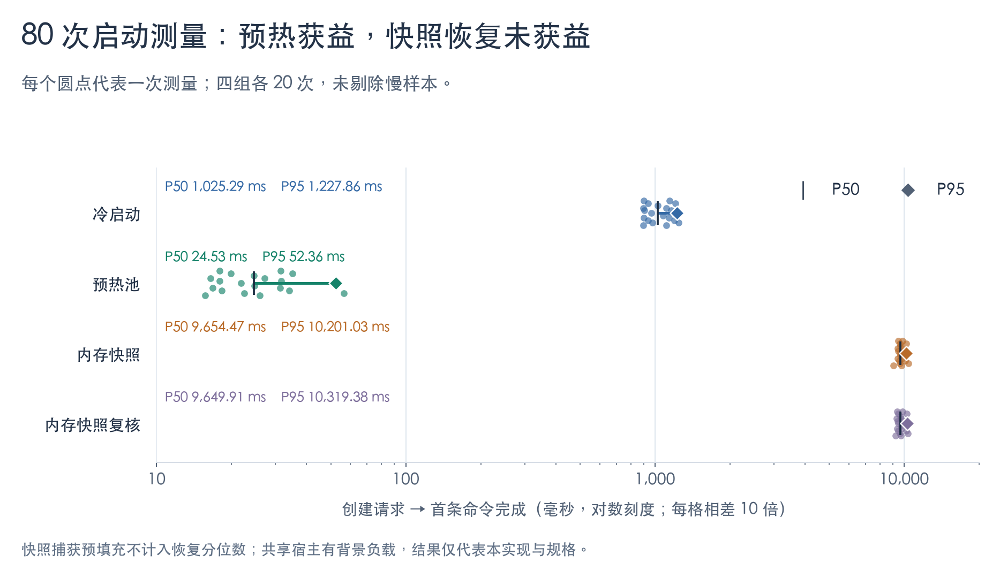

# Firecracker 沙箱启动性能：预热池将 P95 从 1.23 秒降至 52 毫秒

> 2026-11-07 实测 · 2026-11-10 整理呈现 · 固定版本、相同 VM 规格，每组 20 次。
>
> 计时从**创建请求发出，到首条真实 shell 命令完成**。这里衡量的是用户拿到可用沙箱的等待时间。

这次对照回答了一个具体问题：为 Agent 创建沙箱时，冷启动、预热池和内存快照，哪种方式能更快开始执行命令？

- **预热池有效。** P95 从 **1,227.86 ms 降到 52.36 ms，下降 95.7%**；P50 从 1,025.29 ms 降到 24.53 ms。
- **内存快照恢复没有带来加速。** 两次测量的 P50 都约为 9.65 秒，是冷启动的 **9.4 倍**。因此，本轮验收没有建议启用快照缓存。
- **四组测量均完成 20 次、失败 0 次。** 全部慢样本保留；快照还在全新目录下复核了一组。

## 真实测量结果与交付证据

### 1. 预热池带来了多少改善？



*图 1：横轴从零开始，单位为毫秒，越短越好。P50 表示典型等待时间；本次每组 20 个样本，P95 取排序后的第 19 个值。*

预热池提前准备好可用 VM，收到请求后分配已有实例，因此用户请求路径中的等待明显减少。**这组数据衡量预热池可用时的收益，不包含提前建池的耗时与常驻资源成本**，也没有测量高并发导致池耗尽时的表现。

### 2. 为什么没有采用内存快照加速？



*图 2：每个圆点代表一次真实测量；竖线为 P50，菱形为 P95。为同时展示几十毫秒与约一万毫秒的差异，横轴采用对数刻度，相邻主刻度相差 10 倍；圆点的上下错开仅为避免重叠。*

| 启动方式 | 计入测量的样本 | P50 | P95 | 失败 |
| --- | ---: | ---: | ---: | ---: |
| 冷启动 | 20 | 1,025.29 ms | 1,227.86 ms | 0 |
| 预热池 | 20 | **24.53 ms** | **52.36 ms** | 0 |
| 内存快照恢复 | 20 | 9,654.47 ms | 10,201.03 ms | 0 |
| 内存快照恢复复核 | 20 | 9,649.91 ms | 10,319.38 ms | 0 |

快照恢复需要执行本实现的内容校验与恢复 I/O。在这套实现、镜像和规格下，两次测量均未获得启动收益；复核的典型耗时也没有改善。**当时的上线决策是继续保持 `AR_FC_SNAPSHOT_CACHE_MIB=0`。** 快照恢复功能及隔离能力通过验证，但性能结果不支持默认开启。

两组快照测量各有一次额外的真实捕获预填充，原始记录全部保留；它们不计入随后 20 次恢复的分位数。启动来源依据同一 `env_id` 的 bootstrap 记录确认，没有根据耗时猜测是冷启动还是快照恢复。

## 测量口径与可复现条件

| 项目 | 本次设置 |
| --- | --- |
| 固定实现 | [`17f1c7b2`](https://github.com/Hanwen-Jiang/agent-runtime/commit/17f1c7b2c8e1a661eb09b8cbec0a6c9ed090f0c6)；相同优化构建的 manager、Firecracker、kernel 与 rootfs |
| 单个 VM | 1 vCPU、256 MiB 内存、256 MiB scratch 磁盘；Python 基础镜像 |
| 宿主机 | 24 个逻辑 CPU；共享生产宿主，存在背景服务 |
| 请求方式 | 启动时延逐次测量，各组观测并发为 1；预热池提前准备 2 台 VM |
| 计时边界 | 创建请求发出 → 首条真实 shell 命令结束；不是仅测创建 API 返回 |
| 分位数 | nearest-rank：第 `ceil(q × n)` 个有序样本；本次 P50 是第 10 个，P95 是第 19 个 |
| 样本处理 | 不删除慢样本；快照预填充单列，恢复样本单独统计 |

二进制、镜像与配置的精确 SHA-256，以及逐次请求、资源采样和清理结果，均保留在[测量证据总索引](evidence/fc-pin-20261107/comparison.json)及其关联文件中。

**结果适用范围：**

- “冷启动”指新建 VM；测量前为核对哈希读取过镜像，**不等于宿主页缓存完全冷态**。
- 测试使用共享宿主。首组快照期间观察到 Go 编译，复核期间也观察到 Go/Postgres 测试；[背景进程记录](evidence/fc-pin-20261107/snapshot-repeat/build-process-observations.jsonl)和[首轮干扰记录](evidence/fc-pin-20261107/first/contention.json)均保留。不能把结果描述为完全独占环境下的性能。
- 每组只有 20 个样本，未测 P99、持续吞吐、并发压力或长任务性能；本报告不从启动时延推断这些能力。
- 预热池的资源投入、命中率和补充速度会影响实际收益，本轮没有量化完整的成本收益关系。

## 资源与隔离：还有哪些验证？

**资源采样。** 每次运行均记录宿主 CPU、内存、磁盘、PSI 压力，以及 VM cgroup 的 CPU、内存和 I/O 指标。四组平均宿主 CPU 忙碌率分别为 15.43%、18.29%、18.77%、13.96%；VM `memory.peak` 中位数约为 52.6、52.9、7.2、7.1 MiB。快照组受到文件映射与按需触页影响，这些值不用于推断物理内存节省。空 `io.stat` 只表示该时间窗没有归属到该 cgroup 的块设备 I/O 记录。

**隔离验证。** 真实 KVM 测试覆盖快照克隆后的 machine-id、boot-id、hostname、随机状态和时间更新，跨租户访问拒绝，以及工作区隔离。活动 VM 仍引用失效快照时，缓存仍计入配额，最后一个引用释放后才清理或重新捕获。[查看真实隔离测试日志](evidence/fc-pin-20261107/real-isolation-test.log)。

**容量边界。** 另一组更早版本的测试曾同时运行 96 台空闲 VM，并逐台执行首条命令。这只证明相应配置下至少可运行 96 台空闲实例，没有探测物理容量上限，也不代表编译或真实 Agent 任务的并发容量。[查看该组独立证据](evidence/fc-pin-20261107/density-earlier-source/summary.json)。

<details>
<summary>展开：原 D26-REVIEW03 修复与验收记录</summary>

本次工作基于真实验收线 `261450be`，复用已有的 jail 镜像固定、API socket 路径限制、I/O accounting、warm hardlink 修复和真实 rootfs。

快照失效时先写入 `invalidated` 标记，禁止新恢复；只要 state、memory 或 scratch 仍被活动 VM 的 hardlink 引用，就保留整个缓存条目，并按文件逻辑长度计入容量。重启或重新打开缓存后，仍能从失效标记和链接数恢复计费。同一 key 的旧代被引用时只允许冷启动；最后一个引用释放后才清理并重新捕获。

- `cargo test --offline -p fc-manager --lib`：**35 passed**，无跳过；覆盖失效代保留配额、重开后计费、最后引用释放与已有通信/缓存用例。
- `memory_snapshot_clones_refresh_identity_and_keep_tenant_disks_private`：**1 passed，37.68 秒**，显式启用真实 KVM。使用优化 release manager 和 `python.ext4`，独立目录 `fcr-9120fb87`；测试结束后全部 VM 销毁、sweep 检查无残留。
- 保留前两次功能验收失败：debug 构建的哈希计算超过测试 HTTP 60 秒；随后一次 release 尚未链接完成就启动测试，导致 binary 不存在。对应本地日志为 `.goal-tools/fc-pin-functional.log`、`fc-pin-functional-release.log`；成功日志为 `fc-pin-functional-release2.log`。功能测试耗时不计入启动性能结果。
- 96 台密度测试使用更早的 `5e1037e5`，配置 `MAX_VMS=96`、`MAX_VCPUS=96`，内存与磁盘预算各 32768 MiB。它与本次固定版本的启动对照分开记录。
- 本轮测试的 manager、VM、jail、cgroup、临时凭据及 gp9/gp10 基础快照缓存已清理；[宿主清理记录](evidence/fc-pin-20261107/snapshot-repeat/host-cleanup.json)确认无残留。原始测量产物保留；本轮未修改生产 manager、rootfs 或其它会话原始产物。未调用模型，新增模型费用为 **$0**。

</details>

## 原始数据与图表复现

| 要核对的内容 | 原始证据 |
| --- | --- |
| 汇总、环境、文件哈希与解释边界 | [comparison.json](evidence/fc-pin-20261107/comparison.json) |
| 冷启动 20 次记录 | [汇总](evidence/fc-pin-20261107/first/cold/summary.json) · [逐次样本](evidence/fc-pin-20261107/first/cold/samples.jsonl) |
| 预热池 20 次记录 | [汇总](evidence/fc-pin-20261107/first/warm/summary.json) · [逐次样本](evidence/fc-pin-20261107/first/warm/samples.jsonl) |
| 快照首次测量与捕获预填充 | [汇总](evidence/fc-pin-20261107/first/snapshot/summary.json) · [逐次样本](evidence/fc-pin-20261107/first/snapshot/samples.jsonl) |
| 快照复核与捕获预填充 | [汇总](evidence/fc-pin-20261107/snapshot-repeat/snapshot/summary.json) · [逐次样本](evidence/fc-pin-20261107/snapshot-repeat/snapshot/samples.jsonl) |

两张图由[绘图脚本](../../scripts/render_fc_startup_report.py)直接读取原始样本生成。脚本核对文件 SHA-256，排除单列的预填充记录，并复算 P50/P95 与原始汇总逐项比较；没有重新运行性能测试或修改测量值。

```bash
uv run --no-project --with matplotlib python scripts/render_fc_startup_report.py
# 缺少中文字体时，追加：--font /path/to/CJK-font.ttf
```
