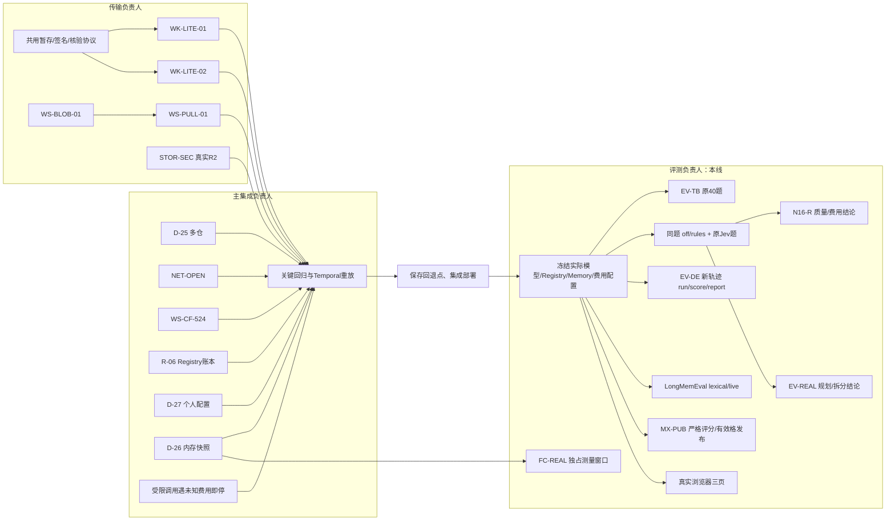

# 全量 Goal：评测线执行记录

负责会话：01a1b1e7-de7f-7df0-aef8-b78ad52aaa06。集成部署由原主线会话负责；认领及依赖见父目录 GOAL-COORDINATION.json。

## MX-PUB 运行前冻结的标准

2026-11-06，任何新付费运行前冻结。依据 capability-matrix-evals.md 第 4、13 节和设计书附录 D.5、E.1/E.2：

- S-09 plan 保持 schema、规则、分诊、形状全部通过才得 1 分；不改标注、不给部分分、不删除困难题。工程门槛不代替能力分。
- Planner 补齐通用 template、revise、人工澄清和交付说明，不在提示中加入题目答案或形状标签。
- 评分契约 s09-strict-v2；每条新结果固定数据版本和提示/校验/评分/上下文源码摘要。旧 S-09 plan 无该证据，只作诊断，不发布、不混入新运行。
- 每格至少 40 道不同题，完整采集计划规定的重复；污染率 ≤5%，按题 bootstrap 95% 区间半宽 ≤0.15，收缩系数 10，保留淘汰赛规则。重复或缺失记录不能增大有效样本。
- 同格至少一半候选满足发布条件，否则整格不发；报告保留所有分数和原因。
- 发布须按本契约重新生成报告，不能直接信任旧 scores.json 的 publishable 标志。原始结果保留，诊断输出放新目录。

## 历史与费用

批准上限（all-plans-dag §7.1）：TB $80、EV-REAL/N16-R 共用 $40、DeepEval $10、LongMemEval $20、MX $200。新运行前扣除已有实际费用，不扩大上限。

TB 实物为23完成、4已提交并付费但后续失败、13未提交；旧记录无完整模型/Registry/Memory锁定，不能拼入新版40题。DeepEval /opt/evals/w1/deepeval-b 的8题已有真实工具证据，保留作旧版本对照；本次仍需新目录 run/score/report。

本线本轮新增费用：$0。当前执行沙箱拒绝 Docker/Kubernetes socket，KVM不可见；继续本地实现和离线回归，不能将其记作真实验收。

## 文件认领

evaluation：MX与Planner提示；paired-eval：TB及配对实验；memory-eval：LongMemEval和页面冒烟；deepeval：新采集和重判。各自独立worktree，不修改Task Loop/Stage Runner/Node Executor。

## 已落实与验证

MX实现：Planner补上设计书中的通用展开/质量/人工澄清模式；S09结果携带真实提示、校验、评分及schema文件摘要，续跑换版本会拒绝。发布保留完整严格评分，增加40题下限、重复完整性、重复记录/不同题集拒绝与至少一半候选可发布的门槛。CLI发布从原始记录重新评分，不信任旧scores文件。Profile来源写入整格证据SHA256。

离线验证：能力矩阵原有与新增测试首轮61通过，补充题集一致性后相关46通过；Planner full/tiers/verdicts/triage/sub_agent 78通过。实际模型调用为0。Temporal重放已启动，但当前环境下首份回放等待超过65秒；保留测试，继续定位，尚不能报告重放通过。

旧矩阵实物：/opt/evals/mx/round1 的5742条，历史成本精确 $120.085294。新复核证据在父目录 .goal-evidence/mx-audit-20261106：输入文件sha、完整新scores、可发布补丁、费用估算。12个act分数满足条件，已准备进本分支model-profiles与registry-seed；Registry实际发布/导出/部署待集成方执行，不能将源码更新称为线上发布。plan已知旧证据无效、route只有36题、judge有效候选不足一半、transform未运行，均不发布。

新plan+route计划固定47/58题、seed0、3次重复；保守估计初轮 $51.5499，淘汰赛候选全部晋级另需 $43.6326，合计超过剩余 $79.914706。执行时必须以剩余额度作硬总上限；未完成的候选明确记录，不扩大支出授权。

## 协作 DAG 与实际边界

主集成会话已确认分工：核心实现、公共契约及统一部署由其负责；本线独占评测实现、准备和结果记录。轻测试随各线并行，重型构建/密度/TB拉取独占资源窗口。

### 后续交叉检查

- Matrix的计划、候选、题集、Profile和部署快照均不可变；评分/发布核对运行摘要，不能缩减候选或伪造S09摘要通过门槛。目录跨进程独占，坏正文拒绝，只有持锁的末尾半行可恢复。
- 费用保护复用evals/budget.py，每次Generate/Embed都传剩余额度；并发、错误和退出不清除未知费用。总预算本地拒绝保留为未运行，不写模型失败或done。历史产物费用仍要核对model_usage，不能推断不存在pending。
- Gateway红回归在真实Server、SQLite和内存gRPC传输复现：8个未知费用问题失败、2个已知费用对照通过。核心实现未由本线修改；详见goal-gateway-eval-budget-regression文档，修好后才能启动受限付费实验。
- Temporal问题为测试沙箱阻止asyncio本地socketpair唤醒。仅测试循环增加普通定时器，保留全部死锁/不确定性检测：Task重放5过，Stage等8过，旧版本分支1过；40份golden保留。771efed7独立基线也通过。证据在父目录.goal-evidence/temporal-20261106，真实Temporal服务器集成仍待宿主网络。
- Jev原题见goal-jev-reproduction文档与evalsets/paired/jev-reproduction.json。f06e30c不修第一次误拦；原1.97美元只是文档近似，分项费用待账本/外部Jev记录核验。

合并回归：相关七文件105过；配置与证据校验补强后四文件70过；另一组含真实DeepEval指标桥、Memory指标和FC工具100过。均为离线/进程内验证，不替代部署、线上模型或浏览器验收。本线新增模型费用仍为0美元。
