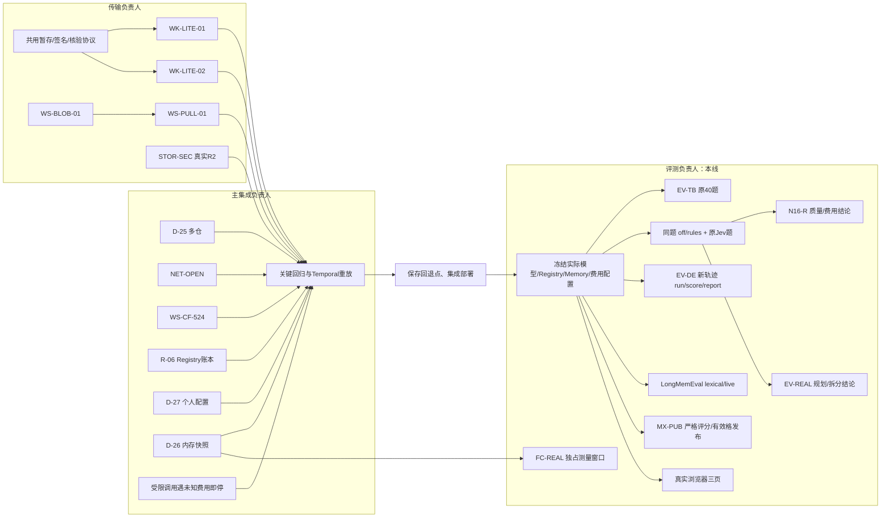

# 全量 Goal：评测线执行记录

> 历史盘点记录，费用与完成状态以[全量交付最新记录](goal-full-20-2026-11-07.md)及各次原始账本证据为准。早期报告金额不代表已核实余额；pending既不是实际费用，也不能视为免费。

负责会话：01a1b1e7-de7f-7df0-aef8-b78ad52aaa06。集成部署由原主线会话负责；认领及依赖见父目录 GOAL-COORDINATION.json。

## MX-PUB 运行前冻结的标准

2026-11-06，任何新付费运行前冻结。依据 capability-matrix-evals.md 第 4、13 节和设计书附录 D.5、E.1/E.2：

- S-09 plan 保持 schema、规则、分诊、形状全部通过才得 1 分；不改标注、不给部分分、不删除困难题。工程门槛不代替能力分。
- Planner 补齐通用 template、revise、人工澄清和交付说明，不在提示中加入题目答案或形状标签。
- 评分契约 s09-strict-v2；每条新结果固定数据版本和提示/校验/评分/上下文源码摘要。旧 S-09 plan 无该证据，只作诊断，不发布、不混入新运行。
- 每格至少 40 道不同题，完整采集计划规定的重复；污染率 ≤5%，按题 bootstrap 95% 区间半宽 ≤0.15，收缩系数 10，保留淘汰赛规则。重复或缺失记录不能增大有效样本。
- 同格至少一半候选满足发布条件，否则整格不发；报告保留所有分数和原因。
- 发布须按本契约重新生成报告，不能直接信任旧 scores.json 的 publishable 标志。原始结果保留，诊断输出放新目录。

## 历史与费用

批准上限（all-plans-dag §7.1）：TB $80、EV-REAL/N16-R 共用 $40、DeepEval $10、LongMemEval $20、MX $200。新运行前扣除已有实际费用，不扩大上限。

TB 实物为23完成、4已提交并付费但后续失败、13未提交；旧记录无完整模型/Registry/Memory锁定，不能拼入新版40题。DeepEval /opt/evals/w1/deepeval-b 的8题已有真实工具证据，保留作旧版本对照；本次仍需新目录 run/score/report。

本线本轮新增费用：$0。当前执行沙箱拒绝 Docker/Kubernetes socket，KVM不可见；继续本地实现和离线回归，不能将其记作真实验收。

## 文件认领

evaluation：MX与Planner提示；paired-eval：TB及配对实验；memory-eval：LongMemEval和页面冒烟；deepeval：新采集和重判。各自独立worktree，不修改Task Loop/Stage Runner/Node Executor。

## 已落实与验证

MX实现：Planner补上设计书中的通用展开/质量/人工澄清模式；S09结果携带真实提示、校验、评分及schema文件摘要，续跑换版本会拒绝。发布保留完整严格评分，增加40题下限、重复完整性、重复记录/不同题集拒绝与至少一半候选可发布的门槛。CLI发布从原始记录重新评分，不信任旧scores文件。Profile来源写入整格证据SHA256。

离线验证：能力矩阵原有与新增测试首轮61通过，补充题集一致性后相关46通过；Planner full/tiers/verdicts/triage/sub_agent 78通过。实际模型调用为0。Temporal重放已启动，但当前环境下首份回放等待超过65秒；保留测试，继续定位，尚不能报告重放通过。

旧矩阵实物：/opt/evals/mx/round1 的5742条，历史成本精确 $120.085294。新复核证据在父目录 .goal-evidence/mx-audit-20261106：输入文件sha、完整新scores、可发布补丁、费用估算。12个act分数满足条件，已准备进本分支model-profiles与registry-seed；Registry实际发布/导出/部署待集成方执行，不能将源码更新称为线上发布。plan已知旧证据无效、route只有36题、judge有效候选不足一半、transform未运行，均不发布。

新plan+route计划固定47/58题、seed0、3次重复；保守估计初轮 $51.5499，淘汰赛候选全部晋级另需 $43.6326，合计超过剩余 $79.914706。执行时必须以剩余额度作硬总上限；未完成的候选明确记录，不扩大支出授权。

## 协作 DAG 与实际边界

主集成会话已确认分工：核心实现、公共契约及统一部署由其负责；本线独占评测实现、准备和结果记录。轻测试随各线并行，重型构建/密度/TB拉取独占资源窗口。

### 后续交叉检查

- Matrix的计划、候选、题集、Profile和部署快照均不可变；评分/发布核对运行摘要，不能缩减候选或伪造S09摘要通过门槛。目录跨进程独占，坏正文拒绝，只有持锁的末尾半行可恢复。
- 费用保护复用evals/budget.py，每次Generate/Embed都传剩余额度；并发、错误和退出不清除未知费用。总预算本地拒绝保留为未运行，不写模型失败或done。历史产物费用仍要核对model_usage，不能推断不存在pending。
- Gateway红回归在真实Server、SQLite和内存gRPC传输复现：8个未知费用问题失败、2个已知费用对照通过。核心实现未由本线修改；详见goal-gateway-eval-budget-regression文档，修好后才能启动受限付费实验。
- Temporal问题为测试沙箱阻止asyncio本地socketpair唤醒。仅测试循环增加普通定时器，保留全部死锁/不确定性检测：Task重放5过，Stage等8过，旧版本分支1过；40份golden保留。771efed7独立基线也通过。证据在父目录.goal-evidence/temporal-20261106，真实Temporal服务器集成仍待宿主网络。
- Jev原题见goal-jev-reproduction文档与evalsets/paired/jev-reproduction.json。f06e30c不修第一次误拦；原1.97美元只是文档近似，分项费用待账本/外部Jev记录核验。

合并回归：相关七文件105过；配置与证据校验补强后四文件70过；另一组含真实DeepEval指标桥、Memory指标和FC工具100过。均为离线/进程内验证，不替代部署、线上模型或浏览器验收。本线新增模型费用仍为0美元。

## 宿主权限恢复后的核验（2026-11-06 19:29 UTC起）

本节取代此前“无法创建socket”的环境状态，但不将旧失败改写为成功。实际TCP、真实DeepEval/Ragas框架桥及Memory gRPC回归45项通过、0skip，日志位于父目录.goal-evidence/live-transports-20261106.log。原User-Agent断言已按StartWorkspaceOperation返回Unimplemented→旧DeleteWorkspace→SSE三个实际请求更新，仍逐请求校验身份。页面独立真实Chromium测试6过，线上桌面溢出缺口另由页面负责人修复，待部署重新验收。

费用重核推翻了仅用旧report计算的余额，前文的“剩余”只能作为历史报告口径，不能再作为开工依据：

- 原Jev Task已done/2轮；model_usage 13次已结算合计0.273624美元，8次pending预占1.695528美元，两者和1.969152美元接近旧文档1.97。预占不是已知实付，不能宣称“旧实际成本1.97已修好”。
- TB30个历史Task：model_usage已结算42.786647美元，206次pending预占142.677378美元；report只有36.432857美元。未知尝试未查清前不能按report余额新开40美元实验。
- DeepEval16个历史Task已结算1.972641美元，6次pending预占2.045521美元；裁判费用另外核对。旧报告重复引用同Task时只算一次。
- 已有LongMemEval中断实验339次embed已结算0.015291美元、pending0；队列0，本次278个候选均已清理。原始interrupted记录不篡改，记录恢复证据；不得重复计费启动同一尝试。

只读provider用量接口只能提供最近1000条消费记录；不能凭窗口内缺少记录把pending清零，也不能把provider折扣计量与冻结Registry单价混为一套费用。真实核对原件位于.goal-evidence/paired-live-preflight-20261106及memory-live-audit-20261106；后续实验必须等待费用不确定性得到处理和部署冻结。

后续直接调用Gateway的MX/DeepEval采用evals.audited_gateway:from_env：设置稳定AR_EVAL_RUN_ID、独立AR_EVAL_USAGE_DIR（实验输出下的usage子目录）、AR_MODEL_GATEWAY_ADDRESS，并经现有预算包装调用。每个实验固定唯一task_id，每次RPC固定唯一node_id，日志只存原调用身份/摘要/计量，不存提示或凭据；未结算调用禁止盲目续跑。使用该模块的--directory和--out命令只读tenant-scoped model_usage，可核对逐次attempt的真实Registry修订和费用，而不会把旧的空task_id/共用评测id误归入新实验。实现5项回归通过，尚未新增付费调用。

## 2026-11-07 19:24 UTC 配对实验有限续采集

固定11题×off/rules的原实验已采集9道off；第9题质量轨迹完整，但一次DeepSeek调用实际费用未知。原`metrics.valid=false`逐字节保留，未知reservation `mbr_DTTAF6WU2EWRW4S267NLH6APYE`预占14,517微美元；不得当成实付、退款或确定的实际费用上界。

A/B复核完整隔离租户126条账本后，只允许补原2道off和11道rules。已知费用1.030475美元、保留预占0.014517美元、subject硬额度18.445261美元，扣除两者的准入余额17.400269美元。原总限仍40美元：当前实验37.945261美元加旧Jev保留1.969152美元、早期无效样本0.085586798美元为39.999999798美元；没有追加预算。Jev和语义裁判分别保持12.5与7美元原分配。

`paired_admission`将原plan、完整baseline账本和唯一pending的摘要固定；新pending、旧行变化、额外Task、预算变更均停止下一题。完整质量证据可进入盲评，但原有效性及费用未知不改。汇总报告要求每题和scope费用均已知，否则完整费用/比例为null且验收不能通过；缺题时不报告部分题目的费用比例为完整cohort结果。

针对性回归90项通过、0skip：`test_paired_admission.py test_paired_evaluation.py test_paired_completion.py`，显式加载pytest_asyncio。真实断点只读验证确认原9题全部跳过，不重复付费；仅给第9题账本补全权威`reserved_usd_micros`，旧字段/metrics不变，原件另存。证据在`/opt/evals/n16-evreal-pinned-20261107/{pending-subject-ledger.json,pending-admission-reconciliation.json,collection-continue.json,collection-continuation-preflight.json,before-pending-continuation/}`。证据采集代码修订独立记录；运行时fdd0f202、模型/Registry/题目/评分门槛不变。

续跑在HTTP题提交前暴露空仓兼容缺口：异步create已完成，但空仓没有Git head，评测客户端误拒；此次未创建Task、无模型费用。客户端仅在repo/ref/files均空且workspaceId精确匹配时接受空head，runner按head字段是否存在恢复创建/幂等提交，仍拒缺失恢复元数据及clone缺head。真实操作号与失败原件保留，复用同操作恢复；冻结题目及服务版本不变。paired/SWE/TB回归110通过，交付证据回归8通过，0skip。

## 2026-11-07 rules 首题未结算与追加收据

off原11题全部终态并清理，已知Gateway费用1.124750美元，Jev14241输入token对应0.000598122美元；原14517微美元未知仍保留，完整费用不是两者相加。五隔离Worker只切off→rules，真实模板、镜像及其他ConfigMap逐项核对不变。rules首题完成/清理，但新增Haiku triage reservation `mbr_QXBAQLBWMIB2BSAG4U5B33M2SJ`，预占9083微美元。Gateway同rid日志证实30秒timeout；后续成功3644输入/84输出、406微美元可对应provider消费记录，不能据此把首次超时费用记零。运行器正确停止，未继续第二题。

A/B核对完整scope：已知1282125微美元，两笔预占共23600微美元，原18445261微美元subject限下准入余额17139536微美元；旧148行不变，新8行全属首rules题。仍在原40美元总分配内只补剩余10题，不改变旧题有效性或总费用未知。原`collection-continue.json`原位保留；新增收据引用整份前件摘要，扩展只新增指定9083微美元完整行，存`collection-continue-extensions/<digest>.json`。新未知、分叉、孤立扩展、旧行修改、回退与预算变化继续拒绝，完整cost ratio继续null。

131项针对性回归通过、0skip（admission/evaluation/completion/semantic material）。真实证据：`.goal-evidence/rules-pending-review-20261107/`及`/opt/evals/n16-evreal-pinned-20261107/rules-{new-pending-reconciliation,first-provider-window,first-provider-recent}.json`；原首rules metrics字节与失败记录保留，不重新调用该题模型。

## 已完成实测的原始证据入口

- D-26/FC-REAL：`evidence/fc-pin-20261107/comparison.json`及`first/{cold,warm,snapshot}/summary.json`、`snapshot-repeat/snapshot/summary.json`。固定1000m CPU、256MiB内存、256MiB盘，各20样本；cold p50/p95为1025.287/1227.864ms，warm为24.530/52.358ms，真实内存快照为9654.466/10201.032ms；另20次快照复核为9649.908/10319.383ms。未观察到快照加速，生产snapshot cache保持0。CPU/内存/IO原样本及背景负载原件保留，不过滤慢样本。
- 密度：`evidence/fc-pin-20261107/density-earlier-source/{manifest,summary,cleanup}.json`。96台同时存在、资源证据完整并已清理；当时配置上限也为96，且是idle VM加单条shell，结论只为观测下界，绝非物理密度极限。该批较早source单独列示，不与最新冷/暖/快照源码混成同版本。
- STOR-SEC：`evidence/transfer-r2-live-20261106.log`列明真实R2全部11子例通过，包含真实agent上传/缺块恢复、不可覆盖、同长度错误内容、checksum/If-None-Match/Content-Length/对象key/method/过期。执行与清理条件见`transfer-acceptance-2026-11-07.md`；后续复核日志为父目录`.goal-tools/livecheck-transfer-r2.log`，没有桶生命周期修改。

以上是已存在原始验收文件的交付索引，没有重跑实验或新增模型费用。2026-11-07用户指定后，两仓作者与提交者email均设为`haven-just@qq.com`，新提交使用该邮箱；已推送历史未重写。
