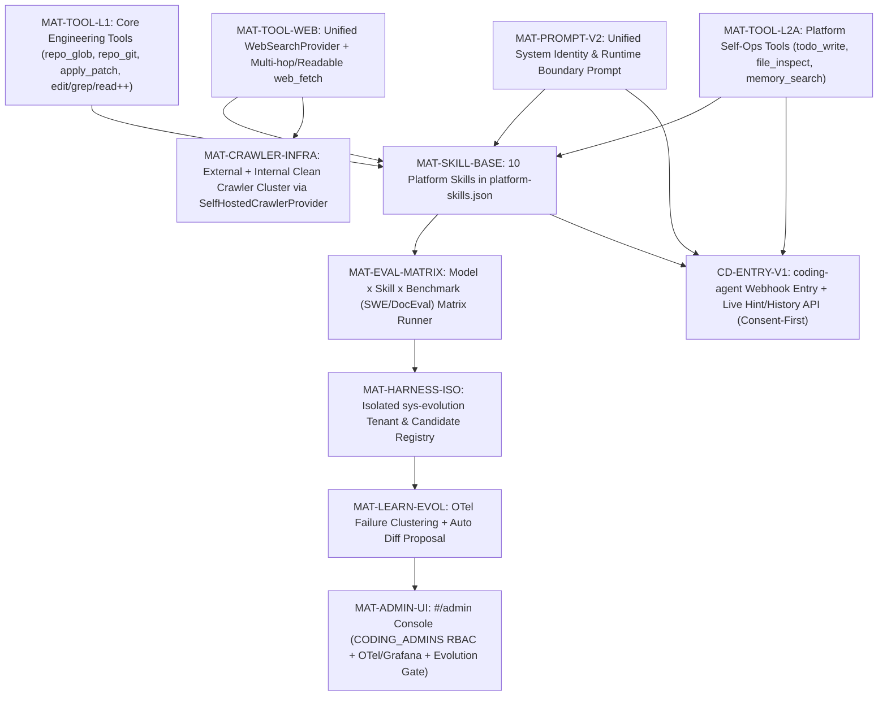

# System Maturity, Eval-Driven Self-Evolution, Admin Console & `<coding-dance>` Master DAG

- 状态：Wave 1 实施中（2026-11-25 制定，随各 Wave 推进持续更新）
- 关联仓库：`agent-runtime` + `coding-agent`（参见 `coding-agent/docs/plan/maturity-admin-and-coding-dance-plan-2026-11-25.md`）
- 目标读者：任何新接手本系统演进工作的工程师与 Coding Agent

---

## 1. 设计总览（Five-Layer Architecture）

本方案把系统的长期成熟度建设拆为 5 个正交层次，并通过 Eval-Driven Self-Evolution 闭环驱动持续演进：

1. **Layer 0 — System Identity & Boundary Prompt（深层系统提示词）**
   - 统一维护在 `services/py-worker/src/agentruntime_worker/prompts/system_identity.py`，按角色（`planner` / `executor` / `reviewer`）与动态运行态（`RuntimeCapabilities`：当前 `effect_ceiling`、可用工具集、工作区挂载模式 `local` vs `sandbox`、沙箱断网边界、平台 Skill 索引、长短期 Memory 可用性）注入系统提示词。
   - 让 LLM 明确知道：**自己是谁、当前处于哪个运行时边界、哪些能力被租户策略或只读上限锁住、何时必须查 Skill/Memory、何时禁止伪造未实测结论**。

2. **Layer 1 — Three-Tier Tool System（三层成熟工具体系）**
   - **L1 核心工程工具（Core Engineering Tools）**：
     - `repo_read`（增强 `with_line_numbers`）、`repo_list`
     - `repo_glob`（支持 glob 模式匹配、文件修改时间/路径排序，兼容本地挂载与 Sandbox 存档工作区）
     - `repo_grep`（增强 `glob` 过滤、`context_lines` 上下文与 `case_sensitive` 控制）
     - `repo_edit`（增强 `replace_all` 批量精确替换）
     - `apply_patch`（标准 multi-file diff/patch 原子修改，适配大模型最擅长的 unified patch 输出，预校验通过后再落盘，失败零残留）
     - `repo_git`（受控只读 Git 状态工具：`status` / `diff` / `log` / `show` / `blame` / `rev-parse`，无写操作）
     - `shell_run`（保留沙箱与 checkpoint 撤销契约）
   - **L2 平台自操作工具（Platform Self-Ops Tools）**：
     - `todo_write`（任务内结构化进度清单，按 `(tenant_id, task_id, workspace_id)` 隔离存储于工作区临时元数据之外的内存/状态存储或受控工作区状态）
     - `file_inspect`（代码/配置文件元数据、行数、语言、符号摘要检查，减少整文件盲读）
     - `memory_search`（主动检索平台语义经验库 Memory Service，绑定当前租户上下文）
     - 与既有 `skill_read`、`skill_file`、`context_read`、`attachment_import`、`deliver_file`、`file_*`、`network_request` 组成完整的平台内自操作闭环。
   - **L3 外部联网与爬虫接口层（External Web & Future Clean Crawler）**：
     - `web_search`：统一抽象 `WebSearchProvider` 接口（Wave 1 内置 `TavilyProvider` / `SerperProvider` / `BraveProvider` / `ExaProvider`，API Key 通过平台 SecretStore `web-search/api-key` 注入；无 Key 时自动回退到免 Key 的 `SearXNGProvider`（`AR_SEARXNG_URL`）或 `DuckDuckGoLiteProvider`，同时保留 `SelfHostedCrawlerProvider`（`AR_CRAWLER_ENDPOINT`）接口骨架以无缝对接 Wave 4 自建纯净爬虫集群）。
     - `web_fetch`：升级安全重定向跟踪（每跳重检白名单与 SSRF 内网封禁，遇拦截策略时返回 3xx `redirect_blocked` 明确告知）与正文提取模式（`extract_readable=True` 去除 `<script>/<style>/nav` 等噪声标签，输出干净可读 Markdown/文本）；并在生产环境 Worker 开启 `AR_TOOL_FETCH_HOSTS=*`（SSRF 内网防火墙默认保持开启）。

3. **Layer 2 — Platform Skill System & Model × Benchmark Matrix Tuning**
   - 平台级 Skill 清单从 4 个扩展至 10 个高精度可执行 Skill（`deploy/dev/platform-skills.json`），全部符合 `schemas/skill.schema.json`：
     1. `explore-repo`：大型代码库考古与调用链定位
     2. `coding-engineering`：全栈工程设计与模块化脚手架/规范落地
     3. `bugfix-tdd`：根因定位 → 复现测试 → 最小修复 → 回归验证闭环
     4. `write-tests`：边界/并发/错误恢复测试工程规范
     5. `refactor-safely`：跨文件接口演进与零破坏重构
     6. `docs-architecture`：架构文档、API 契约与 Mermaid DAG 规范
     7. `eval-authoring`：面向 `agentruntime-evals` 的 Golden Case 与判分器编写
     8. `security-review`：SSRF / 注入 / 越权 / 密钥泄露与边界审计
     9. `commit-and-pr`：最小脏区识别、原子提交与 PR 交付说明
     10. `deliver-files`：面向用户的交付产物打包与 `deliver_file` 校验
   - 建立 **Model × Benchmark Matrix（模型 × 评测基准矩阵）**，将每类 Skill 与对应 Benchmark 绑定持续调优：
     - `coding-engineering` / `bugfix-tdd` / `refactor-safely` ↔ `SWE-bench` / 内部工程题库
     - `docs-architecture` / `deliver-files` ↔ `DocEval` / 结构化文档评分器
     - `explore-repo` / `security-review` ↔ 长上下文检索与漏报率 Benchmark

4. **Layer 3 — Isolated Self-Evolution Harness（独立系统自进化机制）**
   - **绝对隔离原则**：系统级自进化运行在专属隔离租户 `_system_evolution` 下，拥有独立 Budget、只读生产 Trace/OTel 采样权限与独立的候选项 Registry 分支（`status = candidate_eval`），**严禁污染或借道任何终端用户的 workspace harness**。
   - **闭环链路**：`OTel / VictoriaMetrics Trace 采集` → `py-learning 模式聚类（高频 tool failure / 过度只读 / skill 缺口）` → `Evolution Agent 生成 Skill / Prompt Patch Diff` → `Eval Runner 自动跑 SWE-bench & DocEval 回归矩阵` → `写入候选项表等待管理员审批`。

5. **Layer 4 — Admin Console（管理员可观测性与自进化控制台）**
   - 仅限 `CODING_ADMINS` 鉴权通过的管理员访问，嵌入 `coding-web` 的 `#/admin` 路由。
   - 聚合展示：**OTel 链路延时/错误率**、**Grafana / VictoriaMetrics 运维面板**、**Tool 调用成功率热力图**、**Model × Skill Eval 矩阵对比**、以及 **`_system_evolution` 候选项 Diff 审阅 / 一键 Promote / 一键 Rollback**。

6. **Layer 5 — `<coding-dance>` Companion Agent（合拍伴侣接入）**
   - 采用 Webhook（`internal/entry/codingdance`）+ 实时分析 API（`/api/integrations/coding-dance/v1/*`）双通道接入。
   - 严格执行 **Consent-First（先征询同意、禁止剧透）** 原则：支持 `off` / `on_demand` / `proactive_consent` 三档模式，以及 `L1`–`L4` 渐进提示等级与 Git 历史习惯画像分析。

---

## 2. 执行总览 DAG 图

---

## 3. 各 Wave 详细任务表

### Wave 1 — 成熟度基石（当前轮次立即开发、测试并上线）

| 节点 ID | 目标模块与文件 | 核心交付内容 | 完成与验收标准 |
| --- | --- | --- | --- |
| `MAT-TOOL-L1` | `services/py-worker/src/agentruntime_worker/tools/platform.py`、`workflows/verification.py`、`executor/tool_loop.py` | 1) 新增 `repo_glob`（支持本地挂卷与 Sandbox 存档）、`repo_git`（只读子命令白名单）、`apply_patch`（多文件原子补丁）；2) 增强 `repo_read`（`with_line_numbers`）、`repo_grep`（`glob`/`context_lines`/`case_sensitive`）、`repo_edit`（`replace_all`）；3) `_READ_TOOLS` 与 `_WRITE_CAPABLE_TOOLS` 同步对齐。 | `test_platform_tools.py`、`test_maturity_wave1.py` 全绿；越界路径、无效 patch 原子回滚、只读 git 越权拦截均验证通过。 |
| `MAT-TOOL-L2A` | `services/py-worker/src/agentruntime_worker/tools/self_ops.py`、`tools/__init__.py`、`tools/platform.py` | 1) 新增 `todo_write`（任务内多步骤状态表，租户+任务+工作区隔离）；2) 新增 `file_inspect`（文件行数/大小/语言/头部结构快速探测）；3) 新增 `memory_search`（在配置 `memory_address` 与签名密钥时绑定当前租户调用 `WorkerMemoryClient`）。 | `test_worker_entry.py` 与 `test_maturity_wave1.py` 通过；未配置 `memory_address` 或工作区时不越界暴露，已配置时完整注入。 |
| `MAT-TOOL-WEB` | `services/py-worker/src/agentruntime_worker/tools/web.py`、`tools/__init__.py`、`deploy/` | 1) 将 `_NoRedirect` 与 `_Fetcher` 迁移升级至 `tools/web.py`，支持最多 5 跳安全重定向（逐跳检查 `host` 与公网 IP，受限跳转仍返回 3xx + `redirect_blocked`）与 `extract_readable` 正文提取；2) 新增 `web_search`（`WebSearchTool` + `Tavily`/`Serper`/`Brave`/`Exa`/`SearXNG`/`DuckDuckGoLite`/`SelfHostedCrawlerProvider`）；3) 生产环境 Worker 启用 `AR_TOOL_FETCH_HOSTS=*`。 | `test_platform_tools.py` 已有 SSRF/重定向断言保持兼容；`test_maturity_wave1.py` 覆盖 mock HTTP 搜索后端与 DDG fallback 解析；线上 pod 注册包含 `web_search` 与 `web_fetch`。 |
| `MAT-PROMPT-V2` | `services/py-worker/src/agentruntime_worker/prompts/__init__.py`、`prompts/system_identity.py`、`executor/tool_loop.py`、`planner/prompts.py`、`reviewer/prompts.py` | 抽象分角色系统身份与运行时边界构建器 `build_system_identity(role, ...)`，把工具层级分工、沙箱/无外网/只读上限边界、Skill 优先查证规则与“仅陈述实测证据”原则统一注入 `executor`/`planner`/`reviewer`。 | 单测验证不同角色与 `RuntimeCapabilities` 组合提示词输出；`test_planner_verdicts.py`、`test_reviewer_rules.py` 通过。 |
| `MAT-SKILL-BASE` | `deploy/dev/platform-skills.json` | 平台 Skill 扩充至 10 份高密度可执行规范（覆盖工程开发、代码库探索、TDD 修 Bug、测试、安全重构、架构文档、Eval 编写、安全审查、Git 提交与交付），每份给出明确 Trigger 与 Step-by-Step 检查清单。 | 全部 10 个条目严格通过 `schemas/skill.schema.json`（Draft 2020-12）校验，并成功 seed 到线上 Registry。 |

### Wave 2 — Model × Skill Eval Matrix 与独立自进化通道（已实现并离线验收）

| 节点 ID | 目标模块与文件 | 核心交付内容 | 验收与运行入口 |
| --- | --- | --- | --- |
| `MAT-EVAL-MATRIX` | `services/py-learning/src/agentruntime_learning/evolution/matrix.py`、`__main__.py` | 新增 `(model_tier, skill_variant, benchmark_suite)` 多维矩阵运行器（内置 `swe_engineering` 与 `doc_architecture` 套件），自动计算通过率、盲读率、工具报错率、Doc/Mermaid 规范与诚实性门禁并输出 `matrix-report.{json,md}`。 | `uv run --package agentruntime-learning python -m agentruntime_learning.evolution matrix --out <dir>`（默认 `fixture` 模式 `$0`，支持 `gateway` 实测）。 |
| `MAT-HARNESS-ISO` | `services/py-learning/src/agentruntime_learning/evolution/{isolation,store}.py`、`deploy/dev/sys-evolution-policy.json` | 采用符合 `defs.schema.json` slug 规范的隔离租户 `sys-evolution`（`^[a-z0-9][a-z0-9_-]{0,62}$`，拒绝前导 `_`）；`IsolatedEvolutionRegistry` 只允许暂存 `cand-<skill>-<hash>` 阴影候选；`EvolutionStore`（平台表 `evolution_candidates`）强制管理员审批 `approve_and_promote` 与一键 `rollback`。 | `test_evolution_wave2.py` 验证跨租户表与 Registry 写入严格隔离，系统身份禁止自审批。 |
| `MAT-LEARN-EVOL` | `services/py-learning/src/agentruntime_learning/evolution/{clustering,proposer,pipeline}.py` | 解析 OTel / console Span 结构聚类 5 类高频缺陷（如 `readonly_churn`、`edit_or_patch_conflict`、`unverified_completion` 等），自动生成含 Schema + 安全红线校验的 Unified Diff，经 Matrix Gate 后写入 `pending_approval` 或 `rejected_by_gate`。 | `uv run --package agentruntime-learning python -m agentruntime_learning.evolution evolve --traces <files...> --out <dir> --data-dir <dir>`；离线证据在 `docs/plan/evidence/wave2-evolution-20261126/`。 |

### Wave 3 — 管理员面板（`#/admin`）与 `<coding-dance>` 接入（已实现、部署并验证）

| 节点 ID | 依赖 | 目标与范围 | 验收标准与实现映射 |
| --- | --- | --- | --- |
| `MAT-ADMIN-UI` | `MAT-LEARN-EVOL` | 在 `coding-agent` 实现 `adminops` 包（`scrypt` 独立运维认证 + `CODING_ADMINS` RBAC、`VictoriaMetrics`/`Grafana`/`Task API` 聚合、`evolution_candidates` 存储与 Registry 内部 `8092` `Publish` 晋升/回滚）及 `#/admin` 独立前端控制台。 | 已通过 `adminops_test.go`、`wave3_test.go`、CSP/i18n 检查与线上部署验收；未认证返回 `401`、缺权限返回 `403`、管理员可完成观测巡检与 Approve Promote / Rollback。 |
| `CD-ENTRY-V1` | `MAT-PROMPT-V2`, `MAT-TOOL-L2A`, `MAT-SKILL-BASE` | 在 `coding-agent` 新增 `internal/entry/codingdance`（Webhook 入口）与 `/api/integrations/coding-dance/v1/{hint-check,hint-reveal,history-analyze}`，严格执行 **Consent-First（`off` / `on_demand` / `proactive_consent` + HMAC `consent_token`）** 与 **L1–L4 渐进提示**。 | 已通过 `codingdance/kind_test.go` 与 `TestWave3CodingDanceCompanionAPI`；`off` 静默/拦截，`proactive_consent` 默认无剧透征询，显式同意+有效令牌才按 `L1`–`L4` 解锁。 |

### Wave 4 — 自建内外网纯净爬虫集群（已实现、部署并验证）

| 节点 ID | 依赖 | 目标与范围 | 验收标准与实现映射 |
| --- | --- | --- | --- |
| `MAT-CRAWLER-INFRA` | `MAT-TOOL-WEB` | 在 `services/go-crawler-gateway` 实现零外部依赖 Go 静态服务，隔离 `external`（严格公网 IP / 防 DNS 重绑定 / 5 跳重验 / 正文清洗 / 可选无头渲染）与 `internal`（严格主机端口白名单 + 阻断 metadata/DB 端口 + 脱敏响应头），接入 `py-worker` 的 `web_search` 与 `web_fetch`；同时通过 `deploy/cluster/wave4-crawler-and-wave2-evolution.yaml` 上线 Wave 2 `ar-self-evolution-cycle`（Redpanda `telemetry.spans` → Postgres）定时巡检与 Grafana 成熟度看板。 | 已通过 `crawler_test.go`、`test_maturity_wave1.py`、`test_evolution_wave2.py` 与双集群实测验证。 |

---

## 4. 长期 Agent 接手协议（Handover Protocol for Future Agents）

任何后续接手本长期规划的 Agent，开始工作前必须按以下顺序执行：

1. **检查当前已落地节点状态**：阅读本文档第 3 节与最近 commit，确认各 Wave 的实际完成状态；不要重复发明已经上线的工具或 Skill。
2. **禁止破坏既有契约**：
   - `agent-runtime` 修改 Temporal workflow 必须遵循 `patches.py` / `workflow.patched` 确定性规则；
   - 工具 `effect`（`read` / `write_reversible` / `write_irreversible`）与 `output` schema 字段保持向后兼容；
   - `sys-evolution` 自进化链路必须隔离在独立租户，严禁修改普通用户的运行时行为以绕过审批。
3. **调优闭环原则**：每次调整 `prompts/system_identity.py` 或 `deploy/dev/platform-skills.json` 中的任何指令，必须同步运行回归测试与对应 Benchmark 对比，记录真实指标再决定是否推广到默认版本。
4. **同步更新计划与笔记**：每完成一个节点，在此文档更新状态与关键 commit SHA，并在根目录 `AGENTS.md` 约定范围内将可复用工程与评测结论沉淀至对应笔记。
