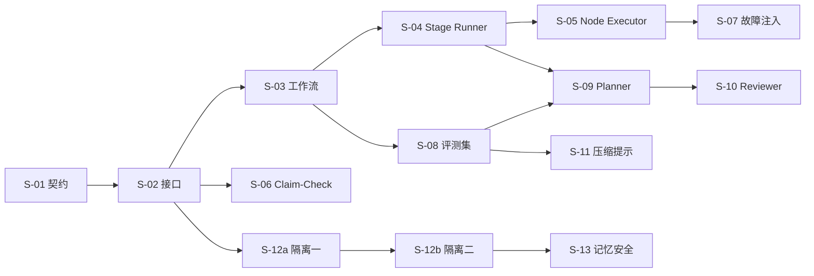

# 强档实施计划

> 用 AI 分模块实现 Agent Runtime 时，必须由强档模型完成或评审的工作项。
> 依据：[设计书](../design/agent-runtime-design.md)（下文称“设计书”，章节号与附录字母均指它）。术语一律用设计书附录 A 的名称。
> 中档与轻档工作项只在第 7 节列出一览，供排序参考。

## 1. 约定

### 1.1 档位与推理强度

| 档位 | 指什么 | 用在哪 |
| --- | --- | --- |
| 强档 | Opus 级模型；具体型号以 docs.claude.com 的模型列表为准 | 全局契约、并发与重放正确性、执行保障、安全面、需要靠评测迭代的决策提示 |
| 中档 | Sonnet 级模型 | 大部分工程代码 |
| 轻档 | Haiku 级模型 | 样板、配置、补测试 |

推理强度分四级：低、中、高、最高，对应编码工具里的 effort 或 thinking 设置。本文只有 S-03 用“最高”。

这里的档位指**写代码用的模型**。Runtime 运行时各角色用什么 Tier，由设计书附录 H.3 决定，两者无关。

### 1.2 编号

- **S-xx**：强档实现的工作项，共 13 项，详见第 4 节。
- **R-xx**：中档实现、强档评审的工作项，共 6 项，详见第 5 节。

每个 S 项都有同样的字段：目标、输入、交付、难点与防错、验收、模型与评审、依赖。

### 1.3 五条执行规则

1. **先测试后实现**：每个工作项先让 AI 写验收测试或评测集，人确认后再写实现。
2. **写审分离**：
   - 强档写的，由另一家的强模型或人来审。
   - 中档写的，由强档以“高”推理来审。
   - 评审只看 diff、设计书相关章节和测试结果，不看实现者的对话过程，道理同设计书 3.2.1 的“Planner 与 Reviewer 分开”。
3. **失败升级**：
   - 同一问题失败 2 次，先提高推理强度。
   - 仍失败，就换另一家强模型。
   - 第 3 次失败，说明问题在上游（契约或设计），停下来回到设计。规则与附录 B.8 相同。
4. **单一写者**：Task Loop → Stage Runner → Node Executor 这条核心链路，同一时间只让一个 agent 写。Provider 适配器等互不依赖的模块可以并行。
5. **契约变更走 S-01**：任何工作项需要改 `/proto` 或 `/schemas` 时，回到 S-01 的流程：强档修改、`buf breaking` 检查、人审。不在实现分支里顺手改。

### 1.4 每个工作项给 AI 的输入包

- 设计书中对应的章节与附录，只给相关部分。
- 当前的 `/proto` 与 `/schemas`。
- 依赖模块的接口与内存实现。
- 本文对应工作项的全文，尤其是“难点与防错”和“验收”。
- 仓库约定：目录结构见设计书 4.15。

## 2. 总览

### 2.1 阶段与强档工作项

| 阶段 | 编号 | 工作项 | 模型 · 推理 | 评审 | 依赖 |
| --- | --- | --- | --- | --- | --- |
| 0 契约与基座 | S-01 | 仓库与契约骨架 | 强 · 高 | 人审 + 另一家强模型 | — |
| 0 契约与基座 | S-02 | Provider 接口与一致性测试 | 强 · 高 | 人审 | S-01 |
| 1 骨架 | S-03 | Session 与 Task 工作流 | 强 · 最高 | 另一家强模型 + 人审 + 重放测试 | S-01、S-02 |
| 1 骨架 | S-04 | Stage Runner 调度与展开 | 强 · 高 | 另一家强模型 + 重放测试 | S-03 |
| 1 骨架 | S-12a | 租户隔离（第一批：接口层与业务库） | 强 · 高 | 强档 + 越权测试 | S-02 |
| 2 执行保障 | S-05 | Node Executor 与 effect 规则 | 强 · 高 | 强档 + 故障注入 | S-03、S-04 |
| 2 执行保障 | S-06 | Claim-Check 编解码 | 强 · 中 | 强档 | S-01、S-02 |
| 2 执行保障 | S-07 | 故障注入与恢复测试套件 | 强 · 高 | 人审用例 | S-05 |
| 3 决策 | S-08 | 评测集与评测 harness | 强 · 高 | 人审 | S-03 |
| 3 决策 | S-09 | Planner 与 Triage | 强 · 高 | S-08 评测集 | S-04、S-08 |
| 3 决策 | S-10 | Reviewer 判定 | 强 · 高 | S-08 评测集 | S-09 |
| 4 上下文 | S-11 | 压缩提示与 Compaction Probe | 强 · 中 | S-08 评测集 | Context Builder 主体 |
| 5 记忆 | S-12b | 租户隔离（第二批：记忆与向量） | 强 · 高 | 强档 + 越权测试 | S-12a、Memory 主体 |
| 5 记忆 | S-13 | 记忆写入安全与 Promotion | 强 · 高 | 强档 + 投毒测试 | S-12b |
| 贯穿 | R-01 至 R-06 | 强档评审项 | 强 · 中至高 | — | 对应模块 |

阶段 6 是 Learning Pipeline，没有强档实现项，只有评审项 R-06。

### 2.2 依赖关系



为什么这样排：

- **依赖从下往上**：先定契约，再搭骨架，最后做功能。
- **最难改的风险前置**：确定性、幂等、租户隔离这三件事，返工代价最大，放在最前面。
- **数据依赖**：评测集要先有端到端骨架才能跑。Memory 与 Learning 要有真实任务跑过之后才有意义，所以放在最后。

## 3. 阶段门槛

每个阶段结束前必须满足下表的门槛，不满足不进入下一阶段。

| 阶段 | 门槛 |
| --- | --- |
| 0 契约与基座 | S-01、S-02 验收通过；人确认契约 |
| 1 骨架 | 端到端跑通；杀掉 Worker 后能恢复；重放测试进入 CI；S-12a 通过 |
| 2 执行保障 | S-07 全部场景通过 |
| 3 决策 | S-08 评测集达到门槛；每个任务族都能算出每次成功成本（设计书 1.1） |
| 4 上下文 | 压缩后的 Task 成功率与重复操作率不劣于“只做 mask”的基线 |
| 5 记忆 | 越权测试与投毒测试全部通过 |
| 6 学习 | Learning Pipeline 的产出必须过评测门槛才能经 Registry 发布 |

## 4. 强档实现项

### S-01 仓库与契约骨架

**目标**：把所有跨服务、跨语言的骨架一次定好，后续模块只在骨架内实现。

**输入**：设计书 2.3–2.5、4.1、4.15；附录 A、B.1–B.2、C.3、D.1–D.2、I.3、K.1。

**交付**

1. 仓库：
   - Buf：`buf.yaml`、`buf.gen.yaml`，生成 Go 与 Python 代码。
   - Python：uv workspace。
   - Go：`go.work`。
   - 目录按设计书 4.15。
2. `/proto`：
   - `common`：
     - TenantContext：tenant_id、user_id、workspace_id、session_id、trace 上下文。
     - ID 类型。
     - 错误模型：transient、invalid、denied、not_found、conflict。
     - 计量：token 与成本。
   - `task_api`：
     - Submit、Cancel、Signal、Query 四个方法。
     - SSE 事件信封：递增 event_id、type、payload。
   - `workflow`：
     - SessionWorkflow 与 TaskWorkflow 的输入、信号、查询结构。
     - 固定的版本清单：Recipe、Node Template、Model Profile 的版本。
   - `registry`、`model_gateway`、`memory`：先定方法签名，实现可以分阶段补。
3. `/schemas`（JSON Schema 2020-12）：Atomic Node、Goal Node、Stage、Task State、Task Plan、Node Output、Verdict、Hook 结果、Memory Item。
4. 样例：附录 B、C、D、I 中的 YAML 示例都转成正例文件；另写一组反例。

**难点与防错**

- **跨语言工作流载荷**：Go 的 Session 工作流会启动 Python 的 Task 子工作流，两边的 Temporal payload converter 必须一致。
  - 统一用 protobuf JSON 编码。
  - 写一个跨语言往返测试。
- **protobuf 只放骨架**：Node 的 inputs、result 和模板参数一律是 JSON Schema 载荷，用 `google.protobuf.Struct`，或用 bytes 加 schema 引用来携带。不要把它们写成 proto message（设计书 4.1）。
- **租户上下文不能伪造**：
  - 设计书 4.1 要求调用方无法绕过租户隔离。
  - 所以服务端从认证身份推出租户；请求里的 tenant_id 只用来做一致性校验。
- **枚举**：
  - 取值用附录 A 的名字：executor、effect、role、mode、quality、reasoning、Verdict、Triage 级别。
  - proto 枚举的 0 值统一为 `*_UNSPECIFIED`。
  - 同时出现在 proto 与 JSON Schema 中的枚举，只在一处定义，另一处生成或用测试比对。
- **字段编号预留**：破坏性变更由 `buf breaking` 拦截。

**验收**

- `buf lint` 与 `buf breaking` 通过；Go 与 Python 生成代码能编译或导入。
- 所有正例通过 schema 校验，反例全部失败。
- 跨语言往返：Go 编码的 TaskWorkflow 输入，Python 解码后字段完全一致；反向亦然。
- 人审确认字段命名与附录 A 一致。

**模型与评审**：强档 · 高。另一家强模型对照设计书审一轮，人审必做。

**依赖**：无。

### S-02 Provider 接口与一致性测试

**目标**：定下 13 个 Provider 接口的签名和错误语义，并写一套所有实现都必须通过的一致性测试。内存实现交给中档。

**输入**：设计书 2.4、4.1–4.14；[运行核心速查](../reference/runtime-quickref.md) 的“外层接口与开发实现”。

**交付**

- 接口定义：
  - 按设计书 2.3 的语言划分，Python 侧与 Go 侧各写需要的接口。
  - 两种语言都用到的接口，在文件头注明，并保持语义一致。
- 一致性测试（contract tests）：每个接口一组，参数化地跑在内存实现和生产实现上。必须覆盖：
  - 租户隔离：A 写入，B 读不到。
  - 缺少租户上下文时直接报错。
  - 错误分类：transient 可重试，其余不可重试。
  - 幂等写。
  - 过期与删除语义。
- 共享库位置：建议放在 `/libs/py-core` 与 `/libs/go-core`。设计书 4.15 没有列出这两个目录，需人确认。

**难点与防错**

- **接口只表达能力**：不漏出产品概念，例如 Qdrant 的 collection、Valkey 的 key 前缀。
- **租户上下文的传法**：作为每个方法的第一个参数，或者绑定在按请求创建的客户端上，二选一并全仓统一。推荐后者，不容易漏传。
- **错误语义统一**：一律映射到 S-01 的错误模型；Node Executor 的失败分类（附录 D.6）依赖它。
- **Python 接口统一用 async**。

**验收**：内存实现全部通过一致性测试；一致性测试本身经人审，重点看隔离与错误分类的用例是否齐全。

**模型与评审**：接口与一致性测试用强档 · 高；内存实现用中档 · 低。

**依赖**：S-01。

### S-03 Session 与 Task 工作流

**目标**：搭出 Task Loop 的持久化骨架：Go 的 Session 工作流加 Python 的 Task 子工作流。

- Planner 与 Reviewer 先用桩：固定计划、永远判 done。
- 重放、续接、取消、版本固定，这一项里必须全部做对。

**输入**：设计书 2.2、2.5、3.1.1、3.2.1、3.6；附录 K。

**交付**

- `services/go-task-service`：
  - Session 工作流：
    - 接收 Task 信号。
    - 会写 Session 状态的 Task 串行执行；只读 Task 并行启动子工作流。
    - 查询。
    - Continue-As-New。
  - Task API 的 gRPC 实现：提交、取消、信号、查询。
- `services/py-worker`：
  - Task 工作流：
    - Round 循环：Planner activity → Stage 执行 → Reviewer activity。
    - Task State 作为工作流状态，通过 query handler 读取。
    - 取消处理。
    - 版本清单写入工作流输入。
  - task、decision、model、program 四个任务队列的 Worker 启动入口。
- 重放测试工具：导出测试运行的事件历史，用 SDK 的 Replayer 回放。

**难点与防错**

这一项最容易出隐蔽的 bug，评审时逐条核对：

- **确定性（Python）**：
  - 工作流代码里不读系统时间、不用 random、不做 I/O、不调用模型。
  - 时间用 `workflow.now()`；随机数与 UUID 用 `workflow.random()`、`workflow.uuid4()`。
  - 经沙箱放行的第三方库只放纯函数库。
  - 不用 set 的遍历顺序做决定；并发结果按 Node id 排序后合并（设计书 3.2.3 第 5 条）。
- **确定性（Go）**：
  - 不用 `time.Now`、原生 goroutine、channel 与 select，改用 `workflow.Now`、`workflow.Go`、`workflow.Channel`、`workflow.Selector`。
  - map 的遍历顺序不确定，先排序再用。
- **版本**：
  - 改动工作流代码时，用 SDK 的版本分支（Python 的 `workflow.patched`，Go 的 `workflow.GetVersion`），或用 Worker Versioning。
  - 任何改变命令序列的修改，都要用重放测试证明旧历史仍能回放。
- **Continue-As-New**：
  - Session 工作流按 SDK 给出的续接建议，或按事件数阈值续接。
  - 续接前把未处理的信号排空，带入新的运行。
  - Task State 不放在 Session 工作流里。
- **子工作流 ID**：task_id 作为 Task 子工作流的 ID；重复提交时返回同一个 task_id。
- **上限**：未完成的子工作流、activity、信号各默认 2,000（附录 K.3），Session 工作流对并行的只读 Task 设上限。
- **取消**：
  - 取消 Task 时，传播到正在运行的 activity，human 节点的等待随之结束。
  - Reviewer 的收尾写回作为不可取消的清理步骤。
- **大载荷**：Task State 增长后可能超过载荷上限，从这里开始接入 S-06。
- **心跳**：长 activity 要发心跳，heartbeat 超时短于 start-to-close 超时。这样 Worker 崩溃后，activity 才能被及时接手。

**验收**

- 端到端：提交 → 桩 Planner → 一个 model 节点（桩模型）→ 桩 Reviewer 判 done → SSE 收到结果。
- 杀 Worker：在 Stage 执行中杀掉 Python Worker，重启后 Task 完成；用调用计数断言已完成的 activity 不重跑。
- 重放：
  - 所有集成测试导出的历史，都能被当前代码回放。
  - 故意调换一行命令顺序的代码，必须让重放测试失败，以此证明测试有效。
- Continue-As-New：Session 连续接收 N 个 Task 触发续接，续接前后查询结果一致，不丢信号。
- 取消、重复提交、只读 Task 并行与写 Task 串行，各有测试。

**模型与评审**：强档 · 最高。另一家强模型逐条对照“难点与防错”审一遍，再人审。重放测试是硬门槛。

**依赖**：S-01；S-02 中 DurableEngine 与 Cache 的内存实现，或 Temporal 开发服务。

### S-04 Stage Runner 调度与展开

**目标**：在 Task 工作流内把一个 Stage DAG 跑完，包括调度、Hook 插入点、quality 展开和 Goal Node 展开。

**输入**：设计书 3.2.3；附录 B.2、D.5、E、F.1。

**交付**

- `py-worker` 中的 Stage Runner（工作流侧代码）。
- 两类展开器：
  - quality：revise、ensemble、search。
  - Goal Node：template、tool_loop、sub_agent、sub_task。
- Hook 调用点：Policy Engine 先用桩，一律返回 allow。

**难点与防错**

- **确定性约束同样适用**：调度代码在工作流里运行；ready 集合要排序，结果按 Node id 合并。
- **扇出上限**：
  - 一个 Stage 同时运行的 Node 数设上限，超过的排队。
  - 大批量拆到子工作流，例如附录 B.3 的 1000 张工单。
- **确定的 Node id**：展开后的子图 Node id 用“父 id + 序号”，重放和 trace 才对得上。
- **tool_loop**：每一步是一个 activity；循环设最大迭代次数，并检测重复出现的同一错误（附录 B.8）。
- **sub_task**：嵌套运行完整的 Task Loop，深度不超过 2；超过时拒绝并交给 Reviewer。
- **sub_agent**：默认只读，展开时校验它可用的工具 effect 都不高于 read。
- **单一写者**：
  - 同一份共享产物，同一时刻只允许一个写者。
  - 推荐在工作流内串行化写节点，不用分布式锁，以免锁过期。
  - 跨 Task 的写冲突由 Session 工作流的串行保证。
- **只传 result**：下游默认只拿 result，rationale 不传递（设计书 3.2.4）。

**验收**

- 附录 B.3 的三个 Round 示例作为集成测试（桩模型返回固定结果）；DAG 的执行顺序与并行度符合预期。
- 每种 quality 和每种 mode 至少一个测试；revise 达到 max_rounds 后停止；search 的剪枝生效。
- 嵌套深度、扇出上限、只读约束的拒绝路径都有测试。
- 重放测试覆盖所有展开路径。

**模型与评审**：强档 · 高。另一家强模型评审；重放测试是门槛。

**依赖**：S-03。

### S-05 Node Executor 与 effect 规则

**目标**：执行 Atomic Node，并把由 effect 决定的缓存、重试、幂等、审批规则做成不可绕过的代码路径。

**输入**：设计书 3.2.4、3.6；附录 D、K.4。

**交付**：`py-worker` 的 Node Executor（activity 侧代码），包括：

- model、program、human 三类执行。
- effect 规则。
- output_schema 校验。
- 大结果外置。
- 失败分类到 Temporal 重试策略的映射。

**难点与防错**

- **幂等键**：
  - 由 tenant_id、task_id、node_id 与输入的规范化哈希生成。
  - 不含 attempt 编号，保证 activity 重试和重放时不变。
  - effect 为 write_* 的 Node 缺幂等键时，直接拒绝执行。
- **结果未知（UNKNOWN）**：
  - 写操作超时且没有确认时，不当作失败重试。
  - 先用幂等键向外部查询是否已经生效，这要求 ToolDriver 登记“按幂等键查询”的能力。
  - 查不到结果再交给 Reviewer，必要时问人（附录 K.4）。
- **重试策略映射**：
  - transient 设为可重试错误。
  - invalid_output 只对 model 节点重问一次，并带上校验错误。
  - 其余错误、denied 与参数错误，一律设为不可重试的错误类型。
  - write_irreversible 的 activity 最大尝试次数固定为 1。
- **缓存**：
  - 只缓存 effect 为 none 或 read 的 Node。
  - 缓存键 = 模板版本 + 输入哈希（附录 D.1）。
  - read 设 TTL。
- **审批双保险**：
  - write_irreversible 前的人工审批，由 Stage Runner 插入 gate 节点。
  - Node Executor 再兜底检查一次：没有通过的 gate 记录就拒绝执行。
- **凭据**：program 节点只拿 SecretStore 签发的短期凭据；日志与 trace 里不出现凭据。
- **大结果**：超过阈值的结果写入 ObjectStore，只回摘要与路径；路径带租户前缀。
- **human 节点**：发出问题后，由工作流的信号与定时器等待；Node Executor 不占线程等待。

**验收**（与 S-07 的故障注入共用）

- 矩阵测试：每种 effect × 每种失败类型，断言重试次数、是否缓存、是否要求幂等键。
- 写操作在“已执行、结果未写入历史”时被杀，恢复后外部只生效一次。
- UNKNOWN 路径：模拟外部已生效但响应丢失，最终不重复执行。
- 没有 gate 记录的 write_irreversible 被拒绝。

**模型与评审**：强档 · 高。强档评审，S-07 的故障注入是门槛。

**依赖**：S-03、S-04；S-02 中 ToolDriver、ObjectStore、SecretStore 的内存实现。

### S-06 Claim-Check 编解码

**目标**：大载荷卸载到 ObjectStore，工作流历史里只存引用；Go 与 Python 两侧的编解码互相兼容。

**输入**：设计书 4.7；附录 K.3、L.8。

**交付**：Go 与 Python 各一个 PayloadCodec。

- 载荷超过阈值（默认 64 KB，可配置）时，加密上传并替换为引用。
- 解码时下载并解密。

**难点与防错**

- **跨语言一致**：两种语言的引用格式、加密方式、元数据键必须一致，用跨语言测试保证。
- **租户隔离**：按租户密钥加密，密钥来自 SecretStore；对象路径带租户前缀。
- **生命周期**：工作流的保留期结束后才能清理对象，所以对象的生命周期策略要长于 Temporal 的 retention。
- **可迁移**：引用格式里带版本号，为以后切换到 Temporal 官方的 External Storage 留出路径。

**验收**

- 跨语言往返测试。
- 阈值上下的载荷各一组。
- 密钥错误时解码失败，且报错明确。
- 租户 A 的引用不能用租户 B 的上下文解码。

**模型与评审**：强档 · 中，强档评审。

**依赖**：S-01、S-02。

### S-07 故障注入与恢复测试套件

**目标**：把设计书 1.1 的“可恢复”目标变成可重复执行的测试。场景由强档设计，脚本可由中档实现。

**输入**：设计书 1.1、3.6；附录 K.4。

**必须覆盖的场景**

1. Worker 在 model 节点执行中崩溃。
2. Worker 在写操作已执行、结果未写入历史时崩溃。
3. 写操作结果未知：外部已生效，响应丢失。
4. 模型供应商持续超时，触发 Model Gateway 切换。
5. human 节点等待期间，Worker 全部重启。
6. 同一信号重复到达；同一 Task 重复提交。
7. 发布新版本时有运行中的 Task，验证版本固定。
8. Session 工作流 Continue-As-New 时有信号到达。
9. Cache 重启：SSE 断线续传，以及限流计数丢失后的行为。
10. ObjectStore 暂时不可用：Claim-Check 的重试与报错。

**验收**

- 每个场景都有自动断言：Task 的最终状态、外部副作用的次数、事件历史无异常。
- 套件进入 CI 的夜间任务。

**模型与评审**：强档 · 高设计用例；人审用例清单。

**依赖**：S-05。

### S-08 评测集与评测 harness

**目标**：Planner、Reviewer 与压缩提示都靠评测迭代，所以先有评测集，再写提示。

**输入**：设计书附录 B.3（六类常见任务）、B.4–B.7、C.1–C.5、J.3。

**交付**

- 评测集：30 到 50 条代表性任务，覆盖六类任务、四个 Triage 级别和主要的 Verdict。每条带：
  - 输入。
  - 期望的 Triage 级别。
  - 合格 Stage 的形状特征，例如是否扇出、是否有 gate。
  - 期望的 Verdict 序列，或可接受的范围。
- Reviewer 专用样本：给定 Stage 结果与 Task State，标注正确的 Verdict；包括附录 B.7 的典型症状。
- 评分器：
  - 结构校验：schema 必须 100% 通过。
  - 规则检查：例如风险上升必须走 full；write_irreversible 前必须有 gate。
  - rubric 评分：用与被测模型不同家的模型打分。
- 运行器：一条命令跑完，输出成功率、成本，以及与上一版的差异。

**难点与防错**

- 标注要经人确认。
- 评测集分开发集与留出集，提示只在开发集上调。

**验收**

- 人审评测集。
- 用“永远返回 full + 单个 Node”这样的基线去跑，运行器能给出可解释的低分。

**模型与评审**：强档 · 高，人审。

**依赖**：S-03（端到端能跑通）。

### S-09 Planner 与 Triage

**目标**：实现 Round 的开头：分诊、Triage、Task Plan、Stage 规划。

**输入**：设计书 3.2.2；附录 C、D.7、E.1。

**交付**：`py-worker` 的 Planner（decision activity），包括：

- 分诊与 Triage：用规则加小模型分类器，fast 与 light 不调用强模型。
- 完整规划：提示与结构化输出。
- Stage 规划：Atomic Node 只能从 Node Catalog 实例化。
- replan：只重做剩余部分。

**难点与防错**

- **规则优先**：
  - 风险等级上升一律走 full（附录 C.1），由代码判定，不交给模型。
  - fast 与 light 增加的延迟控制在数百毫秒内。
- **结构化输出**：
  - 必须通过 Stage 的 JSON Schema。
  - 不合格时带上错误重问一次。
  - 仍失败就回退到保守规划：单个 Goal Node，mode 为 tool_loop。
- **不能编造模板**：Atomic Node 的 template 必须在 Node Catalog 中存在，校验在代码里做。
- **一轮只规划到下一个信息检查点**：评测里检查 Stage 是否包含“要看结果才能决定”的后续节点。
- **缓存友好**：Planner 的提示放在 system 区与 brief 区，配合 Context Builder 的分区保住提示缓存。
- **规划成本**：full 的成本不超过 Task 预计成本的约 5%（设计书 3.2.2），在评测报告里统计。

**验收**

- 在 S-08 的开发集与留出集上达到人定的门槛。建议起点：
  - Triage 级别准确率 ≥ 90%。
  - Stage 的 schema 通过率 100%。
  - 规则违例为 0。
- replan 保留已验证的 Node。

**模型与评审**：提示与决策逻辑用强档 · 高；分类器与规则可由中档实现。以评测集作为评审。

**依赖**：S-04、S-08；Registry 与 Memory 的接口，可先用内存实现。

### S-10 Reviewer 判定

**目标**：实现 Round 的结尾：汇总、诊断、Verdict、收尾。

**输入**：设计书 3.2.5；附录 B.4–B.9。

**交付**：`py-worker` 的 Reviewer，包括：

- 硬信号计算：中档实现，强档审。
- Progress Check 提示。
- Verdict 决策逻辑：规则加模型判断。
- 升级顺序与次数上限。
- 收尾写回。

**难点与防错**

- **上下文隔离**：Reviewer 只看 Stage 结果、Task State 与验收条件，不看 Planner 的规划过程（设计书 3.2.1 第 4 条）。在代码里限制传入的内容，不靠提示约束。
- **规则先于模型**：下列规则由代码判定（附录 B.8）：
  - 同一 Node 失败 2 次就换方法，3 次就 replan。
  - 预算用掉 80% 而完成度不到 50% 时，缩小范围或问人。
- **防震荡**：每一级升级都有次数上限，防止 repair 与 replan 来回切换。
- **完成看产出物**：校验 deliver 节点的输出是否满足验收条件，不看对话。
- **问人**：escalate 问人时，回复限定为三种：原样继续、带指导重规划、停止并收尾（设计书 4.11）。
- **异步写回**：收尾的写回全部异步，不阻塞交付。

**验收**

- 在 S-08 的 Reviewer 样本上，Verdict 准确率达到门槛。建议起点：≥ 85%，且“该升级却原地重试”的错误为 0。
- 震荡测试：构造来回失败的场景，断言在上限内终止。

**模型与评审**：判定逻辑与提示用强档 · 高；硬信号用中档 · 中。以评测集作为评审。

**依赖**：S-09。

### S-11 压缩提示与 Compaction Probe

**目标**：完成 Context Builder 中需要模型的两部分：

- summarize 用的增量摘要提示。
- 压缩后的抽查：生成问题并判分。

**输入**：设计书 3.2.7；附录 G；[上下文与压缩参考](../reference/context-engineering.md)。

**交付**

- 增量摘要提示：
  - 固定分区：意图、决策、产物、未决、下一步。
  - 只合并新截断的片段。
- Compaction Probe：从 Task State 与 Task Plan 中抽 3 到 5 个关键事实提问并判分；答错就补回原文片段。

**难点与防错**

- **先调召回，再调精度**：过度摘要会丢掉后来才显出重要性的细节。
- **精确状态不进摘要**：文件清单、ID、数值由 Task State 注入。
- **按工作模式区分**：附录 G.3 的每种工作模式给出不同的“必须保留”清单。

**验收**：在 S-08 中加入长任务样本，压缩后的 Probe 通过率与重复操作率不劣于“只做 mask”的基线。

**模型与评审**：强档 · 中，以评测集作为评审。分区组装、阈值、mask 与 offload 由中档实现（推理强度“高”），并经 R-03 评审。

**依赖**：Context Builder 主体、S-08。

### S-12 租户隔离（分两批）

**目标**：把“跨租户读写全部被拒”（设计书 1.1）落到每一层。

**输入**：设计书 1.1、4.1、4.3、4.4、4.12；附录 I.6、I.7。

**交付**

- **第一批 S-12a**（阶段 1 末）：
  - 接口层强制租户上下文：S-02 的约定落实到所有实现。
  - Postgres 行级安全策略与迁移脚本：会话变量设置租户，连接归还连接池时清除。
  - ObjectStore 的租户前缀。
- **第二批 S-12b**（阶段 5）：
  - Memory Service 的 ACL 过滤条件由服务端根据认证身份拼接；缺少租户条件的查询直接拒绝。
  - Qdrant 的租户字段分区与强制过滤。
  - 向量按租户密钥加密存储：嵌入与原文同等敏感（附录 I.7）。
- **越权测试套件**：以 A 租户身份，对每个接口、每个服务读写 B 租户的数据，断言全部被拒或返回空。

**难点与防错**

- **RLS 与连接池**：租户变量必须在事务或会话开始时设置、归还时重置，否则会串租户。
- **过滤条件不由模型生成**：设计书 3.4.1 要求如此；逐个检查所有检索入口的调用链。
- **跨租户读取**：Learning Pipeline 等离线任务需要跨租户读取时，用单独的角色并留审计，不复用在线服务的身份。

**验收**

- 越权测试套件全部通过，并进入 CI。
- 人工抽查：RLS 策略覆盖所有带租户数据的表。

**模型与评审**：强档 · 高。强档评审，越权测试是门槛。

**依赖**：S-02；S-12b 还依赖 Memory Service 主体（中档）。

### S-13 记忆写入安全与 Promotion

**目标**：让记忆防投毒、可追溯、可删除。

**输入**：设计书 3.4.1；附录 I.2–I.5、I.7；[记忆与检索参考](../reference/memory-and-retrieval.md) 的投毒部分。

**交付**

- 写入流水线的安全过滤：
  - PII 脱敏。
  - 密钥拒绝入库。
  - 检测指令式内容。
  - 外部来源的条目降低信任，且不可晋升。
- Promotion 规则（附录 I.4）。
- 冲突条目进入人审。
- lineage 级联删除与墓碑：向量与稀疏索引同步删除。
- 记忆库版本化与回滚。

**难点与防错**

- 网页、邮件、文件等外部来源的条目不得晋升。
- 与已有高信任条目语义冲突的新条目，进入人审。
- 删除沿 lineage 级联；墓碑防止同一内容被重新写入。
- 检索结果以数据形式注入，标注来源与“可能过时”。

**验收**

- 投毒测试：构造含指令的外部内容和恶意纠正，断言既不晋升，也不作为指令注入。
- 级联删除测试：删除源条目后，派生条目与向量全部消失。
- 回滚测试。

**模型与评审**：强档 · 高。强档评审，投毒测试是门槛。

**依赖**：S-12b、Memory Service 主体。

## 5. 强档评审项

以下模块由中档实现，强档负责评审。

| 编号 | 模块 | 评审重点 | 推理 |
| --- | --- | --- | --- |
| R-01 | Policy Engine（3.2.6、附录 F） | write_irreversible 的审批插入不可绕过；deny 不重试；驳回类 Hook 有次数上限；Hook 里没有复杂推理 | 高 |
| R-02 | Model Gateway 选档与升降级（3.3.1、附录 H） | 先按租户约束过滤；期望成本公式实现正确；同档切换与限流；Task 中途不换主模型；judge 用不同家的模型 | 高 |
| R-03 | Context Builder 主体（3.2.7、附录 G） | 分区顺序与缓存断点；外置内容只以路径出现；阈值按有效长度设 | 高 |
| R-04 | SecretStore 接入（4.12） | 节点拿不到长期密钥；凭据不进日志与 trace；吊销路径可用 | 高 |
| R-05 | Ingress 与 SSE（4.14、3.1.1） | Last-Event-ID 续传；Cache 里推流数据的保留期；控制指令的鉴权 | 中 |
| R-06 | Learning Pipeline 发布门槛（3.5.1、附录 J） | 未过评测不能发布；后台任务单独记预算；运行中的 Task 不受影响；失败归因提示 | 中 |

## 6. 任务说明模板

### 6.1 实现

```text
你在实现 Agent Runtime 的工作项 {编号} {名称}。

必读：
- docs/plan/strong-tier-plan.md 中 {编号} 的全文
- docs/design/agent-runtime-design.md 的 {章节与附录}
- /proto 与 /schemas 的当前版本
- {依赖模块} 的接口与内存实现

术语：一律使用设计书附录 A 的名称。

步骤：
1. 先写验收测试，覆盖本工作项“验收”的每一条，以及“难点与防错”中能测的每一条。写完停下，等确认。
2. 再写实现，直到测试全部通过。
3. 列出没有覆盖、或与设计书不一致的地方。

约束：
- 不修改 /proto 与 /schemas；需要改就停下来说明。
- 不引入设计书 4.15 之外的新依赖；需要就说明理由。
```

### 6.2 评审

```text
你在评审工作项 {编号} 的实现。只依据：本工作项全文、设计书 {章节}、diff、测试结果。

1. 逐条检查“难点与防错”，每条给出“已处理 / 未处理 / 不确定”，并指出代码位置。
2. 另外列出：确定性风险、并发风险、租户隔离风险、与设计书不一致的地方。
3. 不提风格类意见。
```

## 7. 中档与轻档工作项一览

供排序参考，细化另行编写。

| 阶段 | 工作项 | 模型 · 推理 | 强档评审 |
| --- | --- | --- | --- |
| 0 | 13 个接口的内存实现 | 中 · 低 | — |
| 0 | CI 与本地开发环境（Temporal 开发服务、本地依赖编排） | 轻或中 · 低 | — |
| 1 | Task Service API 与 Ingress 的开发实现 | 中 · 中 | R-05 |
| 1 | Telemetry 打点与 Collector 配置 | 中 · 低 | — |
| 1 | Registry | 中 · 中 | — |
| 1 | Model Gateway 单供应商直连 | 中 · 中 | — |
| 2 | Policy Engine 与默认 Hook | 中 · 中 | R-01 |
| 2 | ToolDriver 契约与平台内工具 | 中 · 中 | — |
| 2 | Sandbox 本地子进程实现、HumanChannel 命令行实现 | 轻 · 低 | — |
| 2 | SecretStore 接入 | 中 · 中 | R-04 |
| 3 | Reviewer 的硬信号 | 中 · 中 | S-10 内评审 |
| 4 | Context Builder 主体 | 中 · 高 | R-03 |
| 4 | Model Gateway 完整版与多供应商适配 | 适配：中 · 低；路由：中 · 高 | R-02 |
| 5 | Memory Service 检索流水线 | 中 · 中 | S-12b、S-13 |
| 5 | 存储类 Provider 的生产实现 | 中 · 低（RLS 见 S-12a） | — |
| 6 | Learning Pipeline | 中 · 中 | R-06 |
| 贯穿 | MCP Gateway | 中 · 中 | — |
| 贯穿 | Helm 与 KEDA | 中 · 低 | — |
| 贯穿 | 补单测 | 轻 · 低 | — |
