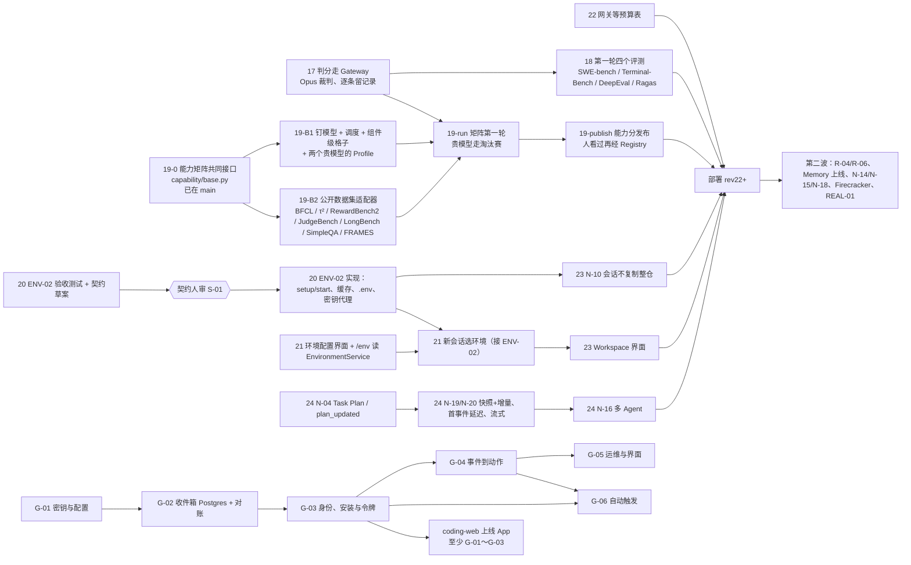

# 工作 DAG 与并行线（2026-11-03）

人定（2026-11-03）：任务 17、18、19（能力矩阵设计稿已审）、20、21、22、23、24 都做，按 DAG 并行。线上基线：第 19 版（Runtime `b4f37e2`、coding-web `a319601`）。

## 并行线

同时 5 条线（本机 4 核，后台 4 条加主线 1 条）。每条后台线在自己的 git worktree 里、用自己的虚拟环境，只在本地分支提交，
由主线合进 `main` 后推送（不往远端推分支，2026-11-01 人定“直接合并，不开很多分支”）。

| 线 | 仓库 | 范围（任务号） | 独占的文件（避免冲突） |
| --- | --- | --- | --- |
| **M 主线** | agent-runtime | 17 判分走 Gateway → 22 网关等预算表 → 18 跑四个评测；合并各线、部署打包 | `evals/deliverables.py`、`evals/rag.py`、`evals/frameworks.py`、`go-model-gateway/cmd` |
| **B1 矩阵调度** | agent-runtime | 19：钉模型的命令行开关、调度（计划 → 跑格子 → bootstrap、收缩、区间 → capability_scores 补丁）、S-09/S-10/S-11 三个组件级 CellEval、gpt-6-astra 与 fable-5.1 的 Profile | `capability/matrix*.py`、`capability/evals/s0*.py`、`evals/worker_subject.py`、`deploy/dev/model-profiles.json`、`registry-seed.json` |
| **B2 公开数据集** | agent-runtime | 19：BFCL v4、τ²-bench、RewardBench 2、JudgeBench、LongBench v2、SimpleQA、FRAMES 的 CellEval | `capability/evals/` 下各自的新文件 |
| **C 环境与工作区（Runtime）** | agent-runtime | 20 ENV-02 执行链 → 23 的 N-10（会话不再整仓复制） | `agentruntime_worker/sandbox/`、`workspace/`、`tools/platform.py`、`go-egress-gateway` |
| **D 网页** | coding-agent | 21 环境配置界面与 `/env` → 23 的 Workspace 界面 | coding-agent 全部 |
| **E 核心链路（单写者）** | agent-runtime | 24 的 N-04 计划事件 → N-19/N-20 快照、首事件延迟、流式 → N-16 多 Agent | `workflows/task.py`、`stage_runner.py`、`node_executor.py`（CLAUDE.md：同一时间只由一个 agent 改） |
| **G GitHub App**（2026-11-03 加，待分配） | coding-agent | G-01 密钥与配置 → G-02 Webhook 收件箱（Postgres）与对账 → G-03 身份、安装与令牌 → G-04 事件到动作 → G-05 运维与界面；G-06 自动触发在 G-03、G-04 之后。计划与人定的决定见 coding-agent 的 `docs/plan/github-app.md`；上线前必须有 G-01～G-03 | 新包 `internal/github/`、`internal/server/oauth.go`、`accounts.go`、`git.go`、`projects.go`、`store.go`、`deploy/`；界面文案（`i18n.js`、`messages_en.go`）与别的网页改动共用，改前对一下 |
| **F 第二波的一部分**（2026-11-03 人定，另一个会话做，按这个顺序） | agent-runtime、coding-agent | F1 模型目录自动同步（N-07 的延续，`docs/plan/model-catalog-sync.md`；2026-11-03 已完成，待部署）→ F2 Memory 上线，检索验收用 LongMemEval_S → F3 N-18 文件交付的公开入口 → F4 开放注册剩下的（coding-web 注册防滥用；Grafana 按租户的花费面板与告警）；REAL-01 线上验收穿插着跑 | F1：新文件 `scripts/sync_model_catalog.py`、`deploy/dev/model-catalog-rules.json`、`tests/deploy/test_model_catalog_sync.py`；F1 合进来以后 `model-profiles.json`、`registry-seed.json`、`default-tenant-policies.json` 与 values.yaml 的 `modelAllowlist` 由同步脚本改（能力矩阵的 `capability publish` 只改 `capability_scores`，不冲突）。F2：`services/py-memory`、Chart 里 memory 的部分、`agentruntime_worker/context` 里取记忆的一段、新的 LongMemEval 评测模块；不碰 E 线的三个文件。F3：task-service 的下载接口、Worker 新加的发布工具（新文件，不碰 `tools/platform.py`）、coding-web 的下载。F4：coding-agent 的 `internal/server/oauth.go`、`accounts.go`（与 G 线重叠：F4 先做，或交给 G 线一起做）、`deploy/data` 的面板 |
| **H 评测网站**（2026-11-03 加，分出来的会话做） | agent-runtime | 主页 + `/results`（现有看板）+ `/datasets`（题目、答案、来源与框架介绍），数据从 main 动态同步，不在发布时生成；计划 `docs/plan/eval-site.md`，先写验收测试给人看 | `evals/dashboard_server.py`、新文件 `evals/site_catalog.py`、`evals/site_sync.py`、`evalsets/site.json`、`evalsets/public/`、`templates/eval-dashboard.yaml`；`scripts/eval_dashboard.py` 的页面要拆成壳加接口，动它前先和 M 线对一下 |
| 后续（第二波） | agent-runtime | 23 的 R-04/R-06；24 的 N-14、N-15、Firecracker | 等第一波合并后排 |

## DAG

说明：

- 19-run 依赖 17：deliver 角色的开放题要经 Gateway 调 Opus 当裁判，用 17 的记录方式。
- 20 的实现要等契约人审：环境配置怎么到 Runtime（会话、工作区或 Task 上的字段）多半要改 proto；C 线先出验收测试与草案，停在人审点，
  草案之外不涉及契约的部分（缓存键、执行与失败门禁、密钥代理）可以先实现。
- 21 的“新会话选环境”要等 20 的契约；界面的增删改查与 `/env` 只读投影不用等。
- 24 的各项都动核心链路，必须在 E 一条线上串行；N-04 的契约包已在人工验收基线里批准，生成代码照旧过 buf breaking。
- 18 是在第 19 版上跑的基准轮（不钉模型、不进能力分）；19-run 是矩阵轮，两者可以同时跑，但都花钱，花费都实时进看板。
- G 线只动 coding-agent，与 Runtime 的各线不冲突；D 线已完成，G 线接手 coding-agent 时先和网页的其他改动对一下文件。App 已注册、密钥已在服务器上（`coding-oauth`），
  还缺 App 的 Client secret（G-03 要）、SOPS 文件里的 App 密钥、G-06 要的 `issue_comment` 事件与 Issues 权限（见 github-app.md 第 3、6 节）。
- Memory 上线的检索验收用 LongMemEval（2026-11-03 人确认）：它是题库，测 Memory Service 的检索，与 Ragas 不冲突（Ragas 照样打分）；
  先用 LongMemEval_S，原来的 memory-rag 10 题留作冒烟。
- 能力矩阵的 S-09、S-10、S-11 格子还没有改编题，题数不够出可发布的分数；写题前人要先定选哪些题、原数据没有的标签由谁补
  （建议 Claude 先补、标成未确认，再请人抽查）。

## 合并规则

1. 各线在本地分支上提交，完成一个可验收的小阶段就报告；主线检查测试后合进 `main`，按需要变基到最新 `main`。
2. 要改 `/proto`、`/schemas` 的提交单独成组，主线先拿给人审，审过再合（S-01）；`buf breaking` 与契约测试必须通过。
3. 动到 Temporal 命令序列的修改加版本分支并补重放测试（CLAUDE.md）；只有 E 线改核心链路。
4. 文件换行符保持原样（很多文件是 CRLF）。
