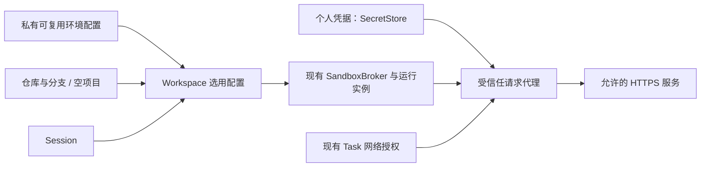

# Codex / Claude 云环境核实与本系统对照

> 核实日期：2026-11-02（Asia/Shanghai）。范围：当前官方产品文档、用户提供的界面记录，以及本地 `agent-runtime` / `coding-agent` 的相关设计与代码。
> 状态：**外部事实核实与设计依据**。2026-11-02 按用户要求将相关增强并入 [环境配置草案](../plan/environment-config.md) D-23 / D-24；草案中的新增实现仍待契约与验收流程，不等于功能已上线。本次不修改权威设计书、契约或运行代码。
> 仓库依据：拉取后的 Runtime `fe284320c63786477371409c6e84cb11f25104ba`；coding-agent 本地已检出的 `ed1554031119060866757aa8bbe05f64e11fc1a8`。在独立工作区整理文档，保留原工作区其他未提交工作。下文“代码存在”不代表集群验收完成；外部事实来自已打开的官方页面，未登录两家账号逐项操作界面。

## 1. 核实结论

用户提出的两个方向都值得采用：**环境配置可以跨仓库复用；个人密钥可以跨环境复用**。两者都应在启动会话时按需绑定，避免把仓库、运行实例和凭据混成同一个对象。

需要修正的主要是版本与语义：Codex 已区分新版 Cloud 与 Legacy；Claude 当前文档的网络选项已变为四档；`.env` 是配置输入格式，不能据此推断内部存储或沙箱落盘方式；“禁止网络”必须说明约束的是哪条网络路径。

**docs 中确实已有对应方案：[环境配置与多仓库工作区](../plan/environment-config.md)**（2026-11-01 草案），覆盖变量、联网模式、setup / start 和多仓库。它在本次拉取最新仓库后被纳入对照；旧稿按工作区保存配置，尚缺跨 repo 的可复用环境和个人凭据引用。另有 [Sandbox、Workspace 与网络设计改动稿](../plan/design-changes-workspace.md) 作为已确认的底层基线。本次增强集中在原草案，不再另外维护一份并行实现设计。

## 2. 产品事实对照

### 2.1 先区分 Codex 的两个版本

新版 Codex Cloud 先准备并发布环境，任务从可用环境启动。环境准备包含选仓库、安装和验证。[Codex Cloud 概览](https://learn.chatgpt.com/docs/cloud)

Legacy 仍服务于 Code Review、Linear / GitHub 等旧入口，使用 setup / maintenance scripts；其中旧式 secrets 只提供给 setup 阶段。**不能把这条旧限制套到新版网络密钥上**。[Codex Cloud Legacy](https://learn.chatgpt.com/docs/environments/cloud-environment)

OpenAI Agents API 是另一套产品接口；其环境枚举、vault 参数和端口范围不作为本次 Codex 设置界面的证据。

### 2.2 用户记录逐项核对

“待核实”表示本次公开资料不足，保留用户观察，不解释为功能不存在。

| 用户记录 | 核实结果与边界 | 一手依据 |
| --- | --- | --- |
| Codex 环境名、description | 文档展示命名环境；独立 description 字段的格式与限制待核实 | [Cloud 概览](https://learn.chatgpt.com/docs/cloud)；description 来自用户观察 |
| Codex 配置环境时选 repo | 确认，可选择多个 GitHub 仓库 | [创建流程](https://learn.chatgpt.com/docs/cloud#get-started-with-codex-cloud) |
| Codex 安装脚本、启动技能 | 确认 Install script / Start skill 两项；启动技能与 Bash 脚本不能直接视为相同执行契约 | [配置示例](https://learn.chatgpt.com/docs/cloud#reuse-your-project-setup) |
| Codex 完全、受限列表、禁止 | 大体对应访问意图；当前文档展示全公网开关、包管理器预设、附加域名，不能断言固定三个枚举 | [网络配置示例](https://learn.chatgpt.com/docs/cloud#connect-your-tools-and-services) |
| Codex 网络密钥留在环境外 | 确认：程序得到占位符，代理对获准的 HTTPS:443 请求替换；setup 与任务阶段均可使用 | [变量与网络密钥](https://learn.chatgpt.com/docs/environments/cloud-environments#configure-environment-variables-and-network-secrets) |
| Codex 两类值都“以 .env 存储” | 需改成“支持 .env 输入”。普通变量可被程序读取；网络密钥原值不进入本地进程或文件，未证实内部存储格式 | [变量与网络密钥](https://learn.chatgpt.com/docs/environments/cloud-environments#configure-environment-variables-and-network-secrets) |
| Codex 用户通用密钥 | 确认 Personal vault：可适用工作区内全部或指定环境；仅本人任务中被环境请求的 key 可用；指定环境值优先于通用值 | [个人值](https://learn.chatgpt.com/docs/environments/cloud-environments#supply-personal-values) |
| Codex 隐私目前只有仅我自己 | 用户当前界面观察成立；产品还支持 Enterprise 工作区共享 | [共享环境](https://learn.chatgpt.com/docs/environments/cloud-environments#share-within-an-enterprise-workspace) |
| Codex 高级 OIDC / VPN | 确认；OIDC 用短时云身份，VPN 当前支持 Tailscale，可用性有条件 | [OIDC](https://learn.chatgpt.com/docs/environments/cloud-environments#access-cloud-resources-with-oidc)、[VPN](https://learn.chatgpt.com/docs/environments/cloud-environments#private-networking-vpn) |
| Claude 一个默认环境、Name | 提供命名的 Default，也可新增个人或组织共享环境；并非只能有一个 | [Default](https://code.claude.com/docs/en/cloud-environments#the-default-environment) |
| Claude None / Limited / Full | 当前为 None / Trusted / Full / Custom；Custom 可附加默认名单。Limited 保留为用户界面记录 | [网络级别](https://code.claude.com/docs/en/cloud-environments#access-levels) |
| Claude Allowed domains + package managers | 核心语义成立；默认名单还含其他开发服务，不能理解为仅包下载域名 | [默认名单](https://code.claude.com/docs/en/cloud-environments#default-allowed-domains) |
| Claude Host / Header / Prefix / Token | 代理按目标主机注入密钥的机制确认；当前完整表单有名称、网站及自定义头，另有按角色简化的表单，四个旧标签不是统一契约 | [添加密钥](https://code.claude.com/docs/en/cloud-environments#add-a-secret) |
| Claude Bash setup、64 KB、缓存 | 确认：64 KB 是文件导入上限；启动 Claude 前执行，缓存命中会跳过；约五分钟内完成才缓存文件系统，运行中进程不缓存 | [Setup](https://code.claude.com/docs/en/cloud-environments#setup-scripts) |
| Claude env 每行 KEY=value、可见 | 确认输入为 .env 格式，使用者可读取；setup 阶段尚未注入这些变量 | [变量](https://code.claude.com/docs/en/cloud-environments#set-environment-variables)、[脚本约束](https://code.claude.com/docs/en/cloud-environments#script-requirements) |
| Claude 环境与 repo 解耦 | 确认：启动会话单独选仓库、分支；预填参数也分别提供 repositories 与 environment | [启动任务](https://code.claude.com/docs/en/web-quickstart#start-a-task)、[预填参数](https://code.claude.com/docs/en/web-quickstart#pre-fill-sessions) |

### 2.3 影响设计的少数边界

- **Codex 的域名可达性与密钥使用有关联规则**：环境自有网络密钥会把目标加入受限网络名单；个人值不会自动加域名。个人网络密钥使用环境规定的目的地。公网策略与 VPN 分开。[网络密钥](https://learn.chatgpt.com/docs/environments/cloud-environments#configure-environment-variables-and-network-secrets)、[连接服务](https://learn.chatgpt.com/docs/environments/cloud-environments#connect-to-services)
- **Claude 的 None 有独立路径例外**：GitHub 代理、启用的 MCP、网络密钥目标及模型 API 仍可能可达；网络密钥不能用于 setup 请求。[访问级别](https://code.claude.com/docs/en/cloud-environments#access-levels)、[不注入密钥的请求](https://code.claude.com/docs/en/cloud-environments#requests-that-never-get-the-secret)
- **环境复用与文件隔离是两个问题**：Codex 每个 Cloud 任务有自己的工作文件，任务改动不回写可复用环境。[环境模式](https://learn.chatgpt.com/docs/environments/modes) Claude 也在会话启动时准备独立工作上下文。[会话流程](https://code.claude.com/docs/en/web-quickstart#how-sessions-run)

因此，用户说的“云端选 repo 类似本地选文件夹”适合作为我们产品的交互目标。它描述的是**选择工作内容**，并不意味着云端可以直接继承本地文件、登录态或 VPN。

尚未核实：Codex description 的完整字段规则、两家服务端实际存储布局，以及 Claude 是否有等同 Codex Personal vault、OIDC、VPN 的此类配置入口。公开环境文档未建立后几项的等价能力，不作否定结论。

## 3. 仓库中已有的方案与实现

| 依据 | 已有内容 | 与本次需求的关系 |
| --- | --- | --- |
| [设计书 4.10 / 4.12](../design/agent-runtime-design.md)（第 669、705 行起） | Sandbox 接口；SecretStore；节点拿不到长期密钥的原则 | 权威导出仍含“本期只定义 Sandbox 接口”的旧表述，已确认改动稿记载其待同步状态 |
| [环境配置草案](../plan/environment-config.md) D-23～D-25、D-27 | 变量、网络三种模式、setup / start、多仓库；保留五项已确认决定 | 正是现有对应设计稿；本次增补可复用环境、个人凭据和外置密钥边界，尚未实现 |
| [设计改动稿](../plan/design-changes-workspace.md) W2、W5～W8 | Workspace 与后端分离；会话复用沙箱；统一工具链和项目镜像；任务联网授权 | 2026-10-27 已确认的底层基线，本次保留其职责划分 |
| [Workspace 细化](../plan/workspace-layer.md) §1、§4、§8 | Workspace API、会话工作副本、存档恢复、Git 操作 | 可复用为云环境绑定工作内容的底座；文档记录 Workspace 契约于 2026-10-28 人审通过 |
| [沙箱平台细化](../plan/sandbox-platform.md) §2～§5 | `sandbox_envs`、Broker、任务授权、包镜像、项目环境构建 | 这里的“环境”主要指运行实例或镜像，不等于用户保存的环境配置 |
| [云上部署计划](../plan/cloud-deploy.md) D-11～D-17 | 对应交付与验收范围 | 现有实现细化列有真集群验证缺口，不能由代码存在推断验收完成 |
| [coding-agent MVP](https://github.com/Hanwen-Jiang/coding-agent/blob/ed1554031119060866757aa8bbe05f64e11fc1a8/docs/plan/coding-agent-mvp.md) 与 [Project / Session 数据](https://github.com/Hanwen-Jiang/coding-agent/blob/ed1554031119060866757aa8bbe05f64e11fc1a8/internal/server/store.go) | 项目记录 repo；会话持独立 WorkspaceID | 已有仓库与会话模型，本次检查未找到独立的用户云环境配置对象及选择流程；链接固定到核对版本 |

本次还直接核对了以下代码，避免仅凭旧文档判断：

1. [SandboxSpec](../../libs/py-core/src/agentruntime_core/providers/sandbox.py) 第 39 行的网络模式为 `none / allowlist`，没有可直接映射的 `full`；`runtime`、`image` 和 `workspace_id` 已分别存在。
2. [EnvCredentials.test_env](../../services/py-worker/src/agentruntime_worker/sandbox/credentials.py) 第 101 行起读取租户 `sandbox/test-env` 的 JSON 值并返回命令环境变量。此路径让命令接触真实值，日志掩码不改变这一事实。
3. [出网代理](../../services/go-egress-gateway/internal/proxy/proxy.go) 第 3～7 行说明 HTTPS 经 CONNECT，检查 SNI 后原样转发、不解密。因此当前代理不能直接在 HTTPS 请求头里加密钥或替换占位符。
4. [SecretStore Provider](../../libs/py-core/src/agentruntime_core/providers/secret_store.py) 当前没有个人凭据的写入、元数据列举、删除接口；复用现有存储仍需补管理契约，不能把开发种子写入当成已完成的产品能力。

**现有能力可以承接改动，但“已有 SecretStore 和出网网关”不足以证明已经具备网络密钥功能。** 实例短期代理凭据、Git 操作凭据、用户第三方服务密钥也各有用途，不能相互代替。

## 4. 求同存异与落点

具体拟议行为、验收和机制成本由 [环境配置草案](../plan/environment-config.md) 拥有。下表只解释为何采用或保留差异，避免调研与实施草案分别定义一套行为。

| 议题 | 本系统选择 | 落点 |
| --- | --- | --- |
| 环境与 repo | 采用 Claude 的组合方式：独立选择可复用环境与 repo / branch / 空项目；环境不保存 Git 凭据或仓库清单 | 草案 §4.1、D-23、应用入口 §8 |
| 默认环境与隐私 | 提供默认入口，首次保存才生成记录；首版私有，不复制竞品组织共享权限体系 | §4.1、D-23 |
| 个人通用密钥 | 采用一次保存、多环境显式引用；首版不做“所有环境自动注入”或多层覆盖 | §4.2；需补 SecretStore 管理接口 |
| 普通变量、直传机密、网络密钥 | 分为三类。保留 2026-11-01 已确认的“直传机密可被命令读取”；新增网络密钥才承诺原值不由平台交给 shell | §1、§4.2、D-23 两阶段 |
| `.env` | 作为导入格式，确认普通 / 直传分类；网络密钥另填目标及注入位置，不推导出统一落盘存储 | §4.2、应用入口 §8 |
| 网络模式 | 保留已确认的 deny / allowlist / open；包源是可查看的名单预设；open 仅公网、租户默认关闭 | §1、§4.3；需实现 public 授权，当前代码尚不支持 |
| 密钥与网络名单 | 不照搬两家的特殊放行：保存网络密钥不扩大可达范围，仍须 Task 授权和租户许可 | §4.3～§4.4 |
| 首批网络密钥交付 | 借鉴 Claude 的精确主机 + 请求头，HTTPS:443；暂不并做 Codex 占位符替换。实际客户端确定后选型 | §4.4；现有 CONNECT 透传不足以实现 |
| 安装与启动 | Bash setup / start；新实例恢复工作区后准备，同实例复用不重跑；显式 setup 失败阻止业务命令 | D-24；保留 D-17 自动镜像构建的既有回退 |
| 缓存与发布 | 首个交付不新增缓存表或发布状态机；D-26 缓存另有输入顺序问题需要处置 | §1.1、§10～§11 |
| 多仓库、启动技能 | D-25 多仓库继续独立推进；自然语言 Start skill 不等同 Bash，D-27 保持占位 | D-25、D-27，不阻塞单仓库环境流程 |
| OIDC / VPN / 共享 | 记录方向；没有当前使用需求与运维依据，不纳入首版 | §9～§10 |

图中的外置请求注入属于第二阶段；现有 `sandbox_envs` 继续表示运行实例。环境配置独立复用不意味着两个会话共用可写文件。本地入口选文件夹是工作内容选择的类比，不是本次新增本地文件同步协议。

## 5. 与既有方案的差异及处置

| 编号 | 核实到的差异 | 本次处置 |
| --- | --- | --- |
| C-1 长期密钥 | 设计书 4.12 要求节点不拿长期密钥；现有 test-env 可注入原值，环境草案又已确认直传机密可读 | 保留已确认决定，新增外置类别；在草案 §7 / §11 列出权威原文需补的边界，未改写设计书 |
| C-2 配置归属与批准 | 旧草案按工作区存配置，并以保存人记网络批准；底层授权实际属于 Task | 改为用户可复用配置、工作区选用参数；按当前 Task 与 approver 校验，保存动作不替代未来任务审批；无永久环境授权 |
| C-3 HTTPS 处理 | 当前 CONNECT/SNI 透传无法注入头或替换占位符 | 明确缺口、客户端信任成本与限界；能力未通过验收不能用直传值冒充外置密钥 |
| C-4 准备失败 | D-17 自动构建允许回退 universal；旧 D-24 同样回退会跳过用户明确配置的前置要求 | 只调整 D-24 显式脚本失败语义，保留 D-17；本次变更清单与验收均已记录 |
| C-5 setup 与快照 | D-24 要先恢复工作区；D-26 说在导入工作区前缓存 setup，且同时要求无租户数据 | 单列在草案 §11，待 D-26 实施前明确准备输入与缓存范围；本次未重写 Firecracker 草案 |

## 6. 交付范围与核实边界

第一阶段交付 D-23 的私有可复用环境、个人直传凭据、三种网络意图，加 D-24 的显式脚本和应用选择入口；第二阶段交付选定客户端的外置网络密钥。多仓库 D-25 独立，快照、共享、OIDC、VPN 不成为前置条件。具体先后、最小验收和成本记录见 [环境配置草案 §6、§10～§11](../plan/environment-config.md)；[云部署计划](../plan/cloud-deploy.md) 同步入口说明。

已核实两家官方环境页面、Codex 新旧版本、Claude 会话启动流程，以及上文列出的本地设计与代码。未执行账号实机配置、线上凭据探测或本系统集群验收，没有读取真实密钥。description 等尚未证实的字段继续标注待核实。未来页面变化时先更新产品事实，再判断是否影响已接受的系统要求，不据此反复重开既定设计。
